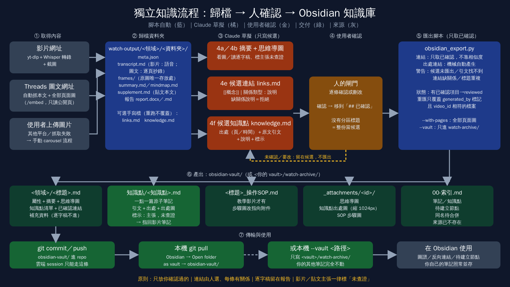

# 步驟 4e／4f／5b：Obsidian 知識庫（連結、知識點 → 匯出）

> 歸檔結果除了 Word／Markdown 報告，也可匯成同一個 Obsidian vault，讓每支影片變成一篇筆記，並把使用者確認過的「知識點」各存成一篇原子筆記。Spec：`.scratch/obsidian-vault-export/spec.md`。

## 流程圖



圖源 `docs/obsidian-knowledge-flow.svg`；改圖後用 Playwright 重新截圖（視窗 1600×900）：`node -e "const{chromium}=require('playwright');(async()=>{const b=await chromium.launch();const p=await b.newPage({viewport:{width:1600,height:900}});await p.goto('file://'+process.cwd()+'/docs/obsidian-knowledge-flow.svg');await p.screenshot({path:'docs/obsidian-knowledge-flow.png'});await b.close()})()"`。

## 原則

- **只放使用者確認過的**：連結與知識點都分 `## 已確認`／`## 候選` 兩區。Claude 只能寫進候選區，使用者確認後才移到已確認區；匯出只取已確認區。檔案沒有這兩個標題時，整份視為候選（警告、不匯出）。
- **連結由人選，不靠相似度**：不用 `keywords` 或語義相似度自動產生連結。每條概念連結要寫關係類型與說明；缺說明的行會被拒絕並警告。
- **出處連結是機械的，自動產生**：知識點 ↔ 影片筆記、影片筆記 → SOP 筆記。
- **逐字稿不進筆記**，只留在報告；筆記放摘要、思維導圖、知識點、已確認連結、補充資料。

## 4e 寫 `links.md`（選填，影片整體的概念連結；重跑歸檔不覆蓋）

```
# 連結
## 已確認
- [[知識管理]]｜上位概念：本篇討論的是個人知識管理方法
## 候選
- [[原子習慣]]｜舉例：用同一本書示範不同背景連出不同網路
```

- 關係類型建議用：上位概念、舉例、互補、反例與侷限、歷史脈絡、實際應用、另一個學科（不強制白名單，但一定要有類型與說明）。
- 先看 `obsidian-vault/` 既有筆記名稱，能連到既有筆記就用原名；新概念照寫，Obsidian 會顯示為「待建立節點」，索引也會列出。
- 一篇約 3–7 條；說不出關係的就不要連。提問清單：背後證據？牽涉哪些前提？跟人類行為有什麼關係？可應用在哪些決策？在更大的脈絡代表什麼？哪裡不適用？
- 回覆使用者時列出候選，請使用者確認或刪改；使用者確認後才移到「已確認」。

## 4f 寫 `knowledge.md`（選填，知識點；重跑歸檔不覆蓋）

```
# 知識點
## 已確認
### 連結是在定義關係
- 出處：第 5 頁            （影片寫時間，如 03:12）
- 引文：「真正的連結，不是把東西湊在一起」
- 說明：link 要有方向、有脈絡，不是排版。
- 標示：作者主張，未查證      （省略時自動補「講者／作者主張，未查證」）
- 連結：[[知識管理]]｜上位概念：說明   （可多條）
## 候選
### …
```

- **什麼算知識點**：可獨立成立的概念、方法、判斷標準或主張，一句話說得完，脫離原影片仍看得懂。不要：開場、廣告、轉場、重複的話、個人敘事、純口號。
- 標題要唯一（同影片重名會互相覆蓋，匯出時警告）；引文必須是原文，找不到會警告，轉述不要放進「引文」。
- 影片中的數字與主張一律標「講者／作者主張，未查證」；整理者自己的補充才可標「整理者補充」。
- 每個已確認知識點會自帶出處圖：出處是 `第 N 頁` 取該頁圖，是時間就取最接近的截圖，縮成 1024 px。
- 流程：Claude 先把候選列給使用者，使用者確認哪些後才移到已確認區。

## 5b 匯出

重建報告（步驟 5）之後：

```bash
python3 scripts/obsidian_export.py watch-output/<領域>/<資料夾>      # 寫進 repo 內專用 vault：obsidian-vault/
python3 scripts/obsidian_export.py --all                              # 全部重匯
python3 scripts/obsidian_export.py <資料夾> --vault <你的 vault>       # 只寫進 <你的 vault>/watch-archive/
python3 scripts/obsidian_export.py <資料夾> --with-pages              # 圖文貼文：把全部頁面圖放進影片筆記
```

| 檔案 | 內容 |
|---|---|
| `<領域>/<標題>.md` | 屬性（title／type／source／platform／video_id／category／date／status／origin_folder／aliases／tags／related）、摘要、思維導圖、知識點清單、已確認連結、SOP 連結、補充資料 |
| `知識點/<知識點>.md` | 說明、引文與出處、出處圖、標示、連結（含關係）、指回影片筆記 |
| `<領域>/<標題>_操作SOP.md` | 有 SOP 時由 `kb/` 複製，圖片路徑改指向 `_attachments/` |
| `_attachments/<video_id>/` | 思維導圖、知識點出處圖、SOP 步驟圖（相對路徑；原圖只保存在 `frames/`） |
| `00-索引.md` | 依領域列筆記、知識點（同名者標示）、待建立節點、來源資料夾已不存在的筆記 |

- `status`：有已確認連結或知識點才是 `reviewed`，否則 `unreviewed`。
- 重匯只覆蓋帶 `generated_by: watch-archive` 且 `video_id` 相符的檔案；使用者自己的筆記與圖片不動；同名但不是我們產生的筆記不覆蓋（另存加 ID 後綴）；改標題或領域時清掉舊的產生檔。不同影片的同名知識點各存一份，不自動合併；來源資料夾被刪除的筆記不自動刪，只在索引列出。
- 傳輸：匯出的 `obsidian-vault/` 會 commit；使用者在本機 `git pull`，用 Obsidian「Open folder as vault」開啟。雲端 session 碰不到本機 vault，所以 `--vault` 只在本機執行時用。
- 回覆使用者時列出匯出警告（候選未匯出、引文找不到、連結缺關係）。

## 圖文貼文（輪播圖，非影片）

- **Threads 貼文自動歸檔**：`/watch-archive <Threads 貼文或分享連結>` 會自動取得貼文本文（存進 `supplement.md`）與全部頁面圖（`frames/slide_NN.jpg`），建好 `carousel` 骨架（`scripts/threads_fetch.py`）。貼文是影片時自動走原本的影片流程；抓取失敗（網路／頁面改版或需登入／沒有圖片）會印警告，此時請使用者上傳圖片，照下方手動流程。
- 取圖原理：主頁 HTML 只有 `og:image`（第 1 張）與 `og:description`（本文）；`<貼文網址>/embed` 含全部頁面圖（只收 Meta CDN 的 https 圖，第一個 `t51.2885-19` 是頭像會略過）。不要只看主頁就說缺頁（2026-10-27 教訓：曾因此誤報第 9–10 頁無法取得）。只讀公開頁，不用 cookies。
- **之後仍由 Claude 做**：看圖逐頁抄錄到 `transcript.md`（每行 `[00:0N] 文字`，圖上筆誤照抄並在摘要註明）、寫 `meta.json` 的 `slides`（title／note／keywords）、`summary.md`、`mindmap.md`，再 `build_report.py`、4e／4f、5b。
- **手動流程（使用者只給圖片，或其他平台）**：`meta.json` 加 `"media_type": "carousel"`，`platform` 填實際平台或 `Image`，`duration` 寫頁數，`transcript_source` 寫「圖片文字（逐頁人工抄錄，非語音轉錄）」；`slides` 每頁一筆，`start` 用 `00:0N`（第 N 頁），`frame` 指向 `frames/slide_0N.jpg`，同時寫 `frames.json`；缺頁寫進 `supplement.md`，不推測內容。報告會顯示「第 N 頁」與「頁數」。
