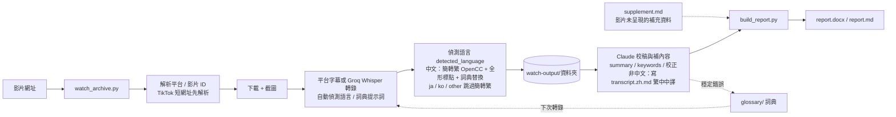

# watch-video

Claude Code 的 `/watch` skill：把影片網址或本機檔案轉成帶時間戳的畫面與逐字稿，讓 Claude 回答影片內容。

- Skill 來源：[bradautomates/claude-video](https://github.com/bradautomates/claude-video)（v0.3.2，MIT），位於 `.claude/skills/watch/`
- `.claude/hooks/session-start.sh`：雲端 session（`CLAUDE_CODE_REMOTE=true`）啟動時自動安裝 `yt-dlp` 與 `requirements.txt` 的 Python 套件（`python-docx`、`opencc-python-reimplemented`），並在缺少設定時寫入預設值（本機引擎、`balanced`、僅使用字幕）
- `.claude/settings.json`：註冊上述 SessionStart hook

## 使用

```text
/watch <影片網址或本機路徑> 請摘要內容並附時間戳
/watch video.mp4 --start 2:15 --end 2:45
/watch video.mp4 --detail transcript
```

需要 Python 3.10+、ffmpeg；yt-dlp 由 hook 自動安裝。網址影片能否下載取決於環境的網路政策。

## 影片 → 圖文報告流程（watch-archive）

把影片轉成「畫面 + 逐字稿」的圖文報告（Word / Markdown），並依影片 ID 歸檔，方便日後查找。


### 事前準備

- 環境變數 `GROQ_API_KEY`（無字幕時用 Groq Whisper 轉錄；不要把 key 寫進任何檔案）
- `python3 .claude/skills/watch/scripts/setup.py --backend groq --detail balanced`
- `pip install -r requirements.txt`（雲端 session 由 hook 自動安裝；產生 Word 檔；簡體逐字稿自動轉繁體）；轉 PDF 目視檢查另需 LibreOffice

### 流程



### 指令

```bash
python3 scripts/watch_archive.py "<影片網址>" [--glossary ai-chips,electronics] [--lang zh（一般不要加）] [--title "自訂標題"] [--terms "詞1,詞2"] [--question "..."] [--keep-media]
python3 scripts/build_report.py watch-output/<資料夾>   # 編輯 summary.md / meta.json 後重建報告
```

在 Claude Code 說「用 watch-archive 處理 <網址>」，會依 `.claude/skills/watch-archive/SKILL.md` 完成整套流程（選參數 → 歸檔 → 校稿 → 補摘要與關鍵字 → 重建報告 → 傳送 Word 檔 → 提交）。

### 提高轉錄準確度

- **語言：預設不加 `--lang`，讓 Whisper 自動偵測。** 強制 `--lang` 會把任何語言硬轉成該語言（例如英文影片加 `--lang zh` 會得到不通順的中文，且事後無法偵測），腳本會對強制語言印警告。轉錄後腳本從輸出文字判斷語言，寫入 `meta.json.detected_language`（`zh`／`ja`／`ko`／`en`／`other`／`unknown`）、`forced_lang` 與 `needs_zh_translation`（只有 `en`／`ja`／`ko` 時為 true；`ja`／`ko`／`other` 不做簡轉繁）；非中文影片由 Claude 依 SKILL 步驟 4b 補寫繁體中文中譯 `transcript.zh.md`。
- `--glossary ai-chips,electronics`：載入詞典領域（`common` 一律載入；重跑會記住，存在 `meta.json.glossaries`）。詞典放在 `glossary/`：
  - `glossary/common.json`：任何主題都不會出錯的修正（例如簡轉繁後的「里／裡」）。
  - `glossary/domains/<領域>.json`：領域詞典，目前有 `ai-chips`、`electronics`、`kubernetes`、`claude-code`。新增領域只要新增一個檔案。
  - 每個檔案有 `terms`（Whisper 提示詞，只放整個詞，總長約 200 字內；選中的領域優先）與 `replace`（轉錄後固定替換，key 用繁體、至少 3 字或帶上下文）。
  - 單支影片才成立的修正，不要放進詞典，改用 `--terms` 或 `meta.json.known_asr_errors`。
  - `WATCH_GLOSSARY_DIR` 可指向別處（例如獨立的詞典 repo），方便跨專案共用。
- `--terms "詞1,詞2"`：只對這一支影片額外提示的詞（人名、術語）。
- Whisper 的語言與提示詞由 `.claude/skills/watch/scripts/whisper.py` 的環境變數 `WATCH_WHISPER_LANGUAGE` / `WATCH_WHISPER_PROMPT` 傳入（本專案對上游 skill 的小幅修改，更新上游時需重新套用）。

### 輸出結構

```text
watch-output/
├── index.md                                   # 所有影片索引
└── <日期>_<平台>_<標題>__<影片ID>/              # 同一影片 ID 只會有一個資料夾，重跑為更新
    ├── <stem>_report.docx / <stem>_report.md  # 圖文報告（摘要 → 補充資料 → 畫面+逐字稿(+中譯) → 已知轉錄錯誤 → 補充資料連結）
    ├── meta.json                              # 網址、標題、上傳者、轉錄來源、關鍵字、已知轉錄錯誤
    ├── transcript.md                          # 逐字稿（預設轉為繁體中文，時間戳不變）
    ├── transcript.raw.md                      # 轉繁體前的原始轉錄（僅在內容有變動時產生）
    ├── transcript.zh.md                       # 非中文影片的繁體中文中譯（Claude 補寫，重跑保留）
    ├── summary.md                             # 摘要（時間戳重點 + 名詞/縮寫說明）
    ├── supplement.md                          # 選用：影片未呈現的補充資料（重跑保留，報告自動納入）
    ├── frames/、frames.json                   # 截圖與其時間戳（小檔，進 git）
    └── media/<stem>_video.<ext>               # 僅 --keep-media；只存本機（gitignore）
```

`<stem>` = `<日期>_<平台>_<標題前20字>__<影片ID>`，單看檔名即可辨識是哪支影片。

### `meta.json` 中重跑不會被覆蓋的欄位

| 欄位 | 用途 |
|---|---|
| `keywords` | 整份報告的關鍵字標籤 |
| `section_keywords` | 各畫面標籤，key 為畫面起始時間，如 `"00:12"` |
| `slides` | 投影片分段（`start`、`frame`、`title`、`note`、`keywords`）；有設定時每張投影片只放一張圖，說明文字與逐字稿接在下方 |
| `known_asr_errors` | 轉錄誤聽校正（時間、聽成、應為） |
| `first_archived` | 首次歸檔日期 |
| `detected_language`／`forced_lang`／`needs_zh_translation` | 由腳本每次重跑時重新判斷（不保留舊值） |
| `title_override` | `--title` 指定的標題（重跑沿用） |
| `glossaries` | `--glossary` 選用的詞典領域（重跑沿用） |

### 補充資料（`supplement.md`）

影片沒呈現、或畫面一閃而過而遺漏的資訊（被截斷的畫面文字、貼文說明欄／留言回傳的完整內容、連結、更正），另存成同資料夾的 `supplement.md`（獨立檔，重跑不覆蓋）。`build_report.py` 會把它放在報告「摘要」之後，並在報告最後加「補充資料連結」。

寫法重點（完整範本見 `.claude/skills/watch-archive/SKILL.md` 步驟 4c）：一筆補充一節（S1、S2…）並標類型；來源要完整（誰提供、位置、取得日期、方式）；**原文（逐字）** 與 **Claude 的對照分析** 分開；用語分級——補充直接寫明／與影片一致／據此推定；未查證的主張、數字、版本號進備註。

### 測試

```bash
python3 -m unittest discover -s tests -v   # 語言偵測、supplement.md 解析、docx 轉換
```

### 注意事項

- 已實測：Facebook、Instagram、X、小紅書、TikTok（含 `vt.tiktok.com` 短網址，會先解析出真正的影片 ID）、公開分享的 Google Drive 影片（分享權限須為「知道連結的任何人」，否則 yt-dlp 回 403）。YouTube 在雲端環境可能被擋（429／要求登入）。標題只有 #標籤 或太雜亂時，用 `--title` 指定；之後重跑會記住（`meta.json.title_override`）。
- `meta.json.transcript_source` 標示逐字稿來源：`whisper (groq)` 為語音轉錄，否則為平台字幕。
- 影片檔不進 git；報告內附來源網址的超連結。他人影片僅供個人參考，repo 改為 public 或分享前請勿附影片。
- 開發請在 `claude/...` 分支進行，合併後的分支不要重用。

### 限制與風險

- **平台**：YouTube 在雲端環境常被擋（HTTP 429、要求登入），歸檔會失敗；Google Drive 影片須設成「知道連結的任何人」才抓得到（403 通常是權限問題，歸檔後建議改回私人）。上游 `watch` skill 的 Gemini 引擎可能遇到服務塞車（503）或模型停用（如 `gemini-2.5-flash` 已不開放新使用者），失敗時不會自動降級，需明確改用 `--engine local`。
- **語言偵測是啟發式**：只看輸出文字的字元比例（門檻為經驗值，僅在少數影片實測）。`en` 代表拉丁字母的非中文（西班牙文也會標 `en`）；`other`（混雜）與 `unknown`（太短或缺失）必須人工確認；`--lang` 強制語言時偵測不出錯誤。`ja`／`ko`／`other` 不做簡轉繁，是為了避免把日文漢字改壞（會議→會議）。
- **轉錄品質**：Whisper 常把 Claude 聽成 Cloud 等；詞典 `claude-code` 的替換假設講者在談 Claude，若影片在講雲端請勿載入。Whisper 提示詞以「、」串接，可能讓它偏向中文，尚未驗證。
- **舊資料**：語言偵測加入前歸檔的影片，`meta.json` 沒有 `detected_language`，重跑歸檔才會補上。
- **Word 報告**：字型為 Microsoft JhengHei；在缺此字型的環境轉 PDF 預覽可能出現方框（僅預覽問題，docx 內文字正確），但尚未在真正的 Word 逐份驗證。
- **內容可信度**：影片中的數字、價格與效果都是講者主張，未經查證；補充資料（`supplement.md`）也只逐字保留來源文字，不代表已驗證。他人影片僅供個人參考，repo 改為 public 或分享前請勿附影片。
- **相依**：需要 `GROQ_API_KEY`（沒有字幕時轉錄用）、ffmpeg 與 yt-dlp；轉 PDF 目視檢查另需 LibreOffice。
