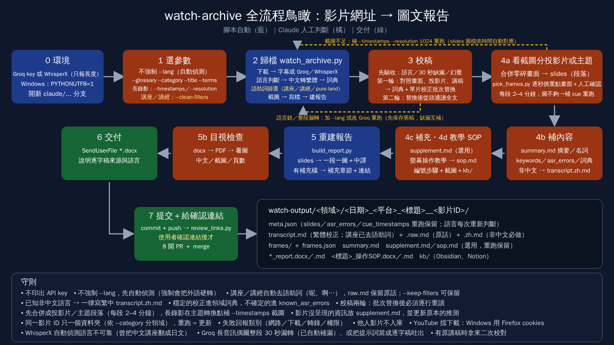
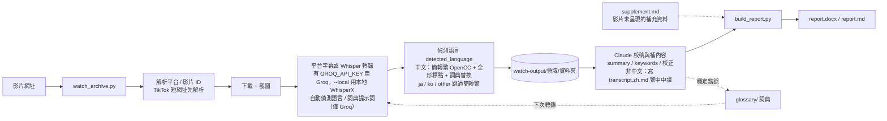

# watch-video

Claude Code 的 `/watch` skill：把影片網址或本機檔案轉成帶時間戳的畫面與逐字稿，讓 Claude 回答影片內容。

- Skill 來源：[bradautomates/claude-video](https://github.com/bradautomates/claude-video)（v0.3.2，MIT），位於 `.claude/skills/watch/`
- `.claude/hooks/session-start.sh`：雲端 session（`CLAUDE_CODE_REMOTE=true`）啟動時自動安裝 `yt-dlp` 與 `requirements.txt` 的 Python 套件（`python-docx`、`opencc-python-reimplemented`），並在缺少設定時寫入預設值（本機引擎、`balanced`、僅使用字幕）
- `.claude/settings.json`：註冊上述 SessionStart hook

## 使用

```text
/watch <影片網址或本機路徑> 請摘要內容並附時間戳
/watch video.mp4 --start 2:15 --end 2:45
/watch video.mp4 --detail transcript
```

需要 Python 3.10+、ffmpeg；yt-dlp 由 hook 自動安裝。網址影片能否下載取決於環境的網路政策。

## 影片 → 圖文報告流程（watch-archive）

把影片轉成「畫面 + 逐字稿」的圖文報告（Word / Markdown），並依影片 ID 歸檔，方便日後查找。



### 事前準備

- 轉錄方式（擇一，僅在影片沒有平台字幕時使用）：
  - **Groq Whisper**：設環境變數 `GROQ_API_KEY`（不要把 key 寫進 repo 的檔案；也可放在 `~/.config/watch/.env`）；有這個 key 時 `watch_archive.py` 預設就用 Groq
  - **本地 WhisperX**（桌機用）：不需 key、不上傳音訊，`python3 .claude/skills/watch/scripts/setup.py --install-whisperx` 安裝（會下載 PyTorch 與模型）；有 Groq key 時用 `--local` 切換
- **雲端（Claude Code on the web）**：在環境 secret 設 `GROQ_API_KEY`，session-start hook 會自動設定成 Groq。**雲端不要加 `--local`**：容器沒有裝 WhisperX，加了只會有截圖、沒有逐字稿；沒設 key 時，無字幕影片同樣拿不到逐字稿
- `python3 .claude/skills/watch/scripts/setup.py --engine local --backend groq --detail balanced`（沒有 Groq key 的機器把 `groq` 換成 `whisperx`）
- `pip install -r requirements.txt`（雲端 session 由 hook 自動安裝；產生 Word 檔；簡體逐字稿自動轉繁體）；轉 PDF 目視檢查另需 LibreOffice

### 流程



### 指令

```bash
python3 scripts/watch_archive.py "<影片網址>" [--glossary ai-chips,electronics] [--category AI] [--lang zh（一般不要加）] [--title "自訂標題"] [--terms "詞1,詞2"] [--timestamps "MM:SS,..."] [--resolution 1024] [--question "..."] [--keep-media] [--local | --whisper groq|openai|whisperx]
python3 scripts/build_report.py watch-output/<領域>/<資料夾>   # 編輯 summary.md / meta.json 後重建報告
```

**轉錄方式**（只在影片沒有平台字幕時才轉錄）：

依下表由上往下，第一個符合的就採用：

| 情況 | 使用 |
|---|---|
| 加 `--whisper <backend>` | 指定的後端（`groq`／`openai`／`whisperx`） |
| 加 `--local` | 本地 WhisperX（不上傳音訊、不需 key，較慢） |
| 這支影片之前用 `--local`／`--whisper` 歸檔過 | 沿用上次的選擇（`meta.json.whisper_choice`） |
| 有 `GROQ_API_KEY`（環境變數或 `~/.config/watch/.env`） | Groq Whisper（預設） |
| 都沒有 | `setup.py` 存的 `WATCH_WHISPER_BACKEND`（`~/.config/watch/.env`） |

- `--local` 與 `--whisper` 不能同時使用。用 `--local` 歸檔過的影片，重跑時會繼續用本地轉錄，不會把音訊上傳到 Groq；要改回 Groq 就加 `--whisper groq`。
- **WhisperX 不支援提示詞**：`--glossary`／`--terms` 的術語提示不會送給 WhisperX，詞典只在轉錄後做固定替換（腳本會印警告，`meta.json.whisper_hints.prompt` 記為空）。`--lang` 會轉成 WhisperX 的語言參數，但只接受兩個小寫字母（例如 `zh`）。
- 實際用的來源寫在 `meta.json.transcript_source`。

在 Claude Code 說「用 watch-archive 處理 <網址>」，會依 `.claude/skills/watch-archive/SKILL.md` 完成整套流程（選參數 → 歸檔 → 校稿 → 補摘要與關鍵字 → 重建報告 → 傳送 Word 檔 → 提交）。

### 提高轉錄準確度

- **語言：預設不加 `--lang`，讓 Whisper 自動偵測。** 強制 `--lang` 會把任何語言硬轉成該語言（例如英文影片加 `--lang zh` 會得到不通順的中文，且事後無法偵測），腳本會對強制語言印警告。語言優先採用 **Whisper 自己回報的語言**（報告表頭 `Whisper language`）；平台字幕來源沒有這個資訊，才從文字的字元比例判斷。結果寫入 `meta.json.detected_language`（`zh`／`ja`／`ko`／`en`／`es`…／`other`／`unknown`）、`language_source`（`whisper`／`heuristic`／`heuristic (forced --lang)`）、`forced_lang` 與 `needs_zh_translation`（任何已知的非中文語言為 true；`other`／`unknown` 為 false；`ja`／`ko`／`other` 不做簡轉繁）；非中文影片由 Claude 依 SKILL 步驟 4b 補寫繁體中文中譯 `transcript.zh.md`。
- `--category AI`：歸檔到 `watch-output/<領域>/`（記在 `meta.json.category`，重跑沿用；改值會搬資料夾）。領域必須在白名單 `glossary/categories.json` 內（目前 `AI`、`AI/claude-code`（AI 底下的子領域，資料夾 `watch-output/AI/claude-code/`，放以 Claude Code 為主角的影片；已有專屬詞典且是學習主題的子領域可提前開，不必等 5 支）、`佛學`、`商業理財`、`身心生活`、`電子`、`雲端`、`未分類`，也是 `index.md` 的小節順序）；清單外的值直接報錯，只有英文大小寫不同或寫成簡體時會自動校正（`ai`→`AI`、`佛学`→`佛學`）；領域名稱一律用繁體中文（單元測試檢查白名單）；`meta.json` 記住的舊值不在白名單時也報錯，請用 `--category` 重新指定。未指定時取第一個 `--glossary` 詞典檔的 `category` 欄位（多個詞典不一致時以第一個為準並印說明），再不行放「未分類」並印 `WARNING`。新增領域：先在 `categories.json` 加值，再視需要在詞典檔填 `category`（單元測試會檢查詞典的值都在白名單內）。舊的平面資料夾用 `python3 scripts/organize.py [--map map.json]` 搬進領域資料夾並重建 `index.md`；`--map` 的值先整批檢查，有錯就一個都不搬。
- `--glossary ai-chips,electronics`：載入詞典領域（`common` 一律載入；重跑會記住，存在 `meta.json.glossaries`）。詞典放在 `glossary/`：
  - `glossary/common.json`：任何主題都不會出錯的修正（例如簡轉繁後的「里／裡」）。
  - `glossary/domains/<領域>.json`：領域詞典，目前有 `ai-chips`、`ai-video`、`electronics`、`kubernetes`、`claude-code`、`neo4j`、`pure-land`（淨土宗／佛學講座）、`lengyan`（楞嚴經講經）。新增領域只要新增一個檔案；可加 `"category"` 欄位，讓 `--category` 未指定時自動歸類。
  - 每個檔案有 `terms`（Whisper 提示詞，只放整個詞，總長約 200 字內；選中的領域優先）與 `replace`（轉錄後固定替換，key 用繁體、至少 3 字或帶上下文）。
  - 單支影片才成立的修正，不要放進詞典，改用 `--terms` 或 `meta.json.known_asr_errors`。
  - `WATCH_GLOSSARY_DIR` 可指向別處（例如獨立的詞典 repo），方便跨專案共用。
- `--terms "詞1,詞2"`：只對這一支影片額外提示的詞（人名、術語）。
- `--timestamps "MM:SS,…"`／`--resolution 1024`：在指定時間點加抽截圖、提高截圖解析度。適合長的螢幕錄影或 notebook 示範（自動抽圖會把緩慢捲動的畫面當成重複而丟掉）。兩者記在 `meta.json`，重跑沿用；`slides` 的圖檔會依時間自動對到新截圖。Word 報告插圖時會自動裁掉影片左右／上下的純黑邊。
- Whisper 的語言與提示詞由 `.claude/skills/watch/scripts/whisper.py` 的環境變數 `WATCH_WHISPER_LANGUAGE` / `WATCH_WHISPER_PROMPT` 傳入（本專案對上游 skill 的小幅修改，更新上游時需重新套用）。另外 `download.py` 支援環境變數 `WATCH_COOKIES_CONTENT`（cookies.txt 全文，適合放環境 secret）並在只有 node 時自動加 `--js-runtimes node`；`transcribe.py`、`whisper.py`、`watch.py` 各有少量修改：保留 Whisper 回報的 `language`（多段音訊取最多數），並在報告表頭輸出 `Whisper language`，供 `watch_archive.py` 讀取。另外 `whisper.py` 會在 API 轉錄（Groq／OpenAI）後**自動補漏**：Groq 處理長音訊時，有些 30 秒窗格會在短標題後提早結束、漏掉其餘人聲，段落間空白 ≥15 秒時把該段音訊單獨重送再依時間插回（最多 40 段）。

### 輸出結構

```text
watch-output/
├── index.md                                   # 所有影片索引：依領域分節（例 `## AI（12）`），節內由新到舊
└── <領域>/                                    # 粗分類：AI（含子領域 claude-code）、佛學、商業理財、身心生活、電子、雲端、未分類…
    └── <日期>_<平台>_<標題>__<影片ID>/          # 同一影片 ID 只會有一個資料夾，重跑為更新
        ├── <stem>_report.docx / <stem>_report.md  # 圖文報告（摘要 → 補充資料 → 畫面+逐字稿(+中譯) → 已知轉錄錯誤 → 補充資料連結）
        ├── meta.json                              # 網址、標題、上傳者、轉錄來源、關鍵字、已知轉錄錯誤
        ├── transcript.md                          # 逐字稿（預設轉為繁體中文，時間戳不變）
        ├── transcript.raw.md                      # 轉繁體前的原始轉錄（僅在內容有變動時產生）
        ├── transcript.zh.md                       # 非中文影片的繁體中文中譯（Claude 補寫，重跑保留）
        ├── summary.md                             # 摘要（時間戳重點 + 名詞/縮寫說明）
        ├── supplement.md                          # 選用：影片未呈現的補充資料（重跑保留，報告自動納入）
        ├── sop.md                                 # 選用：電腦工具教學影片的操作 SOP（Claude 手寫，重跑保留）
        ├── <影片標題>_操作SOP.docx / .md          # 只有 SOP 與截圖的版本（有 sop.md 時產生）
        ├── kb/                                    # 知識庫包：<影片標題>_操作SOP.md（YAML frontmatter）＋ attachments/ 圖片，可放進 Obsidian／Notion
        ├── frames/、frames.json                   # 截圖與其時間戳（小檔，進 git）
        └── media/<stem>_video.<ext>               # 僅 --keep-media；只存本機（gitignore）
```

`<stem>` = `<日期>_<平台>_<標題前20字>__<影片ID>`，單看檔名即可辨識是哪支影片。

### `meta.json` 中重跑不會被覆蓋的欄位

| 欄位 | 用途 |
|---|---|
| `keywords` | 整份報告的關鍵字標籤 |
| `section_keywords` | 各畫面標籤，key 為畫面起始時間，如 `"00:12"` |
| `slides` | 投影片分段（`start`、`frame`、`title`、`note`、`keywords`）；有設定時每張投影片只放一張圖，說明文字與逐字稿接在下方 |
| `known_asr_errors` | 轉錄誤聽校正（時間、聽成、應為） |
| `first_archived` | 首次歸檔日期 |
| `detected_language`／`language_source`／`forced_lang`／`needs_zh_translation` | 由腳本每次重跑時重新判斷（不保留舊值） |
| `title_override` | `--title` 指定的標題（重跑沿用） |
| `glossaries` | `--glossary` 選用的詞典領域（重跑沿用） |
| `category` | 領域資料夾（`--category` 或推測；須在 `glossary/categories.json` 白名單內；重跑沿用） |
| `whisper_choice` | `--local`／`--whisper` 選的轉錄方式（`whisperx` 等；空白表示依 key 自動決定；重跑沿用） |

### 操作 SOP（`sop.md`，電腦工具教學影片）

影片是在螢幕上示範軟體、網頁服務、CLI、程式碼、手機 App 或系統設定的操作時，歸檔多一個步驟：消化報告後，把它整理成 step by step 的 SOP（`sop.md`，Claude 手寫，重跑不覆蓋）。`meta.json.video_type: "tutorial"` 標記這類影片；`--sop`／`--no-sop` 可強制開關（記在 `sop_mode`，重跑沿用）。

- **內容**：依任務分章，每章有前置條件、編號步驟（動作＋畫面按鈕原文＋預期結果＋影片時間）、注意事項；有示範錯誤時加排解表。只收可重現的操作；影片沒示範的標「影片未示範」或「推測」，價格與硬體需求標「講者主張，未查證」。
- **截圖**：寫 ``，建報告時換成最接近該時間的 `frames/` 截圖，重跑後重新編號也對得上。
- **產出**：主報告多一節「操作 SOP」；另有 `<影片標題>_操作SOP.docx／.md`；以及 `kb/` 知識庫包（YAML frontmatter＋`attachments/step-MMSS.jpg`，相對路徑）。Obsidian：用「Open folder as vault」開 `kb/` 或複製進 vault；Notion：Import → Markdown & CSV，選 `kb/` 壓成的 zip。重建只會更新自己產生的檔（`*_操作SOP.md`、`attachments/step-*.jpg`），不會動你在 `kb/` 裡新增的筆記、圖片或 `.obsidian/` 設定。
- 完整寫法見 `.claude/skills/watch-archive/SKILL.md` 步驟 4d。

### 補充資料（`supplement.md`）

影片沒呈現、或畫面一閃而過而遺漏的資訊（被截斷的畫面文字、貼文說明欄／留言回傳的完整內容、連結、更正），另存成同資料夾的 `supplement.md`（獨立檔，重跑不覆蓋）。`build_report.py` 會把它放在報告「摘要」之後，並在報告最後加「補充資料連結」。

寫法重點（完整範本見 `.claude/skills/watch-archive/SKILL.md` 步驟 4c）：一筆補充一節（S1、S2…）並標類型；來源要完整（誰提供、位置、取得日期、方式）；**原文（逐字）** 與 **Claude 的對照分析** 分開；用語分級——補充直接寫明／與影片一致／據此推定；未查證的主張、數字、版本號進備註。

### 測試

```bash
python3 -m unittest discover -s tests -v   # 語言偵測、supplement.md／sop.md 解析、docx 轉換、知識庫包
```

### 注意事項

- 已實測：Facebook、Instagram、X、小紅書、TikTok（含 `vt.tiktok.com` 短網址，會先解析出真正的影片 ID）、公開分享的 Google Drive 影片（分享權限須為「知道連結的任何人」，否則 yt-dlp 回 403）。YouTube 在雲端環境可能被擋（429／要求登入）。標題只有 #標籤 或太雜亂時，用 `--title` 指定；之後重跑會記住（`meta.json.title_override`）。
- `meta.json.transcript_source` 標示逐字稿來源：`whisper (groq)` 為 Groq 轉錄，`whisper (whisperx …)` 為本地 WhisperX 轉錄，否則為平台字幕。
- 影片檔不進 git；報告內附來源網址的超連結。他人影片僅供個人參考，repo 改為 public 或分享前請勿附影片。
- 開發請在 `claude/...` 分支進行，合併後的分支不要重用。

### 限制與風險

- **平台**：YouTube 在雲端環境常被擋（HTTP 429、要求登入），歸檔會失敗；Google Drive 影片須設成「知道連結的任何人」才抓得到（403 通常是權限問題，歸檔後建議改回私人）。上游 `watch` skill 的 Gemini 引擎可能遇到服務塞車（503）或模型停用（例如 `gemini-2.5-flash` 已不開放新使用者；預設模型為 `gemini-3.7-flash`），失敗時不會自動降級。`watch_archive.py` 預設就用本機引擎（環境變數 `WATCH_ENGINE` 未設時為 `local`；Gemini 只回傳文字答案，沒有截圖與逐字稿可歸檔），只有明確設 `WATCH_ENGINE=gemini` 才會走 Gemini。
- **語言偵測**：Whisper 回報的語言在無語音（靜音、純音樂）、`nn` 等不可靠標籤時不採用；Whisper 與文字判斷明顯衝突時（例如中文影片開頭有英文歌）會在 `language_source` 標註並印警告，需人工確認；環境變數 `WATCH_WHISPER_LANGUAGE` 或 `--lang` 都算強制語言；WhisperX 後端的語言不可靠，不採用。Whisper 轉錄的影片直接採用 Whisper 回報的語言（目前只在一支中文 Instagram 影片實測過）；平台字幕來源與強制 `--lang` 時退回啟發式，只看文字的字元比例（門檻為經驗值，僅在少數影片實測），此時 `en` 代表拉丁字母的非中文（西班牙文也會標 `en`）；`other`（混雜）與 `unknown`（太短或缺失）必須人工確認；`--lang` 強制語言時偵測不出錯誤。`ja`／`ko`／`other` 不做簡轉繁，是為了避免把日文漢字改壞（会議→會議）。
- **偵測的已知盲點**：日文以平假名判斷（至少一半含漢字的行有平假名，且占比 ≥15% 才判 `ja`，5–15% 判 `other` 交給人確認；中文只在少數行夾日文會維持 `zh`），所以①以漢字為主的日文（新聞標題、名詞列表）可能判成 `zh` 而被簡轉繁改字；②純片假名日文判成 `other`；③帶漢字的韓文可能判成 `zh`；④`unknown`（太短）仍會簡轉繁，短日文句（如「会議です」）會被改。整份逐字稿只有一兩行的極短影片，中文夾日文仍可能誤判。`main()` 的語言分流與資料夾改名目前沒有自動化測試。
- **轉錄品質**：Whisper 常把 Claude 聽成 Cloud 等；詞典 `claude-code` 的替換假設講者在談 Claude，若影片在講雲端請勿載入。Whisper 提示詞以「、」串接，可能讓它偏向中文，尚未驗證。
- **舊資料**：語言偵測加入前歸檔的影片，`meta.json` 沒有 `detected_language`，重跑歸檔才會補上。
- **Word 報告**：字型為 Microsoft JhengHei；在缺此字型的環境轉 PDF 預覽可能出現方框（僅預覽問題，docx 內文字正確），但尚未在真正的 Word 逐份驗證。
- **內容可信度**：影片中的數字、價格與效果都是講者主張，未經查證；補充資料（`supplement.md`）也只逐字保留來源文字，不代表已驗證。他人影片僅供個人參考，repo 改為 public 或分享前請勿附影片。
- **相依**：沒有字幕時的轉錄需要 `GROQ_API_KEY` 或本地 WhisperX（擇一；雲端只能用 Groq）；另需 ffmpeg 與 yt-dlp；轉 PDF 目視檢查另需 LibreOffice。
- **Windows 本機**：系統預設編碼是 cp950 時，`pip install -r requirements.txt` 會因中文註解失敗，`watch_archive.py` 讀取 `watch.py` 的中文輸出也會出錯。請設定使用者環境變數 `PYTHONUTF8=1`。
