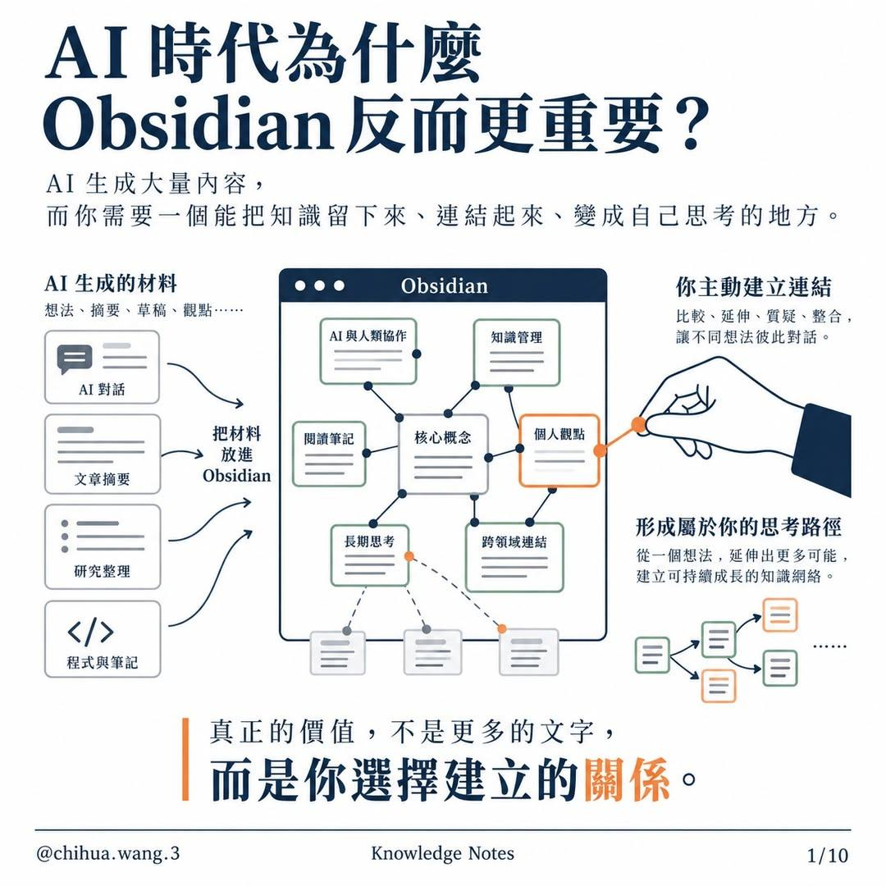
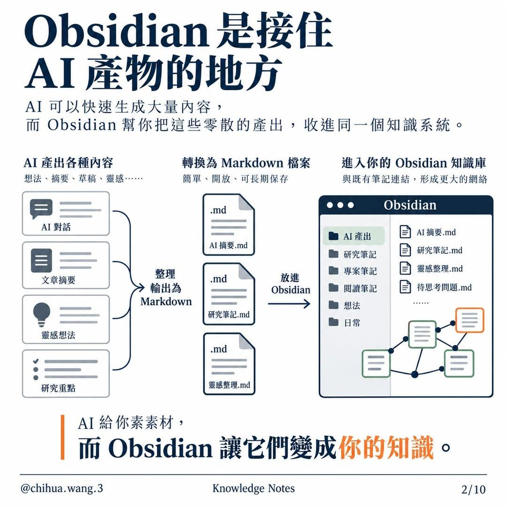
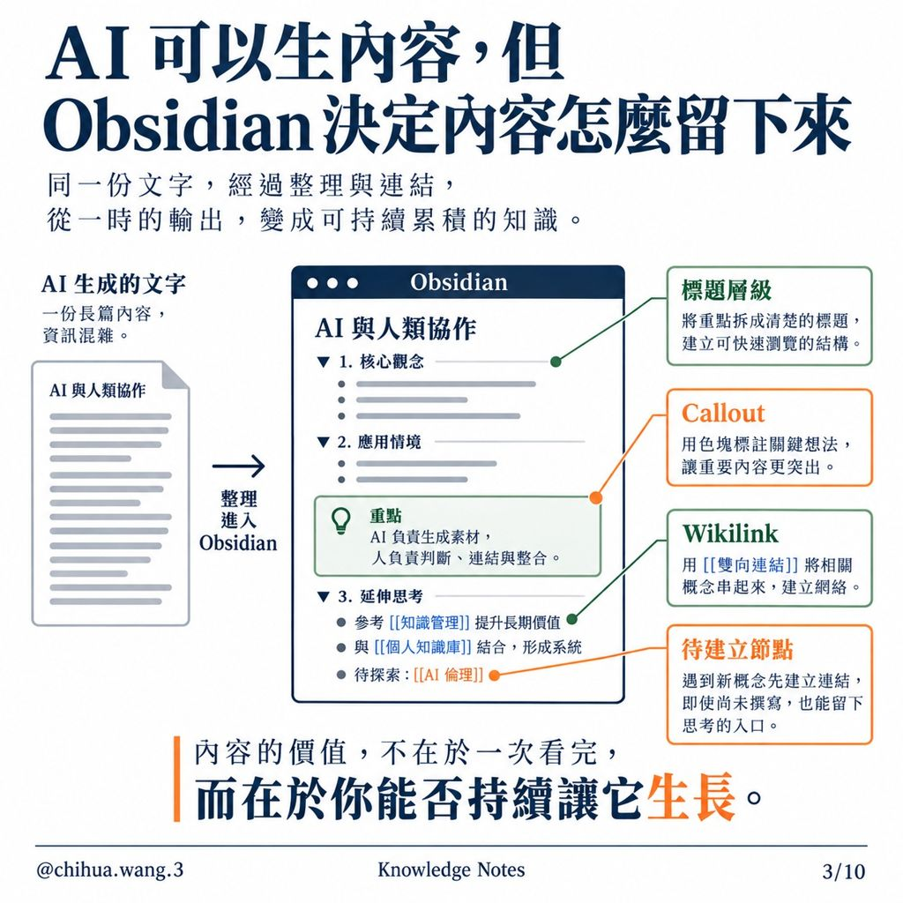
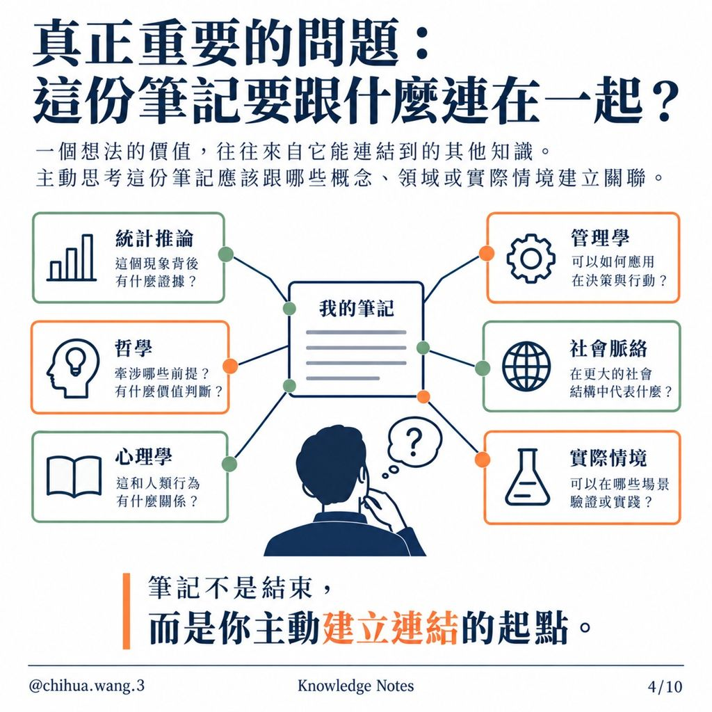
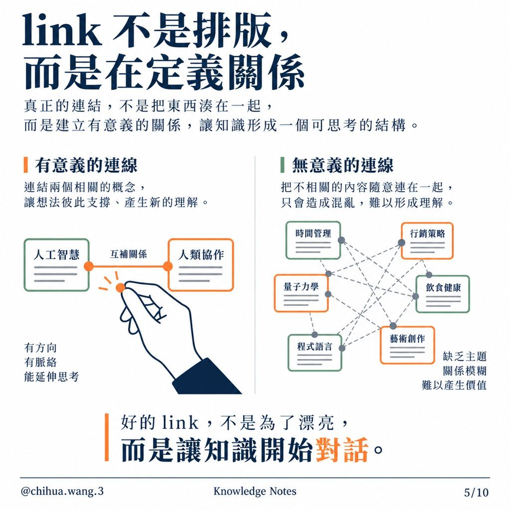
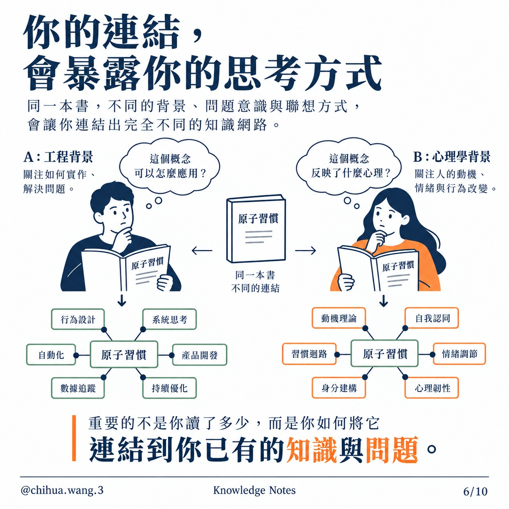
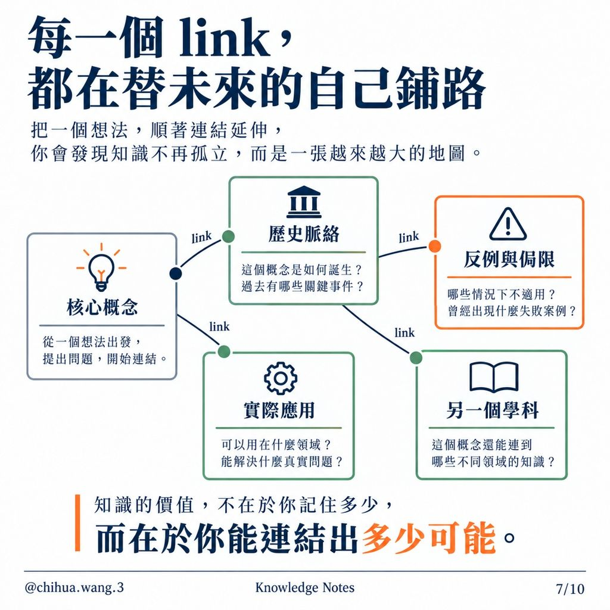
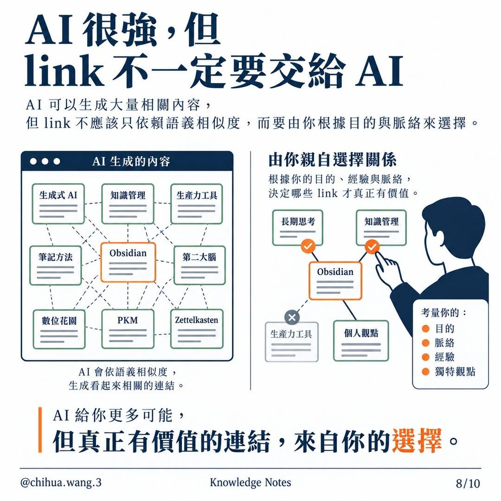
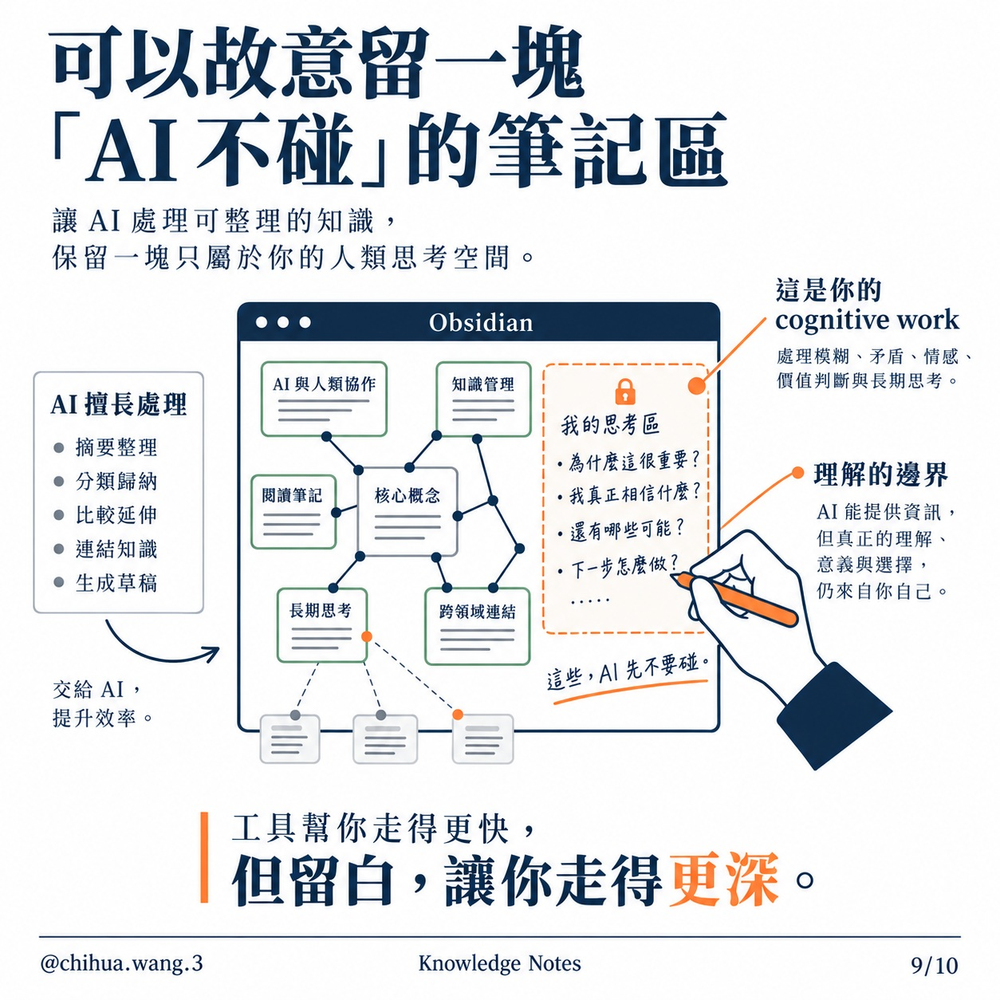
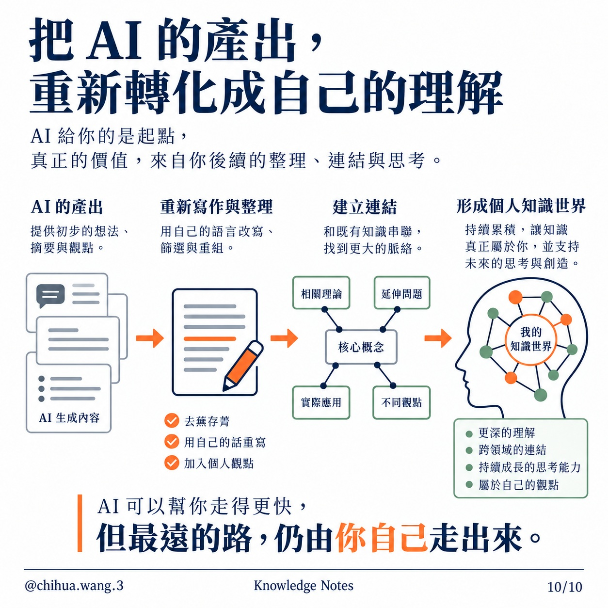

# AI 時代為什麼 Obsidian 反而更重要？

## 思維導圖

- AI 時代為什麼 Obsidian 更重要
  - AI 負責生成素材
    - 對話、摘要、草稿、靈感
  - Obsidian 接住產物
    - 轉成 Markdown 檔
    - 簡單、開放、可長期保存
  - 內容怎麼留下來
    - 標題層級與 Callout
    - Wikilink 與待建立節點
  - 人負責建立連結
    - 比較、延伸、質疑、整合
    - 問：這份筆記連到什麼
  - link 是在定義關係
    - 有方向、有脈絡
    - 亂連只會混亂
  - 連結暴露思考方式
    - 同一本書、不同網路
  - 每個 link 為未來鋪路
    - 脈絡、應用、反例、跨學科
  - link 不必交給 AI
    - AI 只看語義相似度
    - 依目的與經驗選擇
  - 留一塊 AI 不碰的區域
    - 模糊、矛盾、價值判斷
  - 產出轉成自己的理解
    - 重寫、連結、形成知識世界

## 圖文對照（畫面 + 逐字稿）

### 第 1 頁：AI 時代為什麼 Obsidian 反而更重要？

**重點：** AI 生成的材料（AI 對話、文章摘要、研究整理、程式與筆記）放進 Obsidian，由你主動比較、延伸、質疑、整合，形成屬於你的思考路徑。

**標籤：** #Obsidian #AI #知識管理

AI 時代為什麼 Obsidian 反而更重要？AI 生成大量內容，而你需要一個能把知識留下來、連結起來、變成自己思考的地方。左：AI 生成的材料（想法、摘要、草稿、觀點……）＝AI 對話、文章摘要、研究整理、程式與筆記 → 把材料放進 Obsidian。中：Obsidian 圖譜（AI 與人類協作、知識管理、閱讀筆記、核心概念、個人觀點、長期思考、跨領域連結）。右：你主動建立連結（比較、延伸、質疑、整合，讓不同想法彼此對話）；形成屬於你的思考路徑（從一個想法，延伸出更多可能，建立可持續成長的知識網絡）。結語：真正的價值，不是更多的文字，而是你選擇建立的關係。

### 第 2 頁：Obsidian 是接住 AI 產物的地方

**重點：** AI 的產出（對話、摘要、靈感、研究重點）整理輸出成 .md 檔——簡單、開放、可長期保存——再放進 Obsidian，與既有筆記連結成更大的網絡。

**標籤：** #Markdown #AI產出

Obsidian 是接住 AI 產物的地方，AI 可以快速生成大量內容，而 Obsidian 幫你把這些零散的產出，收進同一個知識系統。AI 產出各種內容（想法、摘要、草稿、靈感……）：AI 對話、文章摘要、靈感想法、研究重點。轉換為 Markdown 檔案（簡單、開放、可長期保存）：AI 摘要.md、研究筆記.md、靈感整理.md。進入你的 Obsidian 知識庫（與既有筆記連結，形成更大的網絡）：資料夾 AI 產出、研究筆記、專案筆記、閱讀筆記、想法、日常；檔案 AI 摘要.md、研究筆記.md、靈感整理.md、待思考問題.md。結語：AI 給你素材，而 Obsidian 讓它們變成你的知識。（圖上寫成「素素材」，疑為筆誤）。

### 第 3 頁：AI 可以生內容，但 Obsidian 決定內容怎麼留下來

**重點：** 同一份 AI 長文，經標題層級、Callout、Wikilink 與待建立節點整理後，從一時的輸出變成可持續累積的知識；AI 負責生成素材，人負責判斷、連結與整合。

**標籤：** #Wikilink #Callout #筆記結構

AI 可以生內容，但 Obsidian 決定內容怎麼留下來，同一份文字，經過整理與連結，從一時的輸出，變成可持續累積的知識。左：AI 生成的文字（一份長篇內容，資訊混雜）→ 整理進 Obsidian。範例筆記「AI 與人類協作」：1. 核心觀念；2. 應用情境；重點 callout（AI 負責生成素材，人負責判斷、連結與整合。）；3. 延伸思考：參考 [[知識管理]] 提升長期價值、與 [[個人知識庫]] 結合形成系統、待探索：[[AI 倫理]]。標題層級：將重點拆成清楚的標題，建立可快速瀏覽的結構。Callout：用色塊標註關鍵想法，讓重要內容更突出。Wikilink：用 [[雙向連結]] 將相關概念串起來，建立網絡。待建立節點：遇到新概念先建立連結，即使尚未撰寫，也能留下思考的入口。結語：內容的價值，不在於一次看完，而在於你能否持續讓它生長。

### 第 4 頁：真正重要的問題：這份筆記要跟什麼連在一起？

**重點：** 一個想法的價值來自它能連到的其他知識；圍繞「我的筆記」問六個問題：統計推論、哲學、心理學、管理學、社會脈絡、實際情境。

**標籤：** #連結 #提問

真正重要的問題：這份筆記要跟什麼連在一起？一個想法的價值，往往來自它能連結到的其他知識。主動思考這份筆記應該跟哪些概念、領域或實際情境建立關聯。中心：我的筆記。統計推論：這個現象背後有什麼證據？哲學：牽涉哪些前提？有什麼價值判斷？心理學：這和人類行為有什麼關係？管理學：可以如何應用在決策與行動？社會脈絡：在更大的社會結構中代表什麼？實際情境：可以在哪些場景驗證或實踐？結語：筆記不是結束，而是你主動建立連結的起點。

### 第 5 頁：link 不是排版，而是在定義關係

**重點：** 好的 link 連結兩個相關概念、有方向有脈絡；把不相關內容隨意連起來只會混亂。link 是在定義關係，不是在排版。

**標籤：** #連結品質 #雙向連結

link 不是排版，而是在定義關係，真正的連結，不是把東西湊在一起，而是建立有意義的關係，讓知識形成一個可思考的結構。有意義的連線：連結兩個相關的概念，讓想法彼此支撐、產生新的理解。例：人工智慧 —互補關係— 人類協作；有方向、有脈絡、能延伸思考。無意義的連線：把不相關的內容隨意連在一起，只會造成混亂，難以形成理解。例：時間管理、行銷策略、量子力學、飲食健康、程式語言、藝術創作彼此亂連；缺乏主題、關係模糊、難以產生價值。結語：好的 link，不是為了漂亮，而是讓知識開始對話。

### 第 6 頁：你的連結，會暴露你的思考方式

**重點：** 同一本書，因背景與問題意識不同，連出完全不同的網絡：工程背景連到行為設計、系統思考；心理學背景連到動機理論、自我認同。重點是連到你已有的知識與問題。

**標籤：** #思考方式 #原子習慣

你的連結，會暴露你的思考方式，同一本書，不同的背景、問題意識與聯想方式，會讓你連結出完全不同的知識網路。A：工程背景（關注如何實作、解決問題）——「這個概念可以怎麼應用？」→ 原子習慣：行為設計、系統思考、自動化、產品開發、數據追蹤、持續優化。B：心理學背景（關注人的動機、情緒與行為改變）——「這個概念反映了什麼心理？」→ 原子習慣：動機理論、自我認同、習慣迴路、情緒調節、身分建構、心理韌性。中間：同一本書，不同的連結（《原子習慣》）。結語：重要的不是你讀了多少，而是你如何將它連結到你已有的知識與問題。

### 第 7 頁：每一個 link，都在替未來的自己鋪路

**重點：** 從核心概念出發，順著 link 延伸到歷史脈絡、實際應用、反例與侷限、另一個學科，知識不再孤立，而是越來越大的地圖。

**標籤：** #知識地圖 #延伸

每一個 link，都在替未來的自己鋪路，把一個想法，順著連結延伸，你會發現知識不再孤立，而是一張越來越大的地圖。核心概念：從一個想法出發，提出問題，開始連結。歷史脈絡：這個概念是如何誕生？過去有哪些關鍵事件？實際應用：可以用在什麼領域？能解決什麼真實問題？反例與侷限：哪些情況下不適用？曾經出現什麼失敗案例？另一個學科：這個概念還能連到哪些不同領域的知識？（連線：核心概念 → 歷史脈絡、實際應用；歷史脈絡 → 反例與侷限、另一個學科。），結語：知識的價值，不在於你記住多少，而在於你能連結出多少可能。

### 第 8 頁：AI 很強，但 link 不一定要交給 AI

**重點：** AI 會依語義相似度生出看起來相關的連結；有價值的 link 由你根據目的、脈絡、經驗與獨特觀點選擇（打勾保留、打叉剔除）。

**標籤：** #AI #連結選擇

AI 很強，但 link 不一定要交給 AI，AI 可以生成大量相關內容，但 link 不應該只依賴語義相似度，而要由你根據目的與脈絡來選擇。左：AI 生成的內容——生成式 AI、知識管理、生產力工具、筆記方法、Obsidian、第二大腦、數位花園、PKM、Zettelkasten 全部互連；AI 會依語義相似度，生成看起來相關的連結。右：由你親自選擇關係（根據你的目的、經驗與脈絡，決定哪些 link 才真正有價值）：Obsidian 與長期思考、知識管理、個人觀點保留（打勾），生產力工具剔除（打叉）。考量你的：目的、脈絡、經驗、獨特觀點。結語：AI 給你更多可能，但真正有價值的連結，來自你的選擇。

### 第 9 頁：可以故意留一塊「AI 不碰」的筆記區

**重點：** AI 擅長摘要整理、分類歸納、比較延伸、連結知識、生成草稿，這些交給 AI 提升效率；另留「我的思考區」處理模糊、矛盾、情感、價值判斷與長期思考，AI 先不要碰。

**標籤：** #留白 #cognitive work

可以故意留一塊「AI 不碰」的筆記區，讓 AI 處理可整理的知識，保留一塊只屬於你的人類思考空間。左：AI 擅長處理——摘要整理、分類歸納、比較延伸、連結知識、生成草稿 → 交給 AI，提升效率。右：我的思考區（上鎖的虛線框）——為什麼這很重要？我真正相信什麼？還有哪些可能？下一步怎麼做？旁註：這些，AI 先不要碰。這是你的 cognitive work：處理模糊、矛盾、情感、價值判斷與長期思考。理解的邊界：AI 能提供資訊，但真正的理解、意義與選擇，仍來自你自己。結語：工具幫你走得更快，但留白，讓你走得更深。

### 第 10 頁：把 AI 的產出，重新轉化成自己的理解

**重點：** AI 給的是起點；後續用自己的語言去蕪存菁、重寫並加入個人觀點，再與既有知識串聯，累積成屬於自己的知識世界。

**標籤：** #改寫 #個人知識世界

把 AI 的產出，重新轉化成自己的理解，AI 給你的是起點，真正的價值，來自你後續的整理、連結與思考。AI 的產出：提供初步的想法、摘要與觀點（AI 生成內容）。重新寫作與整理：用自己的語言改寫、篩選與重組；去蕪存菁、用自己的話重寫、加入個人觀點。建立連結：和既有知識串聯，找到更大的脈絡；核心概念連相關理論、延伸問題、實際應用、不同觀點。形成個人知識世界：持續累積，讓知識真正屬於你，並支持未來的思考與創造；更深的理解、跨領域的連結、持續成長的思考能力、屬於自己的觀點。結語：AI 可以幫你走得更快，但最遠的路，仍由你自己走出來。

## 知識點

- [[AI_價值在於人選擇建立的關係]]
- [[AI_Markdown 檔適合接住 AI 產物]]
- [[AI_link 是在定義關係，不是排版]]
- [[AI_連結會暴露你的思考方式]]
- [[AI_連結不該只依語義相似度]]
- [[AI_留一塊「AI 不碰」的思考區]]
- [[AI_把 AI 的產出重寫成自己的理解]]

## 連結

_由人選定並經使用者確認，每條寫明關係；要增減請改 links.md 的「已確認」區再匯出。_

- [[知識管理]]｜上位概念：本篇討論的是 AI 時代的個人知識管理方法
- [[雙向連結]]｜核心機制：貼文主張 link 是「定義關係」，不是排版
- [[Markdown]]｜格式基礎：AI 產物轉成 .md 才能長期保存、可攜
- [[原子習慣]]｜舉例：第 6 頁用同一本書示範不同背景連出不同網路
- [[AI 與人類協作]]｜分工：AI 生成素材，人負責判斷、連結與整合
- [[watch-archive 流程]]｜應用：本 repo 的影片歸檔可匯出成 Obsidian 筆記，連結仍由人確認
- [[認知工作]]｜界線：第 9 頁主張模糊、矛盾、價值判斷屬人的 cognitive work，AI 先不要碰

## 補充資料

### 貼文本文（Threads 頁面 og:description，逐字；作者主張，未查證）
AI 越能快速生成內容，越需要一個屬於自己的知識世界，決定哪些內容值得留下與如何重新理解。

- 用 Obsidian 選擇要保存的內容，而不是把 AI 產出全部堆進資料庫。
- 為概念建立連結與閱讀路徑，讓知識能回到自己的問題脈絡。
- 保留由自己完成的連結、重寫與判斷，讓 AI 不取代理解。

Obsidian 的核心價值不是儲存筆記，而是守住你和知識之間的關係。

### 取得方式
- 使用者上傳 1–8 頁（1080px）；Threads 主頁 HTML 只含第 1 張圖，但 `<貼文網址>/embed` 頁含全部 10 張原圖（1254px）。本資料夾 `frames/` 已全部改用 `/embed` 取得的 10 張。

### 在 Obsidian 的對應做法（整理者補充，非貼文原文；推測性建議，未實測）
- 把 AI 產出另存 `.md`，放進 vault 的 `AI產出/` 之類資料夾（第 2 頁）。
- 用標題層級（`#`）、Callout（`> [!tip] 重點`）、Wikilink（`[[概念]]`）整理（第 3 頁）。
- 每寫完一篇筆記，自問第 4 頁六個問題，只留下說得出「關係」的 link（第 5 頁）。
- 筆記裡留一個「我的思考區」，記下為什麼重要、我真正相信什麼、還有哪些可能、下一步，AI 不代寫（第 9 頁）。
- 把 AI 產出用自己的話重寫、加入個人觀點，再連到既有知識（第 10 頁）。
- 本 repo 的對應功能：`scripts/obsidian_export.py` 把歸檔結果匯成 vault 筆記，連結只取自手寫的 `links.md`，不自動以相似度產生（呼應第 8 頁）。

## 來源

- 原始資料夾：`watch-output/AI/2026-10-27_Threads_AI時代為什麼Obsidian反而更重要__De9qij5FKBy`
- 逐字稿來源：圖片文字（逐頁人工抄錄，非語音轉錄）
