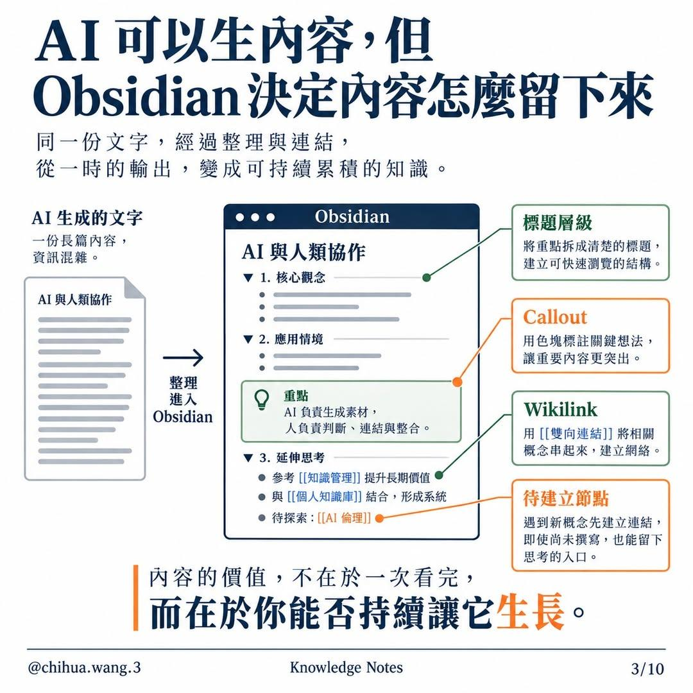
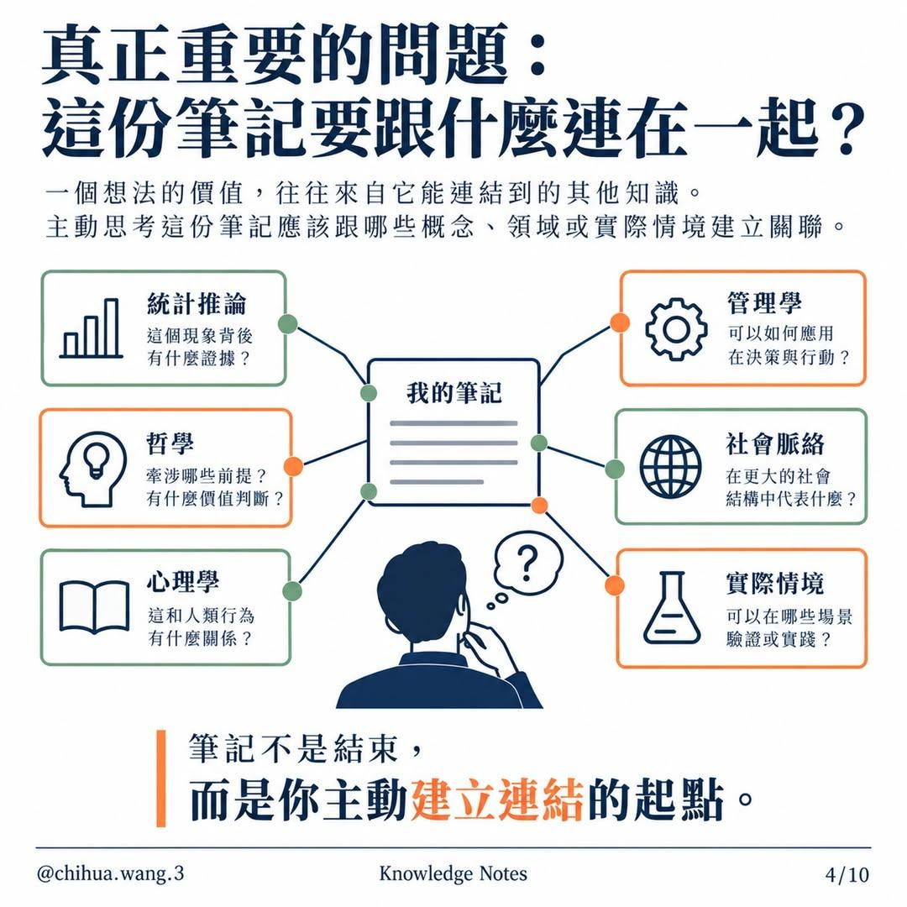
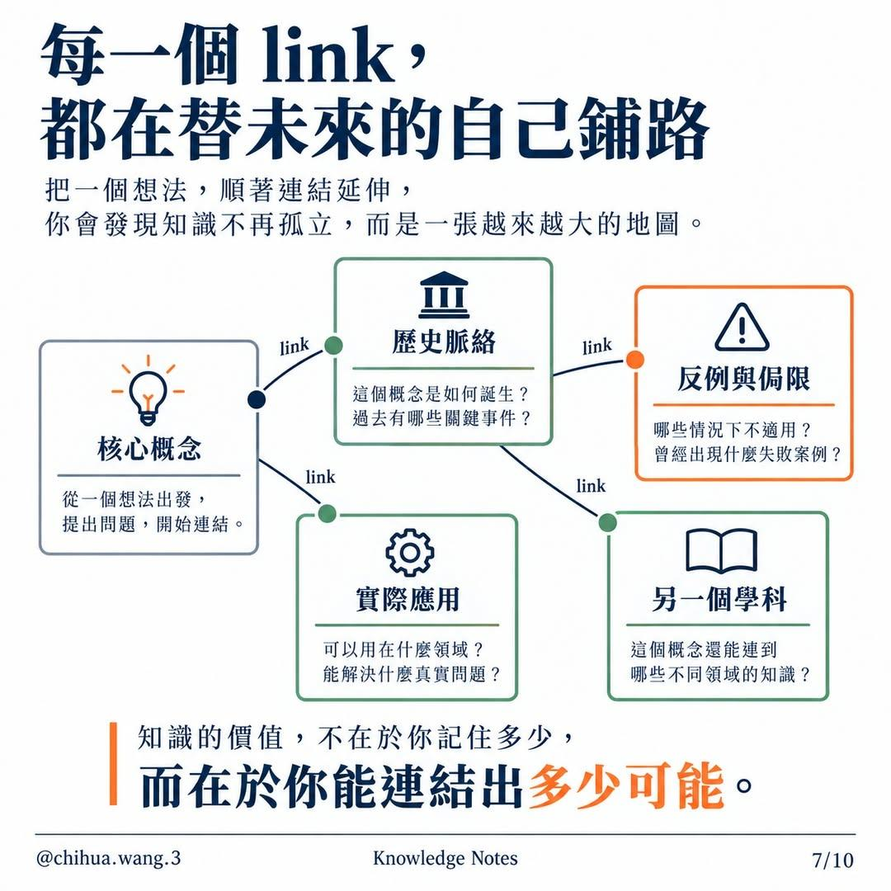

# AI 時代為什麼 Obsidian 反而更重要？

## 摘要

**一句話重點：** @chihua.wang.3（Knowledge Notes）的圖文輪播主張：AI 能大量生成內容，但「真正的價值，不是更多的文字，而是你選擇建立的關係」——Obsidian 把 AI 產物以 Markdown 接住，由人親自建立有意義的 link，才讓內容變成自己的知識（**作者主張，未查證**）。

| 頁 | 重點 |
|---|---|
| 1 | 總論：AI 材料（對話、摘要、研究整理、程式與筆記）放進 Obsidian，由你比較、延伸、質疑、整合 |
| 2 | Obsidian 是接住 AI 產物的地方：AI 產出 → 轉 Markdown（簡單、開放、可長期保存）→ 進知識庫與既有筆記連結 |
| 3 | 怎麼留下來：標題層級、Callout、Wikilink `[[ ]]`、待建立節點；AI 負責生成素材，人負責判斷、連結與整合 |
| 4 | 該問的問題：這份筆記要跟什麼連在一起？（統計推論、哲學、心理學、管理學、社會脈絡、實際情境） |
| 5 | link 不是排版而是定義關係：有意義的連線有方向、有脈絡、能延伸思考；亂連只會混亂 |
| 6 | 連結會暴露思考方式：同一本《原子習慣》，工程背景與心理學背景連出不同網路 |
| 7 | 每個 link 都在替未來鋪路：核心概念 → 歷史脈絡／實際應用 → 反例與侷限／另一個學科 |
| 8 | AI 很強，但 link 不一定要交給 AI：AI 只依語義相似度連，由你依目的、脈絡、經驗、獨特觀點選擇 |

### 名詞與說明
- **Obsidian**：以本機 Markdown 檔為基礎的筆記軟體；一個資料夾就是一個 vault，筆記間可用雙向連結互連。
- **Wikilink**：`[[筆記名稱]]` 語法；指向尚未建立的筆記時仍可先寫（貼文稱「待建立節點」）。
- **Callout**：Obsidian 的色塊標註語法（`> [!tip] 標題`），用來突出關鍵想法。
- **語義相似度**：貼文指 AI 以「意思相近」自動推薦連結；貼文立場是這種連結不能取代人依目的選擇的連結（作者主張）。
- 本檔為**圖文貼文，非影片**：以頁碼代替時間碼（第 N 頁＝00:0N），逐字稿欄是逐頁人工抄錄的圖片文字。
- 貼文共 10 頁，使用者只提供 1–8 頁；第 9–10 頁內容未知，不做推測。
- 第 2 頁結語圖上寫「素素材」，應為「素材」之筆誤。
- 貼文全屬觀點與方法主張，無可查證的數字；原貼文網址未提供。

### 補充資料
- 缺頁說明與在 Obsidian 實作的對照，見 `supplement.md`。

## 思維導圖

## 圖文原頁

**第 1 頁：AI 時代為什麼 Obsidian 反而更重要？**

**第 2 頁：Obsidian 是接住 AI 產物的地方**

**第 3 頁：AI 可以生內容，但 Obsidian 決定內容怎麼留下來**

**第 4 頁：真正重要的問題：這份筆記要跟什麼連在一起？**

**第 5 頁：link 不是排版，而是在定義關係**

**第 6 頁：你的連結，會暴露你的思考方式**

**第 7 頁：每一個 link，都在替未來的自己鋪路**

**第 8 頁：AI 很強，但 link 不一定要交給 AI**

## 連結

_由人選定並寫明關係；新增連結請改 links.md 再匯出。_

- [[知識管理]]｜上位概念：本篇討論的是 AI 時代的個人知識管理方法
- [[雙向連結]]｜核心機制：貼文主張 link 是「定義關係」，不是排版
- [[Markdown]]｜格式基礎：AI 產物轉成 .md 才能長期保存、可攜
- [[原子習慣]]｜舉例：第 6 頁用同一本書示範不同背景連出不同網路
- [[AI 與人類協作]]｜分工：AI 生成素材，人負責判斷、連結與整合
- [[watch-archive 流程]]｜應用：本 repo 的影片歸檔可匯出成 Obsidian 筆記，連結仍由人確認

## 補充資料

### 缺頁
- 貼文標示 1/10 至 10/10，本次只收到 1–8 頁；第 9、10 頁（可能為結論或行動建議）內容未知，取得後請補進 `transcript.md`、`meta.json.slides` 與 `frames/` 再重建。

### 在 Obsidian 的對應做法（整理者補充，非貼文原文；推測性建議，未實測）
- 把 AI 產出另存 `.md`，放進 vault 的 `AI產出/` 之類資料夾（第 2 頁）。
- 用標題層級（`#`）、Callout（`> [!tip] 重點`）、Wikilink（`[[概念]]`）整理（第 3 頁）。
- 每寫完一篇筆記，自問第 4 頁六個問題，只留下說得出「關係」的 link（第 5 頁）。
- 本 repo 的對應功能：`scripts/obsidian_export.py` 把歸檔結果匯成 vault 筆記，連結只取自手寫的 `links.md`，不自動以相似度產生（呼應第 8 頁）。

## 來源

- 原始資料夾：`watch-output/AI/2026-10-27_Image_AI時代為什麼Obsidian反而更重要__chihua-wang-3-knowledge-notes`
- 逐字稿來源：圖片文字（逐頁人工抄錄，非語音轉錄）
