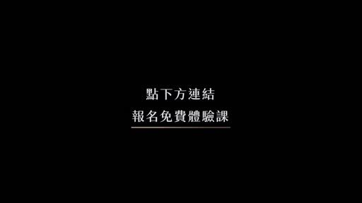

# AI逐字稿怎麼驗收不偷工_2小時免費體驗課

## 圖文對照（畫面 + 逐字稿）

### 投影片 1：AI 交出的逐字稿，你怎麼知道它沒偷工？（00:00–00:06）

**重點：** 提出問題：逐字稿要做成知識庫，每個字都重要，如何確認 AI 沒有偷工減料。

**標籤：** #偷工減料 #知識庫

我們怎麼樣知道AI幫你做完這個逐字稿之後，它沒有偷工減料，我要能夠盡量把原文留下來。

### 投影片 2：別信「看起來做完了」（00:06–00:52）

**重點：** 四道關卡：逐字保留、分段處理、雙指標自我檢查、不覆寫原檔；轉成 MD 檔時要盡量保留原文，長音檔要分段、行數與字數都要達標。

**標籤：** #逐字保留 #分段處理 #雙指標 #不覆寫原檔

既然這個東西它有我做成知識庫的價值，每一個字就是都很重要，很有價值的東西會在某些例子的細節裡面，它可能很多的故事的細節就會被刪掉了，我覺得最厲害、最Juicy的地方就不見了，如果我想要轉成MD檔的東西，我都會希望它盡量保留成原文，一定要逐字保留，這是一個大原則，如果你真的要拿來做很長的檔案的話，後面逐字稿要分段處理，不會一次做一個大段，這東西都不用做，因為我都已經寫在技能包裡面了，這是我的思路，怎麼去拆解這個比較長的音檔，我後面裡面有做的就是雙指標的自我檢查，就是行數跟字數都要達標這個音檔有多長，它應該要有的容量跟行數字數大概是什麼。

### 投影片 3：第一版，就要完美嗎？（00:52–01:09）

**重點：** 技能包不必一次到位，是「永遠在改的進行式」：發現問題就修改，滿意後定稿成下一版。

**標籤：** #技能包 #迭代

這邊另外有一個重點想跟大家分享就是，不要想說一次做技能包就要到位，最棒的技能包就是一個永遠正在改的進行式的技能包，然後你只要一知道他做的哪裡不好就修改他，修改完之後覺得好就叫他把它定稿成為下一個版本，然後就一直不斷最佳化。

### 投影片 4：先求能用，再求完美（01:09–01:12）

**重點：** 講者的技能包不斷最佳化，已做到約 20 版。

**標籤：** #最佳化

其實我們一直不斷的在最佳化好幾個版後來做到20版。

### 投影片 5：帶走：先問對問題，再分工・驗收・迭代（01:12–01:24）

**重點：** 流程為先問對問題 → 分工 → 驗收 → 迭代；挑自己的一段音檔，用同一招跑一次。

**標籤：** #問對問題 #分工驗收迭代

所以大概的流程就會是，先問對問題、分工、驗收、迭代這樣子，8點半大家看到那個文章上線的時候，就可以直接下載下來找一個音檔來自己測試看看。

### 投影片 6：結尾：報名免費體驗課（01:24–01:26）

**重點：** 課程宣傳結尾卡，無語音。

## 來源

- 原始資料夾：`watch-output/AI/2026-10-11_Facebook_AI逐字稿怎麼驗收不偷工_2小時免費體驗課__1Er8dLDmTU`
- 逐字稿來源：whisper (groq)
