# Hux - 今晚別刷Netflix了。  去看這個SpaceX AI工程師1小時的課程。  這是我見過最清晰、端到端講透GrokBot到底該怎麼真正用...

## 思維導圖

- 信任 agent 的方法
  - 開場
    - AI 是配對夥伴
    - 別外包思考
  - 信任曲線（講者主張）
    - 高度介入→平行化
    - 自動合併 PR
  - 驗證 verification
    - 讓 agent 真的執行
    - 功能地圖
  - Skill 與 PStack
    - 把失敗做成 skill
    - eval 是單元測試
    - 評審 agent、爬山
  - 雲端 agent
    - 先本機再雲端
    - Benny 重現 bug
  - 重寫與護欄
    - 原型要護欄
    - Dune 嚴格架構
  - 硬性約束
    - CI、lint、編譯器
    - 軟規則只輔助
  - ROI 與團隊
    - 前期花 token
    - PM／設計師也能交付

## 圖文對照（畫面 + 逐字稿＋中譯）

### 主題 1：開場：AI 是配對夥伴，不是取代思考（00:00–01:25）

**重點：** 講者 Lauren（任職 Cursor／SpaceX AI，Grokbot 團隊）認為使用 AI 最好的方式是把它當配對程式設計的夥伴，而不是取代寫程式、甚至外包思考的工具；她觀察到用 AI 雖省寫碼時間，卻花更多時間審查與修正 AI 的產出（講者主張）。

**標籤：** #配對程式設計 #vibe coding #審查

personally, I think that, the best use of you of AI is really is like a like a pair, like someone you're pair programming with and not someone as not, not a not a tool to just replace the act of writing code or worse, outsourcing your thinking And I think there's a tendency like, you know, because AI is so exciting you wanna put AI everywhere and be seen as someone who's very you know, what do you call it like, on the ball, I guess, with, with AI, that you feel this pressure of like, you know, I'm just gonna, I gotta increase my productivity I gotta ship, like, a hundred PRs this week and barely understand what I'm doing and, you know, vibe code my way to a a million ARR or whatever but I think You know one of the things that I've personally seen is that although when I use AI I save some time you know, writing the code I actually find myself spending more time reviewing what the AI did and like, correcting it So, you know, like, I've, I've tried the the thing that a lot of people say like, you know, you instead of prompting an AI to just build the feature outright you sort of get it to build a spec for you first then you review that spec and then you do that whole thing Then it's like, okay so I assume you can see my screen? Yes, yeah, we're good.

**中譯：** 我個人認為，使用 AI 最好的方式，是把它當成配對程式設計（pair programming）的夥伴，而不是單純取代寫程式的工具，更糟的是把你的思考外包出去。我覺得有一種傾向：因為 AI 太令人興奮，你會想把 AI 用在每個地方，想被看成很跟得上 AI 的人，於是產生壓力，覺得「我得提高生產力，這週要交出上百個 PR」，卻幾乎不懂自己在做什麼，靠 vibe coding 做到百萬 ARR 之類。但我個人看到的是：雖然用 AI 寫程式能省一些時間，我卻發現自己花更多時間在審查 AI 做的東西並修正它。我也試過很多人說的做法：不要直接叫 AI 把功能做出來，而是先請它寫規格（spec），你審查規格，再進行整件事。好，我想你們看得到我的畫面吧？（主持人：看得到，沒問題。）

### 主題 2：核心問題：如何信任 agent？信任曲線（01:25–04:18）

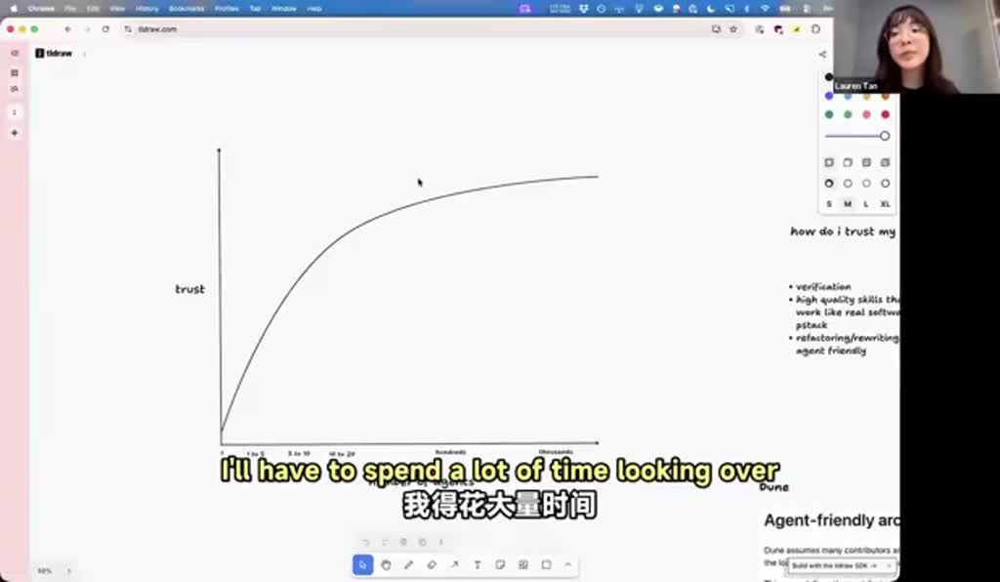

**重點：** 她說最大的主題是如何信任 agent：不信任時就像不信任團隊的主管只能微觀管理、無法平行化。她畫了一條「信任曲線」：過去五個月她逐步爬升，現在讓 agent 自動合併 PR，醒來常有約 20 個 PR 已合併（講者主張，未查證）。

**標籤：** #信任曲線 #自動合併 #微觀管理

So, yeah, today, yeah, I think I think the big theme for me as I've been using agents to write code and I'm sure a lot of you have had the same experience as well is how do you trust it? You know especially if you are an engineer that's been writing code for a very long time you have a lot of opinions and lessons that you've learned about doing good engineering And when you see agents just you know, winging it and, you know, guessing, hallucinating, you know confidently stating that they found the smoking gun for the hundredth time but it's actually not the real problem you lose a lot of trust And when you lose when you don't Much trust in your agents I feel like you you really can't get the most out of them And for me the parallel is like with management so if I'm an a manager, an engineering manager of a team and I have a bunch of you know, I have a team of engineers on my team, and I don't trust them then the mode of operation I'm going to be in is going to be like micromanagement right? I'll have to spend a lot of time looking over my reports' shoulders and checking that they're doing their work well you know that they're not shipping bugs to production And so I drew this chart because it's not, it's not a very scientific chart but like this is how I imagine myself and my journey through using agents So, you know, like fast forward or back forward or fast back, fast backwards, like a year or so when you know, nobody was or not many people were using agents to code I think you you get into this mode where you are In very heavily in the loop with one or several like a handful of agents and you find yourself just constantly fig you know, trying to understand what your agents are doing and you're very, very in the loop You're watching every single output You are sitting there prompting and you really can't parallelize beyond that because you don't again, you don't have that trust right? You can't go to a hundred agents like spawn a hundred agents when you don't even trust the output of one agent So, over the past five months I feel like I've really been able to like, ascend this trust curve and now I'm at the point where I actually have, this sounds kind of scary to say this and it makes me sound like a slop artist but I, I promise I'm not But I actually have my agents now auto-merging PRs for me which is like a wild thing to say but like I woke up today and there were like 20 PRs landed and I just reviewed them on main like they were already landed and they were good.

**中譯：** 今天對我來說最大的主題是：我一直在用 agent 寫程式，我相信你們很多人也有一樣的經驗——你要如何信任它？尤其如果你是寫了很多年程式的工程師，你對好的工程有很多看法與累積的教訓；當你看到 agent 在亂猜、產生幻覺，第一百次信心滿滿地宣稱找到了「鐵證」（smoking gun）、其實根本不是真正的問題時，你就失去很多信任。而當你不太信任你的 agent，我覺得你就沒辦法充分發揮它們的價值。對我來說，這和管理很像：如果我是一個工程團隊的主管，帶著一票工程師卻不信任他們，我的運作模式就會變成微觀管理——花很多時間在他們背後盯著、檢查他們有沒有做好、有沒有把 bug 送上線。所以我畫了這張圖——它不是很科學，但這是我想像自己使用 agent 的歷程。回到大約一年前，沒有多少人用 agent 寫程式，你會處於一個高度介入（in the loop）的模式：只跟一個或少數幾個 agent 互動，一直在試著理解它們在做什麼，盯著每一次輸出、坐在那裡下提示，也無法再平行化，因為你沒有那份信任——你不能在連一個 agent 的輸出都不信任的情況下，叫出一百個 agent。過去五個月，我覺得自己真的爬上了這條信任曲線。現在我到了一個地步——這聽起來有點可怕，也讓我聽起來像個只會量產 slop（粗製濫造內容）的人，但我保證不是——我的 agent 現在會幫我自動合併（auto-merge）PR。這說起來很瘋狂，但我今天醒來，有大約 20 個 PR 已經合併進去，我就直接在 main 上審查它們，而且品質都不錯。

### 主題 3：成績與信心：一個月交付 1000 個 PR（04:18–06:03）

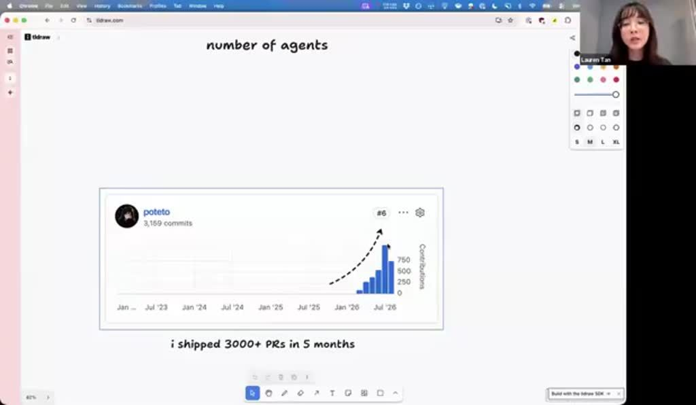

**重點：** 她稱這條曲線與自己在 Cursor 合併的貢獻量呈反向對應：五個月前加入，第一個月幾乎沒產出，信心上升後上月交付 1000 個 PR、本月 12 號已近 800 個；她坦言程式碼品質值得質疑，但相信設定好 agent 就能達到類似水準（講者主張，未查證）。 畫面投影片寫「i shipped 3000+ PRs in 5 months」。

**標籤：** #1000 PR #生產力 #信心

so how did I get to that point? It's basically what I wanted to talk about today and again, like, yeah feel free to jump in if you have questions Colin but, oh yeah, of course I gotta show this this chart, where oh, do, do not trust, someone requested to control my computer probably won't do that but Yeah, so this chart, I think, I, I I'm trying this chart not to kind of like flex but to kind of show like the journey Like, so you can see like the curve like it it sort of like inversely matches the contributions I've been able to land at cursor So I joined five months ago and five months ago like I, you know, my first month I was like not very productive because I was you know, I was learning the code base didn't know what the heck was going on And as I got more confident in in my agents I've really been able to kind of ramp up my productivity and again, like, yeah like last month I shipped a thousand PRs which is ridiculous and then this month we're only on the 12th I'm already at, like, almost 800 PRs landed so the velocity is definitely high and you, you, I I'm sure a lot of you will definitely be questioning like, how how much of this code is actually good and I think, yeah, like, that's definitely fair to question but, yeah, I think I think if you set up your agents well you can definitely get to a very similar level and so I'm going to talk about how we do that.

**中譯：** 我是怎麼走到這一步的？這就是我今天想談的。（中途歡迎提問，Colin。）我放這張圖不是要炫耀，而是要呈現這段歷程：曲線與我在 Cursor 能合併進去的貢獻量大致呈反向對應。我五個月前加入，第一個月沒有很多產出，因為我在熟悉程式碼、完全搞不清楚狀況；隨著我對 agent 越來越有信心，生產力才真正拉起來：上個月我交出了一千個 PR（很誇張），這個月才 12 號，我已經合併了將近 800 個。速度確實很高。我相信你們很多人會質疑這些程式碼到底有多少是好的，這個質疑很合理；但我認為只要把你的 agent 設定得好，你也能達到非常類似的水準，接下來我就談我們怎麼做。

### 主題 4：最重要的技能：驗證（verification）（06:03–07:02）

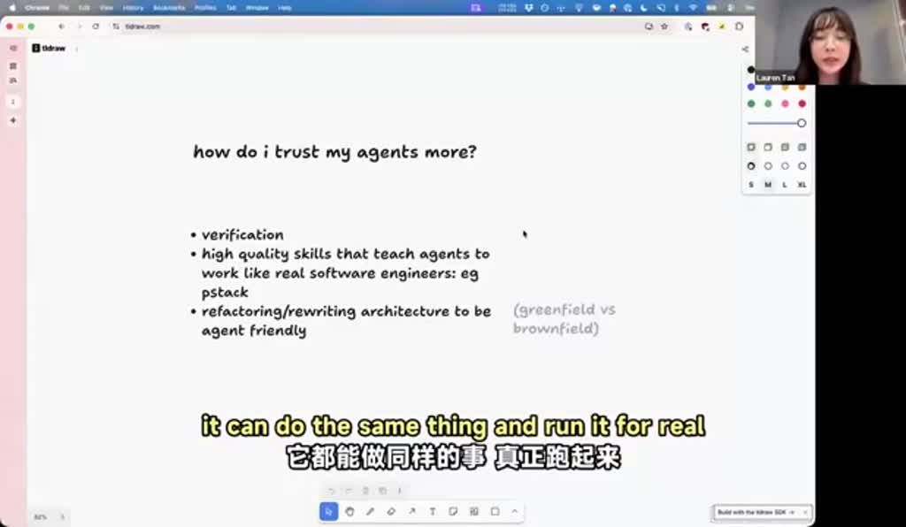

**重點：** 她說與 agent 合作最重要的技能是驗證：讓 agent 能真的執行程式、取得 CPU 追蹤、heap snapshot、開 iOS 模擬器，實際測試並驗證自己的工作；它不保證程式碼好，但能讓 agent 至少寫出「正確」的程式碼，這是信任 agent 的一大步（講者主張）。

**標籤：** #驗證 #閉環 #正確

so for me, I think, I'm curious, like, I guess, Colin, your experience as well but, for me I think the most important skill that you should have in your toolbox when you work with agents is verification and by verification I mean the ability for an agent to actually run the code or take CPU traces or heap snapshots or you know, open an iOS simulator whatever, you know, however your application is exposed to your users it can do the same thing and run it for real and actually test and verify its own work Because that's the thing that really closes the loop it doesn't guarantee your agent writes good code but it allows them to at least write correct code which is a big a really big step forward for being able to trust your agents.

**中譯：** 對我來說，和 agent 合作時你工具箱裡最重要的技能是「驗證」（verification）。我說的驗證，是指 agent 能真的執行程式碼、取得 CPU 追蹤或 heap snapshot、開 iOS 模擬器——不管你的應用程式以什麼方式呈現給使用者，它都能做同樣的事、真正跑起來，實際測試並驗證自己的工作。因為這才是真正「閉環」的東西：它不保證 agent 寫出好的程式碼，但能讓它至少寫出「正確」的程式碼，這對於能夠信任 agent 是非常大的一步。

### 主題 5：實例：Cursor agent 視窗、control glass skill 與功能地圖（07:02–13:46）

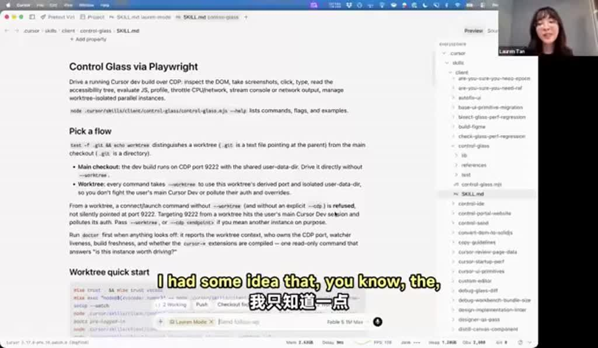

**重點：** 她加入 Cursor 第一週要在緊迫期限內做效能調校，agent 看不懂追蹤檔只會信心滿滿亂猜，人成了瓶頸、無法平行化；於是她做了 control glass skill（讓 agent 用 Chrome DevTools 協定等操作應用），並加入「功能地圖」教 agent 如何走到各個功能，讓模糊的使用者回報也能對應到功能（講者所述）。

**標籤：** #control glass #功能地圖 #DevTools #瓶頸

I will, I can share one example that we have within cursor oops, where, let me open this Let me, let me, make my full screen Here you go so for the, for Cursor's agent window so this is actually an interesting story but, when I joined Cursor five months ago they're actually, well I was supposed to join a different team I was supposed to join like, the cloud agents team but then since I have a lot of experience working on React and agents window is a React application I was I was asked to basically help out with the agent window work but There wasn't really a lot of like, skills to help me So I just found myself like okay, Agent's Windows is going to launch in like a week right? We have a really tight deadline and, there was, you know, I was just sitting there like okay, I'm going to open up the performant the, the Chrome DevTools and just like take a trace look at it myself and try to make sense of this flame graph And keep in mind I was just like in my first week so I had no idea what I was looking at no idea what, you know, I mean I had some idea but, you know, the the code base was completely fresh to me and I realized like my agent had no idea either you know, like I would take a screenshot of the trail download trace, or send it to it and it'd be like yeah, it kind of looks like this you know and it would like confidently state like it's this thing and then I'd try to fix that and turns out that's not the actual thing So this was a very very slow process And if you've ever done any like performance work yourself or, you know just even development with an agent where you don't have a verification skill you are the verifier right? You, you're the bottleneck You, you, you tell your agent to do something and then it goes off and writes some code Then you open up your you know, local dev build, and then you start to say oh, you know, it doesn't work Then you got to copy paste screen you know, screenshots or console errors or whatever and then your agent like slowly kind of like you know works with that and then tries to understand it and That fix the thing But then you're constantly just in the loop and and being a bottleneck. So there's really no way to parallelize So the control glass skills are like one of the first skills I built for cursor and glass, by the way is the code name for agent's window that we use internally but it's just cursor I guess and so this skill is, I guess the, the the code itself is not super interesting Your agent can very easily make one for you where if if you're building an electron app or a web app or even iOS, applications you can teach your agent how to use like, the Chrome DevTools protocol or through Apple has some utilities as well for running the simulator and taking traces and controlling programmatic control as well so that's really useful but one thing I actually want to talk about is the This thing ready to read me so this skill comes with this very unique feature called or not feature unique file called a feature map And so the story then is like I built this skill and so now the agent was able to actually run the agent window and take traces and whatnot but it had no idea what what the agent's window was So, you know, like someone would say like oh, the the left sidebar is like laggy or something like that Or, you know, the right side, the the PR tab is not working And the agent would just be like kind of flailing around. It would spend a lot of time trying to like look up the code and you know, where is this feature? How do I actually get to it on the UI? Which made it basically completely useless you know, like we would I would run this skill locally and you know, it would spawn a dev build but then it just be Churning like I just try to click here it wouldn't know how to get to things and it was just an awful experience so, who is putting arrows on my screen? so, yeah, this, this feature map has been really useful because it teaches the agent how to get to all of the features that you have and in PStack, the plugin that I I've made, if you search for PStack cursor on Google you'll, you'll find it but there is a create verification skill in that plugin where it actually helps you set up something like this for yourself including the feature map so it will actually explore the code and build up this initial feature map that tells your agent how to get to all of the different features that you have and this is extremely powerful because now that you have these user reports that come in you can actually map even like a vague report or even a screenshot So we have this internally at Cursor, where, we have a Slack channel with you know lots of people giving us feedback on the agents window and Grokbot and whatnot and oftentimes the report is very bad like very low quality. Like someone will just put very often we get like a screenshot like, and then someone just says question mark question mark, question mark, like, what is this? And, you know, like, without this, your agents I have no clue right? But with a feature map like this it has a lot more context and understanding of how to actually navigate how to get to all of the different features so like, you know, example, like, I guess, like the sidebar, like what is the sidebar? you know like all the different sub features that are present in it like from the user point of view which is where to how to get to it all the different keyboard shortcuts even like the, the, what do you call it the DOM elements or yeah like the attributes that you use for selecting things through the CDP are all there So, again, yeah, this is like really really powerful, for, for agents and a PStack ships that create verification skill but also a maintain verification skill so you can keep this up to date.

**中譯：** 我可以分享一個我們在 Cursor 內部的例子：Cursor 的 agent 視窗（agent window）。這其實是個有趣的故事：我五個月前加入 Cursor 時，原本要加入的是 cloud agents 團隊，但因為我有很多 React 經驗，而 agent 視窗是個 React 應用程式，我就被請去幫忙 agent 視窗的工作。但當時沒什麼 skill 可以幫我，而 agent 視窗大約一週後就要上線，期限非常緊。我就坐在那裡，打開 Chrome DevTools 的效能面板，自己看追蹤紀錄、試著搞懂那張火焰圖。請記得，那是我的第一週，我根本不知道自己在看什麼，程式碼對我完全陌生，而我發現我的 agent 也一樣：我把追蹤檔截圖或下載後丟給它，它會說「嗯，看起來像這樣」，信心滿滿地說就是這個東西，我去修，結果發現根本不是真正的原因。這是個非常、非常緩慢的過程。如果你做過效能調校，或是用 agent 開發卻沒有「驗證 skill」，那你自己就是那個驗證者、就是瓶頸：你叫 agent 去做事，它寫了一些程式碼，你打開本機的 dev build，說「不能動」，再把截圖或 console 錯誤複製貼上，agent 慢慢處理、試著理解、修好，但你始終在迴圈裡當瓶頸，所以根本無法平行化。所以 control glass skill 是我替 Cursor 做的第一批 skill 之一。順帶一提，glass 是我們內部對 agent 視窗的代號，但它就是 Cursor。這個 skill 的程式碼本身不太有趣，你的 agent 很容易就能幫你做一個：如果你在做 Electron 應用、網頁應用，甚至 iOS 應用，你可以教 agent 使用 Chrome DevTools 協定，或用 Apple 提供的工具跑模擬器、取得追蹤與做程式化控制，這很有用。但有一件事我想特別談：這個 skill 帶有一個很獨特的檔案，叫做「功能地圖」（feature map）。故事是這樣的：我做好這個 skill 後，agent 已經能真的執行 agent 視窗、取得追蹤等等，但它不知道 agent 視窗到底是什麼——有人說「左邊側欄很卡」或「右邊的 PR 分頁壞了」，agent 就像無頭蒼蠅，花很多時間在程式碼裡找「這個功能在哪、要怎麼從 UI 走到它」，等於完全沒用；我在本機跑這個 skill 會啟動 dev build，但它只是空轉、不知道怎麼走到各處，是很糟的體驗。所以這個功能地圖非常有用：它教 agent 如何到達你所有的功能。在我做的 PStack 外掛裡（Google 搜尋「PStack cursor」就找得到）有一個 create verification skill，會幫你替自己建立這樣的東西，包含功能地圖：它會探索程式碼，建出初版功能地圖，告訴 agent 怎麼走到各種功能。這非常強大，因為現在使用者回報進來時，你可以把它對應起來，即使是模糊的回報或一張截圖。我們內部在 Cursor 有個 Slack 頻道，很多人針對 agent 視窗與 Grokbot 提供回饋，回報常常品質很差，例如只貼一張截圖然後打「？？？這是什麼」。沒有功能地圖時，agent 毫無頭緒；有了功能地圖，它對如何導覽、如何走到各個功能就有更多脈絡與理解。例如側邊欄：它是什麼、裡面有哪些子功能、從使用者角度怎麼走到、所有快捷鍵，甚至用 CDP 選取元素用的 DOM 屬性，全都在裡面，對 agent 非常、非常強大。PStack 內附 create verification skill，也有 maintain verification skill，讓你可以保持它是最新的。

### 主題 6：PStack：從一個個 skill 長出來的外掛（13:46–17:26）

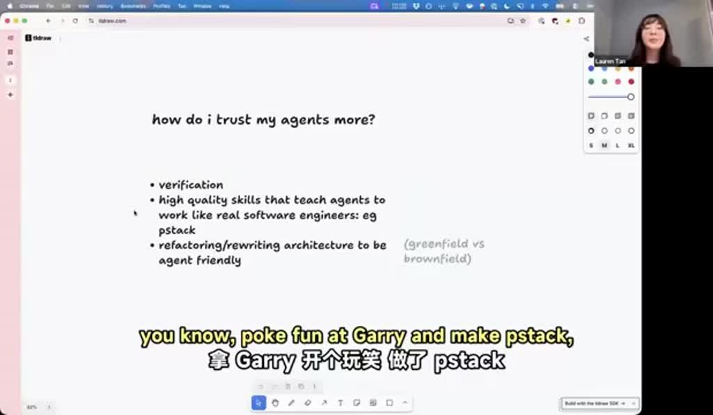

**重點：** PStack 的 P 是 potato（馬鈴薯），調侃 Garry Tan 的 GStack；她從 control glass skill 與 HAL 等 skill 開始，觀察 agent 的失敗模式（信心滿滿卻沒讀該讀的程式碼），每次失敗就做成 skill。她用「新人主管」類比：skill 就是 markdown，編碼資訊與指示，可把 agent 拉到更高品質的「潛在空間」（講者主張）。

**標籤：** #PStack #skill #潛在空間

Cool, yeah I was just gonna ask how you created that. So do you mind sharing a little bit more about that, that process in the context of PStack and maybe just what PStack is for the folks who aren't familiar? Yeah, so PStack is pretty interesting because well, first of all the name is kind of goofy Like the P, the P in PStack is like potato potato stack Because I, so, there is a pretty famous person, Garry Tan, who is the CEO of Y Combinator and he's come up with this plugin called GStack GarryStack, and, funnily enough, we share the last name we have no relation but I thought it would be funny to kind of you know poke fun at Garry and make PStack my version of of, of, of his plugin but kind of just tailor it to my own set of engineering practices but I honestly actually never set out to build PStack it just started with a bunch of skills right? Like, I started with that control glass skill and then I started with another skill like, called HAL, which I also noticed through like, observing agents so, like, you know, in the early days of me you know, trying to climb this ladder I was, like, super in the loop and I was basically nitpicking my agents to an extreme degree I was like, I would tell it you know, this feature has stopped working Here's a bug report Like, why isn't it working? And very often, the agent would just like, confidently state, like, oh, it has to be this right? It has to be this thing And I noticed, like when I looked at the actual tool calls I noticed it wasn't actually reading the code that I thought should be affected and that made me just extremely suspicious And at that point I was just like I'm not gonna, I can't trust any this agent anymore, because it's just it's just completely hallucinating And I think I think it's very easy to just you know, like build up that distrust and not and kind of feel helpless like, you know you don't know how to help your agents succeed But like, again, I think the, the the management analogy is super helpful because like imagine if you were a manager of an engineering team and you had an engineer on your team who was a really good coder no business contacts whatsoever you know, they, they just, you just hired them and they they onboarded, you know, like five seconds ago and so how do you actually teach that person to be effective? So how you do that is through a skill a skill being just you know, it's just marked down right? But, you know, it encodes a lot of information instructions, a lot of you can really draw out a lot of Intelligence from an agent by well, some people on Twitter call it like you know, pull the agent to a different latent space which is kind of like a fancy way of just saying like since, you know, LLMs are sort of like they predict the next token when you give it some high quality tokens to begin with, then, you know, it it can kind of pattern match on like a higher space that's you know, smarter so that's like a very interesting model there But yeah, I built PStack very very incrementally so, started with just really observing how agents you know, all the fail, different failure modes of of that agents were having And every time I saw that I just, okay I'm just going to make that a skill Right, like stop hallucinating, actually go and search up look up the code use a lot of sub-agents and yeah, stop guessing.

**中譯：** （主持人：你可以多分享你怎麼做出來的嗎？順便說說 PStack 是什麼，給不熟的人。）PStack 很有意思：首先，名字有點蠢——PStack 的 P 是 potato（馬鈴薯），Potato Stack。因為有位非常有名的 Garry Tan（Y Combinator 的 CEO）做了個叫 GStack（GarryStack）的外掛，有趣的是我們同姓、沒有親戚關係，我覺得很好笑，就調侃 Garry，做了我版本的 PStack，只是針對我自己的一套工程實務去調整。但老實說我從沒打算做 PStack，它是從一堆 skill 開始的：先有 control glass skill，再有另一個叫 HAL 的 skill，也是從觀察 agent 得來的。在我剛開始爬這座階梯的早期，我高度介入，對我的 agent 挑剔到極點：我會跟它說「這個功能壞了，這是 bug 回報，為什麼不能動？」而 agent 常常信心滿滿地說「一定是這個，一定是這個東西」。我看它實際的工具呼叫，發現它根本沒有讀我認為會受影響的程式碼，我就極度懷疑，覺得「我不能再信任這個 agent，它完全是在產生幻覺」。我覺得很容易就這樣累積不信任，並感到無助，不知道怎麼幫 agent 成功。但管理的類比很有用：想像你是工程團隊的主管，你有個很會寫程式的工程師，卻完全沒有業務脈絡，他才剛到職五秒鐘，你要怎麼教他變得有效？方法是透過 skill。skill 就只是 markdown，但它編碼了很多資訊與指示，你可以從 agent 身上引出很多智慧——有些人在 Twitter 上稱之為「把 agent 拉到不同的潛在空間（latent space）」，這是個花俏說法：LLM 是預測下一個 token，當你一開始給它高品質的 token，它就能對應到一個更高、更聰明的空間。這是個很有意思的模型。我是非常漸進地建起 PStack：從觀察 agent 的各種失敗模式開始，每次看到就說「好，我把它做成一個 skill」，例如「別再產生幻覺，真的去查程式碼、用很多子 agent、不要再猜」。

### 主題 7：如何維護 skill：把 eval 當作 agent 的單元測試（17:26–21:36）

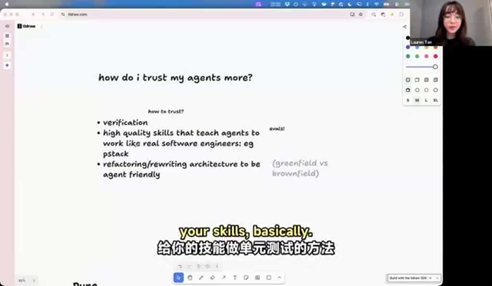

**重點：** 被問到如何維護 skill 與如何知道驗證夠好：她把 eval 當作「agent 的單元測試」，PStack 有 eval playbook：主協調 agent 先訂評分標準、再產生多個子 agent（目錄命名刻意不讓它們知道在被評估，因為 agent 看得出來會改變行為）；可跨多個模型評估；維護 skill 需要品味與觀察，要像配對程式設計的「後座駕駛」（講者主張）。

**標籤：** #eval #子agent #後座駕駛

Yeah, that makes sense. One one kind of follow-up question here both from myself and from a bunch of people in the chat. So I guess it's two two parts. So one is like how do you maintain these skills? So like the product changes over time Obviously there's a lot of people that should be against the code base So how do these skills get maintained? and then second to that is like how do you know when your verification is is good enough? like in, you know you can trust that the verification loops that you've built are gonna I guess you trust that the outputs when, when they're done yeah, maybe I'll talk about I think I have somewhat really maybe I'll start with this one first So like, how do I maintain these skills? So, if you're not familiar with this concept an eval is essentially like a way to well, I think the mental model I have is like it's like a unit test for an agent and, you can actually make your own evals You don't need like a special framework for them You can build, you can you can build one depending on like you know how scientific and how rigorous you want to be my screen is red Yeah, there's a little button sorry. Oh, is mine like disabling the drawing or something? I, I can't see my screen Yeah, sorry. If you guys could not draw on the screen that'd be great, but, there's a little button in the yeah, the, the little drop down Yeah Okay, yeah You got it, perfect Continue Yeah, so evals are a way to unit test your skills basically And actually, in PStack, we ship under Potato Mode, there's a playbook, if you search for it called eval playbook and it's it's like not, it's actually pretty pretty rigorous the way it's done but essentially what I do is I spawn a lot of different sub-agents I have, like, my main coordinator agent come up with a rubric for what I want the skill to do and then it spawns all these sub-agents and it, it creates individual directories for them which are cleverly named to not let the sub-agent know that it's being evaluated because, agents can actually tell and when they do they change their behavior but it does a bunch of stuff like that to essentially, yeah like test whether or not the skill I'm making or changing is actually doing what I think it does and one of the really nice things about Cursor is that we are we, we support so many different models so you can actually eval your skill across all sorts of different models And, you know get a sense of how well it performs across that different matrix especially for the models that you use so I do this a lot Every time I, I modify a skill I will run one of these like the eval playbook and make sure that you know it's actually leading to a result I want but I will say like Maintaining skills is actually pretty hard it requires, I think, a lot of taste and observation So you kind of need to be very good at being a backseat driver You know what I mean? Like, if you do pair if you've ever done pair programming for example, and you watch a coworker code and you just like you, you could probably do this better You know, you could do, you know like, why did you not do this right? You've, you've asked a lot of questions to your coworker and it's kind of a similar thing here You like you don't want to just be a passive observer of the agent you want to be very in the driver's seat in the initial stages when you're building up your own set of skills you know, obviously you can use something like DSAC but if you're building your own set of skills it's very, I think, you know, opening up the all the tool calls and like reading the code and reading all the the agent behavior and their thinking blocks is a really great way to see where they they fail, right? Like what, what You know, where are they being done? And then you can go and build a skill for that.

**中譯：** （主持人提問：兩個部分——你如何維護這些 skill？產品會隨時間改變、很多人在動程式碼庫；第二，你怎麼知道你的驗證「夠好」、可以信任這些驗證迴路的輸出？）我先回答第一個：我怎麼維護這些 skill？如果你不熟這個概念：eval 基本上就是——我的心智模型是——「agent 的單元測試」。你可以自己做 eval，不需要特別的框架，視你想要多科學、多嚴謹而定。所以 eval 就是用來對 skill 做單元測試的方式。事實上，PStack 在 Potato Mode 之下有一份 playbook 叫 eval playbook，做法相當嚴謹：我會產生很多不同的子 agent，由我的主協調 agent 先針對「我想要這個 skill 做到什麼」訂出評分標準（rubric），再產生所有子 agent，並為它們各自建立目錄，名稱經過巧妙設計，不讓子 agent 知道自己正被評估——因為 agent 其實看得出來，一旦看出來就會改變行為。總之就是用來測試我正在製作或修改的 skill 是否真的做到我以為它做到的事。Cursor 一個很好的地方是我們支援很多不同的模型，所以你可以跨各種模型去 eval 你的 skill，並了解它在不同矩陣上的表現，尤其是你常用的模型。我經常這樣做：每次修改 skill 我都會跑一次 eval playbook，確認它真的導向我要的結果。但我要說，維護 skill 其實相當困難，需要很多品味和觀察力：你得很擅長當「後座駕駛」。就像你做過配對程式設計，看同事寫程式時覺得「你大概可以做得更好，為什麼不這樣做？」你會問同事很多問題；這裡也類似——你不想只是被動的旁觀者，在剛開始建立自己那套 skill 時，你要完全坐在駕駛座上。你當然可以用現成的東西，但如果你要建立自己的 skill，打開所有工具呼叫、讀程式碼、讀 agent 的行為與思考區塊，是看出它們在哪裡失敗的好方法，然後你就可以為此做一個 skill。

### 主題 8：用評審 agent 與 hill climbing 迭代驗證 skill（21:36–23:50）

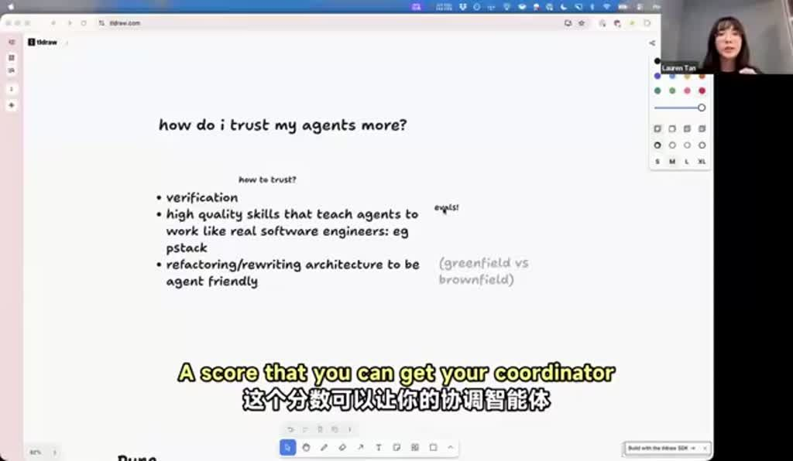

**重點：** 驗證 skill 的方法也是迭代：eval 可產生分數，用另一個模型當評審 agent 交叉比對避免偏頗，並用 Cursor 的 slash loop 持續爬山直到滿分；她就是這樣放手做出 control skill 及其 CLI，但一開始並不順。她的比喻：工程師現在像餐廳主廚，要設計廚房環境、分配任務（講者主張）。

**標籤：** #hill climb #評審agent #主廚

And then with verification how you trust it is it's, I think it's also a very similar iteration loop where, you know like I actually did the same process for verifying the verification skill where I actually get So one thing that's interesting about evals is that you can sort of hill climb them meaning that, your eval can produce a score right? a score that you can get your coordinator to produce but also you can have a judge agent of a different model to kind of cross-reference and make sure that the first model is not being biased right? The model that's judging all of the sub-agents that are running the thing but you can also like hill climb so meaning that you can you can use like slash loop in cursor and you can say okay, keep looping on this eval right, until everything is 10 out of 10 as an example and I did the same the basically the same approach with the control skill and so I kind of it was very, it was very hands-off actually so, you know, I, I kind of built I built that skill that way like the CLI in that skill and over time, it's gotten really good but yeah, it was definitely not super smooth Beginning and required a lot of iteration And I think there's an analogy here for me which is, well I make this analogy later in a different slide on my drawing here but I think of it like you know, as a, as a engineer now you're sort of more like like maybe a manager or the analogy I like is like you're like a a chef in a restaurant you know, you're the head chef you're not cooking all the food yourself anymore You have a team of cooks right? You have line cooks you have a sous chef you have, you know, all these different stations and it's your job to really design the environment You know, you, you you're in charge of setting up the kitchen You're in charge of you know, like giving tasks to different people So yeah, it's a very interesting way of working but yeah, that's, that's how I basically built these verification skills.

**中譯：** 至於驗證，怎麼信任它，我覺得也是類似的迭代迴路：我其實也用同樣的流程去驗證「驗證 skill」。eval 有個有趣的地方是你可以「爬山」（hill climb）：你的 eval 可以產生一個分數，你可以讓協調者產生分數，也可以讓另一個模型的「評審 agent」交叉比對，確認第一個模型沒有偏頗（也就是評判所有執行任務的子 agent 的那個模型）。你也可以爬山：用 Cursor 的 slash loop，說「繼續對這個 eval 跑迴圈，直到全部都是 10 分（滿分）」之類。我對 control skill 用的基本上就是同一種方法，所以其實相當「放手」，我就是這樣做出那個 skill（含其中的 CLI），隨時間它變得非常好；但一開始絕對不順，需要很多迭代。這裡有個類比——我之後在另一張投影片上也會畫——身為工程師，你現在比較像是主管，或我喜歡的比喻：你像是餐廳的主廚。你不再自己烹調所有食物，你有一組廚師——有線廚（line cook）、有副主廚、有各種工作站——而你的工作是設計環境：你負責佈置廚房、負責把任務分給不同的人。這是很有意思的工作方式，我基本上就是這樣做出這些驗證 skill 的。

### 主題 9：從本機驗證走到雲端 agent：Benny 的例子（23:50–27:32）

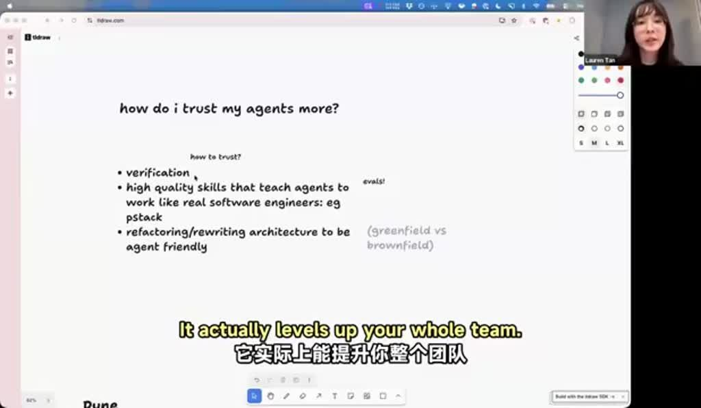

**重點：** 建議從本機開始，才看得到 agent 如何與應用互動；她自己則幾乎全押雲端 agent：設定好環境後，驗證 skill 讓整個團隊受益。例如 Benny agent 自動接 bug 回報、在雲端開桌機跑 Cursor 重現 bug，結果常能直接確認「已修好」；但要先建立信任，不要直接叫出成百上千個雲端 agent，否則浪費 token（講者主張）。

**標籤：** #雲端agent #Benny #本機

Yeah, just, just one follow up there on like try to go one layer deeper So are you, let's say we wanted to build an eval or a skill for for something and we wanted to kind of get better on its own which is, is what I think you're suggesting are you doing that in like a work tree kind of isolated with like the sub-agents and and then the reviewer agents and and all that? Is it happening like in some type of cloud-hosted environment? Like what's the, the more, the practical steps? If I wanted to go do this and like set up a verification system for something what would I do or where would I start? I think that, the best place to start is local because you can observe You can definitely observe what your agents are doing So, if you're building a verification skill for yourself I would definitely start local and just have your agent bring up the application whether it's like a CLI or a desktop app or whatever And so you can actually observe right? You can see how the agent is interacting with the the application You can see it you know, how it calls like the different APIs that that allow it to interact with the the application but, for me personally I have basically been kind of all in mostly all in on cloud agents because they're extremely powerful and the really powerful thing about Cursor is the the cloud agents actually where if you spend a little bit of time setting up your environment These control skills these verification skills pay a huge amount of dividends because it's not just something that makes you as a single engineer better it actually levels up your whole team and even your whole company because you can actually start thinking about cloud agents you can start thinking about automations that automatically do things like I'll, I get, I I kind of talk about this a bit later but I'll just kind of Get into it where, where, you know, for example, like I talk a lot about this agent we have called Benny right, who, who, you know takes all of the bug reports that we get and it automatically goes off in the cloud opens up a cloud its, you know, its desktop It runs Cursor in its own computer and it uses the same control skills to interact with the application and try to reproduce the bug or the user report right? And this is so so powerful because at once I can immediately I get so much information from this automatically Like here in this example you can see that the Benny actually reproduced the bug but it's already fixed on me So it actually confirms that we fixed this problem already and all I need to do is just release another build of of Cursor so that's like huge information there that I didn't have to go off and sit with an agent you know, and spend an hour trying to figure like, is this fixed? Is this not fixed? So you You gain back so much time but, you know everybody on my team benefits from this Everybody in the company benefits from this So definitely think that you know, keeping these using cloud agents is super powerful But yeah, it's like a journey You have to trust it first right, before you get to this point And that's, it goes back to what I was saying here where, you know, it's very hard, it's almost impossible and I would definitely encourage you not to try to jump from you know, like, if you're still in this zone you don't want to jump to like I'm going to spawn a hundred or thousands of cloud agents right now because you're just going to waste a lot of tokens and it's going to be extremely expensive.

**中譯：** （主持人追問：假設我們想替某件事建立 eval 或 skill、並讓它自己變好——你是在 work tree 裡隔離、搭配子 agent 與審查 agent 嗎？還是在雲端託管環境？如果我想做，實際的步驟是什麼、從哪開始？）我覺得最好的起點是本機，因為你可以觀察你的 agent 在做什麼。如果你在為自己建立驗證 skill，我一定從本機開始，叫 agent 把應用程式（CLI、桌面應用或其他）啟動起來，這樣你可以看到它怎麼和應用互動、呼叫哪些 API。但就我個人而言，我基本上幾乎全押在雲端 agent（cloud agents），因為它們非常強大。Cursor 厲害的地方是：只要花一點時間設定好環境，這些控制 skill、驗證 skill 就會帶來巨大的回報，因為它不只讓你一個工程師更強，而是整個團隊、甚至整間公司都被拉高：你可以開始思考雲端 agent 和自動化流程。我稍後會再談，但先舉例：我常提到我們有個叫 Benny 的 agent，它會接收所有 bug 回報，自動到雲端開一台桌機、在自己的電腦上跑 Cursor，並用同樣的控制 skill 與應用互動、試著重現 bug 或使用者回報。這非常強大，因為我能立刻自動得到大量資訊：像這個例子，Benny 重現了 bug，但發現其實我們早就修好了，這確認這個問題已經修掉，我只要再發一個 Cursor 版本。這省下我花一小時和 agent 一起確認「到底修好沒」的時間，而且我團隊每個人、公司每個人都受益。所以我確實認為使用雲端 agent 非常強大。但這是一段旅程：你要先能信任它，才走得到這裡。這回到我這張圖：如果你還在這個區域，我非常鼓勵你不要直接跳到「我要現在叫出一百或上千個雲端 agent」，因為你只會浪費很多 token、而且極其昂貴。

### 主題 10：主持人回顧：從驗證到自動合併的旅程（27:32–29:56）

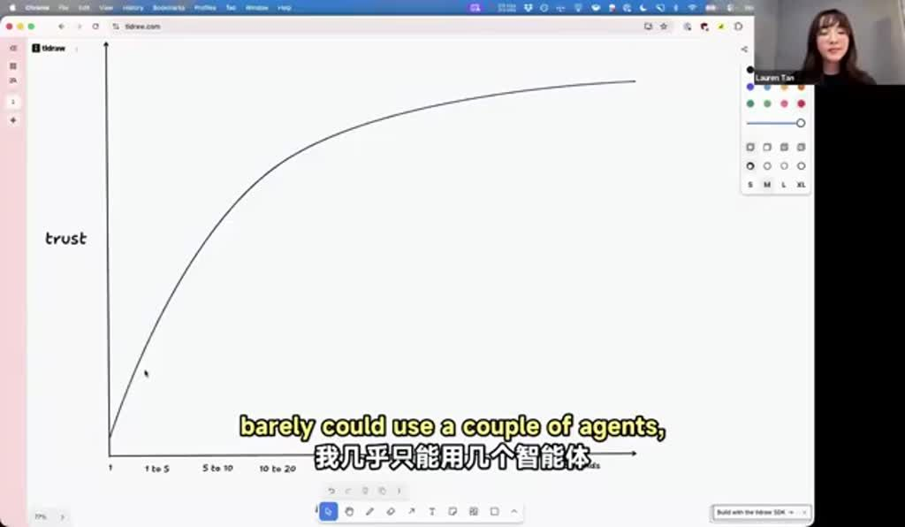

**重點：** 主持人整理路徑：先做驗證與 skill 確保 agent 產出正確程式碼；本機信任後擴展到雲端、讓 agent 自己撿 bug 回報等訊號；最後才是自動合併。Lauren 補充這條路沒有捷徑，取決於個人對 agent 的信任；PStack 等外掛可加速但不建議盲信，鼓勵 fork 成自己的版本，把各自的工程標準編碼成 skill（講者主張）。

**標籤：** #回顧 #沒有捷徑 #fork

Yeah, so just to kind of recap so far basically the if we wanted to go on the journey that you've kind of gone on it would be just start with verification building some skills and some ways of determining that the agents are producing at least like, correct code, whether, like you said whether it's good code or Not as serious of a question but like it's, it's technically solving the problem by looking at you know, stack traces, looking at, you know the actual behavior in the app and so on and then once we trust it locally then we can start to think about scaling into the cloud and running more agents that are picking up signals I guess, on their own, right? So whether that's like a bug report that comes in or something they can go and pick it up and solve the problem and and give us backup PR And then maybe the last step is like auto merging the PRs which is where you're at and maybe not where I want to go and then interviewing them on main but, is that, is that about right? Yeah, exactly. I think, yeah, that's why I do this this, this, this curve, right? Because that, this, this basically describes my journey of you know, when I started, barely could use a couple agents and I was just observing every single thing I think there's really no shortcut for going from here to there because this is really about your personal level of trust in agents right? obviously, you know, as a, as an engineer you don't want to just slot code into production So how do you actually build up that trust takes a lot of, I guess, taste and judgment but, you know, like I think plugins like PStack definitely can help you get up to speed much quicker and so, I guess it's like if you trust me and you trust PStack then in, by extension you can maybe trust your agents But if you don't trust me and I I definitely would not encourage people to blindly trust me you know if you build up your own set of skills that you can obviously you know take a look at PStack and kind of fork it make it your own improve the skills, definitely encourage that but for me, it's really all about it, it, it just keeps coming back to trust You know every one of us here in this chat have a different standard for engineering and there are different things that are important for us in our code base And when you are able to encode all of that into skills and you can verify that your agent is actually doing them that allows you to really kind of ascend this curve And you know, start automating things.

**中譯：** （主持人整理：如果我們要走你走過的路，就是從「驗證」開始，做一些 skill 與方法，至少確認 agent 產出的是「正確」的程式碼（好不好是另一個層次的問題）——看 stack trace、看 app 的實際行為；本機信任之後，再思考擴展到雲端、讓更多 agent 自己撿訊號（例如進來的 bug 回報）去解決並回傳 PR；最後一步或許是自動合併 PR——那是你所在的位置，也許不是我想去的地方——然後在 main 上審查它們；這樣對嗎？）對，沒錯，這就是我畫這條曲線的原因：它描述我的歷程——一開始我幾乎只能用幾個 agent、盯著每一件事。我覺得從這裡到那裡沒有捷徑，因為這是你個人對 agent 的信任程度。身為工程師，你當然不想把程式碼直接塞進正式環境，所以如何建立信任需要很多品味與判斷；不過像 PStack 這樣的外掛確實能幫你更快上手。如果你信任我、也信任 PStack，那你或許能因此信任你的 agent；但如果你不信任我——我也完全不鼓勵大家盲目信任我——你可以建立你自己那套 skill，看看 PStack、fork 它、做成自己的、改進這些 skill，我非常鼓勵這樣做。但對我來說，一切都回到「信任」：我們每個人對工程都有不同標準，不同的事在我們的程式碼庫中很重要；當你能把這些全部編碼成 skill、並驗證 agent 真的在照做，你就能爬上這條曲線、開始自動化。

### 主題 11：重構與重寫：既有 vs 全新應用，護欄先行（29:56–36:05）

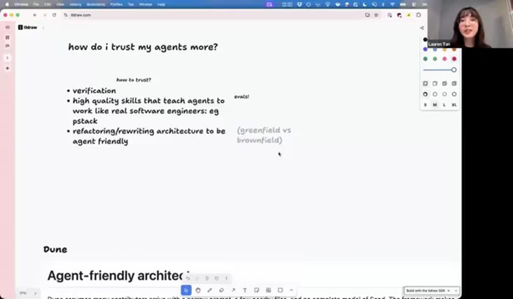

**重點：** 她主張在 agent 時代值得重新考慮重寫：Brownfield 應用若護欄完善，agent 本來就做得不錯；Greenfield／vibe code 的原型（如 Grokbot 初版）完全沒有護欄，agent 會用最方便的方式解題、久而久之失控。她為此用 600+ 個 PR 把 Grokbot 重構成新架構，如今「不再看程式碼」，並讓 PM、設計師、GTM 都能加功能（講者主張，未查證）。

**標籤：** #重寫 #護欄 #vibe coding #新架構

there's another piece I wanted to talk about if there's... Yeah, go for it I'll think of more questions as I go but yeah. I think there's a third part to this which I haven't talked about yet which is kind of an interesting one which is like refactoring and rewriting Like one of the I guess most controversial one of the most controversial topics in the industry I think, is like should you rewrite your app or not? because I think engineers are very prone to this where especially when you join a company you come in and you see like the code base and you're like oh man, this is shit Like who wrote this code? You know it's terrible. I want to rewrite the whole thing There is a very common inclination and I think a lot of you know, before agents, and I guess arguably even now people will definitely discourage you from rewriting stuff But I'm actually here to make a case for why you might want to consider it because I think it really depends you know, Brownfield applications, I think are actually in a pretty good spot especially if they're set up well already and like recently I've been talking to some people but, you know, I was just observing I just noticed this parallel which is that a lot of big tech company problems are now everybody's problems and the big tech company problem you know, like when I was working at Meta like we had this giant monorepo we had like, I don't know tens of thousands of engineers just you know, like banging on their keyboards and and shipping code And a lot of really great engineers at Meta but, I'll say like, you know you'll be surprised that the code quality is actually not that good and so I often joke that like you know, before AI slop, we had human slop and so, you know I think a lot of big tech infra like, like what Meta has or Google you know, you know really big tech companies are actually designed for that where you're, you're sort of like you're catering to the the, you know, like, that sounds so bad to say but like the, the least capable engineer on your team right? You build, you build frameworks, you build conventions, you build guardrails you know, you restrict credentials so that you know, your intern doesn't wipe your production database There's, you know, if you have that level of infra already I think your agents can actually already do a very solid job right? Because they have the guardrails are already in place for agents to not cause havoc or not cause too much havoc in your codebase and you can always add more you know, guardrails but I think like Greenfield applications especially are, you know like the brand new applications are like the biggest risk in my opinion, and also the greatest opportunity Because, you know, if you vibe code a project a prototype, like we did for Grokbot you know, Grokbot was spun up very very, very quickly and if you, if you haven't heard of of Grokbot, it's like a a new application we just launched yesterday it's, it's really cool lets you orchestrate your create like individual agents that have their own identity and you can kind of orchestrate them It's super cool, definitely check it out but yeah, that was, it's like a very it was a very Field application like most prototypes are So it was like vibe coded very quickly Humans were not reading the code at all And, I had this tweet recently where I said something about organic architecture maybe I'll find it but the idea is that when you have a completely vibe coded application you essentially have no guardrails whatsoever So, your agents When you give them a task they will just solve it in whatever method is the most convenient And over time, you get into this situation where you have a code base that is spiraling out of control because you don't understand it your agents understand it I guess, in a way, but, like they've built something that is you know, optimized for short, for shortcuts and, you know, it will, you will suffer, you have a lot of of issues with that application so I think starting your code base with like, very strong constraints is very much needed because, like when you have a code base that you can trust right, when you have guardrails that actually help you help your agents, right? Good code You can get into the you know, like into this part of the curve where I I, where I, like I, I said, you know I woke up today and I had like 20 PRs merged by my agents And that's because I invested a lot a lot, a lot of time over 600 PRs. I I, I calculated yesterday when I refactored all of Grokbot to this new architecture that I've been building and yeah, I've, I've gotten to a point where I I don't really look I really don't look at the code anymore And, I say that not just you know, to sell you tokens but because it, I, you know, it, it it took a lot of work to get to that point. I spent a lot of tokens to get the code base to this point where I no longer have to look at it but I'm very excited because You know the potential where you know, it's not just it just doesn't just benefit me It benefits everyone contributing to Grokbot and it also empowers you know, designers and product managers and you know, people even GTM people to add features to Grokbot And I don't have to worry you know, I don't have to to wake up at night in in the middle of the night and worry like oh shit, someone's just merged a perf regression right? I have a ton of constraints and CI It's like, it's actually very annoying to write code in in Grokbot but like agents absorb all of that annoyance but yeah I'm happy to talk about what exactly that is.

**中譯：** 還有一個部分我想談——（主持人：請說，我邊聽邊想更多問題。）這是第三個部分，我還沒談到，也相當有趣：重構與重寫。這是業界最具爭議的話題之一：你該不該重寫你的應用？工程師很容易這樣想，尤其剛進一家公司，看到程式碼庫就說「天啊這什麼爛東西，誰寫的？太糟了，我想整個重寫」。這是很常見的傾向；在有 agent 之前——甚至可以說現在——大家也都會勸你不要重寫。但我今天想為「你或許該考慮重寫」提出論點，因為這真的視情況而定。Brownfield（既有）應用其實處境不錯，尤其是已經設定得好的。最近我跟一些人聊到，我觀察到一個類比：很多大型科技公司的問題，現在成了每個人的問題。大型科技公司的問題，例如我在 Meta 時，我們有個巨大的 monorepo、幾萬名工程師在敲鍵盤、交付程式碼；Meta 有很多很棒的工程師，但你可能會驚訝程式碼品質其實沒那麼好。我常開玩笑說：在 AI slop（粗製濫造）之前，我們有人類 slop。所以像 Meta、Google 這類大型科技公司的基礎建設，其實就是為此而設計的：你是在遷就團隊中「能力最弱的工程師」（這樣說很糟），所以你建立框架、慣例、護欄，並限制憑證，避免實習生把正式資料庫清掉。如果你已經有這種等級的基礎建設，我認為你的 agent 其實已經能做得很穩，因為護欄已經就位，讓 agent 不至於（或至少不致太）在你的程式碼庫裡造成混亂，你也隨時可以再加護欄。但我認為 Greenfield（全新）應用尤其是最大的風險，也是最大的機會。如果你 vibe code 一個專案或原型——像我們做 Grokbot 那樣——Grokbot 被非常、非常快地做出來。如果你沒聽過 Grokbot，它是我們昨天剛推出的新應用，很酷：讓你建立各自擁有身份的 agent，並進行協調，很棒，大家可以去看看。但它就像多數原型一樣是個 Greenfield 應用，被 vibe code 得很快，人類完全沒讀程式碼。我最近有一則推文談到「有機架構」（organic architecture）：當你有一個完全 vibe code 的應用，基本上完全沒有護欄，你的 agent 拿到任務就用最方便的方式解決；久而久之你會得到一個因為你不理解而失控的程式碼庫——agent 或許某種程度上理解它，但它們建出來的東西是為捷徑而最佳化，你會在那個應用上遇到很多問題。所以我認為程式碼庫一開始就需要非常強的約束：當你有一個可信任、護欄真的能幫助 agent 寫出好程式碼的程式碼庫，你就能走到曲線的這一段——就像我說的，我今天醒來有大約 20 個 PR 被我的 agent 合併。那是因為我投入了非常多時間：我昨天算過，超過 600 個 PR，是我把整個 Grokbot 重構成我一直在建的新架構。我已經到了「真的不再看程式碼」的地步。我這樣說不只是為了賣你們 token，而是因為要走到這一步花了很多功夫，我也花了很多 token 才讓程式碼庫變成我不必再看它。但我很興奮，因為它不只讓我受益，它讓所有為 Grokbot 貢獻的人都受益，也讓設計師、產品經理甚至 GTM 的人能替 Grokbot 加功能；我也不用半夜醒來擔心「糟了，有人剛合併了一個效能退化」，因為我在 CI 裡有大量約束。在 Grokbot 寫程式其實很煩人，但 agent 會吸收所有這些煩人之處。我很樂意談那具體是什麼。

### 主題 12：PR 大小與 CI：Dune 架構的硬性規則（36:05–42:42）

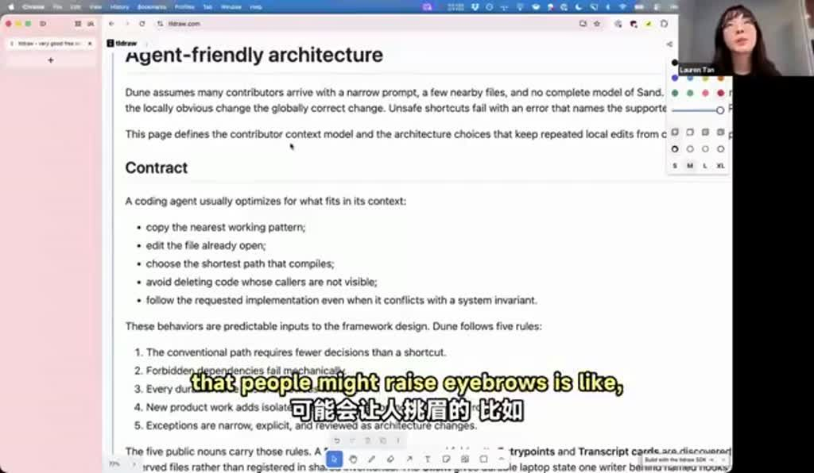

**重點：** PR 大小沒有硬上限，從幾十行到上千行，但鼓勵 agent 拆成原子性 PR，讓 Git 歷史成為脈絡並方便回復。CI 很嚴：Dune 是給 Electron 應用用的「Next.js」，禁用 useEffect、禁止程式碼註解（agent 常寫無關的歷史註解）、用 import CI 檢查 main 與 renderer 目錄的相依，避免卡頓；由 CI、BugBot 等強制（講者所述）。

**標籤：** #Dune #CI #禁用useEffect #BugBot

Yeah, I think one question Before we get into the this part here is just around that element of like what your your, your CI looks like or maybe some of the constraints and then also like the average PR size I saw a question about that earlier Just to give people a you know, kind of a glance It doesn't have to be like mathematically average but just, you know, like what generally the size of the of PR is if it's only a couple lines of code or you know, yeah I think it depends Maybe I'm trying to do this in a way where I'm not gonna like Yeah, you don't have to share the actual number like the actual average I think this is fine But like we have so okay, this is not that interesting but well fun fact is that virtualization in Grokbot and in Cursor is actually powered by pretext which is a sort of new library that someone's built That's really interesting You should check it out But that's not really that important I think the average PR size I actually don't know I don't know if I want to click on these I probably can but I would say like they can range anywhere from a few hundred lines or 50 lines to like a thousand depending on what the thing is doing So like here, I'm actually like deleting a bunch of files so I expect that it's just like mostly deletion But yeah, it kind of varies There's no like, yeah There are like 50 line PRs There's no hard cap definitely no hard cap but I do encourage my agents to split up their work into multiple PRs I do that mostly because I like I like the idea of the I guess maybe this is much harder to do now as in the world of agents and you have like so many commits But I like the idea that you know the Git history is a very rich source of context And I like the I like each PR to sort of atomically describe what that small piece of thing is doing which also makes it easier for me to revert changes and like figure out you know, oh, I shipped a bug and it's this it's here. It's not in this 40,000 line PR where who knows what landed in there But I don't have a hard cap on PR size Cool. And then, yeah also quick question on like CI So again, you don't have to go into like the screen share like your your CI does, but just generally would you describe what the CI kind of looks like or how strict it is? yeah. So, well, specifically for Grokbot, so Dune is the is the sort of cheeky code code name for the architecture that we've built for Grokbot the CI looks pretty annoying because there's checks for everything So, like literally I have well, if you've written any React for example, you know you know that one of the biggest foot guns in React is useEffect so in Dune, and in Grokbot we've banned useEffect So Dune is just an you can, the, the mental model of what Dune is you can kind of think of it as like Next.js for Electron apps, and it's designed for agents to write and it's like custom for you know, our agent powered applications so the CI checks are very like specific to that like, you know, don't use useEffect It's, it's, it's banned, like CI will fail and yell at you We have, like some of the more interesting ones that people might raise eyebrows is like I actually ban code comments as well which is very interesting but I've noticed that 99% of the time agents just write code comments that kind of describe some historical thing that is actually totally irrelevant to the code like it will often say like you know, oh, Lauren said you should never do this and it's now in in a code comment. I'm like what? Like, why? That, that was I didn't say that as like a durable You know global rule. I just met like your this PR sucks and you should change that part Agents don't really understand this that well surprisingly and or they kind of assume too much and they kind of do things in like very stupid ways So like, yeah, we just ban everything Everything you can imagine like the agents are bad at we ban so one example that we actually suffer a lot in the agents window is we have you know, if you've used agents window you've definitely seen performance issues and you know, we're constantly trying to fix them but it's like a It's a never-ending struggle because there's so many pull requests that get merged Any one of them could just regress performance or stability or reliability you know the agents window doesn't have this architecture yet I plan to do bring this learning back there and kind of refactor everything there but, it just regresses super often because, there's, just one example is like we have very poor isolation between processes So like on, you know, on, on Electron you have a renderer thread that renders your UI but you also have like a main thread that you can run other code that you know, doesn't need to block the renderer but we do a poor job of separating those things and so oftentimes you just accidentally have code that gets pulled into running on the renderer thread and then all of a sudden you're competing with the the renderer that, you know, that has a very if you want like 60 FPS you have to every frame that gets drawn has to be done in 16 milliseconds So very, very small, you know, deadline per frame if you want, you know a very smooth product and when you start building bringing in, accidentally bringing in, you know things that are like very computationally heavy or they have a lot of IO then you just get into like a lot of jank And your, your FPS really drops you start, you know, losing frames you get long tasks that take more than 16 milliseconds and then you just get this really choppy experience So all of those patterns that we've learned basically building electron apps we've encoded into this framework and it becomes like a hard failure So I literally, in, in Grokbot we literally have a directory called electron main electron renderer, and we have, import CI, I guess where we actually check the dependency graph to make sure they're not accidentally importing code from one directory to another.

**中譯：** （主持人提問：在進入下一部分前，想了解你的 CI 長什麼樣、有哪些約束，以及平均 PR 大小——不必精確，只是給大家一個概念。）這要看情況。有個小趣事：Grokbot 和 Cursor 的虛擬化（virtualization）其實是由 pretext 這個新函式庫驅動，很有意思，大家可以看看。至於平均 PR 大小我其實不知道，大概從幾十行到幾百行、甚至一千行不等，看那件事在做什麼；像這個我是在刪一堆檔案，所以主要是刪除。沒有硬性上限，確實沒有。但我鼓勵我的 agent 把工作拆成多個 PR：我喜歡 Git 歷史是非常豐富的脈絡來源，也喜歡每個 PR 原子性地描述一小件事，這讓我更容易回復變更、找出「我送出了 bug、就在這裡」，而不是在 4 萬行的 PR 裡不知道到底合進了什麼。（主持人：也請簡單描述 CI 長什麼樣、多嚴格。）具體在 Grokbot 上：Dune 是我們替 Grokbot 建的架構的有點俏皮的代號。CI 看起來非常惱人，因為每件事都有檢查。如果你寫過 React，你知道最大的陷阱之一是 useEffect，所以在 Dune 與 Grokbot 我們把 useEffect 禁用了。你可以把 Dune 想成「給 Electron 應用的 Next.js」，是為 agent 寫程式而設計的，也針對我們這些由 agent 驅動的應用客製。所以 CI 的檢查非常具體：像「不准用 useEffect」，被禁用、CI 會失敗並罵你。有些比較有趣、可能讓人挑眉的規則是：我也禁止寫程式碼註解。我發現 99% 的時候，agent 寫的程式碼註解是在描述某些與程式碼完全無關的歷史，例如「Lauren 說你永遠不該做這個」就寫進註解，我心想「什麼？」——我那句話不是什麼持久的全域規則，只是在說「這個 PR 很糟，你該改那一段」。令人意外的是 agent 不太懂這點，或是假設太多、用很蠢的方式做事。所以我們就把所有 agent 做不好的事全禁掉。一個我們在 agent 視窗很常遇到的例子是效能問題：用過 agent 視窗的人一定遇過效能問題，我們一直在修，但這是永無止境的掙扎，因為合併的 PR 太多，任何一個都可能讓效能、穩定性或可靠性退化。agent 視窗還沒有這個架構，我打算把這些心得帶回去、把那邊整個重構，但它退化得非常頻繁。舉個例子：我們的行程之間隔離做得很差。在 Electron 裡你有負責渲染 UI 的 renderer 執行緒，也有可執行其他程式、不必阻塞 renderer 的 main 執行緒，但我們沒把這兩者分好，所以常有程式碼不小心被拉到 renderer 執行緒上跑，突然間就和 renderer 搶資源：若要 60 FPS，每一幀要在 16 毫秒內完成，期限非常短；一旦不小心帶進運算量大或大量 IO 的東西，就會非常卡、FPS 掉下來、掉幀，出現超過 16 毫秒的長任務，體驗就變得斷斷續續。所以我們把做 Electron 應用學到的所有模式編碼進這個框架，變成「硬性失敗」：在 Grokbot 我們真的有個 electron main 目錄、electron renderer 目錄，以及 import CI——會檢查相依圖，確保沒有不小心從一個目錄匯入另一個目錄的程式碼。

### 主題 13：多層約束：硬強制優先，軟規則輔助（42:42–48:25）

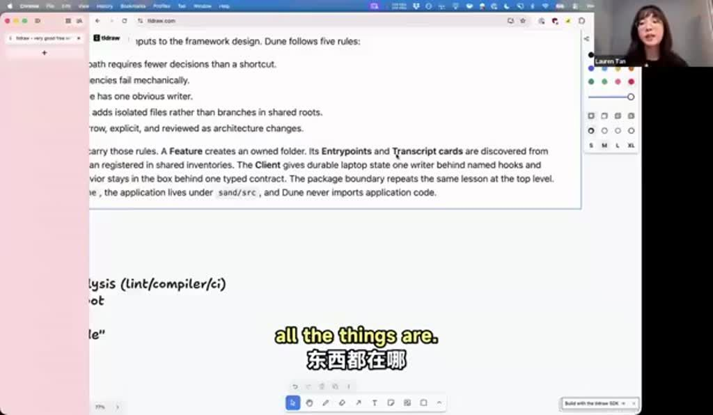

**重點：** 好程式碼庫有多層：最強是架構與慣例（agent 愛複製既有模式，feature 共置在單一目錄、「最短路徑就是最好路徑」）；其次是靜態分析、CI、lint、編譯器診斷（硬性，讓 CI 變紅）；最後才是 BugBot 規則與 skill（軟性、agent 可能忘記）。技術堆疊也重要（如 Rust 的嚴格編譯器）；若要靠人在審查時反覆糾正，就該把它變成 lint 或 CI 規則（講者主張）。

**標籤：** #分層約束 #靜態分析 #Rust #code smell

so that's enforced by CI as well as BugBot which is our, which cursors like code review tool that runs on CI you know, in our agents MD it's everywhere. Like, so I, I, I I, I have this thing here where I I talk about like you know, like there are multiple layers I think, for building a good code base obviously the code base is one where if you have an architecture like this where it's extremely strict you know, the, the the way to build features is very conventional That's like the strongest strongest level of enforcement because agents just love to copy existing patterns So one example of this in Grokbot is like we have this these concepts called like a feature and we have entry points and trans Cards, like all, you know the cards that you see in the chat these are all like like nouns, I guess, in, in the framework And so there's a very conventional way of creating them And so like a feature is all in in a single directory as an example And so all of the code that contributes to that feature lives in one directory So it's all co-located in one place Makes it super easy you know, agents don't have to like wrap around and try to figure out like where all the things are It just looks at the feature and like oh, okay I'm working on the onboarding feature in Grokbot I'm just going to work in this directory And for 80% of the work it's mostly just very encapsulated there But, like, it's like very, it's like design again for you know, like the dumbest agent like you don't have to think right? The, the, the one of the key principles I have for this framework is like the shortest the shortest path is the best path So because that plays exactly to how agents love to write code that they like to take shortcuts really You know, they'll find the quickest way to solve the problem so why not make that the best way to solve the problem? so, I, I I probably won't get into all the specific details and, the this framework's really more of a collection of ideas and principles rather than something that will open source you can, you can, you know, screenshot this, I guess, if you want, and tell your agent to do some, build, build something like this for you too yeah, but it's really all about the layers you know, like, the the code base is one part with features and directories and, you know, import, blocking import dependencies, that shouldn't be imported but, and, and it all enforces that and static analysis So, like, there's CI checks we have a lot of lint for bad patterns that we Serve compiler diagnostics there's also rules in BugBot which are, I think like three four, five are more soft right? These two actually make make CI red, right? So that, you know there's a hard constraint where the agent can't just write crappy code For rules and skills in BugBot Your agents can still forget right? You can still or it may not always consistently apply them So I like to layer them but I don't I don't like to rely on them as the only source of enforcement because it's very very soft, right? And if you if you only have rules and BugBot and skills and a style guide for your code you will it's only a matter of time before your code base looks like complete trash sorry to say that but, I definitely recommend, yeah, like, you know, investing in, you know, things that can be hard enforced right? And this is why you know, maybe the choice of tech stack that you use is also very important Like, I think, for example, Rust is sort of making you know, it's like getting super popular again because the compiler is so strict right? The compiler enforces so many different things you know, there's a borrow checker that you have to appease and as long as you make sure your agents don't write unsafe code blocks you can more or less feel somewhat confident that if the code compiles it probably works and it's good but you'll see it gives you that level of trust and confidence that you as a human engineer no longer need to go and check it yourself You, you know you rely on code and static analysis to actually make that a lot smoother and I, I guess the worst part the worst place to be in is if you are stuck in code review land where you actually enforce all of the constraints the invariants in your code base by literally the human person saying you know, reading the code and like okay, you should Do this right? Every time you have to do that you should consider that as a code smell like a, a, a anti-pattern, and you should say okay, instead of me commenting on the PR how do I turn this into a hard rule right? How do I turn this into a lint rule? How do I turn this into a CI failure? Or how do I even categorically eliminate this problem entirely? I, I can talk about another migration I've done but I'll probably pause here Sure Yeah, I feel like that's that's where I am to be honest, is, is what you're describing right now which is that, like, I don't have all of these rules so I have some things to go do after this session in terms of being able to scale my agents I'm, I'm definitely on, like, the you know, maybe a couple of parallel ones locally stage, like two to three locally and I'm sure most people here are on the same So, yeah.

**中譯：** 這由 CI 強制執行，也由 BugBot（Cursor 的程式碼審查工具，跑在 CI 上）、agents.md 等等強制，無所不在。我有一段談到：打造好程式碼庫有多個層次。最強的強制層是程式碼庫本身——若架構極度嚴格，開發功能的方式就非常「慣例化」，因為 agent 就是愛複製現有模式。例如在 Grokbot 我們有「feature（功能）」這個概念，還有 entry points、聊天裡看到的各種卡片，這些都像是框架裡的「名詞」，而建立它們有非常慣例的方式；一個 feature 的所有程式碼都在單一目錄，所有東西共置（co-locate）一處，讓 agent 不必繞來繞去找東西，只要看那個 feature：「好，我在做 Grokbot 的 onboarding 功能，我就在這個目錄工作」。80% 的工作基本上都被封裝在那裡。它是為「最笨的 agent」而設計，你不必思考。這個框架有個關鍵原則：「最短的路徑就是最好的路徑」，因為這正好契合 agent 愛寫程式的方式——它們愛走捷徑、找最快的方式解決問題，那為何不讓它成為最好的解法呢？我大概不會講所有細節，這個框架更像是一組想法與原則的集合，而不是會開源的東西；你可以把這張截圖下來、叫你的 agent 也替你做出類似的東西。重點是「層次」：程式碼庫一層，包含 feature、目錄、封鎖不該被匯入的相依；全部靠靜態分析強制執行，所以有 CI 檢查、很多針對壞模式的 lint、編譯器診斷，也有 BugBot 的規則——那些比較「軟」。前面這些會讓 CI 變紅，所以是硬性約束，agent 不能寫爛程式碼。至於 BugBot 的規則與 skill，你的 agent 仍然可能忘記、不一定每次都套用，所以我喜歡分層，但不會把它們當成唯一的強制來源，因為它很「軟」。如果你只有規則、BugBot、skill 和程式碼風格指南，不用多久，你的程式碼庫就會變成一團垃圾（抱歉這樣說）。我強烈建議投資在「可以硬性強制」的東西上。這也是為什麼你選用的技術堆疊也很重要。例如 Rust 又開始非常流行，因為編譯器非常嚴格，會強制很多事、有借用檢查器（borrow checker）要伺候；只要確保你的 agent 不寫 unsafe 區塊，你就能或多或少有信心「能編譯就大概能用、也不錯」，這給你一種信任與信心，讓你作為人類工程師不再需要親自去檢查，你依賴程式碼與靜態分析讓一切順暢很多。最糟的處境，是卡在「程式碼審查地獄」：你靠真人讀程式碼、說「你應該這樣做」來強制維持程式碼庫的各種不變量。每次你需要這樣做，都該視為一種 code smell（反模式），並問自己：與其在 PR 上留言，我怎麼把它變成硬規則？怎麼變成 lint 規則？怎麼變成 CI 失敗？甚至怎麼從根本上整個消除這個問題？我還可以談另一個我做過的遷移，不過我先暫停。（主持人：我覺得我正是你描述的這種狀況——我沒有這些規則，所以這場之後有事要做：我現在大概是本機兩三個平行 agent 的階段，我相信多數人也一樣。）

### 主題 14：Q&A：token 成本與 ROI；Grok 4.6（48:25–53:26）

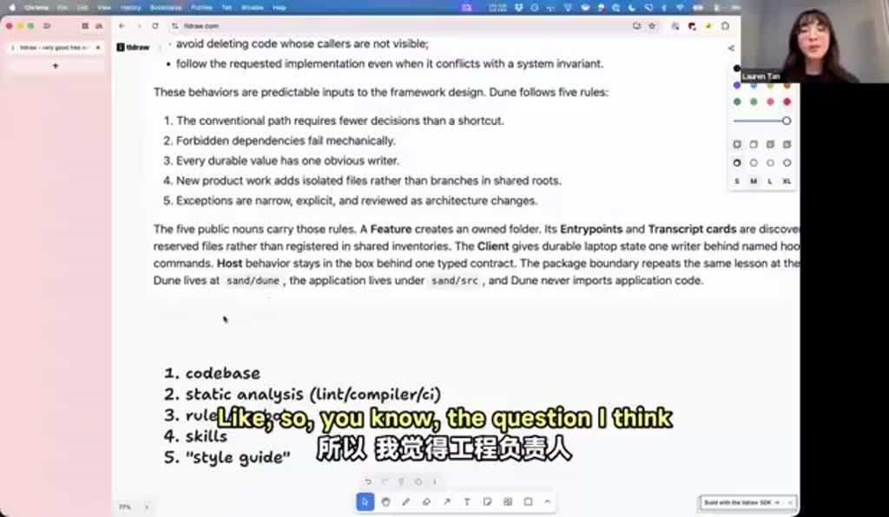

**重點：** 被問到一般人 token 有限是否可行：她承認在 AI 實驗室有無限 token，但認為這是 ROI 取捨：前期花很多 token 重構，換來讓最笨的 agent 也能做好、PM 與設計師也能貢獻；相對於雇人或膨脹成萬人團隊更精實。她並提到當天宣布 Grok 4.6，稱每 token 成本與 4.5 相同但更聰明，Cursor 與 SpaceX AI 追求成本對智慧的帕雷托前緣（講者主張，未查證）。

**標籤：** #token #ROI #Grok 4.6 #帕雷托前緣

I know we only have a couple minutes left Lauren, was there anything else that you wanted to to highlight? I, obviously, there's lots of questions so I can grab more but I want to give you a few minutes if there's anything else you want to talk about Well, I think I've been yapping Work on a lot so maybe let's just do questions Okay, cool One question that had a couple of came up a couple of times was just around like token usage So the question is like is what you're describing a realistic thing for people who are on you know, a normal set of token usage they don't have, you know basically unlimited tokens to work with? I think that's a really good point I mean, like obviously, you know I work at a AI lab where we have unlimited tokens so I definitely cannot say that you know this is something everyone should do in the exact same way that I did it I think it's possible to get to this point without you know, breaking the bank But, you know, if you're like an engineering leader or you know, you're, you, you have a startup that you lead I think to me it's a question of ROI and it's like, yes you spend a lot of money on tokens in the upfront stage You know like refactoring your code base is going to take a lot of tokens adding all these things is going to take a bunch of tokens But if we're heading to a world where agents are writing all the code and you know, you want to be very lean right? You don't want to have to hire you don't want to be you don't want to become like meta right? Like, I mean, like in terms of you don't want to become a 10,000 person engineering org because I mean that's a cool problem to have but also, you know you have so much overhead There's like planning, you know, like it's, it's, personally, I, I wouldn't, it's not super fun But, I think you want to stay very nimble right? And you want to you want to be like agents are all about allowing you to do things that you couldn't do before That's really, to me, like the value of agents You know it's not just throwing tokens on every single little thing But, to me like the thing I couldn't do before is like enforce this level of constraints in a code base by myself right? Like I'm just a single person you know it would have taken me years to build this framework and do all the refactoring and Test everything myself and verify you know, like run, imagine if there, it was just me right? You know, in, in pre-agent era just like running, you know, by my it would take me so long right? And my salary is pretty high right? Like, so, you know, the the question I think an engineering leader might have is just then you know, like, what is, there's a trade-off of do you hire someone to do this or do you spend the tokens to set up a code base so that even the the most naive, right the dumbest agents can do a good job? And when you actually get to this point like even agents that are not you know, fable size do an excellent job of writing code and this pays a lot of dividends as well for me personally where I've empowered not just myself but again, like PMs, designers engineers who are not familiar with Grokbot to just contribute in a way that is sustainable So I think, yeah it's definitely like a trade-off for sure You know, like nothing's like free for sure and tokens are pretty expensive but oh, actually, I, I I don't know how many of you have seen this but we actually announced Grok 4.6 today So very exciting, finally out so yeah, Grok 4.6 would be like a great it's very, very smart it's really good on the on the benchmarks and it's the same the tokens, well, I hopefully I'm not saying this incorrectly but I believe the cost per token is the same as 4.5 So you're actually getting more intelligence for the same cost I think this is an area that Cursor tries to Cursor and SpaceX AI try to really optimize for like that Pareto frontier of you know, cost versus intelligence you know we don't necessarily want to build the biggest model ever because that is extremely expensive to run It's really about like how do you find that sweet spot right? You don't You don't need a giant model but it's just super smart right? And it's not very expensive for inference but, yeah, I think to kind of round it up I think it's like a it's, it's, there's a, if you do your own analysis I feel like it's pretty positive It'll it'll be pretty positive that the ROI you get from investing in stuff like this just empowers not just yourself but your whole team to be so much more productive right? Like imagine if you have an army of engineers like me who are shipping so much improvements and and bug fixes, you know, every day, right? Like, that is pretty exciting Cool.

**中譯：** （主持人：只剩幾分鐘，Lauren 還有什麼想強調的嗎？——我覺得我已經講很多了，我們直接問答吧。）有個問題出現好幾次，是關於 token 用量：你描述的是否對一般 token 用量、沒有近乎無限 token 的人也實際可行？這點很好。我當然是在一家 AI 實驗室工作、我們有無限的 token，所以我不能說每個人都該用我這種方式做。我認為不必砸大錢也能走到這一步；但如果你是工程主管或創業者，我認為這是 ROI 的問題：沒錯，前期你會在 token 上花很多錢——重構程式碼庫、加上這一切都需要很多 token。但如果我們正走向「agent 寫所有程式碼」的世界，而你想保持精實、不想變成 Meta、一個一萬人的工程組織（那是個很酷的問題，但也有很多管銷、規劃——個人覺得不太有趣），你會想保持非常敏捷。agent 的重點是讓你做到以前做不到的事，這才是我認為 agent 的價值，不是把 token 丟在每件小事上。對我來說，我以前做不到的事是：靠我一個人在程式碼庫裡強制執行這種程度的約束。我一個人要花好幾年才能打造這個框架、做所有重構、自己測試與驗證；而我的薪水相當高。所以工程主管可能面對的取捨是：你要雇人來做這件事，還是花 token 把程式碼庫設定好，讓最天真、最笨的 agent 也能做得好？而當你走到這一步，連不是「fable 級」的 agent 也能把程式碼寫得很棒，這帶來很多回報：我個人讓 PM、設計師、不熟悉 Grokbot 的工程師，都能以可持續的方式貢獻。所以這肯定是個取捨，沒有什麼是免費的，token 也很貴。啊，對了，我不知道你們有多少人看到：我們今天宣布了 Grok 4.6，非常令人興奮，終於出來了——它非常聰明、在基準測試上表現很好；而每個 token 的成本我相信（希望我沒說錯）和 4.5 一樣，所以你是用相同成本得到更多智慧。這是 Cursor 和 SpaceX AI 努力去最佳化的方向：成本 vs 智慧的帕雷托前緣（Pareto frontier）。我們不一定要打造有史以來最大的模型，因為執行起來極其昂貴；重點是如何找到甜蜜點——你不需要巨大的模型，但它超級聰明、推論成本又不高。總結一下：如果你自己分析，我覺得結果會相當正面——投資在這類東西上的 ROI，不只讓你自己、也讓你整個團隊更有生產力。想像你有一整支像我這樣的工程師大軍，每天交付這麼多改進和 bug 修復，那很令人興奮。

### 主題 15：Grokbot 與非工程團隊：PM、設計師也能交付（53:26–56:09）

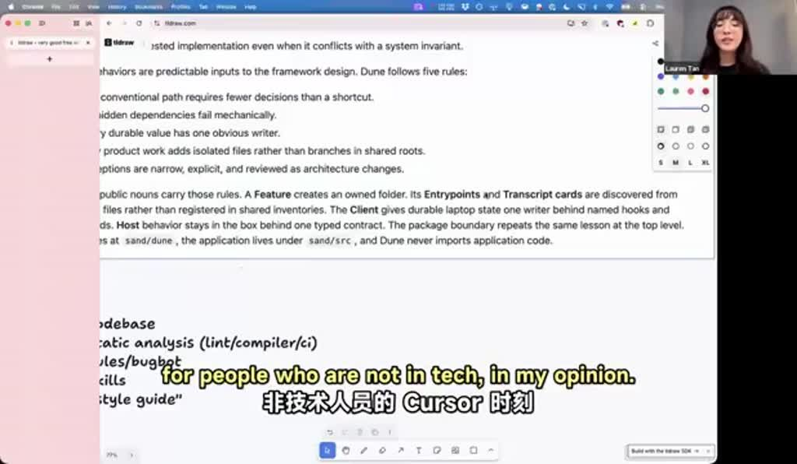

**重點：** 最後一題：產品團隊如何跟上？她說 Grokbot 是非技術人員的「Cursor 時刻」：介面像 iMessage、可給 agent 取名、一人一個 agent 管理帳號、用 agent 總結她昨晚的工作；PM 甚至自己修 bug 提 PR，她審查後直接蓋章，證明 Dune 的嚴格約束讓非工程專家也能高水準貢獻（講者主張，未查證）。

**標籤：** #Grokbot #非技術人員 #iMessage #PM

one last question before we wrap up Now, this one is for the people in product on the on the call So let's say we do have a number of engineers who are shipping like Lauren I'm just curious like how is the product team or other functions of your company keeping up given that like if you're shipping so quickly have, have are they using AI more to do their jobs? Like as much as you can speak to that I obviously you don't have like you're not in that role but just curious about how that works I think this is where Grokbot has been actually exceedingly powerful where, so before Grokbot, like, you know obviously cursor only had cursor like we only had agents window we had a CLI we had an IDE and these are really like power user tools right? Like they're designed for developers so it's very, very developer centric You can do knowledge work in them but it like the UI is not really optimized for that So we actually didn't really have well, I think like a lot of people in like you know, GTM product, like they might have used cursor to do their work but it definitely wasn't like a delightful experience for them I think now with Grokbot it's become Grokbot is basically like their cursor moment for people who are not in tech in my opinion. Like it's like, it's like a very very accessible way to use agents in a very comfortable very familiar interface. It looks like iMessage and it's very fun to you know you can give your agent a fun name you can have you can kind of do orchestration within a very like, natural way where you can sort of you know, each agent's like a person and now you got a team of agents like working on, you have one one agent per account that you manage as an example Or if you're a PM you have, you know you can have an agent that summarizes all the work that Lauren did last night and then now you know what I did right? So I think our PMs are leveraging that a lot and their shipping code too so, you know, like oftentimes they will just say "Oh, here's a bug, I fixed it Can you look at it?" And then I'll go review it and actually, it's just perfect on my okay stamp so, that, I think that shows that you know, the, the dune architecture is holding up right? The, all the the really strict constraints allow people who are not experts in engineering to contribute at a high level so I'm I feel like I'm already seeing that pay off a lot where you know, designers and PMs are just able to to, to ship features directly and that just makes the Grokbot team super fast right? Where we can ship so quickly and we have a lot planned so I'm very excited to, you know, to, to ship more ship more stuff.

**中譯：** （主持人最後一題，給產品人員：如果我們有許多像 Lauren 這樣在交付的工程師，產品團隊或公司其他職能怎麼跟得上？他們是否也更常用 AI 做事？）我覺得這正是 Grokbot 真正強大之處：在 Grokbot 之前，Cursor 只有 Cursor——我們只有 agent 視窗、CLI、IDE，這些都是為開發者設計的「重度使用者工具」，非常以開發者為中心；你能在裡面做知識工作，但 UI 沒有為此最佳化。許多 GTM、產品的人或許用 Cursor 做事，但絕對不是愉快的體驗。現在有了 Grokbot，對非技術人員來說，它就像是他們的「Cursor 時刻」：它是非常容易上手、非常舒適、熟悉的介面來使用 agent——長得像 iMessage，很有趣：你可以給 agent 取個有趣的名字，用很自然的方式做協調，每個 agent 像一個人，你就有一支 agent 團隊，例如每個你管理的帳號一個 agent；或者如果你是 PM，可以有個 agent 幫你總結 Lauren 昨晚做的所有工作，這樣你就知道我做了什麼。我們的 PM 大量利用這點，而且他們也在交付程式碼：常常他們會說「這裡有個 bug，我修好了，你可以看一下嗎？」我去審查，結果完美、直接蓋「OK」章。這顯示 Dune 架構撐得住：那些非常嚴格的約束，讓不是工程專家的人也能高水準貢獻。我已經看到這很有回報：設計師和 PM 能直接交付功能，這讓 Grokbot 團隊超快，我們有很多計畫，我很興奮能交付更多東西。

## 來源

- 原始資料夾：`watch-output/AI/GrokBot/2026-11-21_X_Hux---今晚別刷Netflix了-去看這個SpaceX-AI工程師1小時的課__2120782676676542488`
- 逐字稿來源：captions (en, manual, original)
