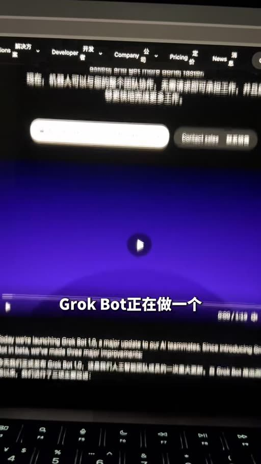
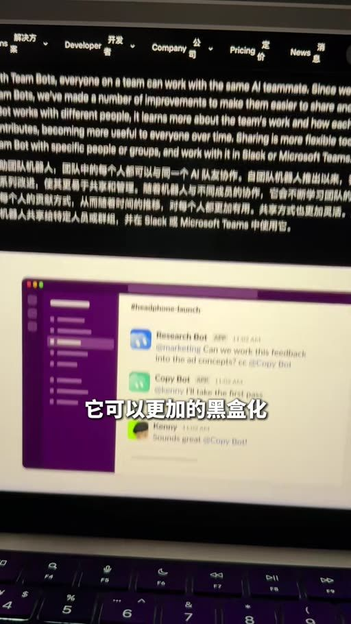
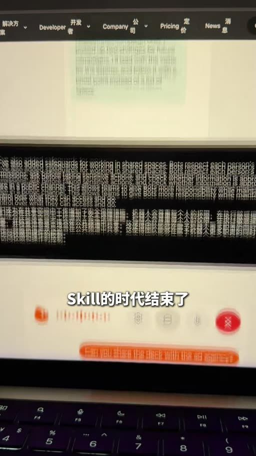

# 為什麼你要儘快用上Grok Bot

## 思維導圖

- Grok Bot 三大優勢
  - 開場
    - 支付寶、不需魔法
    - 超過 99% 人（講者主張）
  - 優勢一：X
    - 全球最大實時文本數據流
    - 實時分析討論
  - 優勢二：當同事
    - 設計理念像同事
    - 加入做 Bot 的 Bot
  - 優勢三：Bot 市場
    - 公司直接找 Bot 僱人
    - 創作者獎勵
  - Bot 對 Skill
    - Skill 易複製
    - Bot 可封裝出售
  - 結論
    - Bot 時代開始？
    - 資訊差可賺錢

## 圖文對照（畫面 + 逐字稿）

### 主題 1：開場：用不上 Claude Code／Codex，就用 Grok Bot（00:00–00:24）

**重點：** 講者（竹子，帳號 yangzhujun1）說如果用不上 Claude Code、Codex，強烈建議用 Grok Bot：可用支付寶支付、不需要魔法；有人說用 Codex 已超過 80% 的人，用 Grok Bot 則 AI 體驗超過 99% 的人。今天講它背後的三大優勢與最快上手方法，結尾還提到用資訊差賺錢（以上為講者主張，未查證）。

**標籤：** #Grok Bot #Codex #支付寶 #資訊差

如果用不上什麼Claude Code的Codex，強烈建議你可以用一下Grok Bot，它可以支援支付寶支付，而且不需要魔法，甚至有人說如果你現在在用Codex，你已經超過了80%的人，但是如果你用上了Grok Bot，那你的AI體驗將超過99%的人，所以今天這一期講一講Grok Bot背後的三大優勢，以及我們怎麼最快用上Grok Bot，甚至用資訊差賺到錢，方法我放最後了，記得截圖儲存。

### 主題 2：優勢一：背後的 X——全球最大的實時文本數據流（00:24–00:53）

**重點：** 第一個先天優勢是背後的 X：講者說馬斯克當年買下 X 很多人覺得貴，現在判斷開始體現；智慧達到一定程度後，資料的品質和時效是最重要的資產，X 就是全球最大的實時文本數據流，是 Grok 最獨特、最不可替代的核心資產，可以讓它實時分析 X 上正在發生的討論、快速準確掌握最新科技動態（講者主張，未查證）。

**標籤：** #X #實時資料 #核心資產

Grok Bot其實有三大先天優勢，第一個就是它背後的X，當年馬斯克買下X，很多人覺得貴，現在當年的判斷終於開始體現了，在智慧達到一定程度之後，資料的品質和時效，就是最重要的資產，現在X就是全球最大的，實時文本數據流，這也是Grok Bot的最獨特，最不可替代的核心資產，然後馬斯克肯定也是在X各種推廣，所以用Grok Bot的必不可少的一件事，就是你可以讓他實時分析，X正在發生的討論，快速和準確的瞭解最新科技動態。

### 主題 3：優勢二：按「同事」思路設計，可加入做 Bot 的 Bot（00:53–01:13）

**重點：** 第二個優勢是它按「把 AI 當同事」的思路設計：講者引馬斯克原話（僱傭 Grok Bot、把它當同事、交給它最艱難的任務），並提到前幾天馬斯克重用的華人女孩「土豆女神」也是這個理念——一個人指揮 50 多個 AI、幹 20 多個工程師的活；可以把「土豆女神」這個做 Bot 的 Bot 加進來，讓它幫你設計更多 Bot 同事（講者轉述，未查證）。

**標籤：** #把AI當同事 #做Bot的Bot #土豆女神

第二個優勢，就是他真按同事這個思路來設計，你看馬斯克原話，僱傭Grok Bot，把他當作同事交給他最艱難的任務前幾天馬斯克重用的華人女孩土豆女神也是這樣的理念一個人指揮50多個AI幹了20多個工程師的活這裡你可以直接把土豆女神這個做Bot的Bot加進來，讓他幫你設計更多的Bot同事。

### 主題 4：優勢三：Bot 市場——公司要僱人直接到市場找 Bot（01:13–01:28）

**重點：** 第三個優勢是 Grok Bot 正在做機器人市場：以後公司要僱人可以直接到 Bot 市場找人；講者說市場已對部分創作者有獎勵，未來可能進一步商業化，讓使用者直接付費給 Bot 製作人（講者主張，未查證）。

**標籤：** #Bot市場 #創作者獎勵 #商業化

而這也是最牛的第三個優勢，Grok Bot正在做一個機器人市場，以後公司要僱人，直接到Bot市場找人就行了，那現在這個市場已經在對一些創作者有一些獎勵，未來可能會進一步的商業化，慢慢的就可以讓使用者直接付費給Bot製作人。

### 主題 5：Bot 與 Skill 的最大區別：可封裝、可出售（01:28–01:49）

**重點：** 講者說 Skill 的流程是文字固定的，複製成本幾乎為零，一個人買了瞬間能轉發給上百、上千人，所以行業裡真正懂的人不太有動力公開最厲害的 Skill；Bot 則像一個封裝好的作品或員工，可以拿到市場上出售、持續盈利（講者主張，未查證）。

**標籤：** #Bot #Skill #封裝 #出售

他跟Skill的最大區別是，他可以更加的客製化，Skill的流程是文字固定的，複製成本幾乎為零，今天一個人買了，瞬間他就能轉發給100個人，1000個人，所以行業裡真正懂的人，不太有動力去公開最牛的Skill，但Bot就可以，它就像是一個封裝好的作品，或者是員工，你可以拿到市場上去出售，持續盈利。

### 主題 6：結論：Skill 的時代結束、Bot 的時代開始？（01:49–02:08）

**重點：** 有人斷言 Skill 的時代結束、屬於 Bot 的時代正式開始，講者覺得有一定道理，至少目前這個資訊差可以賺錢，不妨試一試；最快上手的方法放在結尾，邀請在評論區討論更多教程與技巧（講者主張）。

**標籤：** #Skill時代 #資訊差 #上手

所以有人甚至斷言，Skill的時代結束了，屬於Bot的時代正式開始，我覺得有一定的道理，至少目前這個資訊差是可以賺錢的，大家不妨試一試，那最快上手的方法大家儲存一下，真的超級簡單，如果你還想了解更多的Grok Bot的上手教程和使用技巧，評論區告訴我，我是竹子，關注我，快進一步，把握AI時代機遇。

## 知識點

- [[GrokBot_優勢一：背後有 X，是最大的實時文本數據流]]
- [[GrokBot_優勢二：按「把 AI 當同事」的思路設計]]
- [[GrokBot_把「做 Bot 的 Bot」加進來，讓它幫你設計更多 Bot 同事]]
- [[GrokBot_優勢三：Bot 市場——公司要僱人直接到市場找]]
- [[GrokBot_Skill 複製成本幾乎為零，所以高手不願公開]]
- [[GrokBot_Bot 像封裝好的作品或員工，可以出售持續盈利]]

## 來源

- 原始資料夾：`watch-output/AI/GrokBot/2026-11-21_TikTok_為什麼你要儘快用上Grok-Bot__7707614468418669837`
- 逐字稿來源：whisper (groq)
