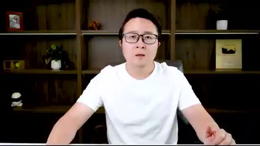
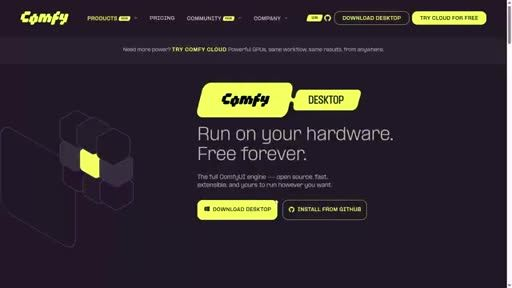
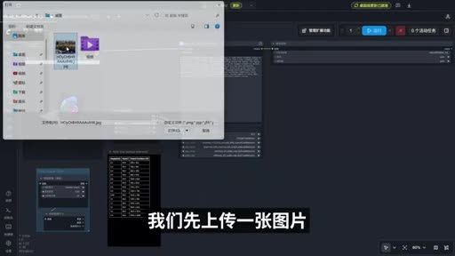
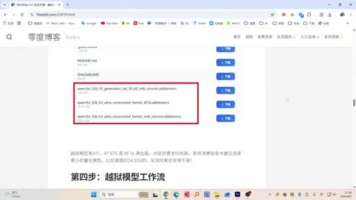
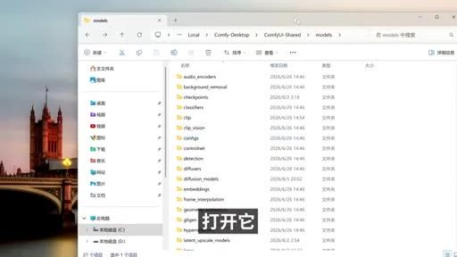
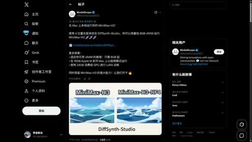
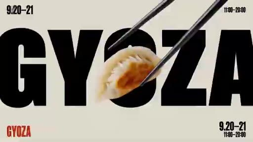
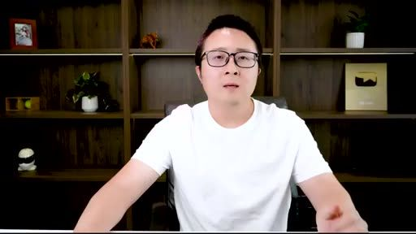

# MiniMax H3 最開放模型！本地無限制，越獄解鎖更多玩法！想生成什麼就生成

## 思維導圖

- MiniMax H3 最開放模型！本地無限制，越獄解鎖更多…
  - 開場：猜猜哪些是 AI 影片
    - AI 影片辨識
  - 安裝 ComfyUI Des…
    - ComfyUI
    - 模型下載
  - 文生影片實測：〈早發白帝城〉
    - 文生影片
  - 圖生影片實測與解析度設定
    - 圖生影片
    - 解析度
    - 放大
  - 「越獄版」模型：去審查文字編…
    - 去審查模型
    - 文字編碼器
    - BF16
  - 安裝工作流節點與放置模型檔
    - 工作流
    - 自訂節點
  - 低顯存方案：NF4 量化版
    - NF4
    - 8GB 顯卡
    - DiffSynth-Stud…
  - 網友作品：角色一致性、MV …
    - 作品展示
    - 商業廣告
  - 結尾

## 圖文對照（畫面 + 逐字稿）

### 主題 1：開場：猜猜哪些是 AI 影片（00:00–01:15）

**重點：** 講者播放多段寫實短片，請觀眾猜哪些是 AI 生成、哪些是真人拍攝；講者稱只確定第三、四段是真人拍攝。

**標籤：** #AI 影片辨識

大家好，這裡是零度解說，在今天教程開始之前，我先給大家看幾個影片，讓大家先猜一下哪些影片是AI生成的，哪些影片是真人拍攝的，看一下你能不能猜對，大家猜一猜這個是AI生成的還是真人拍攝的，大家看後面一個，後面一個估計更難猜了，他的拍攝手法、裝甲，大家看一下，你覺得這是AI影片還是真人拍攝的？前面兩個比較難猜啊，後面幾個稍微好猜一點，這大家猜一下，到底是真人還是AI?，這個，因為這些影片都比較多，所以對現場來說還是比較難猜的，這個，大家看旁邊的人和下面的鱷魚，大家覺得是真的還是假的？其實在剛才所有影片裡，我唯一知道的是第三和第四個是真人拍攝的，現在我們進行本地部署進行實測下，看效果到底如何。

### 主題 2：安裝 ComfyUI Desktop 與下載官方模型（01:15–02:31）

**重點：** 依講者部落格（零度博客）的教學頁，下載開源的 ComfyUI Desktop 並以預設值安裝，再從模型下載中心取得 MiniMax H3 官方的文生影片、圖生影片、參考生成影片模型。

**標籤：** #ComfyUI #模型下載

在開始之前，首先我們需要開啟零度博客這篇文章，連結我會放在影片下方，還有零度博客。開啟後下載上面的全部資料，首先第一步下載開源的 ComfyUI，用它來載入模型，開啟它進行下載，開啟後按下下載按鈕，把它裝上，同樣放到桌面上，透過TDM Fuzz多執行緒下載器，把它裝上，下載好後關閉，開啟它進行安裝，下一步，預設安裝就可以了，安裝好後開啟它，後面的設定步驟保持預設就可以了。啟動後，你左側有一個模板，來進入模型下載中心。如果你不想使用越獄版模型的話，可以先在這裡進行下載。你左側有一個影片，進入好以後，在上方這邊看到，它上方有MiniMax H3、圖生影片模型，或者是參考生成影片，以及MiniMax H3、文生影片這三個模型。開啟以後，它上方會顯示你當前所需的模型檔案。的模型全部給下載下來。或者如你想生成更豐富的影片內容的話，那麼你可以使用它的越獄版模型，它是幾乎沒什麼限制的。在影片後半段我再說一下，如果下載使用了越獄版模型，我們先從官方版開始。

### 主題 3：文生影片實測：〈早發白帝城〉（02:31–03:50）

**重點：** 以李白〈早發白帝城〉詩句當提示詞生成動畫，約數分鐘完成；講者稱低解析度下效果已相當好。

**標籤：** #文生影片

好，下載好模型以後，我們先來測試一下這個文生影片的功能。比如現在我讓它透過唐代詩人李白的七言絕句〈早發白帝城〉，來生成一個跟詩詞內容相匹配的動畫影片。就是朝辭白帝彩雲間，千里江陵一日還，兩岸猿聲啼不住，輕舟已過萬重山。我們一會來看下效果。好，過了幾分鐘以後，它現在算是完成了。我們播放一下。大家看一下，這效果還是可以的。我目前用的還是低解析度的，效果已經非常不錯了。MiniMax H3。

### 主題 4：圖生影片實測與解析度設定（03:50–04:53）

**重點：** 上傳一張圖片並貼上提示詞，長度設為 15 秒。畫素倍數 0.4 約 864×480，最高 1080p；講者建議先降解析度縮短生成時間，再用免費的影片高畫質放大工具放大。講者稱畫面與音效一次生成。

**標籤：** #圖生影片 #解析度 #放大

同時圖生影片也是一樣的，我們來試一下，我們左上有上傳檔案，我們先上傳一張圖片，然後在右側這裡我們貼入提示詞，這個提示詞同樣會放到影片下方，貼入好以後，在下方這裡我把這個，我把這個長度修改一下，改成15秒，然後幫我生成一個15秒的影片，像這個解析度，還畫素倍數等等，這倒是根據顯存的大小進行修改，然後在上方執行，這個畫素0.4對應的解析度是這個，864x480,然後後面是0.5、0.6，最高是1080的，其實在建立影片的時候，你可以把這分別稍微降一點，這樣可以大大縮短生成影片的時間。等後期生成完成以後，我們可以透過這款免費的影片高畫質放大工具來進行高畫質放大就可以了。這款軟體我會放在零度博客，到時大家可以自己下載使用就可以了。好，過了幾分鐘以後，它現在已經完成了，我們來看看效果怎麼樣。我們點選播放下。大家看一下效果。哇，非常可以啊。無論是影片傳傳，還是音效，都非常可以啊。這都是一次性搞定的。關鍵是生成速度非常快啊，只需要幾分鐘就可以完成15秒的影片。

### 主題 5：「越獄版」模型：去審查文字編碼器（04:53–05:31）

**重點：** 講者介紹第三方的「越獄版」模型，畫面檔名顯示為 Qwen3-VL 32B 的 uncensored／heretic 文字編碼器，以替換官方版來移除內容限制；講者暗示可用於成人內容。屬第三方修改版，非官方釋出。

**標籤：** #去審查模型 #文字編碼器 #BF16 #量化版

然後接下來我們來說一下，如何下載安裝越獄版的MiniMax H3影片生成模型。有些東西我就不方便說了，影片的影片也沒法直接放出來，大家都是老司機，比我多懂啊。到時候回到剛才的帖子下，找下方這個越獄版模型下載，那麼你開啟它，直接下載就可以了。好，開啟以後看到，它裡面有三個模型檔案，第一個是7.6G的，這是它生成尾部模組，不是完整模型啊，但是我們同樣需要給它裝下來。我們先給它下載下來，然後下方兩個是它主模型，這個50多G的是它的BF16 精度的完整模型。MiniMax 最高畫質，但很多電腦是跑不動的。這裡我們只下載量化版本，就是26.4G就可以了。

### 主題 6：安裝工作流節點與放置模型檔（05:31–07:41）

**重點：** 下載工作流節點的 ZIP 並解壓，放到 ComfyUI Desktop 的自訂節點資料夾；模型檔放進 models 下的文字編碼器資料夾，重新啟動後載入越獄版工作流。

**標籤：** #工作流 #自訂節點

下載好模型後，然後先返回剛才的帖子下。來進行下一步，就來獲得工作流節點。你點下載，給它動下來。開啟用第三方的code。按下下載的ZIP,給它下下來就可以了。下載好工作流節點後，拿下模型給它解開出來。解開好以後開啟它。來進入根目錄下。我們把根目錄進去重新命名下。比如把名字給它修改一下。把後面去掉。拖出來，拖到桌面上。保持根目是這樣的。現在需要給它封到指定資料夾下。開啟電腦，點選開啟C盤。開啟使用者。找到使用者名稱，這是我的使用者名稱。開啟它。在底下有一個檢視。展開顯示，把這隱藏專案改過去。再往下拉，在下方看到有一個，App Data資料夾，就這裡了。開啟它。點選Local。下方有一個ComfyUI Desktop 資料夾。開啟它。進入以後，開啟裡面有一個安裝目錄，就是第二個。開啟自己的使用者名稱檔案。進入以後開啟ComfyUI 資料夾。在下方這邊看到有一個自訂節點的資料夾，就這裡了。開啟它。開啟以後，先把我們在桌面上結合出來的自訂節點資料夾給拖進來。這樣就可以了。然後先把它返回去。點左上方的返回。返回以後，上方有一個 ComfyUI Desktop 資料夾，就這裡了。返回根部下，進入以後開啟第三個資料夾，這是 ComfyUI 的工具資料夾。開啟它。開啟以後我我們第三方有一個models,這裡面是存放模型檔案的。開啟它。開啟以後，往下拉，找下面一個文字編碼器，就這裡了。開啟它。進入以後，然後先把我們剛下載好的域域模型給拖進來就可以了。拖進來以後，給關閉掉。然後重新啟動一下 ComfyUI 的客戶端。好，重新啟動以後，然後先返回剛才提的下，把這個越獄版模型的工作流給動下來，給下載。下載好以後，MiniMax H3。

### 主題 7：低顯存方案：NF4 量化版（07:41–08:02）

**重點：** 畫面為 ModelScope 貼文：MiniMax-H3 的 4-bit 量化版搭配 DiffSynth-Studio，最低 8GB VRAM 可執行，16GB Apple M 系列 Mac 也能跑，24GB 消費級 GPU 可訓練 LoRA。講者稱不同量化版在一般任務下輸出差異不大。

**標籤：** #NF4 #8GB 顯卡 #DiffSynth-Studio

NF4 是量化版，它是可以適配8G視訊記憶體的。到聲音在3G下載就可以了。其實不同的量化版在常規任務下，它的輸出結果並沒有太大的差異。

### 主題 8：網友作品：角色一致性、MV 與廣告（08:02–08:50）

**重點：** 展示 MiniMax H3 生成的角色一致性影片、網友用 RTX 3060 生成的影片、動態 MV 與餃子廣告；講者主張它已可作為主力工具，能做電影級畫質與商業廣告。

**標籤：** #作品展示 #商業廣告

我們再來看這個生成效果。這個是由MiniMax H3開源模型，透過影片轉影片生成的角色一致性的影片。大家可以看下這個效果，覺得怎麼樣。我們再來看這個，這個是由國外的網友在3060顯示卡上生成的無名的影片。效果還是非常OK的。然後這是由MiniMax H3生成的動態MV。這個大文字的MV影片是透過模特參考圖加提示詞生成的，因為也是由AI生成的。這個生成的質感，還是文字植入效果都非常不錯。不得不說，現在最新開源的MiniMax H3真的可以作為主力工具了。不僅可以生成電影級的畫質，同時也可以用它來拍商業廣告。我們來看一下這個由MiniMax H3生成的廣告影片。

### 主題 9：結尾（08:50–09:17）

**重點：** 講者表示所有資料與連結放在影片說明欄。

今天影片所用的全部資料，他們還上載連結，我就放在影片下方的右上角。

## 來源

- 原始資料夾：`watch-output/AI/2026-10-12_GoogleDrive_MiniMax-H3-最開放模型-本地無限制-越獄解鎖更多玩法-想生成什麼就生成__1EIhyh60imHgwatjkElA-8di38oYtiv0T`
- 逐字稿來源：whisper (groq)
