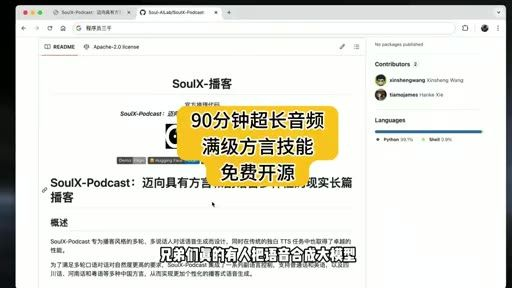
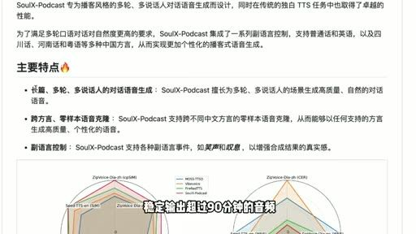
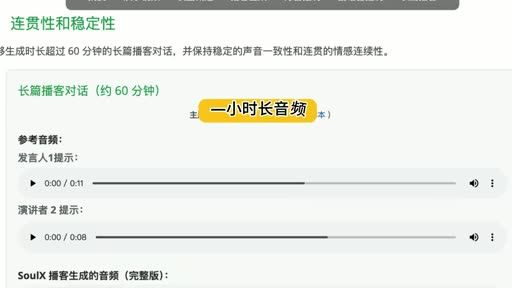
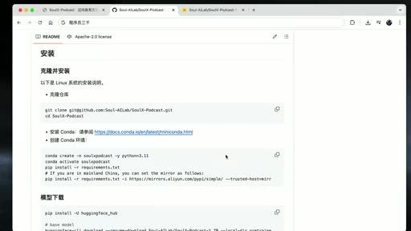

# Github一開源，就登頂？一口氣合成90分鐘音訊～

## 思維導圖

- SoulX-Podcast 開源 TTS
  - 開源與榜單
    - 首日登 TTS 榜首（講者主張）
  - 核心賣點
    - 穩定輸出超過 90 分鐘
    - 多人多輪對話
    - 方言與情緒、笑聲
  - 跨方言零樣本
    - 普通話、四川話、河南話
  - 副語言控制
    - 標籤控制笑聲、嘆息
    - 清嗓子
  - 長音訊一致性
    - 每人聲音一致連貫
  - 部署
    - GitHub／HF 有教程

## 圖文對照（畫面 + 逐字稿）

### 主題 1：開場：SoulX-Podcast 開源，登上 Hugging Face TTS 榜首（00:00–00:08）

**重點：** 講者說有人把語音合成大模型免費開源，發布第一天就衝上 Hugging Face TTS 版本冠軍；畫面為 GitHub 專案 SoulX-Podcast（SoulX-播客）頁面（榜首與開源情況為講者主張，未查證）。

**標籤：** #SoulX-Podcast #開源 #TTS

兄弟們，真的有人把語音合成大模型免費開源了，發布第一天，直接衝上了Hugging Face TTS版本的冠軍寶座。

### 主題 2：核心賣點：90 分鐘長音訊、多人多輪對話、方言（00:08–00:35）

**重點：** 講者說它能一口氣穩定輸出超過 90 分鐘的音訊，除單人語音外支援多人多輪對話，可用來生成小品、電影、播客；支援中文、英文，以及四川話、河南話、粵語等帶方言特徵的自然語言，並能輸出音色、情緒、節奏甚至笑聲語氣詞。專案頁列出三項主要特點：長篇多說話人對話、跨方言零樣本語音克隆、副語言控制（講者主張，未查證）。

**標籤：** #90分鐘 #多人對話 #方言

最強的是，它能支援一口氣穩定輸出超過90分鐘的音訊，不僅能生成單人語音，還能同時支援多人多輪對話，也就是說，你拿去生成一個多人小品，電影，播客等等都是沒有問題的，中文，英文，甚至是四川話，河南話，粵語等等方言特徵的自然語言，也能無壓力輸出音色情緒節奏甚至是笑聲語氣詞，全都穩的離譜，下面我帶兄弟們一起去體驗一下。

### 主題 3：示範一：跨方言零樣本播客生成（00:35–01:10）

**重點：** 講者給模型一句普通話提示，示範依序生成普通話、四川話、河南話（還有粵語標籤）的播客開場與對話。影片裡的方言用字是示範音訊的字幕轉寫，保持原樣。

**標籤：** #跨方言 #零樣本 #播客

跨方言零樣本播客生成，例如我們給它一句普通話提示，Hello 大家好，歡迎收聽我們的節目，喂 我今天想問你一樣東西，你覺不覺得，嗯 現在開電動車最煩，四川話，各位巴士的班內聽眾，謝謝大家好，我是你們主持人金金，今天天氣冷死巴士，不曉得大家是在乾爐嗎，還是茶都跑去了，準備跟我們好生拜一下，龍門真呢，河南話，大家好啊，歡迎收聽在這一期的，瞎聊白就這麼說，我是人類撈朋友燕子，大家好我是老掌，燕子，就是抽抽你這個勁。

### 主題 4：示範二：副語言控制（笑聲、嘆息、清嗓）（01:10–01:40）

**重點：** 講者說只要在文字裡加入一些非語音標籤，AI 就能實現笑聲、嘆息、清嗓子等副語言效果，真實感直接拉滿；畫面標示「笑聲、嘆息聲、清嗓聲等」。接著示範一段充滿未來感的播客對話（講者主張）。

**標籤：** #副語言 #笑聲 #標籤

咋做，是有啥課得進來的事想跟咱撈撈副語言控制我們只需要在文字裡加入一些非語音的標籤AI也能實現笑聲嘆息清嗓子真實感直接拉滿，一個充滿了未來感，然後還有一點點神經質的播客節目，我是主持人小西，最近活得特別賽博朋克，以前覺得AI是科幻片裡的，現在連我媽都用AI寫廣場舞文案了，這個例子很生動，是的，特別是生成式AI。

### 主題 5：示範三：一口氣穩定輸出超過 90 分鐘的播客（01:40–02:25）

**重點：** 講者說這類多人多輪的長音訊也能穩定保持每個人聲音的一致性與連貫性，音色、情緒、節奏都很穩；畫面標示「一小時長音訊」，示範兩位主持人的心理節目對話（講者主張，未查證）。

**標籤：** #長音訊 #聲音一致 #多人

一口氣穩定輸出超90分鐘播客，像這種播客式多輪多人對話的長音訊，也能穩定保持每個人聲音的一致性和連貫性，音色 情緒 節奏全部穩得離譜，各位親愛的聽眾朋友們大家好，歡迎收聽本期的心理節目，我是簡安，大家好 我是陸陽，陸陽 你最近有沒有感覺，就好像整個社交網路都被一股淡淡的憂傷籠罩著，就是前段時間不是有個特別受大家關注的明星情侶嗎，突然就宣佈分開了，然後我點開那個評論區，哇滿屏都是那種心疼抱抱，姐姐不哭，感覺就好像全網的粉絲都跟著一起失戀了一樣，確實有這個感覺，是吧，其實這個現象還挺有意思的，它不光是粉絲對偶像的一種。

### 主題 6：部署與取得方式（02:25–02:33）

**重點：** 講者說部署非常簡單，GitHub 與 Hugging Face 上都有完整的文件與部署教程，感興趣的人可以去體驗。

**標籤：** #部署 #GitHub #Hugging Face

部署起來也非常簡單，Github和Hugging Face上都有完整的文件和部署教程，感興趣的兄弟們可以去體驗一下。

## 知識點

- [[TTS_跨方言零樣本播客生成]]
- [[TTS_副語言控制：用標籤加入笑聲、嘆息、清嗓]]
- [[TTS_多人多輪長音訊要保持每個人聲音一致]]
- [[TTS_開源 TTS 模型可本地部署，文件在 GitHub 與 Hugging Face]]

## 來源

- 原始資料夾：`watch-output/AI/TTS/2026-11-19_TikTok_Github一開源-就登頂-一口氣合成90分鐘音訊～__7708724085718715669`
- 逐字稿來源：whisper (groq)
