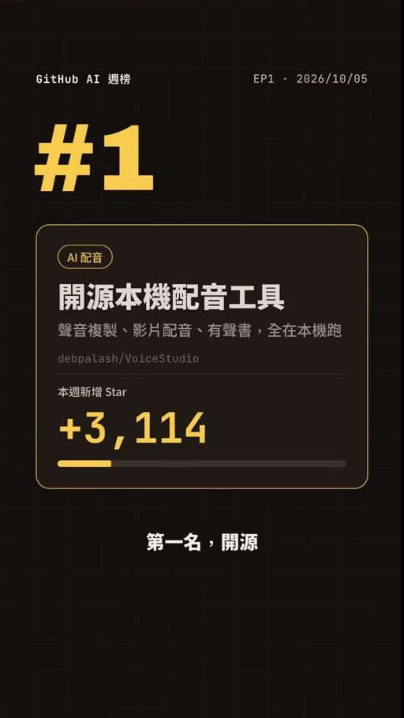

# Video by good_job_ai

## 圖文對照（畫面 + 逐字稿）

### 投影片 1：開場：本週 GitHub 最紅的 AI 工具（00:00–00:03）

**重點：** 主持人（一股GoodJob）預告挑好 7 個本週 GitHub 熱門 AI 專案。

這周GitHub最紅的 AI 工具，我幫你挑好了。

### 投影片 2：#7 一鍵生成短影音（00:03–00:08）

**重點：** 給主題就自動寫腳本、配素材、上字幕；harry0703/MoneyPrinterTurbo，本週新增 Star +1,687（畫面數字）。

第七名，給它一個主題，它就自動寫腳本，配素材，上字幕，直接生成短影音。

### 投影片 3：#6 寫網頁就能出影片（00:08–00:15）

**重點：** HeyGen 開源影片框架，專為 AI Agent 設計；heygen-com/hyperframes，+1,645。

第六名，HeyGen 開源的影片框架，寫網頁就能出影片，這支影片的卡片，就是用它做的。

### 投影片 4：#5 讓 AI 直接操作 Office（00:15–00:20）

**重點：** 試算表、文件、簡報皆可讀寫；dream-num/univer，+3,283。

第五名，讓AI直接操作，試算表，檔案和簡報，才能把資料變成互動報表。

### 投影片 5：#4 幫 AI 裝上網路能力（00:20–00:25）

**重點：** 推特、Reddit、YouTube、小紅書一次接上；Panniantong/Agent-Reach，+3,952。

第四名，幫AI裝上網路能力，Twitter Reddit YouTube，小紅書都能幫你看。

### 投影片 6：#3 管理 AI 員工的工作台（00:25–00:32）

**重點：** 設目標、給預算，一個儀表板看所有 Agent；paperclipai/paperclip，+10,722。

第三名，管理AI員工的工作臺，設目標給預算，一個儀表板看所有agent在做什麼。

### 投影片 7：#2 會學習的 AI 長期記憶（00:32–00:37）

**重點：** 不只記得對話，還會從經驗學習；vectorize-io/hindsight，+14,198。

第二名，AI的長期記憶，它不只記得你說過什麼，還會從過去的經驗學習。

### 投影片 8：#1 開源本機配音工具（00:37–00:44）

**重點：** 聲音複製、影片配音、有聲書，全在本機跑；debpalash/VoiceStudio，+16,775。

第一名，開源，能完全在自己電腦上跑的配音工具，複製聲音，幫影片配音，做有聲書，一套搞定。

### 投影片 9：我的推薦：#3 Paperclip（00:44–00:56）

**重點：** 老闆視角：不是多買幾個 Agent，而是用目標與預算管理 AI 團隊；結尾留言「排行榜」索取完整清單。

如果你是老闆，我最推薦第三名，Paperclip，它不是叫你多買幾個agent，而是用目標和預算去管AI團隊，這才是企業導入真正該想的事，收藏起來，下週榜見。

## 來源

- 原始資料夾：`watch-output/AI/2026-10-13_Instagram_Video-by-good_job_ai__DeJhY7PAMrR`
- 逐字稿來源：whisper (groq)
