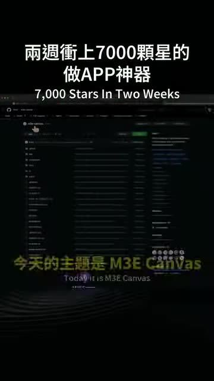

# Video by jarrenpoh

## 思維導圖

- M3E Canvas：畫 UI 轉 prompt
  - 開場：痛點
    - 上線兩週逾 7000 星（講者主張）
    - Vibe Coding 靠文字描述
    - 改用視覺、更精準
  - 拖拉畫面並連線
    - 瀏覽器內拖拉元件
    - Material 3 Expressive 真元件
    - 畫面連線自動畫流程箭頭
  - 一鍵轉 prompt
    - 貼進 Claude Code／Codex
    - AI 照設計做、不用猜
  - 免費開源
    - 免費、MIT、免安裝（講者主張）
    - 存瀏覽器、免註冊（講者主張）
    - Trendshift 當日第一（講者主張）

## 圖文對照（畫面 + 逐字稿）

### 主題 1：開場：M3E Canvas 與 Vibe Coding 的痛點（00:00–00:16）

**重點：** 工具上線兩週、GitHub 逾 7000 顆星（講者主張，未查證）；主題 M3E Canvas，以視覺方式取代純自然語言描述

**標籤：** #M3E Canvas #Vibe Coding #GitHub

這個工具上線到現在兩個禮拜的時間，在Github上已經超過了7000顆星，今天帶你看一個工具，今天的主題是M3E Canvas，現在Vibe Coding是讓我們把腦袋裡抽象的畫面，用自然語言的方式告訴AI，但現在這個工具可以讓你用更直接、更精準的方式來完成它。

### 主題 2：瀏覽器拖拉畫面，連線成 App 流程（00:16–00:32）

**重點：** 拖拉按鈕、導航列、卡片、清單、對話方塊等 Material 3 Expressive 真實元件，畫面連線自動產生流程箭頭

**標籤：** #Material 3 Expressive #拖拉設計 #流程箭頭

你可以直接在瀏覽器裡面用拖拉的方式把畫面畫出來，按鈕、導航列、卡片、清單、對話方塊，全部都是Google Material 3 Expressive的真實元件，絕對不是隨便亂畫的方塊，你只需要將畫面跟畫面連線起來，它會幫你畫出整個app的流程箭頭。

### 主題 3：一鍵轉 prompt 貼給 Claude Code／Codex，免費開源（00:32–01:02）

**重點：** 設計轉成一段 prompt 貼進 Claude Code 或 Codex；免費、MIT、免安裝、存瀏覽器、免註冊；9/2 上架（講者主張，未查證）

**標籤：** #Claude Code #Codex #MIT #Trendshift

最後按一個按鈕，它把你畫的整個設計直接變成一段prompt，你複製這段prompt，貼到Claude Code或是Codex，你畫的每個細節，AI完全不用再猜，直接照你說的做，這工具完全免費、開源、授權 MIT，不用裝任何東西，開啟網站就能使用，你的設計全部儲存在瀏覽器裡面，沒有伺服器，不用註冊帳號，從9月2號上架到現在已經超過了7000顆星，還上過GitHub Trendshift的當日第一名，如果你也想玩玩看，留言M3,我把連結傳給你啦。

## 來源

- 原始資料夾：`watch-output/AI/claude-code/2026-10-21_Instagram_Video-by-jarrenpoh__DddPhkuxDUo`
- 逐字稿來源：whisper (groq)
