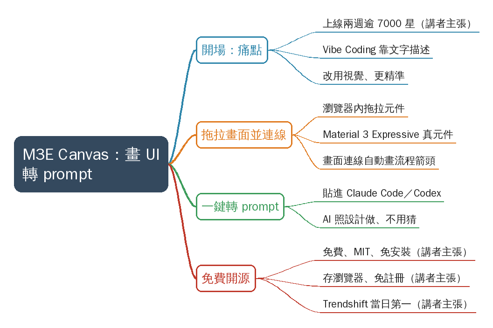

# Video by jarrenpoh

## 摘要

**一句話重點**：講者介紹開源工具 M3E Canvas——在瀏覽器裡用拖拉元件畫出 App 畫面與流程，一鍵轉成 prompt，貼給 Claude Code 或 Codex 生成程式，讓 AI 不必猜設計細節。

> 影片中的數字與主張（7000 顆星、兩週、9/2 上架、Trendshift 當日第一、免費／MIT、資料只存瀏覽器）皆為**講者主張，未查證**。

### 重點表

| 時間 | 重點 |
|---|---|
| 00:00 | 開場：工具上線兩週、GitHub 超過 7000 顆星（講者主張，未查證）；主題 M3E Canvas |
| 00:07 | 痛點：Vibe Coding 靠自然語言描述畫面；此工具改用更直接、更精準的視覺方式 |
| 00:16 | 在瀏覽器拖拉畫出畫面：按鈕、導航列、卡片、清單、對話方塊，皆為 Google Material 3 Expressive 真實元件 |
| 00:27 | 把畫面與畫面連線，自動畫出整個 App 的流程箭頭 |
| 00:32 | 按一個按鈕，整份設計輸出成一段 prompt；複製後貼到 Claude Code 或 Codex，AI 照設計做、不用再猜 |
| 00:43 | 免費、開源、授權 MIT；免安裝、開網站即用；設計存在瀏覽器、無伺服器、免註冊（皆講者主張，未查證） |
| 00:53 | 9/2 上架至今逾 7000 顆星、上過 GitHub Trendshift 當日第一（講者主張，未查證） |
| 00:59 | 行動呼籲：留言「M3」會傳連結（連結影片未呈現） |

### 名詞與縮寫

- **M3E**：Material 3 Expressive，Google Material Design 3 的 Expressive 設計語言（字幕寫 Google Material 3）。
- **Vibe Coding**：用自然語言描述需求、由 AI 生成程式的開發方式。
- **Trendshift**：追蹤 GitHub 熱門專案的排行榜網站（ASR 原作 TrendShift，已依官方寫法校正）。
- **Claude Code／Codex**：影片中的 prompt 貼上目標（AI 寫程式的 CLI 工具）；本影片主角是 M3E Canvas，Claude Code 僅是使用場景。

### 轉錄校正備註

- 轉錄來源：Groq Whisper，語言自動偵測為中文，無重複幻覺或整段漏轉。
- 已校正：遊覽器／浴纜器→瀏覽器（畫面字幕為「瀏覽器」）、授權 MAT→MIT、賬號→帳號、TrendShift→Trendshift（前四項已入 `glossary/common.json`）。
- 講者語助詞未去除（非講座類）。
- 影片未呈現專案網址與 repo 名稱，需另查；見使用者確認事項。

## 思維導圖

## 來源

- 原始資料夾：`watch-output/AI/claude-code/2026-10-21_Instagram_Video-by-jarrenpoh__DddPhkuxDUo`
- 逐字稿來源：whisper (groq)
