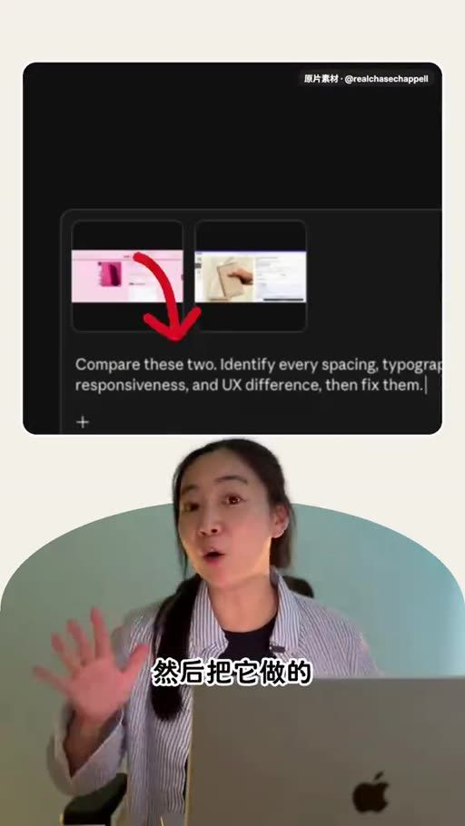

# 照著別人的爆款店，三步搭出你自己的 Shopify 店。 先說清楚：不是抄人家的 logo 和文案，是學人家怎麼讓客人下單。 Claude...

## 思維導圖

- 截圖搭出自己的店
  - 開場
    - Claude Design 進對話（講者主張）
    - 學下單結構不抄文案
  - 1 截購買路徑
    - 首頁、商品頁
    - 購物車、手機版
  - 2 Claude Code 搭
    - 開啟 Shopify 主題
    - 截圖拆成 section
    - 換成自己品牌商品
  - 3 預覽並對比
    - Shopify CLI 本地預覽
    - 並排截圖找差異
    - 改兩三輪（講者主張）
  - 結語
    - 先看購買路徑

## 圖文對照（畫面 + 逐字稿）

### 主題 1：開場：照著爆款店搭自己的店（00:00–00:25）


**重點：** 講者主張：Claude 把 Claude Design 放進每個對話，連 Claude Code 也能用，能照著幾張截圖幫你搭出店鋪頁面，已有人照著別人的爆款店搭出自己的店。她先聲明不是抄人家的 logo 和文案，而是學人家怎麼讓客人下單，並預告三步做法。

**標籤：** #Claude Design #Claude Code

Claude 這次把 Claude Design放進了每個對話，連 Claude Code 都能用，它現在能夠照著幾張截圖幫你搭出店鋪頁面，你看，有人已經照著別人的爆款店搭出了自己的一家店，今天我教你三步就能照著做，先說清楚呢，我們不是抄人家的logo和文案，就是學人家怎麼讓客人下單，首先，第一步，把你想參考的店整條購買路徑都截下來。

### 主題 2：第一步：截下整條購買路徑（00:25–00:30）


**重點：** 把想參考的店的整條購買路徑都截圖，包含首頁、商品頁、購物車與手機版。重點是完整的下單流程，而不是單一頁面，讓 AI 看得懂結構。

**標籤：** #購買路徑 #截圖

例如說首頁、商品頁、購物車還有手機版。

### 主題 3：第二步：在 Claude Code 開主題並丟截圖（00:30–00:45）


**重點：** 在 Claude Code 開啟你的 Shopify 主題，把截圖丟進去，指示它照這個結構拆成 section、換成自己的品牌與商品。畫面示範它把賣點、評價、FAQ 一塊一塊搭出來。

**標籤：** #Claude Code #section #主題

然後第二步在Claude Code裡開啟你的主題，把截圖丟給它，直接告訴他照著這個結構拆成section，換成我的品牌和商品，你看它就把賣點評價FAQ一塊一塊搭出來了。

### 主題 4：第三步：本地預覽並自我對比修正（00:45–01:02）



**重點：** 用 Shopify CLI 在本地預覽，不會動到線上的店。把成品和原店並排截圖，讓 Claude 自己比對間距、字型與手機版差異並逐條修改，改兩三輪就成為自己的店。

**標籤：** #Shopify CLI #本地預覽 #對比

那第三步呢，用Shopify CLI在本地預覽，不會動到你線上的店，然後把它做的和原來那家並排截圖，讓它自己對比，間距、字型、手機版的差別，它會一條一條改掉，改個兩三輪呢，就是你自己的一家店了。

### 主題 5：結語：先看購買路徑（01:02–01:14）


**重點：** 講者說她們幫電商客戶看店時最先看購買路徑，並邀請做電商、想用 AI 把店做起來的人關注她（刀姐，畫面標示）。

**標籤：** #電商 #結語

我們幫電商客戶看店的時候呢，最先看的就是這條購買路徑，如果你也在做電商，想用AI把店做起來，記得關注刀姐。


## 知識點

- [[claude-code_學下單結構，不抄 logo 與文案]]
- [[claude-code_先截下整條購買路徑]]
- [[claude-code_用截圖要求 Claude Code 拆 section 並換成自己的品牌]]
- [[claude-code_本地預覽並並排對比，讓 AI 自己逐條修]]

## 補充資料

### S1｜整理者補充：Shopify CLI 是什麼與基本用法
- 來源：整理者（Claude）依自身知識撰寫，非影片內容、未對照官方文件查證；取得日期：2026-11-22；取得方式：使用者詢問「何謂 shopify cli, how to use」
- 為何需要補充：影片 00:46 只說「用 Shopify CLI 在本地預覽，不會動到線上的店」，沒有說明工具與指令。

### 內容（整理者補充，指令與版本請以官方文件為準）
Shopify CLI 是 Shopify 官方的命令列工具，用來在本機開發與管理主題（theme）、App 與 Function。影片用到的是主題開發。

```text
npm install -g @shopify/cli@latest                     # 安裝（需 Node.js 18 以上）
shopify theme pull --store 店名.myshopify.com          # 把線上主題拉到本機
shopify theme dev  --store 店名.myshopify.com          # 本地預覽（通常 http://127.0.0.1:9292），改檔即時更新
shopify theme push                                     # 上傳；建議先推成未發布的新主題，確認後再發布
shopify theme check                                    # 檢查主題程式碼
```

### Claude 的對照分析
- 與影片一致：影片說用 Shopify CLI 在本地預覽、不動線上的店，對應 `theme dev`（據此推定，影片未講指令）。
- 影片未示範：安裝、登入、`pull`／`push` 步驟。
- 備註：指令、連接埠與版本需求為整理者補充、未查證；建議 `pull` 後用 git 管理、不要直接覆蓋營業中的主題；參考他人店時不複製 logo、文案與圖片。

## 來源

- 原始資料夾：`watch-output/AI/claude-code/2026-11-22_TikTok_照著別人的爆款店-三步搭出你自己的-Shopify-店-先說清楚-不是抄人家的__7710796109655887122`
- 逐字稿來源：whisper (groq)
