# 中國芯 黃仁勳最怕中國AI的事 DeepSeek剛剛做到了

## 圖文對照（畫面 + 逐字稿）

### 畫面 00:00–00:03

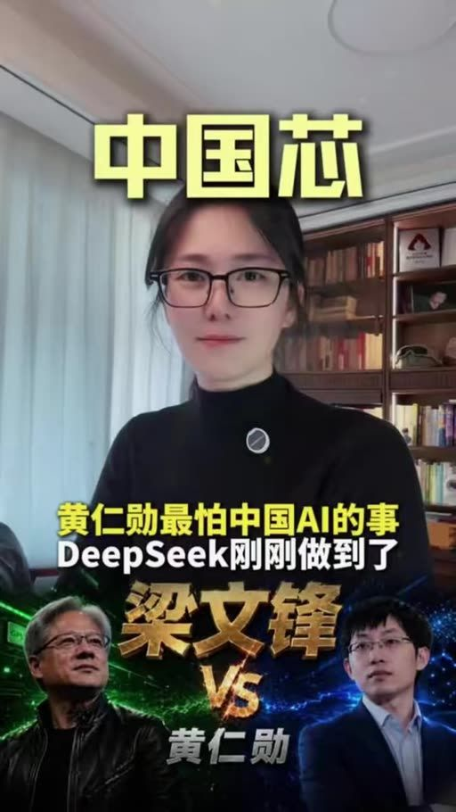

**標籤：** #DeepSeek V4 #黃仁勳

DeepSeek V4發布之後，矽谷很多人可能真的睡不著了。就在幾天前，英偉達掌門人黃仁勳還公開警告。

### 畫面 00:03–00:11

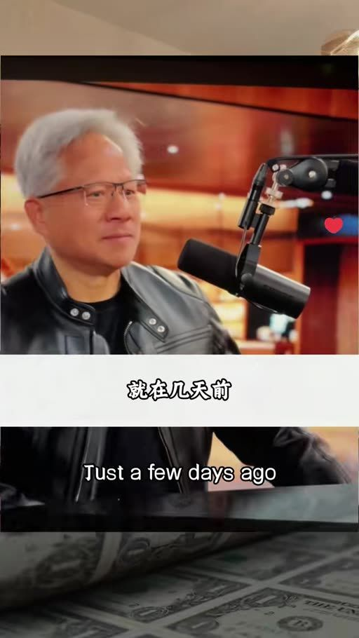

如果DeepSeek率先跑在華為平臺上，對美國來說將是非常可怕的一天。

### 畫面 00:11–00:21

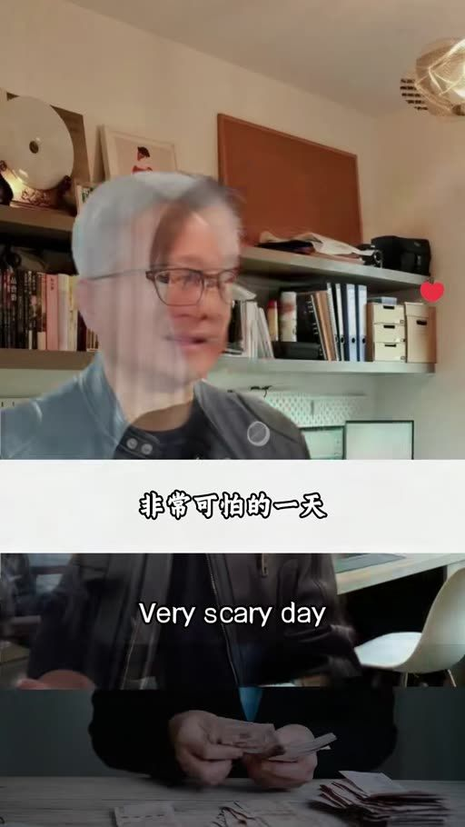

結果不到十天時間，這一天就真的來了。很多人不理解，想當年DeepSeek憑一己之力打破美國避怨模型霸權，為什麼苦等了500多天，換來的卻是一個便宜的答案。

### 畫面 00:21–01:17

**標籤：** #便宜 #科技普惠

但絕大多數人都沒有意識到，這個便宜背後藏著的，不僅僅是半個包子價格就能買到頂級算力的科技普惠，更是一個最了不起的技術破局，更別說這裡面藏著的國運級別的勝負手。毫不誇張的說，從這一刻開始，全球的算力格局和AI智慧體時代的整個遊戲規則都已經徹底改寫。今天我們不聊資料，不聊技術，聊三個決定咱們每一個中國人未來十年生存的核心問題。第一個問題，為什麼便宜才是最了不起的事情？我們天天覺得便宜沒好貨，關於DeepSeek的爭議也從來都沒有消停過。但是你知道嗎？如果按照西方的路線，算力將是咱們普通人永遠用不起的奢侈。如果你把一份幾萬字的研報丟給Claude 4.7,反覆地對談幾十次，就可能要花掉你50塊錢。同樣的場景用在DeepSeek V4,你可能只需要花3毛5分錢。這意味著什麼？一個互飄年輕人，沒有背景，沒有團隊，沒有融資，也可以呼叫一個世界級的策劃小組，程式設計助手和研究團隊。一個山區的孩子，不用產土拔舍，不用砸鍋賣田，也能擁有一個清北水平、隨時線上、反覆培練的AI老師。這不是簡單的降價，這是把改變命運的鑰匙親手交到了咱們普通人的手裡。

### 畫面 01:17–02:10

**標籤：** #普惠AI

這背後真正的邏輯是什麼？美國大模型在拼命的抬高門檻，本質上是一場資本的生意。而DeepSeek的路線是相信科技普惠的路線，是公平的路線。這件事更狠的地方在哪裡？現在用AI已經不是你問我答的聊天工具階段，而是智慧體階段。DeepSeek V4幹的事就是把AI從會說話變成會幹活。它把上下文真正拉到了100萬token,一整套的財報，幾十份的調研，一年的會議記錄，你都可以一股腦一次性的交給它。它能夠持續的處理，持續的執行。而且更關鍵的是，成本還是普通人可以負擔的價格。只有成本下降，AI才能變成基礎設施，AI智慧體也才能真正的落到我們的產業和普通人的身上。第二個問題，這背後藏著什麼更根本的東西？

### 畫面 02:10–02:30

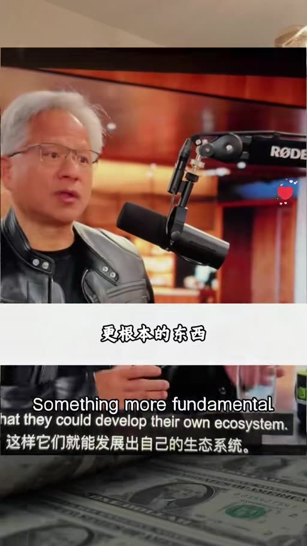

**標籤：** #國產晶片 #華為昇騰 #寒武紀

沒錯，這是黃人馴最害怕的，換了中國芯。這款頂級大模型第一批就官宣了，適配華為昇騰和寒武紀兩款國產晶片，徹底擺脫了對英偉達的依賴。過去的十年，所有的大模型公司要發布新產品，都要提前幾個月，乖乖的把底層介面和裝置需求發給英偉達所最佳化。這麼多年已經成了行業冠頂，其實說白了，這就是一場科技殖民。

### 畫面 02:30–02:38

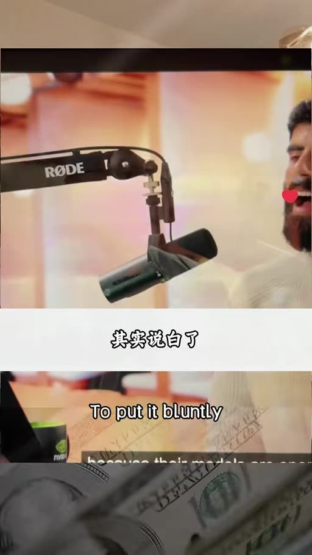

但是這一次，DeepSeek選擇深耕在咱們華為的國產底座上，根本就沒打算給英偉達留任何位置。

### 畫面 02:38–02:47

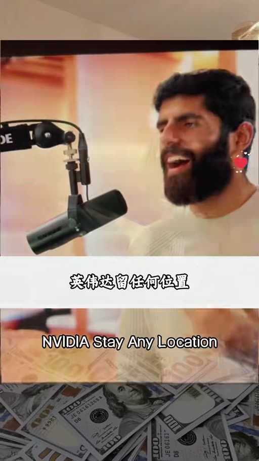

**標籤：** #CUDA生態 #護城河

這才是黃仁勳緊張的根源，他害怕的根本就不是晶片本身，而是整個AI生態的徹底搬家。因為這才是它稱霸全球的根本。英偉達底層的這個CUDA生態，就相當於AI行業的Windows,壟斷了全球AI的軟體生態。

### 畫面 02:47–03:03

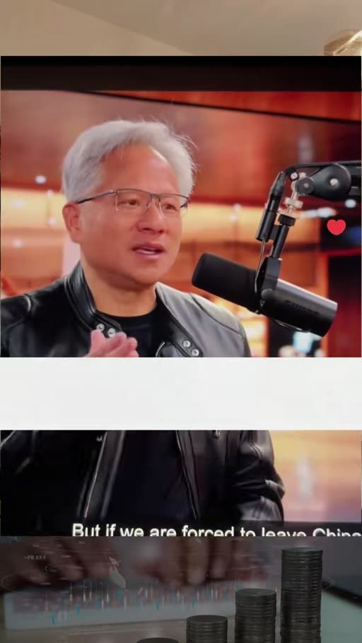

上百萬的開發者，全套的底層工具鏈，所有的大模型都只能跑在它的上面，遷移成本高到幾乎不可能。但是現在DeepSeek直接把英偉達的護城河硬生生的撕開了一個口子。

### 畫面 03:03–03:15

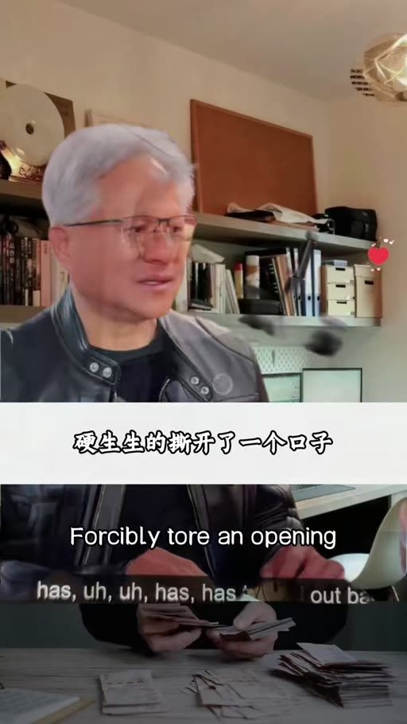

從此我們再也不用擔心人家隨意的制裁、斷供和漲價。中國AI正式進入科技自主時代，第三個問題更狠的是什麼？咱們的開源路線，很多人不知道開源意味著什麼，你看DeepSeek V4的技術報告最佳化器那一節。

### 畫面 03:15–03:19

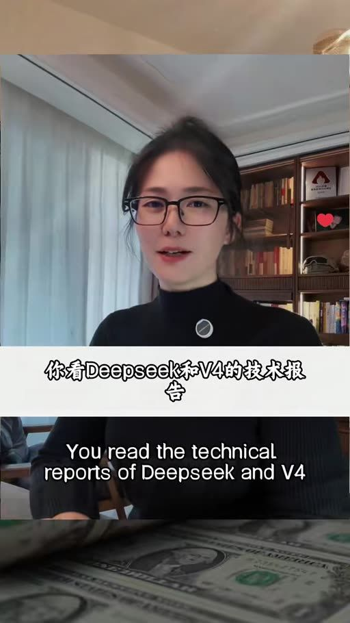

**標籤：** #開源 #MLA #Muon

我們的最佳化器用的是Kimi的Muon。

### 畫面 03:19–03:23

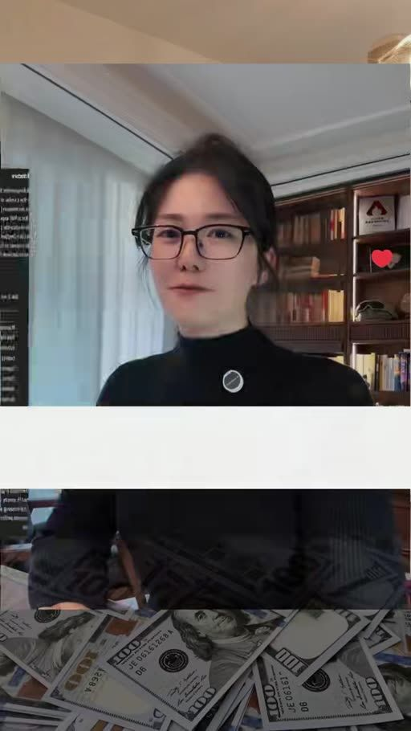

反過來，Kimi K2也用了DeepSeek開源的MLA注意力機制。

### 畫面 03:23–03:36

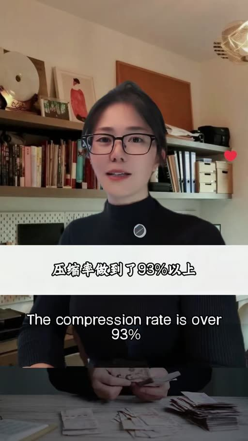

壓縮率做到了93%以上，已經從DeepSeek原創變成了行業標準，你用我的架構，我用你的最佳化器，沒有授權談判，沒有專利糾紛，兩篇論文相互引用，技術就這麼流動了，反觀大洋彼岸。

### 畫面 03:36–03:46

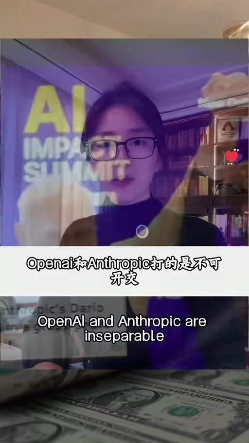

**標籤：** #OpenAI #Anthropic #封閉vs開放

OpenAI和Anthropic談的是不可開交，挖人起訴，相互拆臺，他們還限制中國使用者使用。Claude封了中國區的IP,OpenAI也對中國開發者做了防汙限制。

### 畫面 03:46–03:48

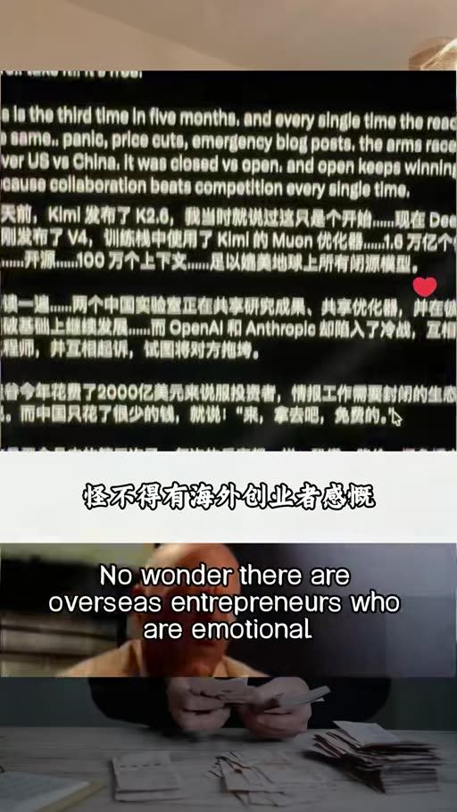

**標籤：** #矽谷2000億美元

怪不得有海外創業者感慨，矽谷今年花了2000億美元，說服投資人，智慧離不開圍牆。

### 畫面 03:48–03:55

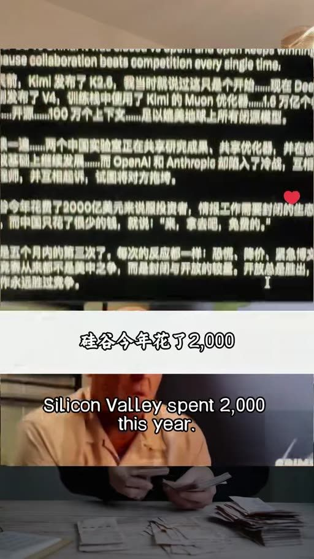

而中國只花了一個零頭，然後說拿去吧，免費用。

### 畫面 03:55–04:04

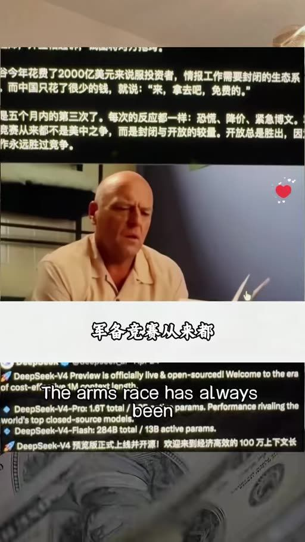

軍備競賽從來都不是美國和中國，而是封閉和開放。而開放之所以持續勝出，是因為協作每次都會比競爭更強。當DeepSeek這條完全不同的技術路線走通，而且成本更低，效果更好時，那麼不僅在中國，未來全球市場都會跟著這條新的路線。

### 畫面 04:04–04:16

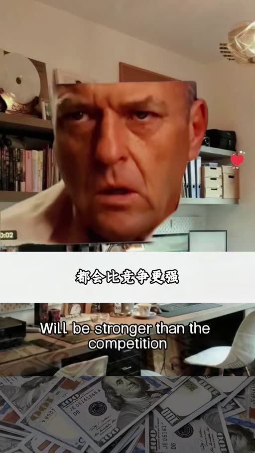

到那時候，中國技術戰就會成為全球標準，英偉達乃至整個矽谷的行業領導地位就會被連根拔起，從基礎價格治理平權到底層喚星擺脫依賴，再到中國路線開放共贏。

### 畫面 04:16–05:29

**標籤：** #全球標準

DeepSeek V4的發布絕不只是價效比的突破，它是從硬體架構到運算元最佳化再到分散式訓練的全鏈路自主化，從此中國AI正式告別看別人臉色過日子的時代，當初他們以為卡住晶片 管住生態就能把中國人擋在原地，但現在國產模型 國產算力用實力證明，中國人從來都不是這樣擋得住的，前面有山我們就把它移走 前面有海我們就把它填平，這就是中國人自古以來的倔強，DeepSeek V4不是終點 是我們奔向星辰大海的起點，外面的局勢很複雜，外界的聲音很嘈雜，但DeepSeek的回應只有16字，不右於喻，不恐於匪，率道而行，端然、正極。中國也真正需要的不是被捧上神壇，也不是被踩進塵埃，而是這份不疾不徐的定力。更重要的是，DeepSeek從來都不是孤軍奮戰，它的背後是華為、是寒武紀、是阿里、是Kimi、是智普和MiniMax,，是從晶片到模型，從架構到生態，億萬個把肩膀借給彼此的中國人。道足且長，行則將至，行而不錯，未來可見。

## 來源

- 原始資料夾：`watch-output/AI/2026-10-11_TikTok_中國芯-黃仁勳最怕中國AI的事-DeepSeek剛剛做到了__7686440557509545237`
- 逐字稿來源：whisper (groq)
