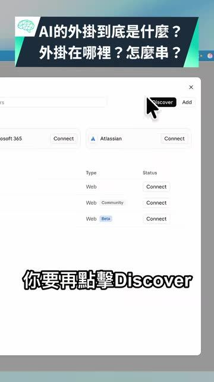
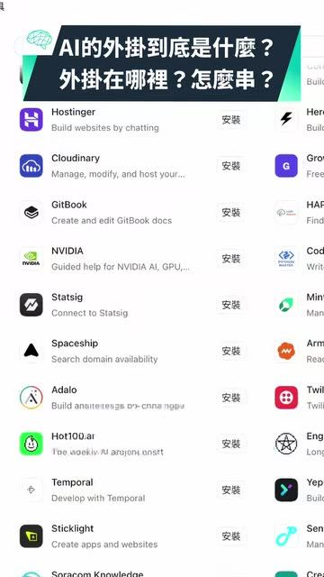

# AI 外掛：Claude Connector 與 ChatGPT App 怎麼用

## 思維導圖

- AI外掛怎麼用
  - 外掛是什麼
    - Claude叫Connector
    - ChatGPT叫App
    - 操作外部服務
  - Claude設定
    - Settings→Customize
    - Connectors→Discover
    - 點進去按授權
  - ChatGPT設定
    - 左上角外掛程式或Apps
    - 分類瀏覽
    - 同意授權
  - 自動判斷
    - 說情境不必指定工具
    - Claude較會自動選（講者主張）
  - 模糊需求
    - 需求轉具體指令代操
    - 導流留言外掛

## 圖文對照（畫面 + 逐字稿）

### 主題 1：外掛是什麼（00:00–00:18）

**重點：** 講者說外掛在 Claude 叫 Connector、在 ChatGPT 叫 App，讓 AI 去操作外部服務，例如查資料、下單、訂位。以前要開好幾個 App 來回切換才能完成的任務，現在可全部在對話框裡完成。

**標籤：** #Connector #App

首先來介紹外掛到底是什麼，外掛在Claude裡面叫做Connector，在ChatGPT裡面則是叫做App，讓AI可以去操作外部的服務，例如查資料、下單、訂位，這些以前要開好幾個App來回切換才可以完成的任務，現在可以全部在對話方塊裡面完成。

### 主題 2：Claude 怎麼設定外掛（00:18–00:42）

**重點：** 依畫面示範：點左下角 Settings → Customize → Connectors，會列出已連的 Connectors；再點 Discover 可看到外掛目錄，右邊有 Filter 可依類型篩選。想連哪一個就點進去，跳出的畫面按授權即可（介面為影片拍攝當時的樣子，可能已變動）。

**標籤：** #Settings #Customize #Discover

要怎麼設定呢？Claude這邊你可以點這個左下角的Settings，找到Customize，點進去找到Connectors，它會顯示出來的是你已經有連的Connectors，你要再點選Discover就可以看到一個外掛目錄，右邊還有Filter可以篩選外掛的型別，想要連哪一個直接點進去就好，跳出來的畫面按授權就OK啦。

### 主題 3：ChatGPT 怎麼設定外掛（00:42–01:00）

**重點：** ChatGPT 比較好找：左上角點「外掛程式」（中文模式）或 Apps（英文模式），App 已分門別類，可點分類看更多。操作一樣是點進去，跳授權畫面按同意即可。

**標籤：** #Apps #授權

ChatGPT 就比較好找一點，在左上角點外掛程式或是Apps，就是看你是中文還是英文模式，它已經把App分門別類了，可以點進去分類裡面的看更多App，操作方式一樣是點進去跳授權畫面按同意就好啦。

### 主題 4：串好後讓 AI 自己選外掛（01:00–01:25）

**重點：** 串好之後不用特別喊「用 Plugin 查」或「連 Gamma 做簡報」，只要說出想訂房、做簡報這類情境，講者主張 Claude 會自己判斷呼叫哪個外掛，ChatGPT 還沒那麼聰明，需要自己再選一下（講者主張，未查證）。外掛的方便在於把散落各 App 的服務接到同一個入口。

**標籤：** #自動判斷 #入口

我自己第一次連的時候其實有一點意外，串好之後你就不用特別喊用Plugin打槓查或是連Gamma做簡報，只要講出我想訂房做簡報這種任務的情境，Claude就會自己判斷要呼叫哪一個外掛，那GPT就還沒有那麼聰明，所以你可以自己再選擇一下，那外掛的方便性就在，它可以把這些散落在各個APP裡面的服務，全部都接到同一個入口。

### 主題 5：模糊需求與結語（01:25–01:46）

**重點：** 對模糊的需求（例如規劃長輩好走的旅行路線），AI 可把需求轉成具體指令並代操 App，省下熟悉 App、想關鍵字的時間。結尾邀請留言「外掛」領取其他外掛推薦的影片連結（導流）。

**標籤：** #代操 #導流

如果你有些比較模糊的需求，像是要請它規劃長輩好走的旅行路線，也可以讓AI幫我們把需求轉換成具體可以操作的指令代操APP，省下我們去熟悉APP想關鍵字的時間，想看其他外掛推薦、留言外掛，我就把影片連結傳給你。

## 知識點

- [[外掛_外掛：讓 AI 操作外部服務（Claude Connector／ChatGPT App）]]
- [[外掛_外掛把多個 App 的任務集中到對話框]]
- [[外掛_Claude 連接外掛的路徑：Settings → Customize → Connectors → Discover]]
- [[外掛_ChatGPT 連接外掛的路徑：左上角外掛程式／Apps]]
- [[外掛_串好外掛後只要說情境，AI 自己判斷呼叫哪個]]
- [[外掛_模糊需求可讓 AI 轉成具體指令代操 App]]

## 來源

- 原始資料夾：`watch-output/AI/外掛/2026-11-22_Facebook_AI-外掛-Claude-Connector-與-ChatGPT-App-怎麼用__1E68sTQniE`
- 逐字稿來源：whisper (groq)
