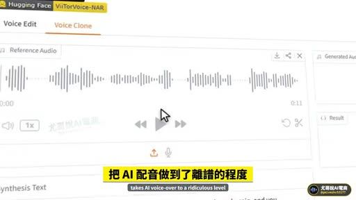
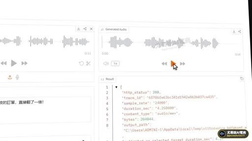
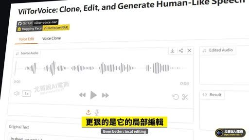
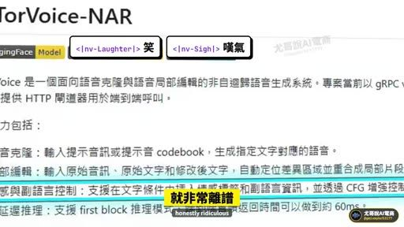
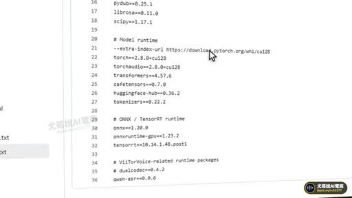

# 開源AI聲音克隆神器，不僅支援聲音克隆，還可以增加語氣，比如：笑、歎氣…最重要的一點是支援區域性編輯，音訊說錯的部分支援單獨更改！

## 思維導圖

- ViiTorVoice 開源聲音克隆
  - 開場
    - 10 秒錄音克隆（講者主張）
    - 不需文字稿
    - Apache 2.0 可商用（講者主張）
  - 多語言示範
    - 中英日韓
    - 開心、生氣情緒
  - 局部編輯
    - 只改文字不重錄
    - 只重做約 0.4 秒（講者主張）
  - 笑聲與嘆氣
    - nv-Laughter 標籤
    - nv-Sigh 標籤
  - 結語
    - 官方只支援 NVIDIA
    - Windows 版 CPU 可跑（講者主張）

## 圖文對照（畫面 + 逐字稿）

### 主題 1：開場：10 秒錄音克隆聲音的開源專案（00:00–00:27）

**重點：** 介紹 GitHub 開源專案 ViiTorVoice，講者稱 10 秒錄音、不需文字稿就能克隆聲音，說錯字改文字即可。授權為 Apache 2.0、可免費商用（講者主張，未查證）。

**標籤：** #ViiTorVoice #Apache 2.0 #10 秒錄音

語音圈直接炸鍋了，這個GitHub開源黑科技，把AI配音做到了離譜的程度，10秒錄音就能克隆你的聲音，說錯一個字改文字就行，記住這個專案名字，ViiTorVoice，完全開源Apache 2.0協議，可以免費商用，只要一段10秒的錄音，連文字稿都不用給，它就能用你的聲音說任何話。

### 主題 2：多語言示範與情緒演出（00:27–00:52）

**重點：** 用克隆聲音示範中、英、日、韓四語自我介紹與「今天全部半價」，並能演出開心、生氣等情緒；後段用電商情境示範（庫存表改錯、訂單翻倍）。

**標籤：** #多語言 #情緒

開心生氣都能演，大家好，我是遊哥，這句話我沒有錄過，Hi, I'm 魚爵，Today everything is half price，こんにちは,Yugoです，今日は全部半額です，안녕하세요,Yugo입니다，오늘은全部半額寫，太好了，這個月蝦皮的訂單直接翻了一倍，到底是誰把庫存表改錯了，今天的單全部出不去。

### 主題 3：局部編輯：只重做改動的部分（00:52–01:15）

**重點：** 口播唸錯價格時不必整段重錄，只改文字，系統只重做約 0.4 秒（講者主張，未查證），其餘部分原樣保留；示範把「今天直播間只要 490」改成「390」，改完仍是同一個聲音。

**標籤：** #局部編輯

更狠的是它的局部編輯，口播唸錯一個價格，不用整段重錄，只要改文字，它只重做那0.4秒，其他部分原樣保留，這件外套原價990，今天直播間只要490，這件外套原價990，今天直播間只要390，改完還是同一個聲音。

### 主題 4：句中笑聲與嘆氣標籤（01:15–01:28）

**重點：** 畫面 README 顯示 <|nv-Laughter|> 笑、<|nv-Sigh|> 嘆氣等標籤，可讓聲音在句子中間笑出來或嘆氣；README 另列克隆、局部編輯、情感與副語言控制、低延遲推理（first block 約 60ms，畫面文字，未查證）。

**標籤：** #情緒標籤 #nv-Laughter

甚至它還能讓你在句子中間笑出來，嘆一口氣，就非常離譜，我本來以為這支影片沒人看，結果一覺醒來，播放破萬了，好吧。

### 主題 5：結語：Windows 版與 CPU 可跑（01:28–01:46）

**重點：** 講者稱官方只支援英偉達（NVIDIA）顯示卡，他已改好 Windows 版，CPU 也能跑，並打包成壓縮包、留言發送（講者主張，未查證）；片尾請觀眾關注。

**標籤：** #Windows 版 #CPU

那我們再改一次，這已經是第十版了，官方只支援英偉達顯示卡，我已經改好了Windows版，CPU也能跑，壓縮包一打包，留言發你，關注我，每天帶你瞭解AI最新科技。

## 來源

- 原始資料夾：`watch-output/AI/2026-11-02_TikTok_開源AI聲音克隆神器-不僅支援聲音克隆-還可以增加語氣-比如-笑-歎氣…最重要的__7700148582044781830`
- 逐字稿來源：whisper (groq)
