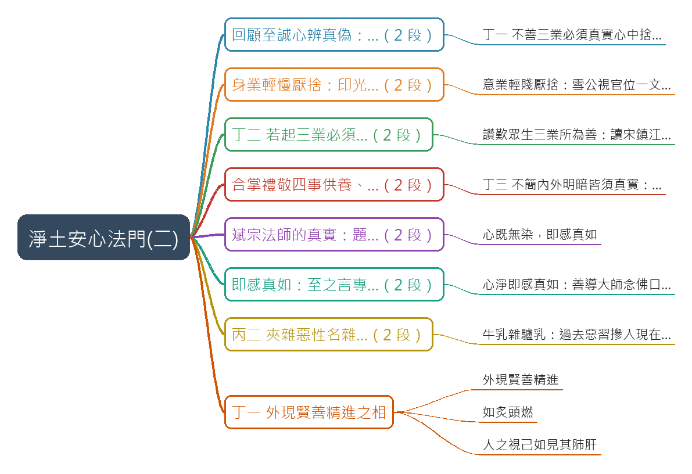

# 淨土安心法門(二)

## 摘要

**一句話重點**：台中蓮社講座第二講，接續帶讀雪公（李炳南老居士）〈淨土安心法門〉的至誠心「辨真偽」。講述丙一「三業修善、清淨心作」的三條：不善三業要真實心中捨（口業毀厭、身業輕慢厭捨、意業輕賤厭捨），善的三業要真實心中作，不論內外明暗都要真實；做到了「心既無染，即感真如」。最後進入丙二「夾雜惡性，名雜毒善」，講到第一條「外現賢善精進之相」。

> 以下是講者的講述與詮釋（宗門內的教學觀點）；人物事蹟、經論出處與歷史細節都是講者主張，未查證。

### 重點（含時間戳）

| 時間 | 重點 |
|---|---|
| 00:00 | 回顧：三業不幹壞事就是清淨心。蕅益大師詩「名譽及利養，愚人所愛樂，能損害善法，如劍斬人頭」：貪名聞利養，功德只剩人家讚嘆完就沒了的「陽德」；清淨心作的才是「陰德」。 |
| 03:26 | 丁一 不善三業必須真實心中捨：不善三業就是貪著娑婆的依報（環境）與正報（身體）。口業要毀厭，佛法把身體說成「革囊臭穢」。 |
| 07:10 | 身業輕慢厭捨：講者說印光大師在普陀山酷熱的藏經樓閉關，拒絕到天目山避暑，說越熱越能寫信回覆眾生。 |
| 09:12 | 意業輕賤厭捨：講者說雪公任職孔奉祀官府時，只要開口孔祥熙就會給官做，雪公卻視官位一文不值。捨就像千年暗室點了一盞燈。 |
| 12:47 | 丁二 若起三業必須真實心中作：「起」是誠於中、形於外。孔子「溫而厲，威而不猛，恭而安」是修出來的；真實要學曾子「吾日三省吾身」。 |
| 16:33 | 讚歎眾生三業所為善：葛繁太守日行眾善（《淨土聖賢錄》），雪公讀後作詩「安得金鋪祇樹園，檢書驚喜獲佳言，利人何患阮囊澀，此後心香輪葛繁」。雪公對蓮友的小善「不吝讚嘆」，所以人人歸心。 |
| 21:06 | 合掌禮敬四事（衣服、飲食、臥具、湯藥）供養：供養是「敬我之心，竭我之誠」，是種自己的福田。梁武帝前世以斗笠為佛像遮雨的故事。意業要常思想、觀察、憶念阿彌陀佛及依正二報。 |
| 25:26 | 丁三 不簡內外明暗皆須真實：有沒有人看到都一樣。引《大學》「小人閒居為不善……揜其不善而著其善」。 |
| 28:35 | 斌宗法師的例子：請雪公題書名一定要楷書；有顯要要受戒，法師只問「是自願的嗎？」 |
| 31:19 | 心既無染，即感真如：三句真實都做到心就清淨；夾雜見思惑（貪瞋痴慢疑）的善是有漏的，不能了生脫死。 |
| 33:42 | 至之言專，誠之言實；《妙宗鈔》「非念真如，豈名專實」；《彌陀疏鈔》「一心無虛妄即真，無遷流即如」。念佛字字清楚、不被妄念牽走；講者說雪公認為五分鐘一心不亂就開智慧，先練「百八聲不亂」。 |
| 37:52 | 善導大師入佛堂合掌胡跪念佛，冬天也汗流浹背；絕意名利、遠諸戲笑、獨行念佛。答問「如汝所念，遂汝所願」，念一聲佛口出一道光明（講者展示日本畫作）。以身證法 vs 以身謗法。 |
| 42:21 | 丙二 夾雜惡性名雜毒善：四帖疏「事同蛇蠍，雖起三業，名為雜毒之善，亦名虛假之行」。 |
| 44:28 | 雪公比喻「牛乳雜驢乳」：牛乳攢則成酥，驢乳攢則成尿；過去惡業習氣摻入現在的善，就不純粹。要隨緣消舊業，降伏習氣。 |
| 47:32 | 丁一 外現賢善精進之相：縱使苦勵身心、日夜急走急作如炙頭燃，內心如蛇蠍仍是雜毒善；人之視己如見其肺肝，瞞不過人。下次續講。 |

### 名詞說明

- **依報／正報**：依報是眾生所依的環境（國土、器物），正報是眾生的身心。「自他依正二報」指自己與他人的身體和環境。
- **陽德／陰德**：講者的說法：為求名利而做的善，受人讚嘆後福報就用完了（陽德）；不求人知的善才會開花結果（陰德）。
- **革囊臭穢**：以皮袋裝臭穢之物比喻身體，用來對治貪愛色身。
- **輕慢厭捨／輕賤厭捨**：善導大師《觀經四帖疏》對身業、意業的捨法：對娑婆享受輕看、厭離、捨棄。
- **見思惑**：見惑（錯誤見解）與思惑（貪瞋痴慢疑等煩惱），夾雜就是「染」。
- **專實**：至誠心的「至」是專一，「誠」是真實；知禮大師《妙宗鈔》用「專實」解釋至誠。
- **雜毒善**：外表行善、內心夾雜惡性的善，四帖疏比作蛇蠍。
- **葛繁**：講者說是宋朝鎮江太守，《淨土聖賢錄》有傳，以日行眾善著稱（未查證）。
- **斌宗法師**：講者說是鹿港人，曾到大陸學天台宗，民國四十幾年回台，著有心經註解（逐字稿依此推定為《般若波羅蜜多心經要釋》，未查證）。

### 轉錄說明

- 逐字稿來源是 Groq Whisper，自動偵測為中文，套用 `pure-land` 詞典。
- Groq 有 9 個 30 秒窗格漏轉：整段只剩一句標題，或吐出提示詞「阿賴耶識、敦倫盡分」。這次的空白被一個長段落蓋住，`whisper.py` 的自動補漏沒有偵測到；已把這 9 段單獨重送 Groq（不帶提示詞）補回約 4 分半的內容，接縫處的重複句已刪除。
- 校稿依投影片截圖校正，例如「讀宋鎮江葛太守小傳」「此後心香輪葛繁」「牛乳攢則成酥」「染即不淨，即是惑」。這次新增的 64 條穩定專名已寫入 `pure-land` 詞典（如依報正報、雪公老師、輕慢厭捨、雜毒善、斌宗法師）；只對這支影片成立或推測性的修正記在 `meta.json.known_asr_errors`。
- 已用雪公原講稿〈淨土安心法門（二）〉二次校對，原稿與影片的對應見補充資料 S1。
- 2026-10-13 檢查漏轉：以每 20 秒字數密度掃描，再把 6 個可疑窗格（00:00、13:00、25:20、34:00、47:40、49:50）單獨重送 Groq 比對。結果：34:08–34:17 漏了一句，已補入；25:32–25:44 約 12 秒轉不出（非靜音），標「轉錄缺漏」；其餘各窗格內容完整。
- 2026-10-13 以 `scripts/clean_fillers.py` 去除無意義語助詞（呢、啊、句尾的啦／嘛／喔／哦／囉）；`transcript.raw.md` 與影片原話不變。載入 pure-land 詞典的歸檔現在會自動去除語助詞，重跑也不必再手動執行。

## 思維導圖



## 補充資料

### S1｜連結：雪公〈淨土安心法門〉原講文字紀錄（二次校對依據）
- 來源：明倫月刊網站〈淨土安心法門〉，雪公講述、鍾清泉敬記（https://www.minlun.org.tw/1pt/1pt-2-1/books2/1025.htm）；取得日期：2026-10-12；取得方式：Claude 以 curl 下載全文比對（網址沿用第（一）講歸檔時使用者提供的連結）。
- 為何需要補充：影片是主講者帶讀雪公講稿，逐字稿有許多同音誤聽；用原講稿核對講表文字與雪公原話。影片（二）涵蓋原講稿（一）後半的丙一三條與總結，以及原講稿（二）的丙二「雜毒善」與丁（一）。對應段落：投影片 2–11（03:26–37:52）、13–15（42:21–50:15）。
### 原文（逐字）
```
丁（一）不善三業必須真實心中捨
……不善的三業，真實心中捨，若不真實也不是清淨心，一下子就放下……
放下如何就行呢？金剛經中有比喻，一座黑屋子，多少年不見陽光，你拿著一支蠟燭進去，千年萬年的黑屋，進去一支蠟燭、一屋子皆放了光明。
```
```
丁（二）若起三業必須真實心中作
……若起三業的「起」是心裡一動，身口意要幹好事，必須真實心中作……儒家大學有云：「小人閒居為不善，無所不至；見君子而后厭然，揜其不善，而著其善。」……然而「人之視己，如見其肺肝然則何益矣？此謂誠於中，形於外。」……曾子云：「吾日三省吾身」……「為人謀而不忠乎」……「與朋友交而不信乎」……
```
```
丁（三）、不簡內外明闇皆須真實
第三條「不簡內外明闇皆須真實」。簡—挑選。在內在外，乃至明顯或暗處，幹一切事情皆須真實，真心誠意絕不欺騙人。
如此三條後，下頭兩句乃總結「心既無染，即感真如」—染是不乾淨，有了見思惑就是不乾淨。「即感真如」—凡事由真心實意顯出來，就能明心見性見了真如。
```
```
淨土安心法門（二）
丙二、夾雜惡性名「雜毒善」
……善性夾雜惡性名雜毒善，在譬喻經有一個比喻，其牛奶中摻了驢奶，這奶就雜了。……我們過去造的惡業，摻入現在所作的善，就好比把驢奶摻入牛奶，名為雜毒善，雖然是作善但不純粹。雜毒善下面列有三條，只講事不講理。
丁（一）外現賢善精進之相
```
### Claude 的對照分析
- 與影片一致：丁一至丁三的標題文字；「簡」是挑選、「在內在外，乃至明顯或暗處」；《大學》「小人閒居為不善……揜其不善而著其善」「人之視己，如見其肺肝然，則何益矣，此謂誠於中，形於外」；曾子三省；「心既無染，即感真如」與「凡事由真心實意顯出來，就能明心見性見了真如」；牛奶摻驢奶「雖然是作善但不純粹」。
- 補充直接寫明（影片沒有的）：「千年暗室」的比喻雪公說出自金剛經（影片只說「千年暗室點一盞燈」）；牛奶摻驢奶的比喻原稿說出自「譬喻經」，影片主講者說「大智度論」（45:48）；原稿把《大學》引文放在丁二，影片主講者則在丁三（26:59）與丁一外現賢善（49:10）引用。
- 據此推定（非補充直接寫明）：逐字稿依原稿改正「不檢→不簡」「民案→明暗」「心即無染 己感真如→心既無染，即感真如」「曾子三省」各句；「染即不淨」依投影片改正。
- 原稿沒有、屬影片主講者延伸的內容（不能用原稿校對）：蕅益大師詩與陽德／陰德、口業毀厭的「革囊臭穢」、身業輕慢厭捨與意業輕賤厭捨的分項說明（依四帖疏與投影片）、印光大師拒避暑、雪公與孔祥熙、論語「子溫而厲」、葛繁太守小傳與雪公詩、四事供養與梁武帝、斌宗法師、妙宗鈔「專實」與彌陀疏鈔「真如」、百八聲不亂、善導大師念佛出光。這些依投影片與上下文校正，推測處記在 `known_asr_errors`。
### 備註
- 原講稿是聽講紀錄（敬記），不是雪公手稿；影片與原稿的對應是依內容比對，未經主講者確認。
- 人物事蹟（印光大師、孔祥熙、葛繁、斌宗法師、梁武帝前世）都是講者主張，未查證。

## 來源

- 原始資料夾：`watch-output/佛學/2026-10-12_YouTube_淨土安心法門-二__pukUhT6JmFw`
- 逐字稿來源：whisper (groq)
