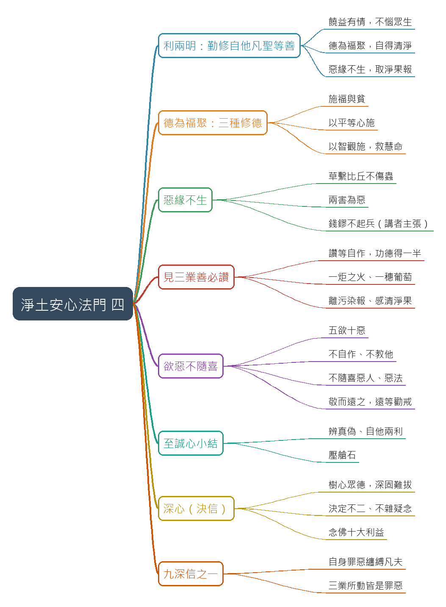

# 淨土安心法門(四)

## 摘要

**一句話重點**：續講《觀無量壽佛經》「至誠心」的第二段「利兩明（自他兩利）」——勤修自他凡聖等善的三條（饒益有情不惱眾生、德為福聚自得清淨、惡緣不生取淨果報），加上「見三業善必讚」與「欲惡不隨喜」；最後進入第二心「深心（決信）」，從「樹心眾德，深固難拔」說到「自身罪惡纏縛凡夫」。（臺中蓮社講座，講師引雪公老師〔李炳南〕科判，講者主張與故事均未查證。）

- 來源：YouTube 直播，臺中蓮社；片長 49:50；逐字稿：Whisper（Groq）。
- 投影片逐條原文見 `supplement.md` S1、科判總表見 S2。

### 重點表

| 時間 | 重點 |
|---|---|
| 00:00 | 更正：表上為「奸詐百端、惡性不改」，PPT 寫「難侵」（惡性很難清除），講者建議改作「不改」。 |
| 01:05 | 第一條「饒益有情，不惱眾生」：一介螻螘、萬聖互援；過午稱「藥食」、碗盤輕放「輕身歸本處」，連針口鬼都不惱。 |
| 04:52 | 第二條「德為福聚，自得清淨」：福報靠修德不靠賺錢；《阿含經》修德三法之一「施福與貧」。 |
| 07:40 | 三法之二「以平等心」、之三「以智觀施」：不只救生命，更要教人出離三界、救慧命。 |
| 10:26 | 反省：念佛多年有沒有帶人？度一人、數人、百人與幫助往生的功德不同。 |
| 12:17 | 第三條「惡緣不生，取淨果報」：草繫比丘因怕傷草中蟲而不扯斷草；《禮記》「方長不折」。 |
| 16:24 | 「兩害為惡」：《道德經》治大國若烹小鮮；吳越國錢鏐不為爭天下讓百姓上戰場（講者主張，未查證）。 |
| 20:28 | 「見三業善必讚」：讚等自作，他的功德你得一半（講者主張）；《四十二章經》一炬之火。 |
| 23:51 | 「讚嘆一切眾生三業所為善」：《雜譬喻經》一穗葡萄；離污染報；會性法師與雪公老師婉拒表揚。 |
| 29:24 | 「欲惡不隨喜」：五欲（色聲香味觸／財色名食睡）、十惡；不自作、不教他。 |
| 32:15 | 不隨喜惡人（借梯給小偷、幫忙拉大魚）、不讚嘆惡法；敬而遠之、遠等勸戒；李晟與張延賞的故事。 |
| 36:30 | 網路演算法：財色名食睡的影片拒絕點閱。 |
| 37:47 | 至誠心小結：辨真偽、自他兩利；至誠心是修行的壓艙石。 |
| 39:10 | 第二心「深心（決信）」：深信如水深淺；「樹心眾德，深固難拔」；「決」如開會決議、決定不二。 |
| 43:19 | 念佛十大利益（諸天護法、二十五菩薩圍繞、諸佛攝受…）：能不雜一念地相信嗎？ |
| 46:09 | 九深信之首「自身罪惡纏縛凡夫」：三業所動皆是罪惡；纏縛＝煩惱綁住有情；凡夫＝不覺。下回續講。 |

### 名詞與說明

- **利兩明**：科判「乙二」名稱，指自利利他（逐字稿原聽寫為「明兩立」「明兩利」，依投影片表校正）。
- **勤修自他凡聖等善**：對自己、對他人勤修各種善。
- **德為福聚**：修德才能聚集福報；**功德為眾福聚處**。
- **惡緣不生**：沒有緣，惡因不會結成惡果；**兩害為惡**：害人又害己。
- **讚等自作**：讚嘆別人做的善，等於自己做（投影片：功德得一半）。
- **五欲／十惡**：色聲香味觸或財色名食睡；身三口四意三。
- **敬而遠之／遠等勸戒**：遇惡人保持恭敬但遠離，遠離本身就是一種勸戒。
- **深心（決信）**：深信之心；決定不二之信，不雜疑念。
- **罪惡纏縛凡夫**：九深信的第一條。
- **針口鬼**：餓鬼之一，喉嚨細如針、肚子大，聽到碗盤聲就更飢餓。

### 轉錄校正備註

- 詞典與人工替換：雪公老師、蕅益大師、會性法師、錢鏐（吳越國）、李晟、張延賞、針口鬼、色聲香味觸、財色名食睡、樹心眾德深固難拔等；推測者見 `meta.json` 的 `known_asr_errors`。
- Groq 轉錄漏掉 5 處約 7–30 秒人聲（18:10、23:57、25:16、29:35、37:09 起），已用單獨重送音訊補回。
- 已去除語助詞「呢」「啊」等（`transcript.raw.md` 保留原話）；刪除口吃與跨行重複，講者語意不通的片段（34:50 附近、24:23 幻覺）已刪並記入 `known_asr_errors`。
- 影片中的歷史故事、典故、數字與主張（草繫比丘、錢鏐、李晟與張延賞、一穗葡萄、十大利益、「功德得一半」等）皆為「講者主張，未查證」。

## 思維導圖



## 補充資料

### S1｜畫面遺漏：投影片條列原文（丙二～乙一）
- 來源：影片畫面（臺中蓮社直播的投影片）；取得日期：2026-10-24；取得方式：從影片截圖逐字抄錄
- 為何需要補充：講者口述時只唸部分條列，投影片上的科判標題、經句出處與括號註記（如「益為加厚」「德為恩惠」）逐字稿沒有；對應截圖 `frames/slide_02.jpg`、`slide_03.jpg`、`slide_04.jpg`、`slide_06.jpg`、`slide_07.jpg`、`slide_08.jpg`、`slide_09.jpg`、`slide_11.jpg`、`slide_12.jpg`、`slide_15.jpg`、`slide_17.jpg`。

### 原文（逐字）
```
（丙二）勤修自他凡聖等善          〔01:20–04:52 起〕
•饒益有情不惱眾生（益為加厚）
•布施，愛語，利行，同事
•德為福聚自得清淨（德為恩惠）
•功德為眾福聚處：
•(一)施福與貧　獲世出世福利
•(二)以平等心　獲眾生世出世福利
•(三)以智觀施　為出世之業

•惡緣不生取淨果報
•無緣不生，自不生惡：
•如草繫比丘，佛在世時，有比丘為賊以生草繫之。
•比丘恐壞其生草，而不解縛
•兩害為惡：雙方不害，自然得清淨果報。（治大國若烹小鮮）

（丙三）見三業善必讚
•贊等自作：他做好事，你讚歎，他的功德你得一半。
•譬如一炬之火，數千百人，各以炬來分取。
•讚歎一切眾生三業所為善（一穗葡萄）
•可離污染報：不好的事情，沾染不到身上。
•可感清淨果：功德愈感愈多

（丙四）欲惡不隨喜
•欲惡：五欲十惡
•不隨喜｛不自作，不教他
         不隨喜惡人，不讚歎惡法
•敬而遠之：遠等勸戒
（李晟 ⟷ 張延賞）

甲二 深心（決信）
•深心：深信之心。
•（樹心眾德，深固故難拔）
•如水分深淺，言心水之信：即是深信之心也。
•決信：決定不二之信
•不雜疑念之信心

（乙一）自身罪惡纏縛凡夫
•自身：胎卵濕化
•罪惡：三業所動皆是罪惡
•纏縛：煩惱纏縛有情而繫三界之獄
•凡夫：不覺凡夫
```

### Claude 的對照分析
- 補充直接寫明（影片沒有的）：科判名稱（丙二「勤修自他凡聖等善」、丙三「見三業善必讚」、丙四「欲惡不隨喜」、甲二「深心（決信）」、乙一「自身罪惡纏縛凡夫」）；「功德為眾福聚處」三種（施福與貧、以平等心、以智觀施）；「樹心眾德，深固故難拔」。
- 與影片一致：講者依此條列逐條講解；逐字稿的「利兩明」「兩利」「布施、愛語、利行、同事」「草繫比丘」「兩害為惡」「李晟與張延賞」「敬而遠之／遠等勸戒」「決信」「胎卵濕化」均已依投影片校正。
- 據此推定（非補充直接寫明）：投影片「（樹心眾德，深固故難拔）」，講者引述的出處人名逐字稿為「深照大師」，推測為「僧肇大師」，投影片沒寫出處，未查證。

### 備註
- 畫面上的投影片文字為抄錄，未另查證原典；括號內註記為投影片原有。
- 乙一至乙九「九條深信」只有第一條在本講出現，其餘留待下一講。

### S2｜畫面遺漏：科判總表（甲一至誠心、甲二深心、甲三迴向發願心、甲四具三心者）
- 來源：影片畫面（講者開頭與 39:21 展示的科判表，同一張圖）；取得日期：2026-10-24；取得方式：從影片截圖（`frames/slide_01.jpg`）辨識
- 為何需要補充：講者開頭說「表上面和 PowerPoint 上面有一點不一樣」，指的是這張表；表中「乙二 利兩明」為本講多次提到的「利兩明（自他兩利）」。

### 原文（逐字）
```
甲：觀無量壽佛經
佛告阿難，及韋提希：凡生西方，有九品人。上品上生者，若有眾生，願生彼國者，發三種心，即便往生。何等為三？一者至誠心，二者深心，三者迴向發願心。具三心者，必生彼國。

甲一 至誠心
  乙一 偽真辨
    丙一 「清淨心」作
    丙二 名「雜毒善」
      丁(三) 奸詐百端惡性不改
      （不名「真實」業）
  乙二 利兩明
    丙一 制捨「自諸惡」
      （自利利他）
    丙二 勤修「他凡聖等善」
      丁(一) 饒益有情不惱眾生
      丁(二) 德為福聚自得清淨
      丁(三) 惡緣不生取淨果報
    丙三 「見三業善必讚」→「可離污染報」「可感清淨果」
    丙四 「欲惡不隨喜」→ 敬「而遠之」亦不隨喜
```
（畫面標：只抄錄與本講有關的部分；其餘細目（含丙一、丙二下的丁(一)(二)）與甲二以下未逐字抄錄。）

### Claude 的對照分析
- 補充直接寫明：表上寫「奸詐百端惡性不改」，與講者說「雪公老師的表上是這樣」相符；PowerPoint 則寫「難侵」。
- 與影片一致：「乙二 利兩明」與逐字稿「利兩明」「自他兩利」一致。
- 據此推定：逐字稿中的「明兩立／明兩利」應為「利兩明」的聽寫錯誤（推測）。

### 備註
- 表中部分小字在 1024px 縮圖中不易辨識，已略過未抄。

## 來源

- 原始資料夾：`watch-output/佛學/2026-10-24_YouTube_淨土安心法門-四__4Lhp2A1kiZw`
- 逐字稿來源：whisper (groq)
