# 大鵬財商 - 一個人財富積累最快的方式，不是拼命尋找成功秘訣，而是直接複製查理·芒格的10個終身習慣。  芒格有一句非常經典的話：  “如果我知道自己會...

## 思維導圖

- 複製芒格的十個習慣
  - ①先攢第一個十萬
    - 先存後花
    - 存錢＝買選擇權
  - ②讀書拆底層邏輯
    - 書是工具箱
    - 知識轉判斷力
  - ③研究失敗
    - 酒精、慾望、高槓杆
    - 看不懂不碰
  - ④守住身體
    - 不熬夜、散步
  - ⑤承認無知
    - 雙軌分析法
  - ⑥遠離讓你變蠢的人
    - 焦慮嫉妒消耗就遠離
  - ⑦時間賠不起
    - 五年後還重要嗎
  - ⑧終局思考
    - 想像年老的自己
  - ⑨逆向思考
    - 先想怎麼會失敗
  - ⑩降低慾望
    - 財富＝能力減慾望
  - 結語
    - 先做到三條

## 圖文對照（畫面 + 逐字稿）

### 主題 1：開場：複製查理·芒格的十個習慣（00:00–00:58）

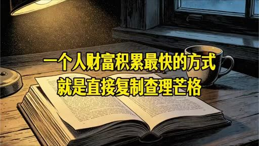

**重點：** 講者主張最快累積財富的方式是直接複製查理·芒格：他經歷大蕭條、破產、失明、喪子仍扛過來，晚年一年還能賺 5000 萬美元、身家 261 億（講者主張，未查證）。講者讀過《窮查理寶典》與演講訪談，歸納出十個習慣，並說巴菲特稱芒格讓他成為更好的投資者。

**標籤：** #芒格 #窮查理寶典 #十個習慣

一個人財富積累最快的方式就是直接複製查理芒格，芒格說我這輩子最驕傲的不是賺到261億，而是當年連房租都快交不起的時候，咬牙做對了幾件小事，2023年99歲的芒格躺在病床上，腦子依舊清醒，大蕭條，破產，失明，喪子，他全扛過來了，到晚年一年還能賺5000萬美元，他到底靠什麼活成了最後的贏家，答案就藏在他一窮二白時，用血淚換來的十個終身習慣，巴菲特親口說過，是芒格讓他變成了更好的投資者，我把窮查理寶典翻爛了，把他的演講和訪談扒了一遍，總結出十個精髓，如果你此刻正陷在迷茫和痛苦裡，覺得人生沒指望，這條影片值得你反覆看，它覆蓋了人生裡幾乎所有的事，現在就寫下複製芒格四個字，不是讓你馬上發財，是提醒你從今天起換一套活法。

### 主題 2：第 1 條：先攢夠人生第一個十萬（00:58–01:25）

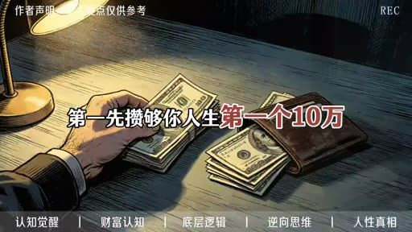

**重點：** 普通人是「賺多少花多少、剩多少存多少」，芒格完全倒過來：先把錢扣下來，剩下的才花。存錢不是摳門，而是替自己買「選擇權」：機會來了接得住、低谷來了不必被迫接爛工作。財富起點永遠是儲蓄。

**標籤：** #儲蓄 #選擇權

第一，先攢夠你人生第一個十萬，普通人花錢的順序是，掙多少花多少，剩多少存多少，芒格完全倒過來，先把錢扣下來，剩下的才拿去花，存錢不是摳門，是給自己買選擇權，手裡有存款，好機會來了，你能接住，低谷來了，你不用被迫接爛工作，沒有這筆保底錢，再好的機會擺你面前，你都沒底氣，財富的起點，永遠是儲蓄。

### 主題 3：第 2 條：讀書但別為了讀而讀（01:25–01:54）

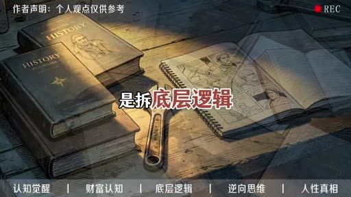

**重點：** 講者說芒格是「長了兩條腿的書」，但他讀書不是收集碎片，而是拆底層邏輯：從歷史看經濟週期、從心理學看人性誤區，書是工具箱，讀一本多一件解決問題的工具。這個時代知識不值錢，把知識轉成判斷力才值錢。

**標籤：** #讀書 #底層邏輯 #判斷力

第二，讀書但別為了讀而讀，芒格說自己是本長了兩條腿的書但他讀書不是收集碎片是拆底層邏輯從歷史看經濟週期從心理學看人性誤區書本對他來說是工具箱，讀一本多一件解決問題的工具，很多人刷短影片，以為學到了乾貨，真遇到事，腦子裡全是零散碎片，這時代知識不值錢，把知識轉化成判斷力的能力才值錢。

### 主題 4：第 3 條：研究失敗比研究成功重要一百倍（01:54–02:31）

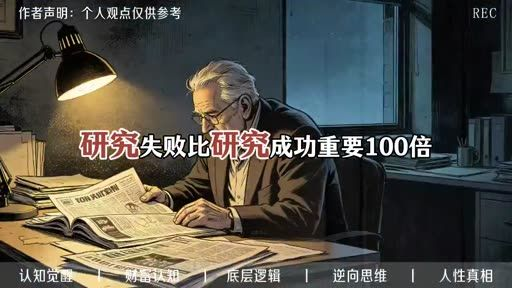

**重點：** 芒格一輩子研究人怎麼垮掉，名言是「如果我知道自己會死在哪，我永遠不去那個地方」；他的清單寫的是絕對不能碰什麼。講者轉述芒格毀掉財富的三樣東西：酒精、慾望、高槓杆，並說看不懂的領域堅決不碰。

**標籤：** #研究失敗 #槓桿 #風險

第三，研究失敗比研究成功重要一百倍，普通人天天想怎麼快速成功，芒格一輩子都在研究人是怎麼垮掉的，他那句名言，如果我知道自己會死在哪，我永遠不去那個地方，他的清單寫的不是要抓住什麼機會，而是哪些事絕對不能碰，普通人剛好相反，眼裡只看見收益，無視風險，一次踩坑，十幾年積蓄清零，芒格總結毀掉財富的三樣東西，酒精，慾望，高槓杆，酒精讓人失控，慾望讓人發熱，槓桿讓一次失誤直接萬劫不復，看不懂的領域堅決不碰。

### 主題 5：第 4 條：守住身體才守得住賺錢的本金（02:31–03:05）

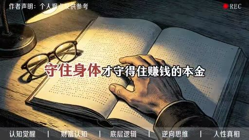

**重點：** 講者說芒格四十多歲患白內障差點失明，一度開始學盲文，手術保住一隻眼睛。他因此體認野心、智謀、財富都掛在身體上，定下鐵律：不熬夜、節制飲食、堅持散步，目的不是長壽而是守住清醒的大腦與穩定執行力（講者主張，未查證）。

**標籤：** #健康 #白內障 #本金

第四，守住身體才守得住賺錢的本金，四十多歲，芒格患上白內障，差點徹底失明，那段時間他甚至開始學盲文，萬幸手術保住了一隻眼睛，這場危機讓他看透一件事，你的野心，智謀，財富全掛在身體上，身體崩盤，一切歸零，從此他定下鐵律，絕不熬夜，節制飲食，堅持散步，不是追求長壽，是守住清醒的大腦和穩定的執行力，太多年輕人拿健康換短期收入，等到中年想發力。

### 主題 6：第 5 條：承認自己無知（03:05–03:45）

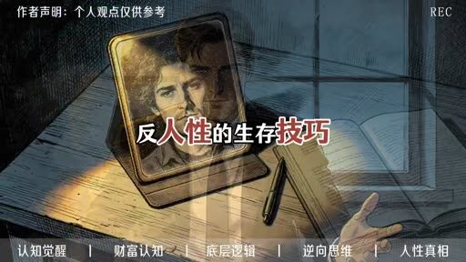

**重點：** 講者引芒格：能意識到自己愚蠢是值得慶幸的事，因為大腦天生有偏見、容易過度自信與自我欺騙。對抗的第一步是坦然說「我不知道」；年輕芒格曾因自負錯過優質投資，之後建立「雙軌分析法」：先理性判斷對錯，再審視有沒有被情緒裹挾，真智慧是清楚能力邊界。

**標籤：** #無知 #偏見 #雙軌分析

身體早就廢了第五，承認自己無知是最反人性的生存技巧芒格說，能意識到自己愚蠢是件值得慶幸的事。人的大腦天生帶偏見，很容易過度自信，自我欺騙。對抗它的第一步就是坦然說出四個字，我不知道，很多人虧了錢騙自己，只是暫時回撥，事情搞砸就怪運氣差，不肯認錯，錯誤只會越滾越大。年輕的芒格也曾因為自負錯過優質投資，之後他建立了雙軌分析法，一件事先理性判斷對錯，再審視自己有沒有被情緒裹挾，真正的智慧不是無所不知，是清楚自己能力的邊界在哪。

### 主題 7：第 6 條：遠離讓你變蠢的人（03:45–04:12）

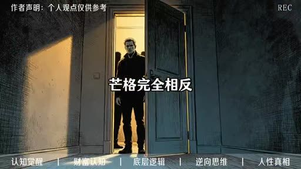

**重點：** 決定命運的不是認識多少人，而是主動遠離哪些人。講者說芒格發現長期跟愛抱怨、愛吹牛貶低他人的人在一起會被拖進情緒泥潭，因此規定：一段關係讓你焦慮、嫉妒、消耗就遠離；篩選不是勢利，是保護判斷力。

**標籤：** #人際 #遠離 #判斷力

第六，遠離所有會讓你變蠢的人，很多人以為成功靠瘋狂拓展人脈，芒格完全相反，決定你命運的不是你認識多少人，而是你主動遠離了哪些人，年輕時他也混圈子，後來發現長期跟愛抱怨，愛吹牛貶低他人的人待在一起，會把你拖進情緒泥潭，於是他定下規矩，只要一段關係讓你焦慮，嫉妒，消耗，直接遠離，篩選不是勢利，是保護你的判斷力。

### 主題 8：第 7 條：時間是唯一賠不起的資產（04:12–04:34）

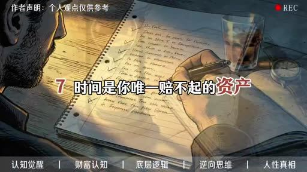

**重點：** 做任何事前問自己「這件事五年後回頭看還重要嗎」，不重要就砍掉。講者提醒別用虛假忙碌掩蓋思維懶惰，真正的勤奮是把有限時間砸進長期複利的事。

**標籤：** #時間 #複利 #五年後

第七，時間是你唯一賠不起的資產，芒格很少把時間浪費在無意義的娛樂上，做任何事之前，他都會問自己，這件事五年後回頭看，還重要嗎，答案是否定的，直接砍掉，不要用虛假的忙碌掩蓋思維上的懶惰，真正的勤奮不是不停幹活，是把有限的時間全部砸進長期複利的事。

### 主題 9：第 8 條：終局思考（04:34–05:00）

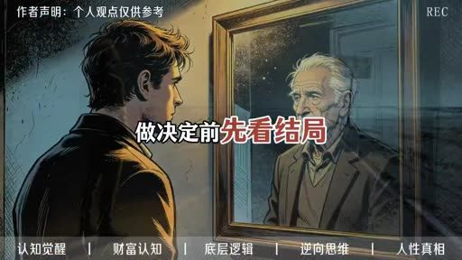

**重點：** 做決定前先看結局：面對誘惑、捷徑、拖延時，想像年老的自己看著當下的選擇，是搖頭（會後悔就停下）還是點頭（認可就堅定去做）。芒格不怕犯錯但不重複踩同一個坑；人生最大成本是為短期快感犧牲長期結局。

**標籤：** #終局思考 #長期

第八，終局思考，做決定前先看結局，面對誘惑、捷徑、拖延的時候他會想像年老的自己站在眼前看著當下的選擇是搖頭還是點頭未來的自己會後悔立刻停下會認可堅定去做芒格不怕犯錯，但絕對不會重複踩同一個坑，人生最大的成本，就是為短期快感犧牲長期結局。

### 主題 10：第 9 條：逆向思考（05:00–05:24）

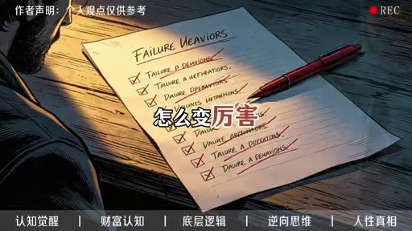

**重點：** 普通人想「怎麼賺錢、怎麼變厲害」，芒格反過來想「怎麼才會變窮、怎麼才會失敗」，把導致失敗的行為全部剔除，自然走向成功。講者主張避開災難比追求奇蹟更容易獲得財富。

**標籤：** #逆向思考 #避開失敗

第九，逆向思考，凡事反過來想，普通人習慣正向思考，我要怎麼賺錢，怎麼變厲害，芒格反過來想，我要怎麼才會變窮，怎麼才會失敗，把所有導致失敗的行為全部剔除，你自然就走向成功，很多人天天找暴富捷徑，卻從來不思考什麼行為，一定會毀掉自己，避開災難，比追求奇蹟更容易獲得財富。

### 主題 11：第 10 條：降低慾望，守住內心平靜（05:24–05:48）

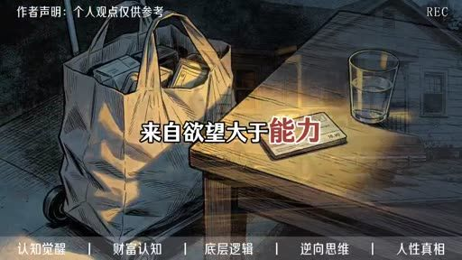

**重點：** 講者說芒格身家千億仍住老房子、開舊車（講者主張，未查證）。痛苦多來自慾望大於能力，慾望超過收入則收入再高也永遠缺錢；砍掉不必要的消費慾望才不被金錢綁架，財富的本質是慾望和能力之間的差值。

**標籤：** #慾望 #消費 #知足

第十，降低慾望，守住內心的平靜，芒格身家千億，依舊住老房子開舊車，他明白慾望是無底洞，人的痛苦大多來自慾望大於能力，慾望超過收入，就算收入再高，你永遠缺錢，學會砍掉不必要的消費慾望，你就不再被金錢綁架，財富的本質是慾望和能力之間的差值。

### 主題 12：結語：做對小事、避開大坑（05:48–06:22）

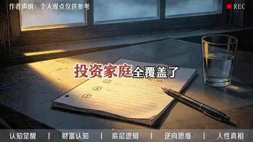

**重點：** 講者總結芒格沒有暴富神話，只是持續做正確的小事、避開所有大坑；財富是長期穩定、少犯錯、慢慢積累出來的。這十條涵蓋認知、決策、生活、投資、家庭，不必全做到，先做到三條人生就會不一樣。

**標籤：** #總結 #三條

芒格的一生沒有驚天動地的暴富神話，只是持續做正確的小事，避開所有大坑，財富不是一次爆發，是長期穩定，少犯錯，慢慢積累出來的，這不是雞湯，是一套完整的人生系統，認知，決策，生活，投資，家庭，全覆蓋了，你不需要全部做到，先做到三條，你的人生就會不一樣，這十條裡你做到了幾條，如果你現在正處在低谷，把這十條反覆讀幾遍，慢慢落地，你的人生會悄悄發生改變。

## 知識點

- [[商業理財_先把錢扣下來，剩下的才拿去花]]
- [[商業理財_把知識轉化成判斷力才值錢]]
- [[商業理財_研究失敗比研究成功重要：先列出絕對不能碰的事]]
- [[商業理財_承認「我不知道」是對抗過度自信的第一步]]
- [[商業理財_用「五年後還重要嗎」過濾事情]]
- [[商業理財_逆向思考：先想怎麼會失敗]]
- [[商業理財_財富的本質是慾望和能力之間的差值]]

## 來源

- 原始資料夾：`watch-output/商業理財/2026-11-18_X_大鵬財商---一個人財富積累最快的方式-不是拼命尋找成功秘訣-而是直接複製查理·__2121985431055311172`
- 逐字稿來源：whisper (groq)
