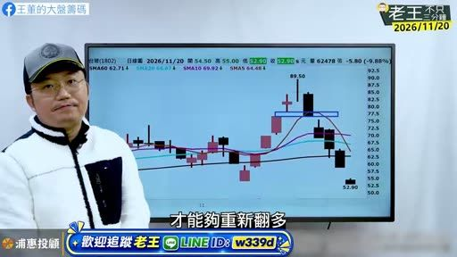
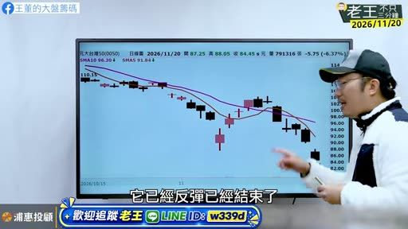
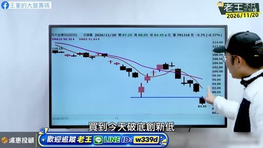
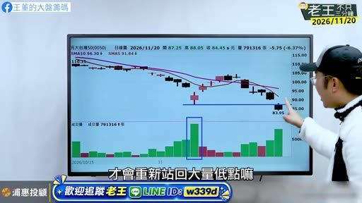
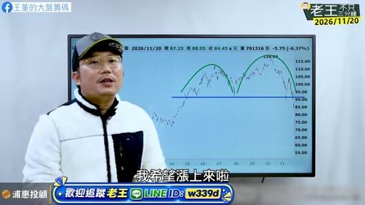

# 0050都破底了快跑臺股沒救了？

## 思維導圖

- 0050破底怎麼辦
  - 先分資金性質
    - 長線：續抱定期定額
    - 短線：看技術面
  - 短線資金
    - 跌破兩條短期均線
    - 反彈結束就出場
    - 與大盤高度連動
  - 空頭趨勢
    - 不要隨便買股票
    - 順勢交易
    - 搶反彈風險高
  - 空方缺口
    - 未封閉＝趨勢延續
    - 封閉才解除危機
  - 爆大量低點
    - 跌破凶多吉少
    - 5月以來買進者套牢
  - 結語
    - M頭形成
    - 站回前要戒慎（講者主張）

## 圖文對照（畫面 + 逐字稿）

### 主題 1：先分清楚：長線資金或短線資金（00:00–00:34）

**重點：** 講者（老王，畫面標示）主張：0050 破底時要不要賣，先看這筆錢的性質。若本來就是長期持有、定期定額的長線資金，就繼續抱著，跌下來可以買更多；若是為了跟著國安基金或搶反彈進場的短線資金，兩者處理差很多（講者主張，未查證，非投資建議）。

**標籤：** #長線資金 #定期定額

0050破底了怎麼辦，怎麼辦，我星期二這個禮拜二就叫你想清楚了，你那個0050到底要不要賣，你先想好你先看清楚，它是你用長線的資金去買的，你打算長期持有的，持續定期定額的，還是那是短線資金，你為了你要吃國安基金豆腐，你為了搶反彈去買的，兩個就有很大的差別，如果你是本來就長線資金，長線在買的長線在持有的，你就繼續抱著就對了，人家說的小跌小買大跌大買，不是就這樣嗎，長期持續定期定額，跌下來的時候你可以買更多蘋果嘛，漲上去的話就大利潤不是這樣嗎，那長期資金啊，那如果你是短線資金啊，跟著國安基金進場你就要看技術面啊，我不是這樣講的嗎。

### 主題 2：短線資金：跌破兩條短期均線反彈就結束（00:34–01:07）

**重點：** 短線資金要看技術面。講者說他週二已提醒，0050 跌破兩條短期均線代表反彈結束，和大盤一樣走第二隻腳；0050 與大盤高度連動，大盤今天破底，0050 自然跟著破底。短線資金在反彈結束處就該先出場，不賣就會一直抱上又抱下（講者主張）。

**標籤：** #短期均線 #破底 #出場

那看技術面你就要回過頭來這張圖啊，我禮拜二怎麼講，看兩條短期均線嘛，跌破這兩條短期均線，我禮拜二已經跟你講，它已經反彈已經結束了，就跟大盤一樣，我就不要再剪VCR了啦，你自己回去看，禮拜二就這樣跟你講的，已經跌破兩條均線了，反彈結束了，跟著大盤你看，是不是就是打第二隻腳了，因為它跟大盤高度連動嘛，那你看大盤今天已經破底了，0050當然就跟著破底了，那就是為什麼你做短線你是短線資金你還是要這邊要先出場你這邊反彈上來這邊結束反彈你不賣那你每次就是抱上又抱下你每次做0050你拿短線資金你每次抱上又抱下。

### 主題 3：長線不用管，空頭趨勢不亂買（01:07–01:57）

**重點：** 講者說長線資金就長期持有、用時間換金錢即可；想要效率才短進短出。他強調空頭趨勢不要隨便買股票，給會員的截圖也要大家不要買，因為在空頭趨勢買進到破底創新低就全部套牢；技術分析教順勢交易，等轉強再買，錯了就趕快出場，頂多小賠或小賺（講者主張）。

**標籤：** #空頭趨勢 #順勢交易

你這樣做什麼0050，你就不用短線資金了，長線就眼睛閉著一直買就好了，長期持有就好了，只是說要多久時間你可以解套，多久時間你可以賺錢，你就要花很多時間嘛，用時間換金錢就這樣，但是很多人你想要把握那個效率嘛，那你就要短進短出嘛，那你看今天這樣蹦下來，這裡是已經把前面的低點給跌破了，意思就是說你過去，所以我常常跟你講，空頭趨勢不要隨便買股票，你看到前面剛才給會員的截圖，我叫會員都不要再買股票，因為你在空頭趨勢，你怎麼買，買到今天破底創新低，通通套牢 通通賠錢，不是嗎，所以技術分析教你順勢交易，你等它轉強再來買，比如說這個地方站上五日均線，你強反彈 上去了，但沒有繼續往上走，它沒有辦法V轉，它結果往下走了，你這個地方趕快出場，你會賠到什麼錢，頂多小賠甚至不賠或小賺。

### 主題 4：搶反彈風險高與空方缺口（01:57–02:41）

**重點：** 講者說搶反彈本來就是短線進出的概念，上週有膽量搶反彈、這週卻沒膽量出場，以後就不要找他聊搶反彈。接著指出今天出現與大盤一樣的空方缺口，缺口沒封閉就是趨勢延續，缺口很重要（講者主張）。

**標籤：** #搶反彈 #空方缺口

這個後面這個你就不用損失了就像我禮拜二講的如果你上禮拜有種有guts去搶反彈但是你沒guts這個禮拜出場拜託你以後都不要跟我聊你要搶反彈這種事情因為搶反彈本來風險就很高，本來就要短線進出的一個概念嘛，這個地方搶，這個地方出場OK吧，沒有什麼賺沒關係嘛，這一波避開，那現在呢？今天出現空方缺口，跟大盤一樣，所以這個缺口重不重要？很重要，這個缺口如果沒封閉啊，就是繼續往下走，缺口就是趨勢的延續，而且我要告訴大家這個缺口多重要，你不要忘記上禮拜我們在分析0050的時候，這一個這一天啊，就爆出了歷史的天量，就歷史最大量啦，從我們出生以來第一次看到0050這麼多人去買啦，買這麼多張啦，現在全部套了，現在全部套了。

### 主題 5：爆大量低點跌破，凶多吉少（02:41–03:13）

**重點：** 講者指出上週 0050 出現歷史最大量，這天買進的人現在全部被套；爆大量低點已跌破，凶多吉少。要破壞這個情況，得把缺口封閉、重新站回大量低點，讓它變成假破底、真穿頭，危機才解除；缺口一直沒封閉，目前就凶多吉少（講者主張，未查證）。

**標籤：** #爆大量 #缺口封閉 #穿頭

到今天說完這樣，全部套了，這一天去買的，因為破底了，那這個爆大量低點已經跌破了，爆大量跌破就凶多吉少嘛，你要怎麼開心的起來，你要怎麼樂觀的起來，那你要去，你要破壞這個情況，你要讓它變成假破底要來真穿頭，那就是要把這個缺口封閉嘛，你只有把這個缺口封閉才會重新站回大量低點嘛那危機就解除了嘛就可以破壞凶多吉少的心態嘛否則如果缺口一直沒封閉那目前就凶多吉少嘛那這個只是董哥這個是底部了啦拜託。

### 主題 6：M 頭、套牢賣壓與結語（03:13–04:09）

**重點：** 對「已經是底部、右下角了，繼續買、抄底」的聲音，講者回應右下角或右上角取決於看的範圍，並展示 M 頭形態。他說自己不是看衰 0050 或個股，也希望股市多頭，但頭部已形成並確實跌破；在大量低點、頸線與兩條短期均線站回前要戒慎恐懼，因為 5 月以來買進者全部套牢、上方賣壓大（講者主張）。

**標籤：** #M頭 #套牢賣壓 #頸線

底部了你在怕什麼啦，跌那麼多了，繼續買啊，去抄底啊，都已經跌那麼多，右下角了，到底是右下角還是右上角，你再看一次，那這個不就是M頭嗎，我再講一次，我再講一次，這到底是右下角還是右上角，你看的範圍不一樣就得到不同的結果，但是我還是提醒大家，我不希望是等幅測距，我也不會看衰0050，我也不會看衰任何一檔個股，因為我們投顧老師，我們喜歡股市是多頭的，而且我也發自內心，我知道很多人都賠錢，我希望大家不要再那麼痛苦，我希望漲上來，所以我不覺得一定要等幅測距，但是目前這個頭部就形成，就確實跌破了，你沒有看到它把大量低點站回來之前，沒有看到它回到這個頸線，站回這兩條短期均線之前，你就要小心要戒慎恐懼，因為頭部，這就代表從5月以來買進0050的人，到現在是全部套牢欸，上面有這麼大的套牢賣壓，就跟大盤剛才套牢高點，好幾個月的套牢賣壓欸，你說你不尊重它嗎，是不是。

## 知識點

- [[0050_先分清資金性質：長線資金續抱、短線資金看技術面]]
- [[0050_短線資金：跌破兩條短期均線代表反彈結束]]
- [[0050_空頭趨勢不要隨便買股票]]
- [[0050_搶反彈風險本來就高，要設好出場]]
- [[0050_空方缺口沒封閉，就是趨勢的延續]]
- [[0050_爆大量低點跌破就凶多吉少]]

## 來源

- 原始資料夾：`watch-output/投資理財/0050/0050都破底了快跑臺股沒救了_2026-11-23_TikTok__7710214436346219796`
- 逐字稿來源：whisper (groq)
