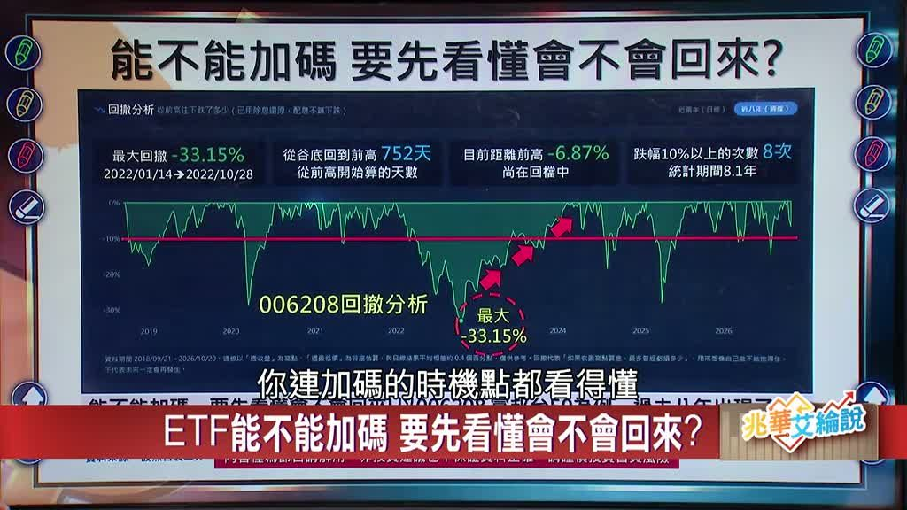
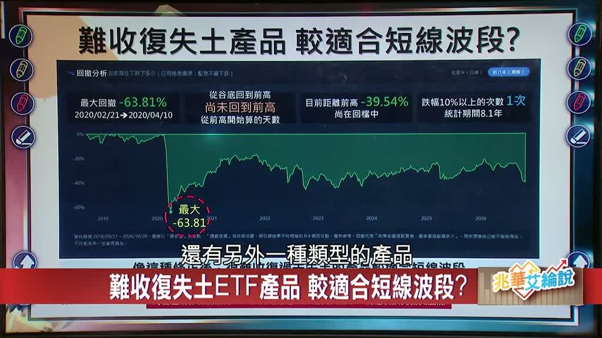
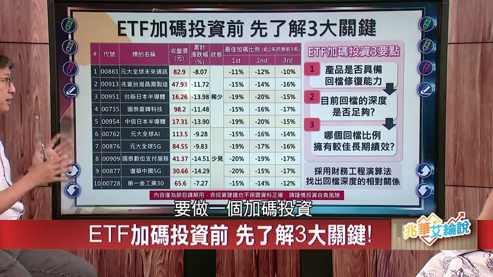
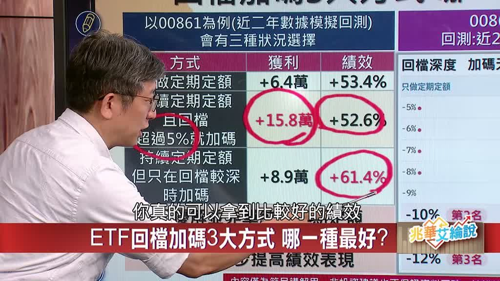
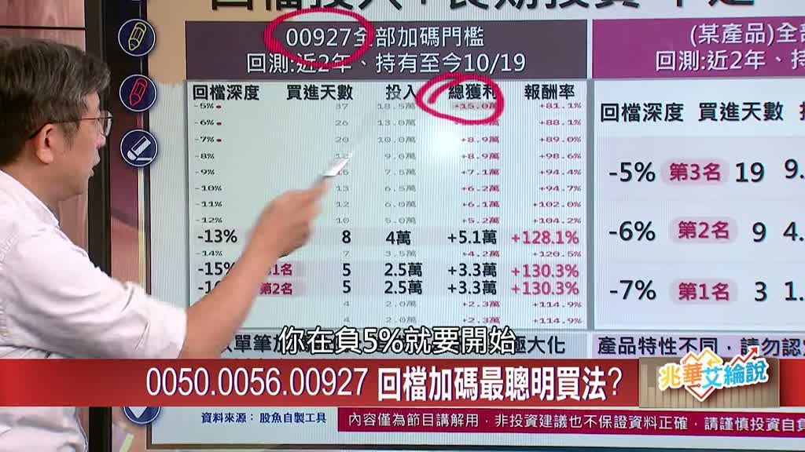
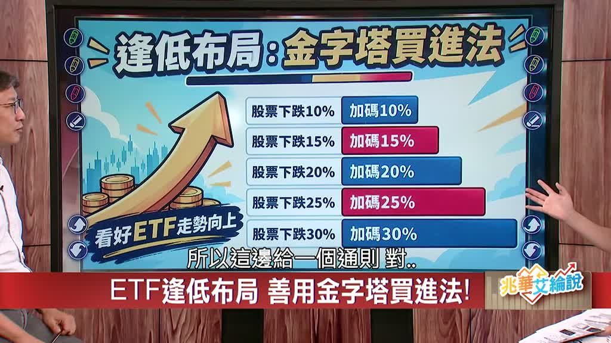
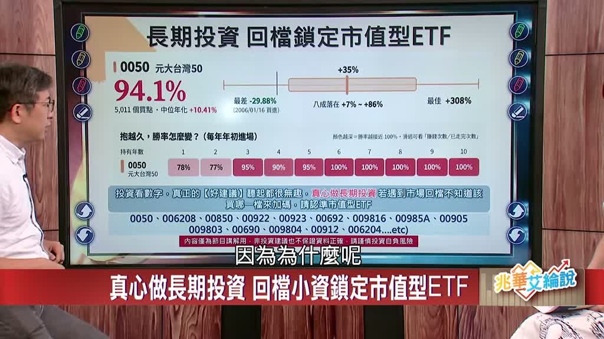
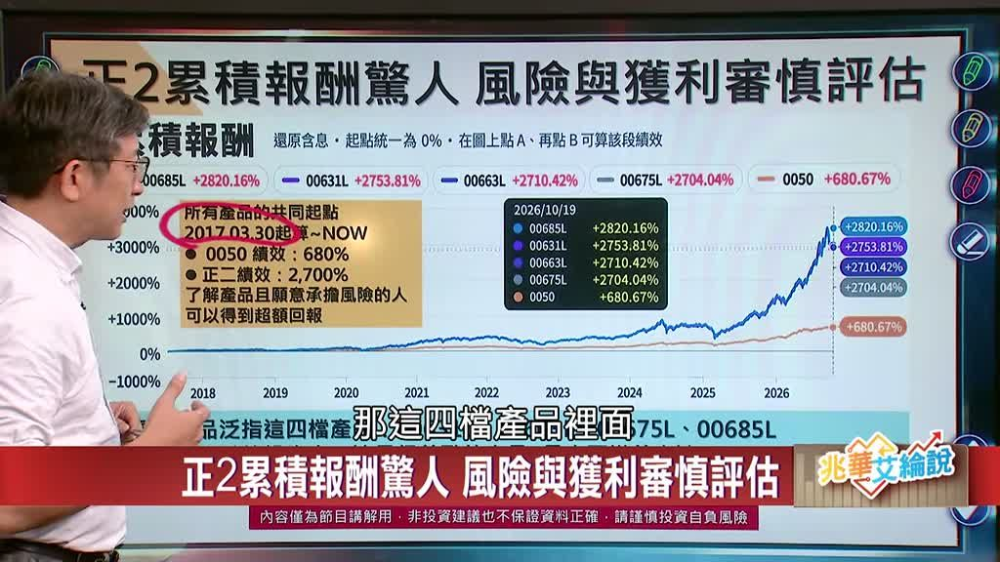
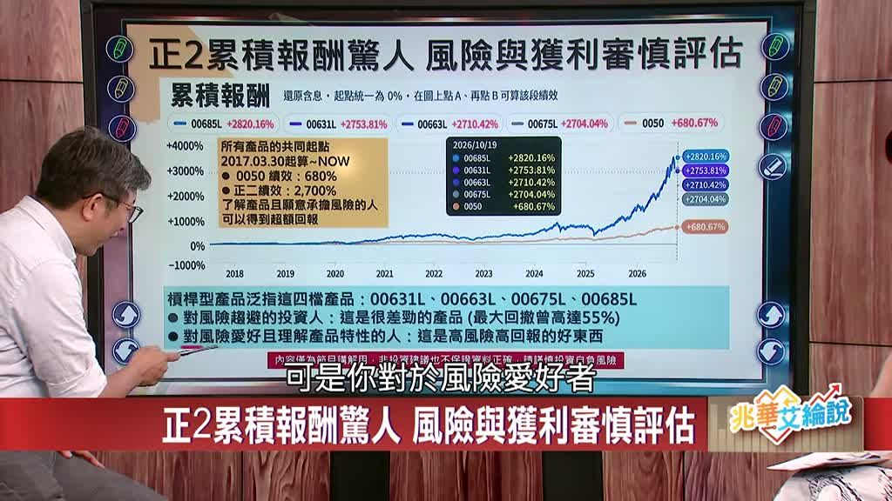
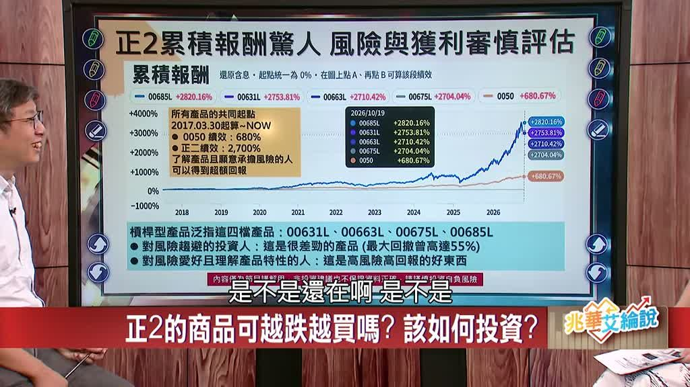

# 【兆華艾綸說】ETF逢低撿 金字塔加碼法 市值、正2、高息型 全都解｜李兆華、艾綸、股魚 2026.10.21 part2

## 思維導圖

- ETF 逢低加碼（股魚）
  - 心態
    - 個股越攤越貧，ETF 可攤平
    - 逆人性：悲觀時樂觀
  - 先看會不會回來
    - 回測：跌下去是否收復
    - 市值型多半回得來（講者主張）
    - 衍生性、收益型可能回不來
  - 加碼三原則
    - 會回來、夠深、比例對
    - 逢 5% 起加碼（00861 例）
    - 別等太深，次數不夠
  - 金字塔加碼法
    - 10/15/20/25% 剛好 100%
    - 跌 30% 已近盡頭
  - 小資選市值型
    - 0050 持有越久勝率越高（講者主張）
    - 配息再投入
  - 正2 可以越跌越買？
    - 官網警語不適合長抱
    - 報酬近 4 倍（講者主張）
    - 曾腰斬 55%，風險趨避者避開
  - 結論
    - 不確定就問投信

## 圖文對照（畫面 + 逐字稿）

### 投影片 1：悲觀者正確，樂觀者賺錢（00:00–03:25）


**重點：** 艾綸問個股與 ETF 是否都可「攤平」；股魚說個股發現苗頭不對要砍，ETF 則可逆人性在大家悲觀時保持樂觀，並提醒攤平要選對產品、也要有時機。

**標籤：** #攤平 #逆人性 #ETF

歡迎回來 兆華，我想請教艾綸，因為你是動能派的，那你會有越跌越買 越攤越貧的情況嗎，ETF會，ETF你會願意攤，個股可能除了臺積電剩下都會遲疑，遲疑是不是，對 遲疑一下，那個股上面你去攤的結果好嗎，結果不太常攤，該砍就砍，但ETF會攤，那攤的成果如何，就還不錯，所以個股上面我覺得大家的思考是，以前攤可能大部分的記憶都不好，就真的叫越攤越貧虧損越來越大，可是ETF好像可以值得那麼一攤，是不是這樣呢，先來請教我們的達人，就是ETF教父，股魚歡迎你，其實我對於剛剛艾綸的答案非常的滿意，你都不用 我要問好了，就直接開始，當然我們先從最重要的艾綸這邊，趕快來解答一下他的一個疑問，他的感覺是沒有錯的，你如果是個股的話，真的有可能在投資的過程當中，越攤越貧，所以你發現苗頭不對的時候，當砍則砍 趕快跑，這關鍵是非常正確的，可是如果是ETF，我勸你好好地想一下，怎麼了，不要隨隨便便就做攤平的動作，不要隨隨便便攤平，還是不要隨隨便便砍掉，一個攤平是有時機點的，然後第二個的話呢 攤平也要選對產品，可是絕大部分啊 大家喜歡的ETF啊，它長期來看呢 它都有那個攤壞的特性，好 不過這個slogan到底跟今天要講的東西，怎麼樣連上啊，悲觀者正確 樂觀者賺錢，進股市就是為了賺錢順序不要搞錯了，對 沒有錯，因為呢 最近幾天的話呢，那個股市的回檔比較大嘛，那你每次在回檔的過程裡面，大家都會開始把一些，悲觀的訊息跟利空開始整合在一起，悲觀者他有可能最後的結果是對的，但是請注意一件事情，你如果想要賺錢，一定要當樂觀的那一個人，而且可能要逆人性，就大家在悲觀的時候，我要樂觀，這樣是不是有點瘋瘋的，所以我今天在這個節目裡面，我們特地準備了這張圖，是，然後這張圖的話呢，我有一個小小良心的建議，字要放大一點，不是，不要中英對照，不是，那是什麼，製作單位呢，應該要把這張圖做成PDF檔，然後呢，在影片的下方呢，提供下載的連結，可以的，今天我們有提供大家圖卡，對，請大家訂閱一下，兆華艾綸說的YouTube頻道，對，這張呢，讓他那個下載之後的話呢，請他做一件事情，是，彩色印出來，貼在他的電腦旁邊，表框更好，哈哈哈，這樣子的話呢，當市場在震盪的時候，就拿這張圖出來看一下，你就會知道，投資市場充斥著各種的利空，充斥著各種的謊言，但是呢你如果撐過去的話呢，就是這樣子，一條斜線往上走啊，中間真的有好多次的震盪，可能會給大家很多的信心考驗，但是終究他是要往右上角走的，對沒有錯。

### 投影片 2：回測分析：跌下去會不會回來（03:25–05:55）



**重點：** 股魚用 006208 近 8 年的回撤圖說明：先看一檔 ETF 每次下跌後會不會收復；市值型產品大致跌到 10% 就開始反彈，曾跌 33% 也回得來（講者主張，未查證）。

**標籤：** #回測 #006208 #市值型

好但是剛剛特別提到今天的主題，個股真的不太建議大家越攤越貧，可是 ETF 在回檔的時候，我們似乎比較有勇氣做加碼，但這邊也要告訴大家，不是每一種 ETF 都可以回檔加碼，是的，那我們來判斷了一檔 ETF，到底可不可以做回檔加碼的一個動作，這個時候，有個專有名詞就出現了，什麼，這個叫做回測分析啊，那這個回測分析指的是什麼呢，我們不看這檔產品，他會不會繼續往上漲，我們只觀察這檔產品，他每次下跌之後，會不會回的來，這邊的話呢，X軸這條是0軸，代表是0的位置，然後你如果下跌的話，如果越跌越多，他這條線就越來越往下，可是當它開始反彈的時候，它就會開始往收斂這個方向走，所以一旦它形成了一個像V型的字型的話，我們就說代表它這一次的下跌它收復回來了，所以我們簡單來看，這檔產品的話是006208，那40型的產品，我們拉它過去8年的一個週期，8年的週期，你就會發現一個很有趣的現象，這張圖如果看得懂，你連加碼的時機點都看得懂，為什麼？因為你看，以這檔產品來講，只要下去了，都會回來，只要下去了都會回來，這是他第一個特徵，然後第二個特徵的話呢，你有沒有發現，我拉了這條10%的線，絕大部分，10%就開始反彈了，好這邊就容易反彈，對有8次，然後都有反彈，對對對，那你如果今天呢，10%之後如果跌的再更深的話呢，其實你也不要怕，你如果有錢繼續加碼，因為反正最後都有很大的機會可以回來，這個是市值型產品它最大的一個特色，你看過去曾經跌了33%，也是一樣給你回來的，所以今天你在挑ETF可不可以做加碼的話，你只要看到它長這個樣子，要勇敢，叫大家悲觀，但是你自己要勇敢，這個腿斷了都會爬回來，對，欸欸欸欸欸欸欸欸欸欸欸欸欸欸欸欸，他有很大的機會一定會回來，一定會回來，所以這種就是非常適合呢，像剛剛那個艾綸說的，欸如果你要做攤平的動作的話，挑這一種，那你整個持有的信心就會非常的高。

### 投影片 3：不會回來的產品：連結選擇權、期貨與收益型（05:55–07:30）



**重點：** 非單純股票型的 ETF（連結選擇權、商品期貨、REITs、MBS、特別股等）遇到大幅回檔時連結信心會潰散，可能回不來；建議優先挑連結股票的產品，並理解名稱裡的槓桿類型。

**標籤：** #衍生性商品 #槓桿 #短線波段

那當然我們在看產品的時候，還有另外一種型別的產品，他下去之後，他就不會再回來了，他誰啊，對啊好想知道，他是誰啊，蛤，他是誰，他為什麼回不來，回不來嗎，這個是因為他，不是單純的股票型的產品，因為我們在ETF的設計裡面的話，它是有各種商品連結的，那我們正規的話都是連結股票，可是有一些的話不是連結股票，有一些的話會連結選擇權，有一些的話會連結商品期貨，有一些的話會連結像REITs MBS，或者是說特別股，這些比較特殊的一個收益型的產品，那這類產品它的特徵就是，一旦遇到大幅度回檔的時候，它產品連結的信心會潰散，然後後來就回不來了，所以我們一旦在挑ETF產品的時候，我也給投資朋友一個小小的建議，請優先挑它後面連結的是股票型的產品，這種產品的話它通常都很容易可以回得來等於是不要連結到有衍生性的金融商品或槓桿嗎對對對因為槓桿它其實還有分很多種譬如說有商品型槓桿，也有股票型槓桿，也有一些其他型別的槓桿，所以我們常常在講說，ETF的名稱裡面，跟它連結的產品，你可能要花點時間去理解一下，你才不會挑到一些錯的東西，這是我們一點小小的提醒，所以那型別的可能就是適合一個，是適合一個短線上做一個小波段，像這樣的加碼方式，對對對。

### 投影片 4：加碼三原則：會回來、夠深、比例對（07:30–09:01）



**重點：** 股魚列出 ETF 加碼三件事：會不會回來、回檔深度夠不夠（臺股 5 萬點跌 1000 點很淺）、投入比例；並提醒等腰斬可能等不到或到時沒錢。

**標籤：** #加碼原則 #回檔深度

所以我這邊幫投資朋友來做一個整理，你如果今天 ETF，要做一個加碼投資，其實他有幾個原則，首先第一個原則就是，他會不會回來，這是我們前面做回測分析，跟投資朋友講的事情，然後第二件事情的話，他的回檔的深度夠不夠，因為你看了我們在臺股市場，會遇到一個很有趣的現象，比如說他回檔啊，今天就說我臺股回檔了1000點，然後大家就很亢奮，衝啊，趕快把我所有的身家都壓下去啊，跌了1000點耶對不對，可是你有沒有想過，我臺股5萬點的時候，跌1000點算得了什麼，那個回檔的幅度是很淺的，那你如果今天在股票市場裡面，要賺到足夠的錢，你的回檔深度，是你要注意的一個問題，然後呢，第三個的話呢，他的回檔的比例，就是你在哪個比例投入，你的長期績效才會比較好，這個可能就很重要了對不對，有時候會覺得，那我就等到臺股腰斬啊，就等不到，對，等到的時候又不敢買，等到的時候你不敢買，或者是說呢，真的出現那個機會的時候的話，你沒錢，我沒錢了，所以其實在做加碼這件事情，它是有一些玄機的，所以這個時候我跟你講，工程師的好處就來了，怎麼樣，我們專門破解數字裡面，潛藏的賺錢機會在什麼地方，要來Debug是不是，Debug是我們的重要工作之一。

### 投影片 5：00861 三種加碼方式回測（09:01–11:55）



**重點：** 以 00861 為例比較定期定額、每逢跌 5% 加碼、等深跌才加碼：兩年回測中逢 5% 加碼累積獲利約 15.8 萬，高於單純定期定額 6.4 萬（講者主張，未查證）；等很深才買次數不夠。

**標籤：** #00861 #定期定額 #回檔加碼

來 我們首先來幫，投資朋友做一個介紹，假設說以剛剛表格裡面，最上面那一檔 00861，那這檔產品來講的話，我幫你做了一個非常有趣的事情，就是你如果只做定期定額，還有你遇到5%回檔的時候，就開始做加碼，或者是說你要跌到很深的時候才開始來做加碼，這個是我們在投資的過程中非常容易見到的幾種情境，那我來跟各位講一下，你如果今天只做定期定額，以這一檔為例在過去兩年的回測，不錯啦，他的績效有53.4%，然後你的累積獲利的話有6.4萬，感覺好像還不錯，我每個月投五千塊，偷了兩年之後竟然可以賺到6.4萬，感覺不錯，可是你如果在這個過程裡面，每逢5%就開始做加碼的話，你一樣可以拿到接近五成的績效，可是你的總獲利可以來到15.8萬，還有另外一種情況是什麼，大家都喜歡說回檔很深的時候，再來買，我再來買進，可不可以 可以，你真的可以拿到比較好的績效，可是我要告訴你一件事情，你賺到了面子，你失去了裡子，好不好 次數不夠多，你的次數不夠多，所以其實我們在投資的過程中，他的回檔的深度會影響到他，加碼的次數，所以你不要老是等到說回檔很深，你才來做加碼，這樣子的話，會害你本金累積的速度反而比較少，我有個問題，超過5%就加碼，對 是什麼意思，就是我5%就加碼，如果6% 7%我就繼續加碼，繼續加碼，對對對，因為你在回檔的過程中，我並不知道他是不是直到，5%他就停下來了，他有可能，你在一個時間裡面的話，假設有10天，譬如說這一天是5%，這一天是6%，這邊是7%，遇到連續下跌，那我就連續投，我就開始連續投，所以-5%的意思就是代表說，我超過5%的時候，我就開始做投入的一個動作，直到它彈回5%以上，那我才把它停下來，我這邊又有疑問了，這是適用於00861嗎，就是他這樣測試這樣，可是有的別的也許是，10%才加碼比較好，嗯，所以呢我就幫各位做了一個整理了嘛，對不對我們今天上節目來，你知道我們刁民在這邊對不對，有兩個刁民在這邊，我們一定幫你做了滿滿的資料，來跟你解釋這個問題好嗎，比如說投資朋友最關心的，這個0050還有這個0056，它是不是也適用這樣子的一個做法呢。

### 投影片 6：0050、0056、00927 的最佳加碼點（11:55–14:41）



**重點：** 0050、0056 超過 5% 開始加碼可賺到錢，要最好績效約在 13%；00927 約 5% 起加、最佳約 15%；但也有產品負 5% 投入兩年仍賠錢，不能一體適用。

**標籤：** #0050 #0056 #00927

我告訴你確實是適用的，所以你看我這邊就幫你把整個表格統計出來的，你如果要的是錢，請在5%之後就開始加碼，你如果要的是面子，那請在13%的時候開始做加碼，這樣子的話你就會拿到最好的一個績效表現，可是如果是0056的話，你會發現也大概是超過5%的時候開始加碼，可是你要最好的績效，這個大概是在13%左右，你會拿到最好的一個績效表現，當然除了這一檔之外的話，還有一檔最近很熱門的 00927，它是半導體收益，半導體收益，我們從統計的狀況上面來看的話，一樣你如果想要得到比較好的收益報酬，你再負5%就要開始做加碼的動作，可是你如果要拿到最好的績效的話，反而是要在負15%這個水準，你再來開始做投入的動作，你會得到最好的績效表現，所以有時候我要問投資朋友一個問題，你重視的是面子，還是你重視的是裡子，那還是我就等到跌15%的時候，我就all in呢，你會得到最好的效果，找到最好的面子，對 又有面子又有裡子，對 你會面子跟裡子的話全拿，好的 摩拳擦掌，摩拳擦掌了 對不對，所以其實你如果今天在投資的過程中，你對你的標的物的掌握程度，夠深的話，你就可以知道說，這一檔大概回檔到哪個時候，你來做投入，你可以得到最好的一個效果，不過我有個小小的提醒，兆華 我講到這邊，你內心會不會產生一個錯覺，什麼錯覺，這個ETF的投資實在是太簡單了，超過5%我就開始加嘛，沒有沒有我要在那個15%all in，對，然後呢超過10%之後的話呢，我開始準備做all in的動作，然後呢按照古語講的，應該都可以賺到錢嘛對不對，沒有我立刻幫你補充一個負面的案例某產品就是剛剛不願意揭露名稱的那個產品沒有這個個又是另外一檔到底是哪裡找了那麼多奇怪的東西其實你要注意，並不是每一檔產品，你在負5%投入都可以賺到錢的，以這一檔為例的話，你負5%投入，買了兩年之後的話你還是賠錢的，所以你在投資的過程當中，你要把這些資料跟產品的特性搞清楚，你才有機會，在這個加碼的過程當中，可以賺到真正的錢，是 好 投資基金有賺有賠，投錯商品有去無回，對 沒有錯，到底是哪一檔他都不肯講，對啊 不能講。

### 投影片 7：金字塔加碼法：跌越深買越多（14:41–16:40）



**重點：** 通則：跌 10% 買 10%、跌 15% 買 15%、20% 買 20%、25% 買 25%，剛好 100%；跌 30% 已近盡頭，忍耐一下。目的是回檔最痛時有投入而不是沒子彈。

**標籤：** #金字塔 #加碼通則

不是嘛 兆華你知道，我上節目有很多的為難你知道嗎，因為你知道，全臺灣的投信眼睛，都看著股魚在講什麼，第一個我們講壞話的話，會被人家攻擊對不對，然後產品檔數講得不夠，也會被人家攻擊你知道嗎，然後講的不夠樂觀的，也會被人家攻擊，其實我們也蠻困難的啦，好，好不好，所以這邊給一個通則啦，對不對，因為剛剛講的每一檔可能，他適合加碼的點，也許是5%也許是10%，但是有一個通則可以給大家，對，那其實呢我們在做 ETF，投資的過程裡面，他確實是有一個通則的方式，讓你來做加碼的動作，因為其實有時候投資，最痛苦的是什麼，最痛苦的是回檔最深的時候，你有錢竟然沒有加碼這件事情，或是我沒有錢加碼，你沒有錢加碼，這是痛苦到了極點，但是你如果在回檔的時候，稍微有投一點點，整個感受都不一樣了，我有參與到，回檔的時候我有賺到，我們要怎麼確保你有這個感覺，來 我就告訴你，跌10%的時候就買10%，跌15%的時候再買15%，跌20%的時候再買20%，跌25%的時候再加25%，我幫你算過了，剛剛好100%，哦，那跌30%的時候呢，就跟兩位借錢來買，其實跌30%的時候，大概已經到了盡頭了，是，對已經到盡頭了，這個是我們從過去的，產品的回測資料圖裡面，我們大概就有看過，這樣子的一個資料，其實絕大部分的產品，它在回檔過程中，大概超過30%的次數，非常的罕見，非常的罕見，超過的時候忍耐一下，對再忍耐一下，因為如果真的被你預見了，它應該很快就會反彈了，這是我們透過以前，在看資料的一個經驗之後，總結出來的一個結論，但是剛剛講了很多標的。

### 投影片 8：小資怎麼選：無聊的市值型 ETF（16:40–20:03）



**重點：** 資金不多時選市值型：以 0050 為例持有 1 年勝率約八成、3 年九成、5 年以上 100%（2003–2026 回測，講者主張，未查證）；統計採配息再投入，不配息產品較接近。

**標籤：** #0050 #市值型 #勝率 #配息再投入

那現在小資就一套資金，我只有一次加碼5000塊，1萬塊，要怎麼樣做一個，對的加碼的方式，對的加碼的方式，我覺得我待會講出來之後，下面的觀眾，可能會打我，噓聲一片嗎，會噓聲一片，那你幹嘛要講，為什麼，因為我想要跟投資朋友講一件事情，正確的標的物就是那麼的無聊，好東西就是無聊，所以我來幫各位介紹一下，什麼叫做好東西，又是你，好東西，可是其實0050它代表是市值，也等於是你優先看的是市值，對 沒有錯，你如果今天在回檔的過程中，你真的有一筆錢，你想要做投資，可是你不知道哪一檔標的物，可以掌握反彈的機會，良心建議，試執行買下去就對了，因為為什麼呢，我幫各位呢，把整個統計學的東西，全部都搬到這邊來，統計學上，來讓你瞭解他的一個，正確的觀念在哪裡，那我們的重點，幫你放在下面的這個地方，下面這個地方，下面這個地方在講什麼呢，講的是說，以0050這檔產品來講，你在任何一天買進它，你如果抱一年，大概有八成的勝率，這麼高啊，你就有接近八成的勝率了，那你如果持有三年，你的勝率會來到九成，你如果持有超過五年以上，勝率將會是完美的100%，哎呦 哦，那找你算帳的時候要等五年，對 今天聽了我的話衝進去的話，你五年後再來找我，五年後再來找我，其實我們這個資料的話呢，我們以前真的有看過，我們從2003年一路回測到2026年，任何一天，任何一天喔，包含你從你認為的最高點投入，到現在的話呢，沒有人在這張圖裡面的話是賠錢的，是賠錢的，所以我們也是說在投資的過程當中，複雜的運算你可以不要管，但是我的結論一定要聽進去，你如果不知道買什麼，買市值型的產品，然後堅持抱至少三年以上，你有九成的勝率，抱五年以上的話，你會拿到接近100%的勝率，這個就是投資的一個秘訣，長期投資，下面我幫大家列出來，市值型不只060，這些都是犯事執行上面，對對對，因為我們剛剛前面有講過了，如果沒有列出來，你的留言會歪樓，他問說老師為什麼沒有6208，他不行嗎，為什麼沒有850，為什麼沒有922，為什麼沒有692，為什麼沒有9816，為什麼為什麼為什麼，像922好像訴求不配息，所以配不配息這件事情，你要怎麼考量，來我跟你說，我這個的話，都已經全部換成不配息的狀態，做統計的了，對對對，所以息最好再投入，對，所以你如果息再投入，你才會拿到這樣子的一個結果，那你如果說覺得很麻煩的話，你也可以直接選那種，不配息的一個產品，這樣的話，你就可以確定說，我拿到的一個效果，就會跟我這邊秀的這張圖，會是比較接近的一個狀況，是，好 有點統計學。

### 投影片 9：正 2 可以越跌越買嗎？官網警語（20:03–21:44）


**重點：** 官網寫「不適合長期持有」是警語；股魚主張重點回到標的長期表現，並以統計說明。

**標籤：** #正2 #警語

是學這個啊，嗯 長期投資，好像很有用，當然啊，不過剛剛有提到，有一些槓桿型的可能不適合逢低價，那大家就要問了，正二呢，因為現在喜歡正二的人越來越多，正二這個產品是不是可以越跌越買呢，我們想要做一個中立的討論，我也要投票，可不可以越跌越買，我個人是站在應該是可以啦，可以嘛對不對，我也投一票可以，你也投一票嗎，那我可以不要投票嗎，我們不要投票，但是我可以告訴你，他統計的結果是什麼，因為我們畢竟投資這種東西，我們不是用感情在投資的，我們是看數字在投資的，所以我們先來講一個，這個產品最容易被攻擊的地方，就在於它的官網，在它的官網，官方，官方的網站，告訴你，對 就告訴你，本基金不適合長期持有所以當然很多人他就會拿著這一段話來攻擊正2這個產品講說官網就告訴你他不能做長期投資嘛 對不對，那你今天說他可以做長期投資，你有比官方懂嗎，聽起來很有道理 對不對，但是我想跟你講一件事情，你知道這種東西叫什麼嗎，這個叫做警語 好嗎，好 而且人就這樣，你越說不行 我就越想要試試看，對對對，因為其實我要跟他講說，投資商品有賺有賠，購買前請祥越公開說明書，其實這句話就是這樣子的一個概念。

### 投影片 10：正 2 累積報酬：不是兩倍而是近四倍（21:44–24:10）



**重點：** 四檔正 2 的曲線幾乎重疊；0050 約 680%，正 2 約近 4 倍而非 2 倍，原因是不配息與複利滾動（講者主張，未查證）。

**標籤：** #正2 #複利 #0050

所以重點還是回歸到說，他對標的那個產品，他長期的表現如何，所以我想要幫投資朋友做一個統計，那這個統計，因為每一檔發行的時間點不一樣，所以我拉了一個所有產品共同的起點，就是在2017年的3月30號，這是這四檔產品共同的起點，這四檔產品裡面我再加了一檔0050，所以你會發現一個很有趣的現象，很多人會爭論，到底買哪一檔正2比較好，你有沒有看到這條線，不好意思，這是四檔產品疊在一起的線，長得一樣，對，它長的幾乎完全一模一樣，因為他們有的是0050正2，有的是加權正2，但其實長一樣，對其實長的是一樣，因為0050正2的話呢，它早期有接近80%以上是追蹤，那個加權指數期貨，也就是所謂的台指期，那是在最近這一兩年的話呢，它稍微做了一點點的區分，做一點點區分，所以呢你看它的曲線，幾乎是疊在一起的，所以你問我說哪一檔比較好，我會跟你講說你開心就好，其實都可以，下面這條黃色的線的話呢是，0050，所以我們來看一下從2017年，一直到呢2026年的10月，0050的績效好不好，哎不錯，繳了680%出來，那正二呢他繳了多少很多人會以為說，0050繳了680，那正二不是應該繳1300出來嗎，乘以2，對不對 乘以2嘛 對不對，不好意思 不是乘以2，是接近乘以4的一個效果，乘以4的一個效果，因為我們剛剛有講過了嘛，這個，它是一個複利投資的概念啊，對不對，因為正二本身它，第一個它沒有做任何的配息，然後第二個的話呢，它本身呢，過去有一些逆價差的一個效果，所以它時間拉長的話呢，他其實是一個非常高速的一個複利滾動，所以你時間拉的越長的話呢這個，他就會從正二，正三慢慢變到，那個正四，所以他是一路往上去做疊加的一個動作，那以後會不會變正五我也不知道。

### 投影片 11：風險：曾在一兩個月腰斬 55%（24:10–25:55）



**重點：** 正 2 績效驚人，但歷史上曾在一兩個月內跌 55%；對風險趨避者是差產品，對理解特性、能長期持有的風險愛好者是好東西。

**標籤：** #風險趨避 #腰斬 #高風險高報酬

但是呢我有一件事情我想要跟，投資朋友先講清楚是，因為你不能夠只享受他的績效，但是卻放棄了他的虧損，他會波動嘛，所以他會破洞，所以我想要跟投票先講清楚一件事情，他的績效很驚人，可是他一旦再回檔的時候，他曾經在一兩個月內，就讓你腰斬了55%，這個是過去的歷史當中，發生過好幾次，所以你要撐得住的人，才拿得到這個績效，所以我們這邊會有一個簡單的提醒，對於風險趨避者，這是一檔很差勁的產品，考驗心智，對 非常考驗心智，可是你對於風險愛好者，而且你非常理解這個產品的特性，願意做長期持有的，這個就是一個好東西，高風險高回報，所以我們會跟投資朋友，做一個觀念上的溝通，就是產品本身沒有什麼對錯，重點是你了不瞭解它，你有沒有用正確的方式，跟心態去投資它，就會導致它後來的結果，會長什麼樣子，當然很多人看到正2還會問，如果真的是大幅的下跌的時候，正2會不會跌到沒有，我們從過去的幾次回檔來看的話，他不是都還活得好好的嗎，因為他沒有歷經網路泡沫，他可能也沒有歷經金融風暴，有 他有歷經金融風暴，他有歷經金融風暴嗎，歷經金融，2008年那一次，2008年那一次，對 因為那時候臺股不只是腰斬，他可能是三分之一斬，就可能很多人對他的回想就是說。

### 投影片 12：歷史回檔與是否歸零（25:55–28:11）



**重點：** 2017 年以來多頭居多；但川普關稅與半導體庫存危機時回檔已逼近 2008 水準，正 2 仍在；股魚建議向元大投信客服詢問是否會歸零（講者主張，未查證）。

**標籤：** #2008 #歸零 #元大投信

沒有錯啊你從2017到現在，大概都是多頭居多空頭年比較少，空頭的回檔幅度也可能沒有到腰斬，或是膝蓋斬這樣子，可能大多數人的擔憂在這個上面，我想他們都是把那個，自己想聽的話聽進去而已，然後不想聽的就故意把它給省略掉，事實上你從2017年到2026年間，你也有發生過接近三成的波動，也是有大幅的下跌，比如說像川普那張卡拿出來的時候，那張卡拿出來的時候，其實他短時間的回檔的幅度，他已經逼近到金融海嘯的水準了，甚至在更前一年的話，半導體庫存危機的時候，不是連續一直下跌嗎，它整體的話臺股市場回檔超過25%以上，其實這兩次的狀況都非常逼近於，所謂的2008年的金融風暴的一個效果，可是你看啊，還在啊，是不是還在啊是不是，其實我們以前也有跟元大的，投信那邊去詢問過這個問題，他那時候還有另外一套公司算給我看，他算的結果就是說不會歸零，對，所以我是覺得，如果投資朋友對這件事情，他真的很感興趣很擔心的話，我會給他一個良心的建議，你可以到元大投信的官網，那邊有一個客服服務的視窗，打電話，你可以打電話或者是說，你寫E-mail給他，然後跟他詢問就是說，你對於這一檔，在那種大幅度回檔的時候，到底會不會歸零這件事情，請他幫你做一個解釋，我跟你說，他很快就會寄資料給你了，因為太多人在問這個問題，所以他其實資料都已經準備好了，就等你來跟他做一個詢問的動作，好 今天很謝謝股魚，不過這邊也講了，如果你是一個風險的趨避者，你就不用想這些了，對 沒有錯，你就要放棄這種所謂超額報酬的機會，那你是一個風險的追逐者，你就要自己知道，可能你能忍受的最大的程度到哪裡，對 沒有錯，可是你看到那個報酬的話，大家都想衝了，對啊 會不會想要把，會算十倍。


## 補充資料

### S1｜畫面遺漏：回檔加碼三大方式（00861 模擬）
- 來源：影片畫面（約 10:18，節目圖表「回檔加碼3大方式 哪一種最好？」，資料來源標示「股魚自製工具」）；取得日期：2026-11-15；取得方式：原始解析度截圖逐字抄錄。
- 為何需要補充：逐字稿只口述部分數字，表格完整三列只在畫面。
### 原文（逐字）
```
以00861為例(近二年數據模擬回測) 會有三種狀況選擇
方式                                   獲利     績效
只做定期定額                           +6.4萬   +53.4%
持續定期定額且回檔超過5%就加碼         +15.8萬  +52.6%   （畫面有紅圈）
持續定期定額但只在回檔較深時加碼       +8.9萬   +61.4%   （畫面有紅圈）
```
### Claude 的對照分析
- 與影片一致：講者口述 53.4%、6.4 萬、15.8 萬。
- 補充直接寫明（影片沒有的）：深跌才加碼績效 +61.4%、獲利 +8.9萬；逢 5% 加碼績效為 +52.6%（略低於 53.4%，講者說「接近五成」）。
### 備註
- 回測為講者自製工具模擬，未查證。

### S2｜畫面遺漏：0050 回檔加碼門檻表
- 來源：影片畫面（約 12:15，「0050.0056.00927 回檔加碼最聰明買法？」）；取得日期：2026-11-15；取得方式：截圖逐字抄錄（僅抄清楚的列；紅圈為節目標示）。
### 原文（逐字）
```
0050全部加碼門檻　回測:近2年、持有至今10/19
回檔深度  買進天數  投入    總獲利   報酬率
-5%       29        14.5萬  +16.7萬  +115.5%   （-5% 有紅圈）
-6%       20        10.0萬  +12.3萬  +123.4%
-7%       14        7.0萬   +9.0萬   +129.2%
-8%       11        5.5萬   +7.4萬   +135.2%
-9%       8         4.0萬   +5.6萬   +140.5%
-10%      7         3.5萬   +4.8萬   +136.1%
-11%      6         3.0萬   +3.9萬   +130.4%
-12%  第3名  4       2萬     +3.8萬   +187.8%
-13%  第1名  3       1.5萬   +2.9萬   +191.6%   （紅圈）
-14%  第2名  3       1.5萬   +2.9萬   +191.6%
```
### Claude 的對照分析
- 與影片一致：講者說要錢在 5% 後加碼、要「面子」（報酬率）最佳在 13%。
- 補充直接寫明：總獲利最大在 -5%（+16.7 萬）、報酬率最高在 -13%／-14%（+191.6%）。
### 備註
- 「第1/2/3名」為畫面標示的報酬率排名；0056 欄位被遮住，未抄錄。

### S3｜畫面遺漏：某產品負 5% 投入仍賠錢（00927 旁）
- 來源：影片畫面（約 12:45「回檔投入＋長期投資 不是一體適用？」）；取得日期：2026-11-15；取得方式：截圖逐字抄錄。
### 原文（逐字）
```
(某產品)全部加碼門檻　回測:近2年、持有至今10/19
回檔深度  買進天數  投入   總獲利   報酬率
-5%  第3名  19      9.5萬  -3,814   -4%
-6%  第2名  9       4.5萬  -1,621   -3.6%
-7%  第1名  3       1.5萬  -407     -2.7%
產品特性不同，請勿認定回檔投入一定能獲利，有眾多投資商品【回檔投入＋長期投資】仍會處於虧損狀態，不可不慎
```
### 備註
- 同畫面左側 00927 表格較小、字糊，未逐字抄錄。

### S4｜畫面遺漏：0050 持有愈久勝率
- 來源：影片畫面（約 17:34「長期投資 回檔鎖定市值型ETF」）；取得日期：2026-11-15。
### 原文（逐字，僅抄清楚處）
```
0050 元大台灣50　94.1%　5,011 個買點・中位年化 +10.41%
抱越久，勝率怎麼變？（每年年初進場）
持有 1 年：78%（其餘年數字在縮圖中看不清，未抄錄）
```
### Claude 的對照分析
- 與影片一致：講者口述 1 年約八成、3 年九成、5 年以上 100%（2003–2026 回測，講者主張，未查證）。

### S5｜畫面遺漏：正2 累積報酬圖
- 來源：影片畫面（約 22:11–25:00「正2累積報酬驚人 風險與獲利審慎評估」）；取得日期：2026-11-15。
### 原文（逐字）
```
還原息息、起點統一為 0%　2026/10/19
00685L +2820.16%　00631L +2753.81%　00663L +2710.42%　00675L +2704.04%　0050 +680.67%
所有產品的共同起點 2017.03.30起算～NOW
● 0050 績效：680%　● 正二績效：2,700%
了解產品且願意承擔風險的人可以得到超額回報
槓桿型產品泛指這四檔產品：00631L、00663L、00675L、00685L
● 對風險趨避的投資人：這是很差勁的產品（最大回撤曾高達55%）
● 對風險愛好且理解產品特性的人：這是高風險高回報的好東西
```
### Claude 的對照分析
- 補充直接寫明：起點為 2017.03.30（逐字稿「2027年」是誤聽，已改）；2,700% 約為 680% 的 4 倍，與講者「近乘以 4」一致。
### 備註
- 報酬數字為節目引用，未查證；非投資建議。

## 來源

- 原始資料夾：`watch-output/投資理財/2026-11-15_YouTube_兆華艾綸說-ETF逢低撿-金字塔加碼法-市值-正2-高息型-全都解-李兆華-艾綸__LrvC2KNcxYs`
- 逐字稿來源：whisper (groq)
