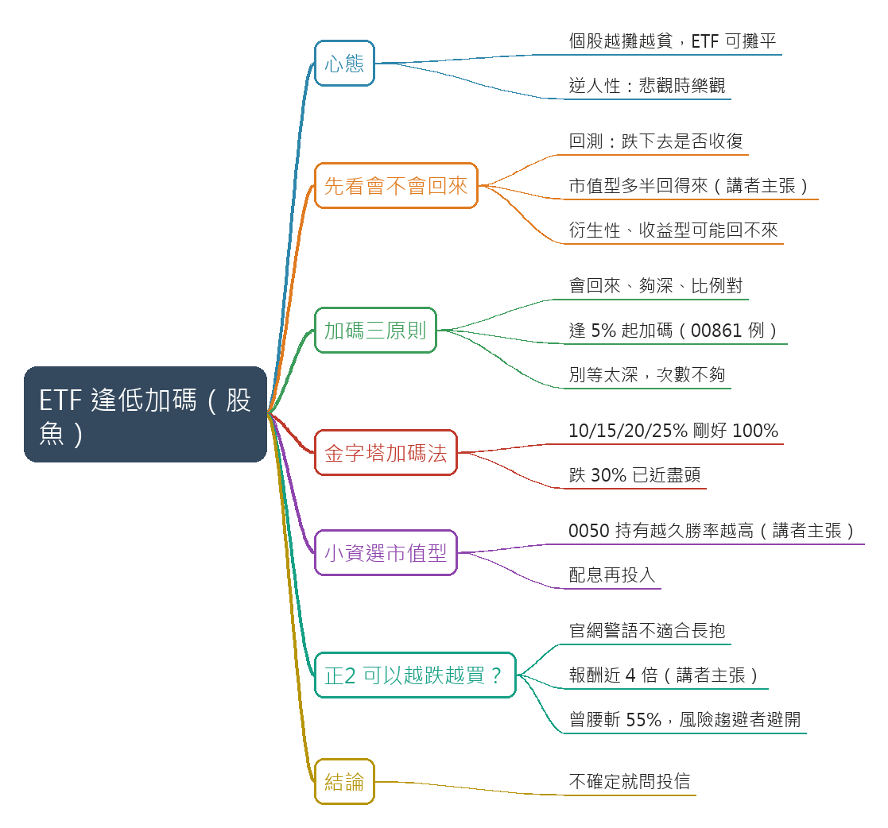

# 【兆華艾綸說】ETF逢低撿 金字塔加碼法 市值、正2、高息型 全都解｜李兆華、艾綸、股魚 2026.10.21 part2

## 摘要

**一句話重點**：存股教父股魚主張，ETF 可以在回檔時加碼，但要先用回測確認「跌下去會不會回來」，再依金字塔法（跌 10% 買 10%、15% 買 15%…）分批投入；資金不多就挑無聊的市值型 ETF 長抱；槓桿型（正2）績效驚人但可能腰斬，只適合能承受風險的人（以下數字皆為講者主張，未查證，非投資建議）。

| 時間 | 重點 |
|---|---|
| 00:00 | 個股越攤越貧要砍；ETF 可逆人性、悲觀時保持樂觀 |
| 03:25 | 回測分析：以 006208 看每次下跌是否收復 |
| 05:55 | 連結選擇權、期貨、REITs 等收益型產品，大跌後可能回不來 |
| 07:30 | 加碼三原則：會回來、夠深、比例對 |
| 09:01 | 00861 三種加碼方式：逢 5% 加碼累積獲利最高約 15.8 萬 |
| 11:55 | 0050／0056／00927 的最佳加碼點；有產品負 5% 投入仍賠錢 |
| 14:41 | 金字塔加碼法：10/15/20/25% 剛好 100%，30% 忍耐 |
| 16:40 | 小資選市值型：0050 持有愈久勝率愈高；統計採配息再投入 |
| 20:03 | 正2 能否越跌越買：官網「不適合長期持有」是警語 |
| 21:44 | 四檔正2 曲線重疊；0050 約 680%，正2 約近 4 倍 |
| 24:10 | 曾一兩個月腰斬 55%；風險趨避者不適合 |
| 25:55 | 歷史回檔逼近 2008 水準仍在；建議向投信詢問是否歸零 |

### 名詞與縮寫
- **攤平**：下跌時加碼降低成本；**回測／回撤**：用歷史資料模擬、從高點下跌的幅度。
- **市值型**：追蹤大型權值股指數（0050、006208 等）；**正2**：追蹤指數每日正向兩倍的槓桿 ETF。
- **配息再投入**：領到的股息再買回同一檔。**金字塔加碼**：跌越深、單次買越多。

### 轉錄校正備註
- 來源：Whisper（Groq），自動偵測為中文，未發現整段漏轉或重複幻覺；畫面燒入字幕與 Whisper 同源，不當權威。
- 已校正：兆華／艾綸、股魚、攤（平）、正2、複利、抱、息、面子／裡子等；畫面表格與圖表逐字抄在 `supplement.md`。推測詞見 `meta.json.known_asr_errors`；語意不通者保留原文。
- 畫面圖表直接寫明起點為 2017.03.30（證實逐字稿「2027年」為誤聽）。

## 思維導圖



## 補充資料

### S1｜畫面遺漏：回檔加碼三大方式（00861 模擬）
- 來源：影片畫面（約 10:18，節目圖表「回檔加碼3大方式 哪一種最好？」，資料來源標示「股魚自製工具」）；取得日期：2026-11-15；取得方式：原始解析度截圖逐字抄錄。
- 為何需要補充：逐字稿只口述部分數字，表格完整三列只在畫面。
### 原文（逐字）
```
以00861為例(近二年數據模擬回測) 會有三種狀況選擇
方式                                   獲利     績效
只做定期定額                           +6.4萬   +53.4%
持續定期定額且回檔超過5%就加碼         +15.8萬  +52.6%   （畫面有紅圈）
持續定期定額但只在回檔較深時加碼       +8.9萬   +61.4%   （畫面有紅圈）
```
### Claude 的對照分析
- 與影片一致：講者口述 53.4%、6.4 萬、15.8 萬。
- 補充直接寫明（影片沒有的）：深跌才加碼績效 +61.4%、獲利 +8.9萬；逢 5% 加碼績效為 +52.6%（略低於 53.4%，講者說「接近五成」）。
### 備註
- 回測為講者自製工具模擬，未查證。

### S2｜畫面遺漏：0050 回檔加碼門檻表
- 來源：影片畫面（約 12:15，「0050.0056.00927 回檔加碼最聰明買法？」）；取得日期：2026-11-15；取得方式：截圖逐字抄錄（僅抄清楚的列；紅圈為節目標示）。
### 原文（逐字）
```
0050全部加碼門檻　回測:近2年、持有至今10/19
回檔深度  買進天數  投入    總獲利   報酬率
-5%       29        14.5萬  +16.7萬  +115.5%   （-5% 有紅圈）
-6%       20        10.0萬  +12.3萬  +123.4%
-7%       14        7.0萬   +9.0萬   +129.2%
-8%       11        5.5萬   +7.4萬   +135.2%
-9%       8         4.0萬   +5.6萬   +140.5%
-10%      7         3.5萬   +4.8萬   +136.1%
-11%      6         3.0萬   +3.9萬   +130.4%
-12%  第3名  4       2萬     +3.8萬   +187.8%
-13%  第1名  3       1.5萬   +2.9萬   +191.6%   （紅圈）
-14%  第2名  3       1.5萬   +2.9萬   +191.6%
```
### Claude 的對照分析
- 與影片一致：講者說要錢在 5% 後加碼、要「面子」（報酬率）最佳在 13%。
- 補充直接寫明：總獲利最大在 -5%（+16.7 萬）、報酬率最高在 -13%／-14%（+191.6%）。
### 備註
- 「第1/2/3名」為畫面標示的報酬率排名；0056 欄位被遮住，未抄錄。

### S3｜畫面遺漏：某產品負 5% 投入仍賠錢（00927 旁）
- 來源：影片畫面（約 12:45「回檔投入＋長期投資 不是一體適用？」）；取得日期：2026-11-15；取得方式：截圖逐字抄錄。
### 原文（逐字）
```
(某產品)全部加碼門檻　回測:近2年、持有至今10/19
回檔深度  買進天數  投入   總獲利   報酬率
-5%  第3名  19      9.5萬  -3,814   -4%
-6%  第2名  9       4.5萬  -1,621   -3.6%
-7%  第1名  3       1.5萬  -407     -2.7%
產品特性不同，請勿認定回檔投入一定能獲利，有眾多投資商品【回檔投入＋長期投資】仍會處於虧損狀態，不可不慎
```
### 備註
- 同畫面左側 00927 表格較小、字糊，未逐字抄錄。

### S4｜畫面遺漏：0050 持有愈久勝率
- 來源：影片畫面（約 17:34「長期投資 回檔鎖定市值型ETF」）；取得日期：2026-11-15。
### 原文（逐字，僅抄清楚處）
```
0050 元大台灣50　94.1%　5,011 個買點・中位年化 +10.41%
抱越久，勝率怎麼變？（每年年初進場）
持有 1 年：78%（其餘年數字在縮圖中看不清，未抄錄）
```
### Claude 的對照分析
- 與影片一致：講者口述 1 年約八成、3 年九成、5 年以上 100%（2003–2026 回測，講者主張，未查證）。

### S5｜畫面遺漏：正2 累積報酬圖
- 來源：影片畫面（約 22:11–25:00「正2累積報酬驚人 風險與獲利審慎評估」）；取得日期：2026-11-15。
### 原文（逐字）
```
還原息息、起點統一為 0%　2026/10/19
00685L +2820.16%　00631L +2753.81%　00663L +2710.42%　00675L +2704.04%　0050 +680.67%
所有產品的共同起點 2017.03.30起算～NOW
● 0050 績效：680%　● 正二績效：2,700%
了解產品且願意承擔風險的人可以得到超額回報
槓桿型產品泛指這四檔產品：00631L、00663L、00675L、00685L
● 對風險趨避的投資人：這是很差勁的產品（最大回撤曾高達55%）
● 對風險愛好且理解產品特性的人：這是高風險高回報的好東西
```
### Claude 的對照分析
- 補充直接寫明：起點為 2017.03.30（逐字稿「2027年」是誤聽，已改）；2,700% 約為 680% 的 4 倍，與講者「近乘以 4」一致。
### 備註
- 報酬數字為節目引用，未查證；非投資建議。

## 來源

- 原始資料夾：`watch-output/投資理財/2026-11-15_YouTube_兆華艾綸說-ETF逢低撿-金字塔加碼法-市值-正2-高息型-全都解-李兆華-艾綸__LrvC2KNcxYs`
- 逐字稿來源：whisper (groq)
