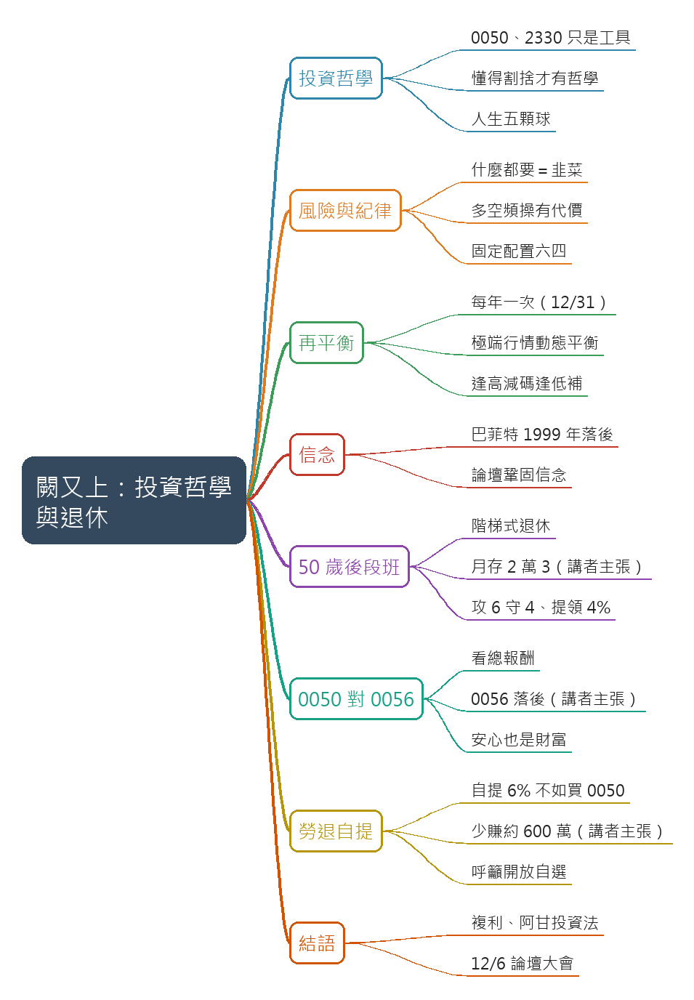

# 五十歲退休後段班莫慌！「月存兩萬三」10年逆轉退休金！- 闕又上 劉寶傑《寶傑怎麼說》20261112-2

## 摘要

**一句話重點**：華爾街操盤手闕又上主張，先建立「投資哲學」（懂得割捨），再用 0050／SPY 搭配「進攻／防守」資產配置與每年再平衡，即使 50 歲才起步的「後段班」，靠月存 2 萬 3 與複利也能 60 歲正常退休（以下數字皆為講者主張，未查證）。

| 時間 | 重點 |
|---|---|
| 00:00 | 0050、2330 只是工具；投資哲學→策略→工具，懂得割捨才有哲學（和牛比喻） |
| 03:00 | 人生五顆球：工作會彈回來，健康、家庭、朋友、心靈不會；0050／SPY 是會彈回的球 |
| 04:50 | 吃不完的韭菜源於什麼都要；多空頻繁操作（犀利媽）的睡眠與生命代價 |
| 07:05 | 2000 年泡沫短期失敗、持續補錢與固定配置（如六四）長期拉回 |
| 09:48 | 每年 12/31 再平衡一次，極端行情才動態平衡；逢高減碼、逢低補進 |
| 11:17 | 巴菲特 1999 年落後大盤、2000 年後大漲；用論壇鞏固信念 |
| 13:07 | 50 歲後段班（約 300–400 萬）：階梯式退休、每月多存 2 萬 3（講者主張） |
| 15:25 | 補考班攻擊 6／防守 4，約 900 萬、提領 4%（月 3 萬）＋勞保勞退（講者主張） |
| 17:41 | 0056 高股息爭議：看股利加資本利得的總報酬 |
| 19:18 | 0056 長期落後 0050（講者主張）；安心也是財富，緣分不勉強 |
| 22:21 | 勞退自提 6% 不如自己買 0050；30 年少賺約 600 萬（講者主張，未查證） |
| 24:12 | 批評勞團只爭提繳率、勞退基金報酬低；他校與新制公務員已可自選 |
| 26:00 | 結語：複利；先讀《阿甘投資法》；12/6 論壇大會（票價 1 萬 6） |
| 28:58 | 主持人回覆觀眾留言（與投資無關） |

### 名詞與縮寫
- **0050**：元大台灣50（台股大型權值 ETF）；**0056**：元大高股息 ETF；**2330**：台積電；**SPY**：追蹤美股 S&P 500 的 ETF。
- **再平衡／動態平衡**：定期把資產比例調回目標；極端行情時提前調整。
- **總報酬**：股利＋資本利得。**複利**：利息再滾入本金。
- **勞退自提**：勞工自願提繳薪資 6% 進勞退個人專戶（由國家基金管理）。

### 轉錄校正備註
- 來源：Whisper（Groq），語言自動偵測為中文，未發現整段漏轉或重複幻覺。畫面燒入字幕與 Whisper 同源（錯字相同），不能當權威；只有名牌（闕又上）、標題條與留言畫面可核對。
- 已校正：邱老師→闕老師、寶傑（保潔／保堅／寶姐）、複利、股利、資本利得、輝達、逢高減碼、範蠡、慢飆股、千年暗室一燈即明、務實自渡、留言帳號與內容。推測詞見 `meta.json.known_asr_errors`；語意不通無法確認的句子（神龍百尾、阿達瑪孔古利、手背做紅袋等）保留原文。
- 所有報酬率、金額、落後幅度與制度評論都是講者主張，未查證；本片非投資建議。

## 思維導圖



## 補充資料

### S1｜畫面遺漏：結尾觀眾留言原文
- 來源：影片畫面（28:58 起的「寶傑專屬互動時間」留言卡，YouTube 留言截圖）；取得日期：2026-11-15；取得方式：自影片抽取原始解析度截圖逐字抄錄。
- 為何需要補充：主持人只口述留言大意，留言帳號與原文只在畫面出現（約 29:24、29:40、30:09、30:20、30:30、30:45）。
### 原文（逐字）
```
@Joanna00245（6 天前）：支持寶傑及團隊，你們是最優秀的
@PinghoL-x5r（8 天前）：政府部門主管機關應該管理一下，堅決不讓中共產品進來台灣。
@Lookword0222（10 天前）：天佑臺灣，感謝寶傑，一起保護臺灣 臺灣人加油
@karenkao3011（1 天前）：感謝寶傑製作這麼好的節目
@Wei20110（1 天前）：只有我覺得鄭麗文尖嘴猴腮面露兇相嗎？
@vicker8822（3 天前）：『中國與和平水火不相容』，這句比較通順。
```
### Claude 的對照分析
- 補充直接寫明：帳號名稱與留言原文；逐字稿原本的「淑君」「聽後X5」「Rookward」「Way」「立刻」皆為帳號誤聽，已更正。
- 與影片一致：主持人回覆內容與留言相符；「尖嘴猴腮」為畫面原文。
### 備註
- 留言屬觀眾個人意見，與本片投資內容無關；未查證。

## 來源

- 原始資料夾：`watch-output/投資理財/2026-11-15_YouTube_五十歲退休後段班莫慌-月存兩萬三-10年逆轉退休金---闕又上-劉寶傑《寶傑怎麼__wlq6fpv-EN8`
- 逐字稿來源：whisper (groq)
