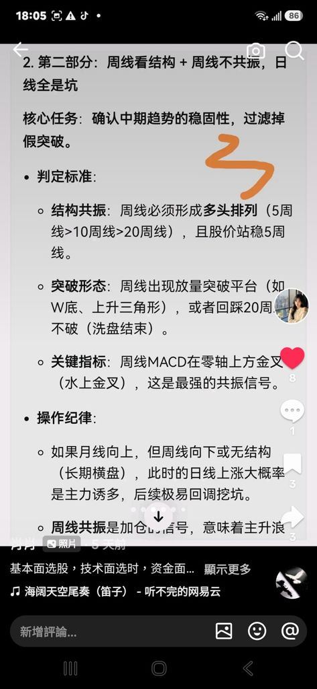

# 三級K線操盤口訣：月線定生死、周線看結構、日線找爆發

## 思維導圖

- 三級K線操盤口訣
  - 核心邏輯
    - 月線戰略、週線戰術
    - 日線執行
  - 月線定生死
    - 站穩20月均線
    - 不抬頭不重倉（作者主張）
  - 週線看結構
    - 5>10>20週線多頭排列
    - 放量突破或回踩不破
    - 不共振日線全是坑
  - 日線找爆發
    - 放量突破阻力位
    - 回踩5或10日線
    - 未突破只看不買
  - 三步走與避坑
    - 勝率70%以上（作者主張）
    - 無量突破是誘多
  - 三層邏輯結語
    - 基本面選股
    - 技術面選時、資金面選點

## 圖文對照（畫面 + 逐字稿）

### 第 1 頁：核心邏輯：戰略→戰術→執行三層過濾

**重點：** 貼文主張：月線定生死（戰略層）、週線看結構（戰術層）、日線找爆發（執行層），以三層過濾避免散戶被日線誘多騙入場；月線向下時所有反彈都是魚尾行情，週線無上升結構時日線漲跌只是隨機噪音。（作者主張，未查證）

**標籤：** #三層過濾

一、核心邏輯：為什麼這個口訣是對的？

這張圖闡述的是“戰略 -> 戰術 -> 執行”的三層過濾系統，能最大程度避免散戶“被日線誘多騙入場”。

- 月線定生死（戰略層）：決定是去打仗還是休息。月線代表大趨勢，月線向下，所有的反彈都是“魚尾行情”，重倉必死無疑。
- 週線看結構（戰術層）：決定有沒有打仗的價值。週線是連接月線和日線的橋樑，週線沒有形成上升結構，日線的漲跌全是隨機噪音，追進去就是填坑。
- 日線找爆發（執行層）：決定什麼時候扣動扳機。在大方向和中期結構都確認安全後，日線的突破才是最佳的入場點火點。

### 第 2 頁：第一部分：月線定生死、月線不抬頭不重倉

**重點：** 核心任務是剔除 80% 的垃圾股。判定標準：股價站穩 20 月均線且 5 月均線拐頭向上，或月線連續 3 根陽線、MACD 紅柱放大、突破長期下降壓力線。紀律：月線明確上升時主倉 60% 以上才可投入，月線下跌或橫盤時最多少量博反彈（作者主張）。

**標籤：** #月線 #20月均線

二、具體實戰方法與細節

1. 第一部分：月線定生死 + 月線不抬頭，堅決不重倉

核心任務：剔除80%的垃圾股，只在長牛賽道里找機會。

- 判定標準：
  - 均線多頭：股價站穩20月均線（牛熊分界線），且5月均線拐頭向上。
  - 趨勢抬頭：月線出現連續3根陽線，MACD紅柱放大，或者突破了長期的下降壓力線。
- 操作紀律：
  - 重倉條件：只有當月線明確處於上升趨勢（抬頭）時，才可以將主倉（60%以上）投入。
  - 空倉/輕倉條件：月線處於下跌或橫盤震盪期，哪怕日線漲停也不重倉，最多拿少量資金博反彈。

### 第 3 頁：第二部分：週線看結構、不共振日線全是坑

**重點：** 核心任務是確認中期趨勢穩固並過濾假突破。標準：週線多頭排列（5>10>20 週線）且站穩 5 週線，放量突破平台或回踩 20 週線不破，週線 MACD 水上金叉為最強共振訊號；月線向上但週線無結構時，日線上漲多半是主力誘多（作者主張）。本頁底部被截斷。

**標籤：** #週線 #多頭排列 #水上金叉

2. 第二部分：週線看結構 + 週線不共振，日線全是坑

核心任務：確認中期趨勢的穩固性，過濾掉假突破。

- 判定標準：
  - 結構共振：週線必須形成多頭排列（5週線>10週線>20週線），且股價站穩5週線。
  - 突破形態：週線出現放量突破平台（如W底、上升三角形），或者回踩20週線不破（洗盤結束）。
  - 關鍵指標：週線MACD在零軸上方金叉（水上金叉），這是最強的共振訊號。
- 操作紀律：
  - 如果月線向上，但週線向下或無結構（長期橫盤），此時的日線上漲大機率是主力誘多，後續極易回調挖坑。
  - 週線共振是加倉的訊號，意味著主升浪（下文被截斷）

### 第 4 頁：第三部分：日線找爆發、不突破看戲不手癢

**重點：** 核心任務是精準卡點、降低持倉成本、避免追高。買點有二：日線放量突破週線結構阻力位（量能放大 30% 以上），或在月週線向好時回踩 5 日或 10 日線縮量企穩。紀律：未突破關鍵位前只看不買，突破後收盤跌破突破位或 10 日線就止損（作者主張）。

**標籤：** #突破買點 #回踩買點 #止損

3. 第三部分：日線找爆發 + 日線不突破，看戲不手癢

核心任務：精準卡點，降低持倉成本，避免追高。

- 判定標準：
  - 突破買點：日線放量突破週線結構的阻力位（如前高、20日線），量能放大30%以上。
  - 回踩買點：在月線、週線趨勢向好的前提下，日線回踩5日或10日線縮量企穩，這是最佳的低吸點。
- 操作紀律：
  - 管住手：在日線沒有突破關鍵位之前，無論怎麼震盪，只看不買，防止被主力洗盤震盪出局。
  - 止損位：日線突破後，如果收盤跌破突破位或10日線，立即止損（視為假突破）。

### 第 5 頁：三步走與避坑指南

**重點：** 作者主張嚴格執行三步走可把勝率提升到 70% 以上（未查證）：月線選出 20 月均線向上的股票、週線確認多頭排列或突破平台、日線不追高只在回踩不破低吸或放量突破追漲。避坑：切忌倒行逆施、突破必須放量（無量突破 90% 是誘多陷阱）、心態上持股週期要與週期匹配（本頁被截斷）。

**標籤：** #三步走 #量能 #避坑

（上文被截斷）嚴格執行以下“三步走”，可以將勝率提升到70%以上：

1. 第一步（選股）：打開月線圖，篩選出20月均線向上的股票，加入自選。（篩掉下跌趨勢票）

2. 第二步（確認）：查看這些股票的週線，必須滿足週線多頭排列或週線突破平台。（篩掉震盪票）

3. 第三步（買賣）：盯著日線，不追高，只在日線回踩均線不破時低吸，或者日線放量突破結構時追漲。

四、避坑指南（關鍵注意事項）

1. 切忌倒行逆施：不要在月線下跌時試圖抄底，也不要在月線上漲時盲目做空。

2. 量能是靈魂：所有的突破（週線突破、日線突破）都必須伴隨成交量放大。如果是“無量突破”，90%是誘多陷阱。

3. 心態管理：這套邏輯要求持股週期與週期匹配。月線多頭意味著可能是大行情，不（下文被截斷）

### 第 6 頁：三級K線操盤口訣實戰解讀（通用版）：月線

**重點：** 以一隻未具名個股為例：長期下跌後底部橫盤多年，月線已多頭排列、屬月線抬頭的趨勢反轉初期，符合重倉布局前提，但仍處慢牛後的中繼調整、主升浪尚未啟動，要等中期訊號確認。本頁下半開始談週線（接下頁）。

**標籤：** #月線抬頭 #中繼調整

📈 三級K線操盤口訣實戰解讀（通用版）

一、月線定生死：大趨勢是一切的前提

- 當前狀態：長期下跌後在底部橫盤多年，目前月線均線已形成多頭排列，股價站穩長期均線，屬於“月線抬頭”的趨勢反轉初期。
- 口訣對應：“月線不抬頭，堅決不重倉”——這隻標的已經滿足重倉佈局的大前提，大方向安全，主力完成了長期底部建倉，未來有大級別行情潛力。
- 注意：月線仍處於慢牛爬升後的中繼調整，主升浪尚未啟動，需要耐心等待中期訊號確認。

二、週線看結構：中期共振才是真機會

- 當前狀態：走出“底部啟動→衝高→回調蓄勢”的完整結構，從低位翻倍後回調約20%，週線短期均線死叉回踩，但中長期均線仍向上，核心支撐未破。

### 第 7 頁：週線：洗盤階段；日線：弱勢震盪

**重點：** 週線走完底部啟動→衝高→回調蓄勢結構，回調約 20%、短期均線死叉回踩但中長期均線仍向上；籌碼 90% 在股價上方、獲利盤約 1 成，屬上漲趨勢洗盤，要警惕假突破、等週線均線重新金叉。日線高位回落後弱勢震盪、空頭排列、量縮（作者主張）。

**標籤：** #洗盤 #籌碼 #假突破

二、週線看結構：中期共振才是真機會

- 當前狀態：走出“底部啟動→衝高→回調蓄勢”的完整結構，從低位翻倍後回調約20%，週線短期均線死叉回踩，但中長期均線仍向上，核心支撐未破。
- 籌碼訊號：90%籌碼集中在當前股價上方，獲利盤僅1成左右，說明上方套牢盤沉重，同時下方支撐也在逐步夯實。
- 口訣對應：“週線不共振，日線全是坑”——目前處於上漲趨勢的洗盤階段，結構完整未壞，可以開始關注日線買點，但要警惕假突破，必須等週線級別均線重新金叉共振。

三、日線找爆發：精準入場的最後訊號

- 當前狀態：高位回落後進入弱勢震盪，短期均線空頭排列，股價承壓於均線下方，上方存在明顯套牢壓力，成交量持續萎縮，主力正在低位吸籌清洗浮籌。

### 第 8 頁：日線找爆發：精準入場的最後訊號

**重點：** 日線沒有明確反轉突破訊號時入場就是接盤填坑，屬嚴格觀望階段；只有放量突破關鍵壓力位並站穩短期均線的組合訊號，才是真正的爆發點，可果斷入場（作者主張）。

**標籤：** #爆發點 #觀望

三、日線找爆發：精準入場的最後訊號

- 當前狀態：高位回落後進入弱勢震盪，短期均線空頭排列，股價承壓於均線下方，上方存在明顯套牢壓力，成交量持續萎縮，主力正在低位吸籌清洗浮籌。
- 口訣對應：“日線不突破，看戲不手癢”——當前日線沒有出現明確的反轉突破訊號（如放量長陽突破關鍵均線/壓力位），此時入場就是“接盤填坑”，屬於嚴格觀望階段。
- 觸發買點：只有等日線出現放量突破關鍵壓力位+站穩短期均線的組合訊號時，才是真正的“爆發點”，可以果斷入場。

### 第 9 頁：最終操盤策略總結（月週日表格）

**重點：** 表格結論：月線趨勢多頭（已抬頭）、週線調整蓄勢（待共振）、日線弱勢震盪（未爆發）；一句話：大趨勢向好、中期洗盤、短期磨底，現在不是重倉出擊時，耐心等日線放量突破。表格右欄「操作建議」被截斷，只能看到部分字。

**標籤：** #策略總結 #表格

（承上頁）壓力位+站穩短期均線的組合訊號時，才是真正的“爆發點”，可以果斷入場。

🎯 最終操盤策略總結

表格（週期｜狀態判斷｜操作建議）：

月線｜✅ 趨勢多頭（已抬頭）｜保留底倉，不下車（右欄被截斷，推測補字）

週線｜⚠️ 調整蓄勢（待共振）｜觀望等待，重點關注核心支撐（右欄被截斷，推測補字）

日線｜❌ 弱勢震盪（未爆發）｜堅決不動，等待訊號再動手（右欄被截斷，推測補字）

一句話總結：

這是一隻大趨勢向好、中期在洗盤、短期仍磨底的潛力標的，現在不是重倉出擊的時候，耐心等日線放量突破，才是最穩妥的賺錢時機。

### 第 10 頁：深度解讀：月線定生死（戰略佈局階段）

**重點：** 貼文把月線稱為主力的戰略地圖：腰斬再腰斬後在底部橫盤多年，月線已完成趨勢反轉，意味大資金完成長期建倉、不是一日遊行情；對它來說「月線不抬頭，堅決不重倉」已經滿足，現在是大底已築、只欠東風（作者主張，未查證）。

**標籤：** #戰略地圖 #大底已築

📉 深度解讀：大週期定方向，小週期定買賣

第一部分：月線——定生死（戰略佈局階段）

- 盤面語言：這隻票經歷了從歷史高位到歷史低位的“腰斬再腰斬”，然後在底部區間橫盤震盪了漫長時間。月線級別已經完成了趨勢的徹底反轉。
- 核心邏輯：月線是主力的“戰略地圖”。月線抬頭，意味著大資金已經完成了長期建倉。既然月線趨勢向上，說明這不是一日遊的行情，而是至少跨越一年以上的大趨勢。
- 深層解讀：主力在低位拿足了籌碼，把高位的舊籌碼全部置換掉了。此時“月線不抬頭，堅決不重倉”這句話，對它來說已經滿分滿足。它現在的狀態是：大底已築，只欠東風。

### 第 11 頁：深度解讀：週線看結構（洗盤吸籌階段）

**重點：** 貼文稱週線看節奏：主力利用散戶恐高心理，在 40 元上方套牢追高盤，再於 35–38 元區間反覆震盪消磨耐心；籌碼集中在成本區上方、獲利盤極少，20 週線絲絲未破代表主力沒跑，只是在洗（作者主張，未查證，個股未具名）。

**標籤：** #洗盤 #千斤重擔萬人挑

第二部分：週線——看結構（洗盤吸籌階段）

- 盤面語言：從底部啟動一波主升浪後，近期出現了明顯的回調震盪。但週線的中期均線（20週線）絲絲未破，這是主力在控盤洗盤。
- 核心邏輯：週線看的是“節奏”。主力利用散戶的恐高心理，在40元上方套牢一批追高盤，然後在35-38元區間反覆震盪，消磨你的耐心。
- 深層解讀：籌碼高度集中在成本區上方，獲利盤極少。這叫“千斤重擔萬人挑”——主力把壓力都留給了散戶，自己只需要在關鍵支撐位托住股價。週線結構沒有壞，就說明主力沒跑，目前只是在“洗”，不是在“跑”。

### 第 12 頁：深度解讀：日線找爆發與一句話終極總結

**重點：** 日線是主力的操盤刀，目前縮量橫盤是吸籌收尾；「日線不突破，看戲不手癢」是給散戶的鐵律，沒突破前買入都可能接飛刀，只有放量陽線突破上方短期均線壓力才是點火訊號。終極總結：大趨勢完美、中期洗盤、短期蓄力（作者主張）。本頁底部被截斷。

**標籤：** #接飛刀 #放量陽線

第三部分：日線——找爆發（臨盤決策階段）

- 盤面語言：日線目前處於“縮量橫盤”狀態，短期均線空頭排列，上方有層層套牢盤壓制，看起來很弱。
- 核心邏輯：日線是主力的“操盤刀”。現在的弱勢，是主力在吸籌收尾。
- 深層解讀：“日線不突破，看戲不手癢”是給散戶的鐵律。因為日線沒突破之前，任何買入都可能是“接飛刀”。
  - 只有當日線出現“放量陽線”，一舉突破上方的短期均線壓力，並且成交量放大時，才是主力真正的點火啟動訊號。到那時，趨勢才會徹底反轉向上。

💡 一句話終極總結

這隻票目前的狀態是：大趨勢完美，中期在洗盤，短期在蓄力。

主力已經在底部坐莊，現在正處於拉升前的最後忍耐期，千萬別因為日線的一時震盪而（下文被截斷）

### 第 13 頁：三層邏輯：基本面選股、技術面選時、資金面選點

**重點：** 貼文用月線看主力戰略意圖、週線看吸籌洗盤、日線看起爆點，提出「基本面選股，技術面選時，資金面選點」三層邏輯；本頁起首與結尾被截斷，內容接下頁。

**標籤：** #三層邏輯

（起首被截斷）做股票，真正的高手從來不是靠猜，而是靠三層邏輯層層鎖定：基本面選股，技術面選時，資金面選點。

先看月線——這是主力的戰略意圖。

這隻標的，從歷史高位一路殺到底部，橫盤磨底長達數年，把所有不堅定的籌碼全部洗乾淨。月線均線已經多頭排列，大趨勢徹底反轉。

這說明什麼？長線主力已經完成底部建倉，這不是短線行情，是大級別底部啟動。大方向對了，你怎麼拿都不會虧。

再看週線——這是主力的吸籌洗盤。

從底部啟動後，衝高回落，中期調整，但關鍵支撐根本沒破。籌碼高度集中，上方全是套牢盤，獲利盤寥寥無幾。

主力在幹什麼？故意壓盤、震盪磨人，把浮籌全部洗出去，為後面的主升浪減輕壓力。週線結構不壞，主力就沒走，現在只是中場休息。

最後看日線——這是主力的起爆點。

現在日線縮量震盪，看著弱，其實是拉升前（下頁續，本頁底部被截斷）

### 第 14 頁：結語：日線不突破，堅決不入場

**重點：** 結尾重申日線縮量震盪是拉升前最後的蓄力、均線壓制與盤面沉悶是給散戶看的假象，記住「日線不突破，堅決不入場」，放量突破壓力位並站穩均線才是點火訊號；總結基本面保證拿好牌、技術面保證買在起漲點、資金面保證吃在主升浪（作者主張，未查證）。

**標籤：** #結語 #三層

最後看日線——這是主力的起爆點。

現在日線縮量震盪，看著弱，其實是拉升前最後的蓄力。均線壓制、盤面沉悶，都是給散戶看的假象。

記住一句話：日線不突破，堅決不入場。一旦放量突破壓力位，站穩均線，就是資金點火、主升浪啟動的訊號。

總結一下：

基本面選股，保證你拿的是好牌；

技術面選時，保證你買在起漲點；

資金面選點，保證你吃在主升浪。

這隻票現在就是：大底已成，洗盤將近，只等突破。耐心拿住，後面空間遠比你想象的大。

## 知識點

- [[五日均線_核心邏輯：戰略（月線）→戰術（週線）→執行（日線）三層過濾]]
- [[五日均線_月線不抬頭，堅決不重倉：主倉 60% 以上的前提]]
- [[五日均線_週線要多頭排列並站穩 5 週線，才算中期共振]]
- [[五日均線_日線兩種買點：放量突破阻力位，或回踩 5／10 日線縮量企穩]]
- [[五日均線_突破必須放量：無量突破多半是誘多陷阱]]
- [[五日均線_日線不突破，看戲不手癢]]
- [[五日均線_三層邏輯：基本面選股、技術面選時、資金面選點]]

## 補充資料

### S1｜畫面遺漏與來源說明：截圖頁數、遮蔽與被截斷處
- 來源：使用者提供 Google Drive 資料夾（14 張 `Screenshot_20261123_*_TikTok Lite.jpg`，手機截圖，拍攝於 2026-11-23 18:05–18:08）；取得日期：2026-11-23；取得方式：公開分享資料夾下載。
- 為何需要補充：貼文網址（`vm.tiktok.com/ZSs8WMMMV/`，實為 TikTok 圖文貼文 `@juliapitts9502wg9q/photo/7709335043344452884`）無法自動抓取圖片與文字，改由使用者截圖手動歸檔。

### 事實與限制（畫面直接可見）
- 使用者說明「一共 13 頁」，實際收到 14 張截圖；我依內容順序排成第 1–14 頁，沒有刪除或合併任何一張。相鄰截圖有重疊（第 6 與 7、8 與 9、13 與 14 頁），推測是捲動拍攝造成，而非重複頁；請使用者確認是否有多餘或缺漏的截圖。
- 貼文輪播指示點共 6 個（截圖 1 為第 1 點、第 8–11 頁為第 5 點、第 14 頁為第 6 點），每個點是一張可捲動的長圖，所以頁碼是「截圖序」，不是貼文的原始頁。
- 排序依據：畫面內容（標題與接續句）與作者橘色手寫序號（2、3、4 出現在第 2、3、4 頁，之後的手寫記號在第 5–8 頁）；拍攝時間順序與內容順序不同（例如第 5 頁「三步走」拍在第 4 頁「第三部分」之前，第 9 頁表格拍在第 10 頁深度解讀之後），已改依內容排序。
- 貼文說明欄只顯示「基本面選股，技術面選時，資金面…（顯示更多）」，完整說明文字未取得。
- 其他畫面資訊（拍攝當時）：作者顯示名「肖肖」、「照片」貼文、發布「5 天前」、愛心 8、留言 1、收藏 3、分享 3；背景音樂「海闊天空尾奏（笛子）- 聽不完的網易雲」。
- 被 TikTok 按鈕、頭像或捲動箭頭遮住的字：2026-11-23 依使用者指示，**依上下文補入推測字**（原圖看不到這些字，非原文，已記在 `meta.json.known_asr_errors`，狀態 `suspected`）：第 2 頁「漲停」、第 3 頁「20 週線」「加倉的訊號」、第 4 頁「立即止損」、第 5 頁「邏輯要求」、第 7 頁「吸籌」（第 8 頁同一句可見「吸籌清洗浮籌」，可印證）、第 8 頁「才是」（第 9 頁開頭同句可見）、第 10 頁「建倉」（第 13 頁「底部建倉」可旁證）、第 12 頁「，現」。第 9 頁表格右欄三格（2026-11-23 再依使用者指示，根據第 1–8 頁內容推測補入）：月線「保留底倉，不下車」、週線「觀望等待，重點關注核心支撐」、日線「堅決不動，等待訊號再動手」；依據與不確定處記在 `meta.json.known_asr_errors`，尤其日線被遮約 2 字，原文可能更長。

### Claude 的對照分析
- 畫面中的「表格」區塊有複製／下載／全螢幕圖示，與 AI 助手回答的呈現方式相似，**推測**這組長圖是 AI 對話輸出的截圖（非確定，作者未說明）；若屬實，內容為模型生成的分析而非實盤紀錄，更不宜當作事實。
- 例子股票（40 元、35–38 元區間）未具名，無法核對；所有勝率、倉位與量能門檻皆為作者主張，未查證。

## 來源

- 原始資料夾：`watch-output/投資理財/五日均線/三級K線操盤口訣-月線定生死-周線看結構-日線找爆發_2026-11-23_TikTok__7709335043344452884`
- 逐字稿來源：圖片文字（逐頁人工抄錄，非語音轉錄）
