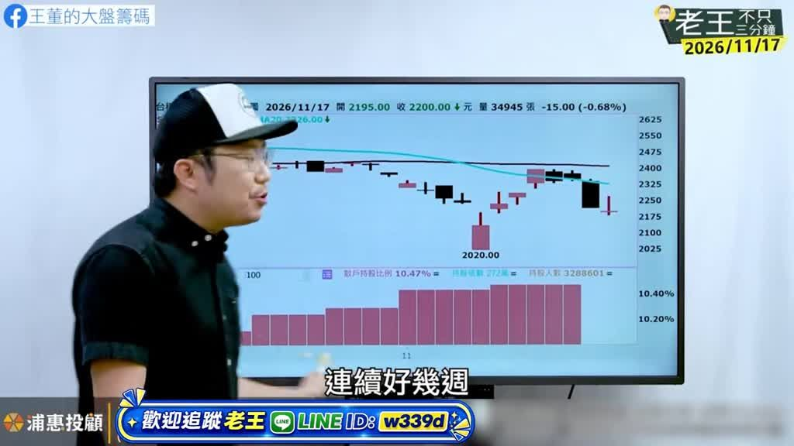
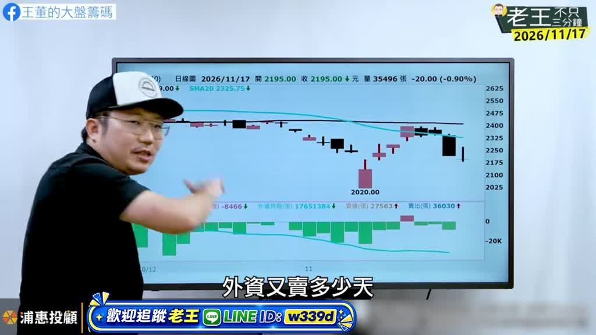
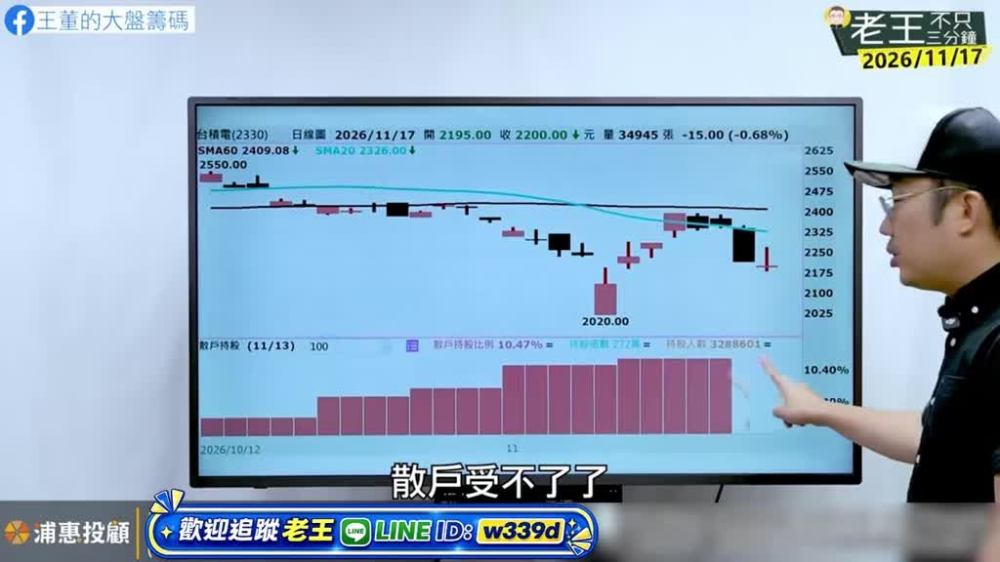
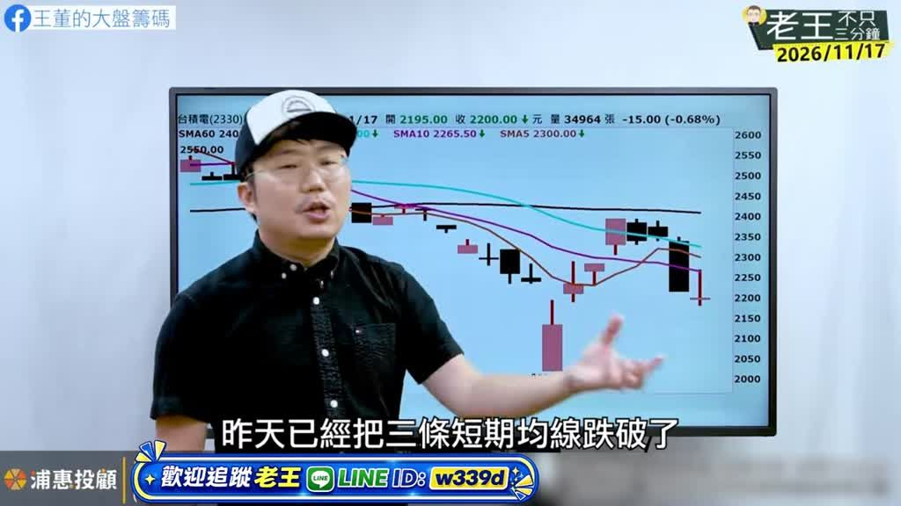
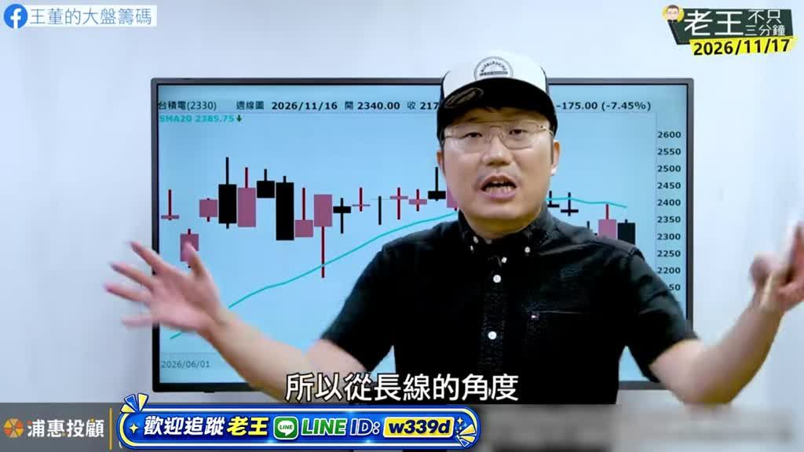
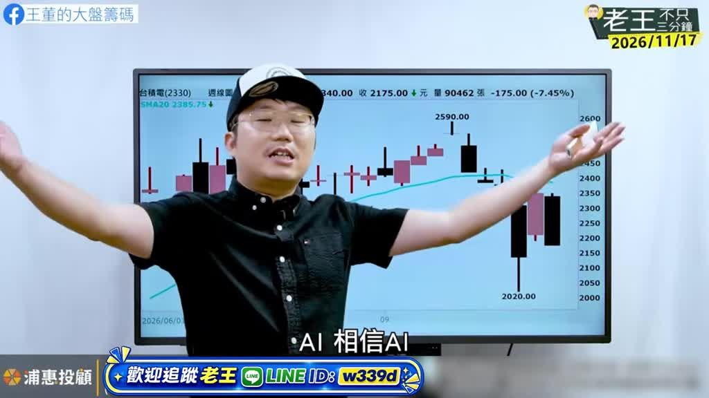
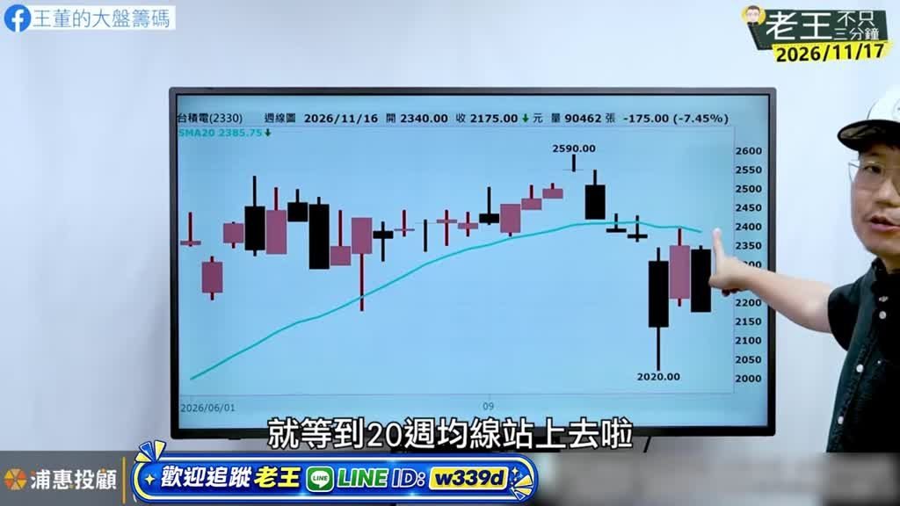

# 散戶入侵台積電，罕見的外資和散戶對作誰會笑到最後？

## 思維導圖

- 台積電籌碼與均線
  - 散戶持股
    - 100張以下持續上升
    - 散戶拼命低接
  - 籌碼面
    - 外資只買一天（講者主張）
    - 外資一路賣、散戶接
    - 籌碼要集中才會漲
  - 理想結構
    - 散戶賣出
    - 外資轉買接走
  - 技術面
    - 站上短均又跌破
    - 長短線都是空頭
    - 要站上所有均線才翻多
  - 20週均線
    - 講者稱早已跌破
    - 反彈沒站上就沒翻多
    - 站回再買回
  - 技術分析
    - 基本面好也要看價差
    - 技術分析才是保障

## 圖文對照（畫面 + 逐字稿）

### 主題 1：散戶持股比例：台積電也是散戶一直買（00:00–00:30）

**重點：** 講者（畫面標示「老王」）用「100 張以下的散戶持股比例」指標說明，台積電和國巨一樣，100 張以下散戶連續好幾週都在拼命低接、拼命買，大家都覺得買台積電像撿黃金，但台積電是很棒的公司、台灣之光（講者主張，未查證）。

**標籤：** #散戶持股 #100張以下

台積電好像也是散戶一直買，Bingo，你很厲害喔，舉一反三喔，來給大家看一下，100張以下的散戶持股比例，其實老王過去分析台積電，過去一年兩年三年，分析台積電，其實也很喜歡拿這個指標，100張以下的散戶持股比例，就第100張的，你看12345，你看跟國巨一樣，連續好幾週，100張以下的散戶，都在拼命低接拼命買，大家都覺得買台積電，哇趕快撿黃金，其實台積電真的是一個很棒的公司。

### 主題 2：籌碼面在作怪：外資一路賣、散戶一路接（00:30–01:05）

**重點：** 講者說股價漲不上去是籌碼太凌亂：外資這張圖上只買一天、其餘都在賣，大戶賣、散戶接，不是正常籌碼；股票要漲得籌碼夠集中，所以台積電反彈上去又跌下來（講者主張，未查證）。

**標籤：** #外資 #籌碼集中

也是台灣之光，可是有時候股價漲不上去，就是這個籌碼面在作怪，就是籌碼太凌亂了，大戶都在賣啊，外資 欸欸欸，整張圖喔 整張圖啊，外資只買一天啊，有沒有搞錯啊，全部都在賣啊，這張圖有多少個交易日，外資又賣多少天，只有一天買超啊，啊外資是不是大戶，啊外資大戶一路賣，啊你散戶拼命接，這是股票正常的籌碼嗎，股票會漲是因為籌碼要夠集中欸，大家不是常常在看籌碼集中度嗎？所以這籌碼你要台積電怎麼漲嗎？所以才會在反彈上去又跌下來了嘛，因為你是散戶在買啊。

### 主題 3：理想的籌碼結構：散戶掉下來、外資接走（01:05–01:17）

**重點：** 講者希望看到的是散戶受不了、賣出去，然後外資轉買接走，這才是很棒的籌碼結構（講者主張，未查證）。

**標籤：** #籌碼結構

所以我們希望看到是散戶要掉下來，散戶這個地方掉下來，散戶股票賣出去了，散戶受不了了，然後誰接走？外資轉買，外資接走了，這就是很棒的籌碼結構，你必須要期待看到這樣子。

### 主題 4：技術面：站上短均又跌破，長短線都是空頭（01:17–01:45）

**重點：** 講者說上週站上短期均線、一度站上月均線卻只站一天，昨天又跌破三條短期均線，再次變成三聲無奈、長短線都是空頭；要翻多一定要看到站上所有均線，往下則觀察前低能否守住（講者主張，未查證）。

**標籤：** #短期均線 #月均線 #前低

再看一下技術面的部分，上禮拜站上短期均線，甚至一度站上月均線，只站上一天，然後又開始跌下來呢，昨天已經把三條短期均線跌破了，所以又再次變成三聲無奈，長線、短線都是空頭，在日K線的部分當然未來就持續往下走你一定是要看到把所有均線站上四海遊龍長線才能翻多技術面是這樣看不然的話往下走呢如果走一個長角，要觀察這一個前面的低點能不能守住啊。

### 主題 5：20 週均線：長線角度早就跌破（01:45–02:15）

**重點：** 講者說他分析台積電時已說過跌破 20 週均線，曾在節目中直接說「不是好像是已經跌破」；從長線角度，要操作價差、甚至長期持有的人都要賣（講者主張，未查證，不構成投資建議）。

**標籤：** #20週均線 #賣出

這樣能夠理解嗎，從長線的週期來說，其實台積電我講到爛了，你們也都聽到我講爛了，20週均線，20週均線有多重要，你看連續兩周啊，我記得這個地方我還有分析台積電，我說早就跌破20週均線了，我那時候小編問說是不是好像跌破，我還在這個節目直接說，不是好像是已經跌破20週均線了，所以從長線的角度，你是要操作資本利的，你要操作價差的，你要趕快賣了，就算你是長期持有也要賣了，大概在這個禮拜講的，就砰，殺爛了。

### 主題 6：基本面再好，技術分析才是保障（02:15–02:51）

**重點：** 講者說台積電基本面、財報、產業都超好，但抱著的人還要看一來一回的價差；他主張技術分析才是保障，並說自己是先講 20 週均線已跌破，不是事後諸葛（講者主張，未查證）。

**標籤：** #基本面 #技術分析

你看我的節目，就技術面，台積電基本面好不好，財報好不好，超好超棒，啵棒，那你因為基本面好，你因為財報好、產業好，AI相信AI，你是不是台積電還抱著，這樣一來一回的價差還差多少，所以不要再講技術分析是沒有任何那些東西，我告訴你技術分析才是保障，你願意相信技術分析，技術分析又會帶給你多少收穫，就是如此而已，20週均線講了多少次，不是現在馬後炮說因為跌破20週均線，我告訴你如果我是這種解盤我就是個垃圾，但我是先跟你講20週均線已經跌破。

### 主題 7：還沒站回 20 週均線，長線就沒翻多（02:51–03:13）

**重點：** 講者說上週反彈沒有站上 20 週均線，所以長期週期沒翻多、這週又下來；前面賣掉的人要等 20 週均線站回再買回，搞不好還買得更便宜（講者主張，未查證，不構成投資建議）。

**標籤：** #20週均線 #買回

就這麼簡單，你看跌破20週均線，上禮拜有反彈，有沒有站上20週均線，沒有，所以長期週期有翻多嗎，沒有，所以這禮拜又下來了，所以你長期週期要翻多，你前面有賣掉了你就要把它買回來，就等到20週均線站上去啦，事實上你這兩週有賣，真的台積電站回來20週，搞不好你都還買得還比較便宜，你說是不是。

## 來源

- 原始資料夾：`watch-output/投資理財/均線/散戶入侵台積電-罕見的外資和散戶對作誰會笑到最後_2026-11-26_TikTok__7709105468039367957`
- 逐字稿來源：whisper (groq)
