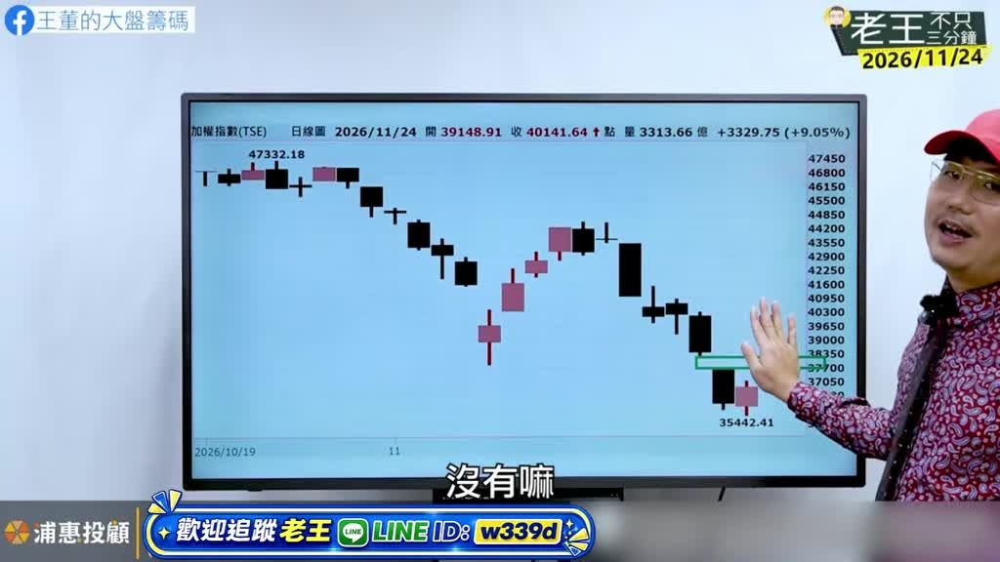
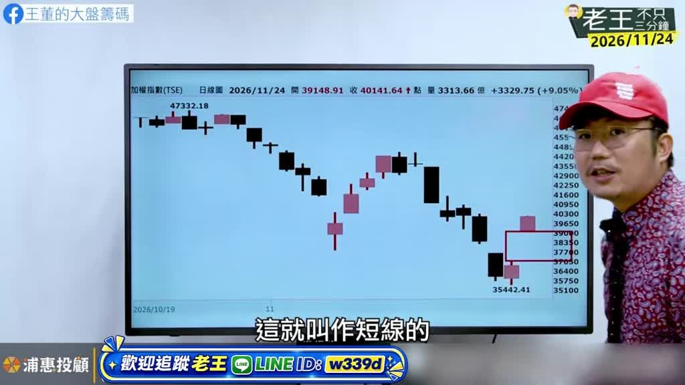
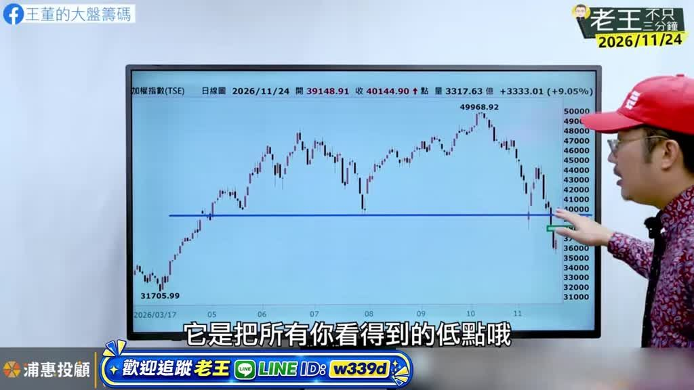
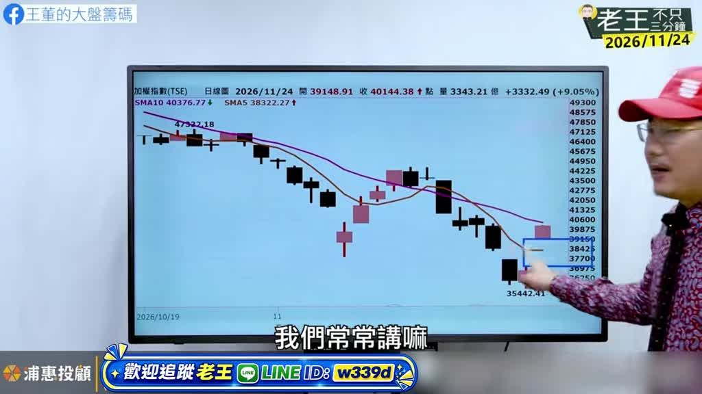
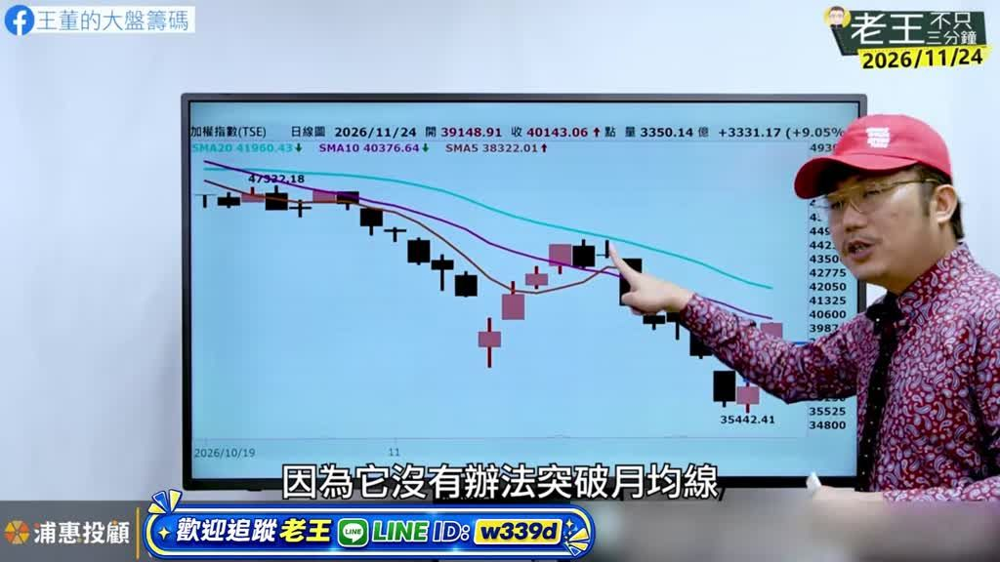
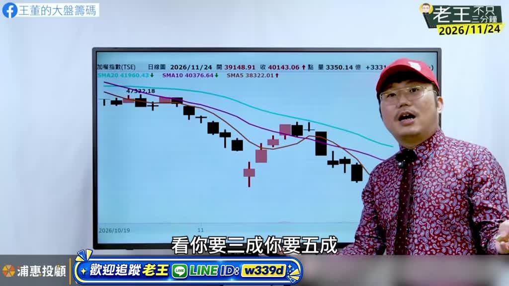

# 短線翻多訊號：缺口與均線

## 思維導圖

- 缺口與均線判斷台股
  - 空方缺口
    - 上週五未封閉
    - 趨勢沒有改變
  - 多方缺口
    - 封閉空方缺口
    - 短線止跌訊號（講者主張）
  - 缺口的意義
    - 跌破 M 頭頸線
    - 假破底要來真穿頭
  - 短期均線
    - 站上五日均線
    - 十日均線上次三天就崩跌
    - 反彈看撐不看壓
  - 月均線
    - 快速下彎
    - 站上才算整個翻多
    - 三陽開泰
  - 操作策略
    - 搶反彈，三成或五成
    - 控制好資金

## 圖文對照（畫面 + 逐字稿）

### 主題 1：空方缺口沒被封閉，趨勢就沒有改變（00:00–00:21）

**重點：** 講者（畫面標示「老王」、節目「王董的大盤籌碼」）說上週五出現空方缺口、昨天沒有封閉它，所以趨勢沒改變；他不看單一 K 棒，不會因為昨天一根紅 K 就說要上漲（講者主張，未查證）。

**標籤：** #空方缺口 #趨勢

上週五還有一個空方缺口，上週五空方缺口在這裡，昨天有封閉這個空方缺口嗎？沒有嘛，所以對我來說趨勢有沒有改變？沒有，我不會看單一K棒，我不會說昨天紅K棒就要往上漲了，不會，這不是我的風格，我們一定是怎樣？看到今天出現了，一個多方缺口出現了，把前面的空方缺口給封閉了。

### 主題 2：今天多方缺口封閉空方缺口：短線翻多訊號（00:21–00:50）

**重點：** 講者主張，今天出現的多方缺口把前面的空方缺口封閉，是短線的止跌（翻多）訊號；台股只要守住多方缺口就持續反彈，反之上週沒有封閉空方缺口前台股就繼續往下。同樣的理論反過來用（講者主張，未查證）。

**標籤：** #多方缺口 #止跌

那就告訴你這就叫做短線的止跌訊號了，短線的翻多訊號了，台股接下來只要守住這個多方缺口，未來就持續反彈，就是這麼簡單，上禮拜我怎麼跟你講的，我上禮拜說這裡有空方缺口，沒有看到封閉缺口之前，台股就繼續往下，那如果要止跌，一定是要把缺口給封閉，現在同樣的理論，只是把它轉過來，今天出現個多方缺口了，就算明天後天開始震盪，只要鎖住這個多方缺口沒有封閉，台股一樣持續往上走，這樣有沒有很清楚。

### 主題 3：為什麼封閉缺口很關鍵：破壞頭部形態（00:50–01:56）

**重點：** 講者說上週五的空方缺口跌破了半年來所有低點與 M 頭頸線，今天缺口封閉等於破壞了頭部形態；他並提到之前的假突破接真破底，現在反過來是假破底要來真穿頭，後面持續觀察（講者主張，未查證）。

**標籤：** #M頭 #假突破 #假破底

把上週五的空方缺口封閉，是很重要一件事情，因為上週五的空方缺口，我跟大家講過，它是把所有你看得到的低點，過去半年以來所有低點這個M頭的頸線給跌破了，所以這個多頭往上走非常的關鍵，缺口出現非常關鍵，因為等於缺口，你等於是把整個頭部的形態給破壞了，而你還不只是破壞頭部的形態，我要告訴大家，你還記不記得當時在這個地方，我上禮拜有給大家看VCR，當時這個地方假突破，假突破在這個地方，我告訴大家台股假突破，要小心要開始回漲修正了，要賣股票對不對，假突破就會接真破底，假突破就真的來破底，現在反過來，短期間上禮拜剛剛重挫破底，結果今天重新站回來了，那是不是就會變成假破底要來真穿頭，之前是假突破要來真破底，現在是假破底要來真穿頭我們後面可以持續來做觀察大家可以放在自己的心中期待黃爸爸大顯神威那往下看了。

### 主題 4：守住缺口與五日均線；面對十日均線（01:56–02:49）

**重點：** 今天也站上五日均線，講者說站上五日均線代表短線止跌；只要守住缺口與五日均線短線就止跌，封閉缺口才會結束。接下來要面對十日均線，上次站上三天就崩跌，所以站上後不能再跌破；反彈看撐不看壓（講者主張，未查證）。

**標籤：** #五日均線 #十日均線 #反彈看撐不看壓

那今天有個多方缺口，今天還站上五日均線，我們常常講站上五日均線代表短線的一個止跌，所以只要持續守住這個缺口跟五日均線，短線就止跌這沒有問題，一定是封閉缺口才會結束，那接下來馬上面對到十日均線，上一次有站上十日均線，一二三三天就結束了，就出現一波崩跌了，原因就是因為站上十日均線之後，就把這兩條短期均線再跌破，所以你接下來觀察的重點就是，明後天如果有機會站上十日均線，當然是最好，代表扭轉了這個慣性的壓力，但是如果站上之後再跌破，那你就要小心，它就會再複製這裡的一個修正的過程，所以站上之後就不要再跌破了，你站上之後就不要再給我下來了，這樣有沒有很清楚，如果明天連站都站不上去，只要它可以守住這個多方缺口，你就不用擔心，終究有一天可以突破，因為我們反彈，看撐不看壓，這樣好不好。

### 主題 5：月均線與三陽開泰：真正翻多的條件（02:49–03:23）

**重點：** 講者說更上面有月均線且正快速下彎，十日均線站上後很快會碰到月均線，上次就是因此只撐三天；他認為真正整個翻多要等站上月均線、形成三陽開泰（講者主張，未查證）。

**標籤：** #月均線 #三陽開泰

那更上面其實還有一條月均線，你可以發現這裡的過程，尤其是這裡，站上十日均線之後，為什麼只站了三天，只撐了三天就往下走了，因為他沒有辦法突破月均線，而我要告訴大家，這個情況可能又要複製到這裡了，月均線現在很快速的下彎，所以明天假設突破十日均線，他很快又會再碰到月均線，所以我覺得真正盤勢整個翻多的時候，應該是要等到他把月均線給他站上去，形成三陽開泰，那個時候你就可以非常的積極，因為三陽開泰了，短線已經翻多了。

### 主題 6：站上月均線前：搶反彈結構，控制資金（03:23–03:41）

**重點：** 講者認為在站上月均線之前只是搶反彈的結構，要控制好資金（舉例三成或五成）進場；若能突破月均線，台股整個形態才能扭轉過去幾個月，真正回到多頭（講者主張，未查證，不構成投資建議）。

**標籤：** #搶反彈 #資金控管

在沒有站上月均線之前，我認為現在就是一個搶反彈的結構，你就控制好自己的資金，當然你看你要三成你要五成，就進場搶反彈，如果可以把月均線給突破，我認為對台股整個形態，才能扭轉過去好幾個月以來，真正回到一個多頭的形態，這樣大家有清楚嗎。

## 來源

- 原始資料夾：`watch-output/投資理財/均線/2026-11-24_TikTok_短線翻多訊號-缺口與均線__7711696553026653460`
- 逐字稿來源：whisper (groq)
