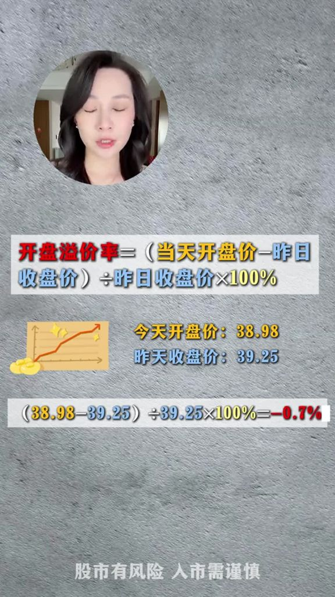

# 封死漲停隔天走還是留：看開盤溢價率就夠了

## 思維導圖

- 開盤溢價率判斷漲停隔天
  - 開場
    - 封死漲停：走還是留
    - 9:25 開盤價揭曉
    - 不用複雜指標
  - 原理：公式
    - (今開-昨收)÷昨收
    - 範例 -0.7%
  - 第一 < 0%
    - 主力出貨（講者主張）
    - 開盤就跑
  - 第二 1%–3%
    - 弱勢訊號
    - 半小時不放量上攻就走
  - 第三 3%–5%
    - 健康走勢
    - 衝高 6% 減半倉
  - 第四 > 5%
    - 主力搶籌（講者主張）
    - 不跌破 3% 續看
    - 可能連板

## 圖文對照（畫面 + 逐字稿）

### 主題 1：開場：封死漲停，第二天走還是留？（00:00–00:35）


**重點：** 講者（自稱「珊姐」）提出問題：股票封死漲停後，第二天該走還是留？講者主張不必用複雜指標，只要在 9 點 25 分開盤價（集合競價結果）出來時算一個數字，就能判斷主力隔天是想拉還是想跑，比任何技術形態都直接（講者主張，未查證）。

**標籤：** #封死漲停 #9:25 開盤價 #主力意圖

當你的股票封死漲停，第二天是走還是留呢，來，別瞎猜了，珊姐來告訴你，看一個數字就夠，那些能夠在漲停板上穩穩吃肉的大佬，從來不用複雜指標反覆折騰的，他們只花30秒算個小學數學題，就知道第二天主力是想拉還是想跑，這個數字呢，比任何技術形態都來得直接，很多散戶呢，看盤就喜歡看那些亂七八糟的指標，卻忽略了真正的關鍵訊號，9點25分開盤價出來那一刻，就已經出現了。

### 主題 2：原理：開盤溢價率怎麼算（00:35–01:17）



**重點：** 開盤溢價率＝（當天開盤價−昨日收盤價）÷昨日收盤價×100%。畫面範例：今天開盤價 38.98、昨天收盤價 39.25，算出約 −0.7%。講者說這個數字「簡單到令人髮指」，接著給出四段區間的參考框架（結合講者幾年的看盤心得）。

**標籤：** #開盤溢價率 #公式 #−0.7%

這就是我要講的開盤溢價率，大家聽到這個名字啊，可能覺得哎呀，又要算複雜的公式，其實簡單到令人髮指，開盤溢價率呢，等於當天開盤價減去昨天收盤價，然後呢再除以昨天收盤價，再乘以百分之百，比如說某隻股啊，今天開盤價是38塊98，昨天收盤是39.25元，那麼就直接套用公式就可以得出開盤溢價率是負的0.7%，計算出來的這個數字啊，具體怎麼用呢，結合這幾年的看盤心得呢，給你一個簡單清晰的參考框架，老規矩點讚收藏起來啊。

### 主題 3：第一：溢價率 < 0%，開盤就跑（01:17–01:25）


**重點：** 漲停隔天開盤溢價率為負（低開），講者解讀為主力已經在出貨。建議別猶豫、開盤就賣，再不走大機率會被套（講者主張，未查證）。

**標籤：** #低開 #主力出貨 #開盤就跑

第一，開盤溢價率為負，說明主力已經是在出貨了，別猶豫開盤就要跑，再不走大機率是要被套的。

### 主題 4：第二：1%–3%，弱勢訊號（01:25–01:38）


**重點：** 開盤溢價率在 1% 到 3% 之間，講者視為弱勢訊號。觀察開盤後半小時：如果不能放量上攻，就直接走人，別抱幻想。注意影片沒有談 0%–1% 這一段。

**標籤：** #弱勢訊號 #放量上攻 #半小時

第二啊，開盤溢價率在1%到3%之間的，這是一個弱勢訊號，如果說開盤半小時內不能夠放量上攻，直接走人，別去抱幻想。

### 主題 5：第三：3%–5%，健康走勢，衝高 6% 減半（01:38–01:51）


**重點：** 開盤溢價率在 3% 到 5% 之間仍屬健康走勢，可以續抱。但若盤中衝高到 6% 以上，講者建議減一半倉位、落袋為安。

**標籤：** #健康走勢 #減半倉位 #落袋為安

第三，開盤溢價率在3%到5%之間的，這仍舊是屬於健康走勢，但如果說盤中衝高到了6%以上，建議減一半的倉位落袋為安。

### 主題 6：第四：> 5%，主力搶籌（含結語）（01:51–02:13）


**重點：** 開盤溢價率大於 5%，講者解讀為主力搶籌意願強烈；開盤後只要不快速跌破 3%，大機率還有衝高甚至連板的可能（講者主張，未查證）。最後請觀眾點讚、反覆觀看。

**標籤：** #搶籌 #連板 #跌破 3%

第四，開盤溢價率大於5%，這說明主力搶籌意願強烈，開盤後，不快速跌破3%，大機率還有衝高甚至連板的可能，大家聽明白了這個邏輯嗎，沒有看懂的，點一顆小愛心，反覆去觀看一下，學會了記得給珊姐點個關注。


## 補充資料

### S1｜畫面遺漏：開盤溢價率公式卡與四條規則卡
- 來源：影片畫面（公式卡 00:46–01:07；規則卡 01:18–01:24、01:27–01:37、01:39–01:50、01:52–02:03）；取得日期：2026-11-22；取得方式：自影片截取原始解析度畫面逐字抄錄（簡體照錄）。對應截圖：`frames/slide_02.jpg`～`slide_06.jpg`。
- 為何需要補充：公式與範例算式只在畫面完整呈現；規則卡是書面版，用字與講者口述略有不同。
### 原文（逐字）
```
（公式卡）
开盘溢价率=（当天开盘价−昨日收盘价）÷昨日收盘价×100%
今天开盘价：38.98
昨天收盘价：39.25
（38.98−39.25）÷39.25×100%=−0.7%

（規則卡）
1、溢价率＜0%：
说明主力已经在出货，别犹豫，开盘就跑，再不走大概率要被套
2、1%≤溢价率≤3%：
是一个弱势信号。如果开盘半小时内不能放量上攻直接走人，别抱幻想
3、3%≤溢价率≤5%：
这仍旧属于健康走势。但如果盘中冲高到6%以上建议减一半仓位，落袋为安
4、溢价率＞5%：
这说明主力抢筹意愿极强，开盘后不快速跌破百分之三，大概率还有冲高甚至连板的可能

（全片底部）股市有风险 入市需谨慎
```
### Claude 的對照分析
- 與影片一致：四條規則的區間與動作，與口述 01:17–02:03 一致。
- 補充直接寫明（影片沒唸的）：公式的完整寫法與算式；第 4 條卡片寫「抢筹意愿**极强**」，口述是「搶籌意願強烈」（逐字稿保留口述）。
- 據此推定（非畫面直接寫明）：卡片區間在 3%、5% 兩端都用「≤」，3% 同時落在第 2、3 條，5% 同時落在第 3、4 條（卡片寫「＞5%」，所以 5% 實際只屬第 3 條）；**0%–1% 沒有任何規則涵蓋**。
### 備註
- 範例驗算：(38.98−39.25)÷39.25×100% ≈ −0.688%，四捨五入為 −0.7%，畫面數字正確（Claude 計算）。
- 四條規則的有效性為講者主張，未查證；畫面自註「股市有风险 入市需谨慎」。

## 來源

- 原始資料夾：`watch-output/投資理財/2026-11-22_TikTok_封死漲停隔天走還是留-看開盤溢價率就夠了__7710063373248892168`
- 逐字稿來源：whisper (groq)
