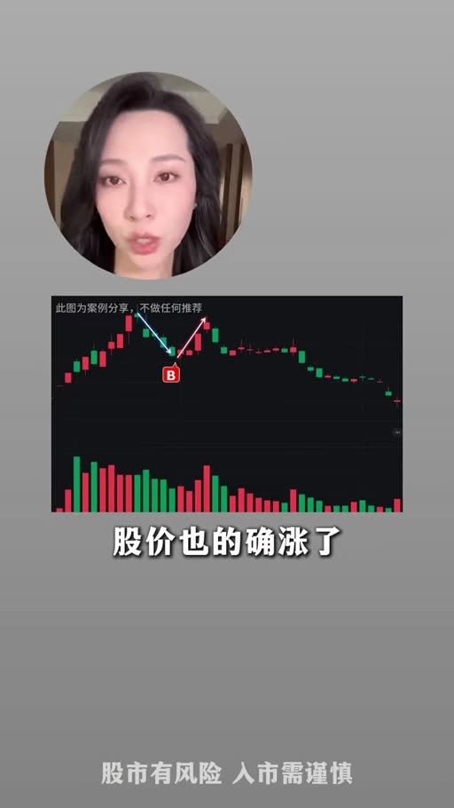
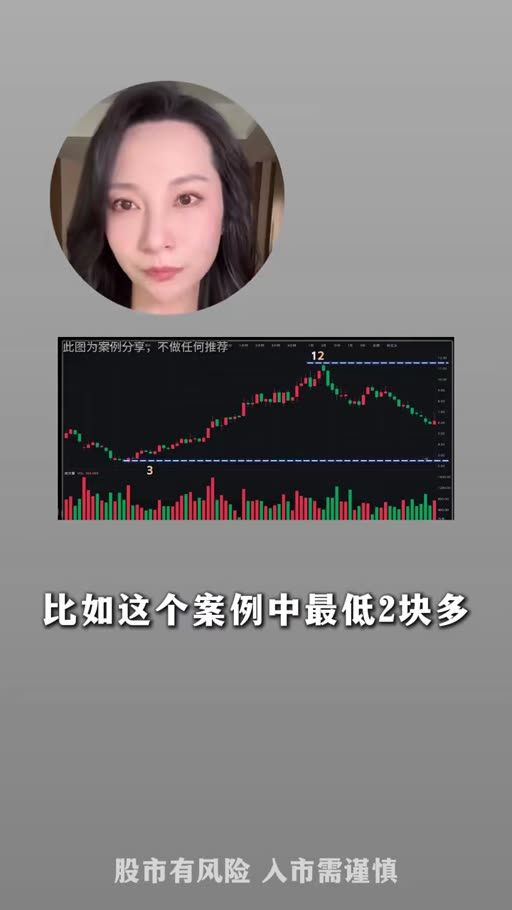
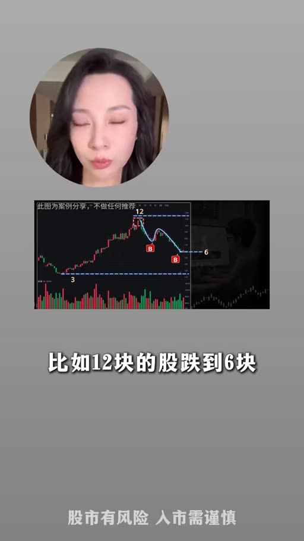
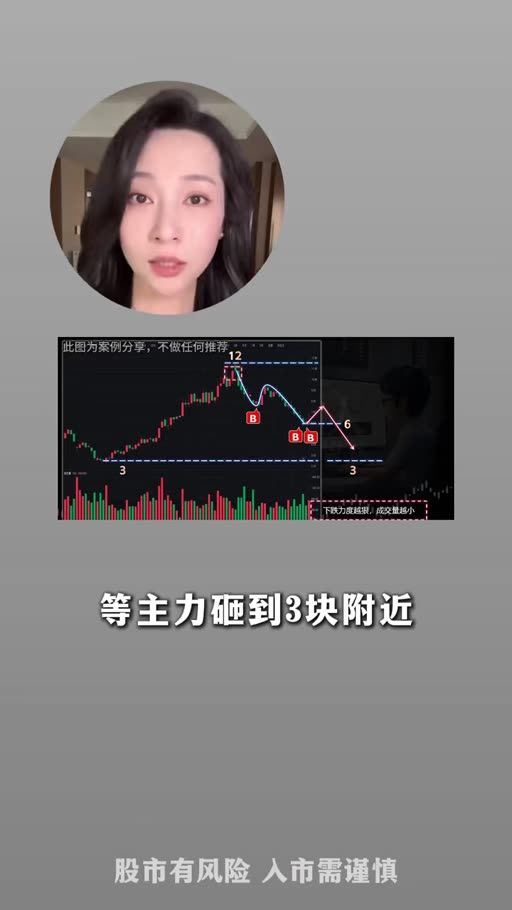

# 山姐：主力如何利用散戶抄底心理出貨

## 思維導圖

- 主力如何利用抄底心理
  - 觀點（講者主張）
    - 越跌散戶越敢抄底
    - 主力越高興
  - 散戶補倉
    - 跌 20–30% 買
    - 越跌越補、攤低成本
  - 主力賺錢方式
    - 上漲中高拋低吸
    - 反彈時逐步出貨
  - 砸盤收集
    - 散戶滿倉後砸
    - 越跌量越小
  - 底部洗盤
    - 反覆震盪
    - 主力成本更低
  - 拉高出貨
    - 讓人以為突破
    - 放量大陽線見頂

## 圖文對照（畫面 + 逐字稿）

### 主題 1：開場：股價越跌，散戶越敢抄底，主力反而越高興（00:00–00:35）

**重點：** 畫面標題「為什麼股價越跌散戶越敢入場抄底」。講者（自稱山姐）主張：散戶以為越跌越便宜、主力吃虧，事實是股價越跌散戶越敢抄底，主力越高興；也不是在一輪上漲的最高點出貨，因為最高點根本出不了多少貨（以上為講者主張，未查證；畫面標示「股市有風險 入市需謹慎」）。

**標籤：** #主力 #散戶 #抄底

你以為是股價越跌散戶越買，主力等於給散戶減便宜籌碼的機會，覺得主力是吃了大虧對不對？事實是股價越跌散戶越敢抄底，主力是越高興的。或者說你以為主力是在一輪上漲的最高點出貨，事實是主力在最高點根本出不了多少，因為主升浪前幾乎大部分的籌碼都是在主力的手上的。其實只要玩過股票的人應該都知道，高點價格持續不了多久，因為只要主力開始出貨了，很快這個股價就砸下來了。

### 主題 2：散戶的補倉心理：跌 20%–30% 買、跌 50% 再補（00:35–01:46）

**重點：** 講者描述散戶的典型過程：一看跌了就覺得夠狠夠便宜而抄底，股價的確漲了，等著下一輪主升浪，結果反彈幾天又跌出新低，於是越跌越補倉、攤低成本；而越往下跌，反彈力度越弱，因為主力經過幾次反彈貨已出光、人就走了，沒有人再拉升股價（講者主張，未查證）。

**標籤：** #補倉 #攤低成本 #反彈減弱

而散戶一看跌了，第一反應就跟你一樣，覺得只要跌的夠狠夠多，就可以抄底了，結果沒想到主力早就看透了散戶的想法，就是在下跌的過程中才打算出貨的，跌個20%到30%左右，你覺得夠便宜了吧，就趕緊衝進去了，股價也的確漲了，買進去等著下一輪主升浪，結果反彈沒幾天繼續跌出新低，這個時候你什麼反應呢，肯定是我得趕緊補倉對不對，覺得越跌越應該加倉，你說就是不信它還能跌到哪去，但是跌到50%了，你覺得該漲了吧，但是這個漲幅距離你的成本還差得遠呢，所以漲的時候你只能夠繼續補倉，攤低成本，結果這次仍然是反彈一段時間之後繼續跌而越往下跌反彈力度就越弱那這是為什麼呢因為主力經過幾次反彈它的貨已經出光了呀出光了主力自然它就跑了，你指望誰來繼續拉昇這個股價呢，靠套在裡頭的廣大散戶嗎。

### 主題 3：股價腰斬了，主力怎麼賺錢？看前面的漲幅（01:46–02:38）

**重點：** 針對「股價都腰斬了主力怎麼賺」的質疑，講者說要往前看這檔股票什麼時候開始走強：你當初買是因為漲了七八成甚至翻倍；以案例（最低 2 塊多、最高 12 塊）說明，主力在上漲過程就高拋低吸做低成本、山頂也出掉一部分，下跌到 6 塊附近照樣能賺（講者主張，案例數字未查證）。

**標籤：** #腰斬 #高拋低吸 #案例

那聽到這兒呢，可能大家會覺得不服氣啊，說這個股價都腰斬了，主力怎麼賺錢，這個時候呢，你可以往前去看，看看這隻股票到底從什麼時候開始走強的，你當初是為什麼會看上這一支票的？肯定是一支票漲了百分之七八十，甚至出現了翻倍這種行情啊，你看見它真的是夠強，漲幅呢夠誘人才去買的對不對？假如這裡頭20塊錢的票漲到了50塊，最後主力在3到40這個區間去出貨，那它都是賺的，更何況上漲的過程當中主力它也會不斷的去高拋低吸啊，做低成本，山頂還會出掉一部分呢，比如說這個案例當中最低2塊多最高是12塊，想在山頂徹底完成出貨根本是不現實。

### 主題 4：下跌中的每次反彈，都是主力為了出貨做出來的（02:38–03:39）

**重點：** 講者主張主力利用散戶抄底的心思，在下跌的反彈過程中逐步出貨；每次反彈的目的是吸引散戶、讓人以為要見底而接盤。她用商家類比：把 3 塊成本的商品炒到 12 塊再打五折、說限時搶購、安排托假裝搶購、製造供不應求的假象，等你心動買了，商家目的就達到，不可能再恢復原價讓你賺價差（講者主張）。

**標籤：** #反彈出貨 #商家類比 #接盤

主力是利用散戶抄底的心思在下跌的反彈過程當中逐步出貨，即使股價腰斬到6塊附近主力出貨照樣是能夠賺錢的，右側下跌的每次反彈都是主力為了出貨做出來的，目的就是吸引散戶，讓散戶以為股價要見底了，誘惑散戶抄底給自己接盤，所以主力早把這個帳給算精了的，也把散戶的心思給摸透了的這個就是和商家3塊錢成本的商品炒到12塊再給你打個五折並且告訴你限時搶購啦，錯過馬上就要漲回原價啦，再安排一堆托，假裝去搶購，做出這個商品供不應求的假象，就問你看見了心不心動吧，等你真的是心動了，也買了，那麼商家的目的他就達到了呀，再指望他恢復原價，讓你賣出去賺一個利差，那是根本不可能的，懂了吧？

### 主題 5：砸盤收集：散戶滿倉後，主力往下砸、越跌量越小（03:39–04:29）

**重點：** 講者說一旦股票套了很多散戶，主力若要繼續做，會先買進一些、再使勁往下砸（例：12 塊跌到 6 塊，收集後砸到 3 塊附近）；此時散戶多已滿倉，要麼割肉、要麼裝死，願意逆勢買進的很少，所以主力可肆無忌憚地砸，越往下跌力度越狠、成交量越小，因為已沒有做多資金阻擋砸盤，一點小錢就能砸出很大跌幅（講者主張，未查證）。

**標籤：** #砸盤 #收集籌碼 #成交量

一旦一支股票套了很多的散戶，那麼再有主力要繼續做這支股票的話，那就會買進來一些，然後使勁往下砸。比如說12塊的股跌到了6塊，它進來收集一些籌碼，然後砸到3塊附近。反正這個時候散戶該買的都買了，也早都是滿倉了，它往下砸，散戶要麼選擇割肉，要麼就是裝死不動，能有錢趁著下跌跟它對著幹，買入的這些散戶是非常少的，所以主力會肆無忌憚的往下砸，這也是為什麼越往下跌力度就越狠，成交量越小的原因，因為跌得夠深，已經沒有做多資金來阻擋砸盤資金了，這個時候一點小錢就能砸出很大的跌幅。

### 主題 6：在底部反覆震盪，消耗散戶耐心並壓低主力成本（04:29–05:01）

**重點：** 等主力砸到 3 塊附近，只需反覆震盪消耗散戶耐心，讓受不了的人在 3 塊附近割肉、或在底部追漲殺跌交出籌碼（例：3–4 塊之間反覆震盪）；這樣不斷高拋低吸，主力成本最高不會高於 4 塊，可能在 3 塊 5 左右（講者主張，案例數字未查證）。

**標籤：** #震盪洗盤 #主力成本 #割肉

等主力砸到3塊附近，這個時候的明牌是大部分拋壓在6塊左右，3塊附近的只需要反復震盪來消耗散戶的耐心讓受不了長期虧損的散戶在3塊附近去割肉或者說在底部反覆去追漲殺跌交出籌碼比如說在三到四塊之間反覆去震盪，這樣不斷去高拋低吸，主力的成本最高就不會高於四塊，可能就是在三塊五左右，主力收集夠了籌碼之後。

### 主題 7：籌碼收夠後拉高出貨，下一個主力再來一輪（05:01–06:19）

**重點：** 主力收集夠籌碼後，把股價拉到 6 塊上方一點，讓人以為要向上突破，等一堆人爭著買入時毫不猶豫出貨；因為底部散戶籌碼不多，高位出貨不需太久，所以底部反彈量能不大，一旦放大量出大陽線，股價就會見頂。之後下一個主力用同樣手法再來一波，直到沒有下跌空間才可能迎來大牛市；你以為抄在最底，往往只在半山腰（講者主張，非投資建議）。

**標籤：** #拉高出貨 #放量大陽線 #大牛市

再把股價拉到六上方一點這個位置，讓人以為要開始向上突破了，等一堆人爭著買入的時候，主力趁著人多會毫不猶豫的選擇出貨，因為底部散戶的籌碼不會太多，所以高位主力出貨也不需要太久，只要有跟風資金接盤，主力很快就能完成出貨了，這就是為什麼底部反彈量能都不會很大，一旦放大量出大陽線，股價就會見頂的原因，這個主力出完貨走了，下一個主力要做這隻股票會繼續用同樣的手法再來一波，直到這隻股票徹底沒了下跌空間，才有可能迎來一波大牛市的行情，而你以為你抄底抄在了最底部，經過漫長的一段時間等待，你才會發現你抄的位置只是在半山腰，就算幾年之後真的迎來牛市了，估計你不是早在底部割肉，就是剛回本就趕緊拋了，後邊不管長再多，也跟你一毛錢的關係都沒有，好了今天的影片就分享到這裡了，喜歡山姐分享的記得給個關注。

## 知識點

- [[投資理財_股價越跌散戶越敢抄底，主力反而越高興]]
- [[投資理財_主力在最高點根本出不了多少貨]]
- [[投資理財_越往下跌，反彈力度越弱：主力的貨已經出光]]
- [[投資理財_每次反彈都是主力為了出貨做出來的]]
- [[投資理財_主力用商家搶購的手法：製造供不應求的假象]]
- [[投資理財_散戶滿倉後，沒有做多資金阻擋，主力砸盤成本很低]]
- [[投資理財_底部放量大陽線，往往就是見頂]]

## 來源

- 原始資料夾：`watch-output/投資理財/2026-11-22_TikTok_山姐-主力如何利用散戶抄底心理出貨__7710177621031669010`
- 逐字稿來源：whisper (groq)
