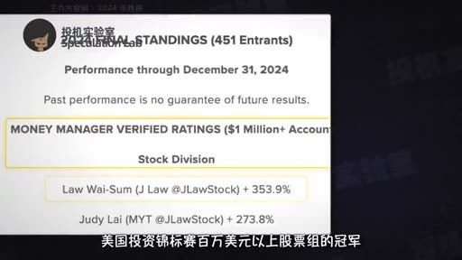
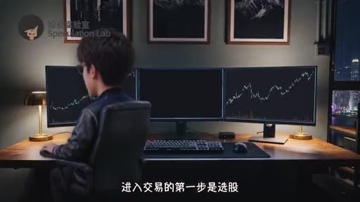
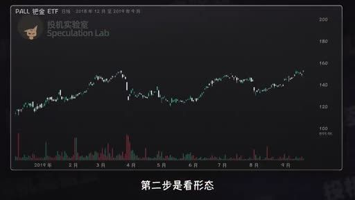
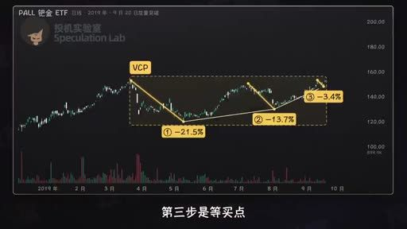
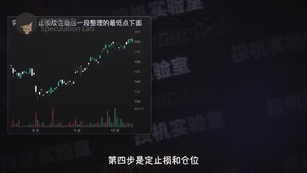
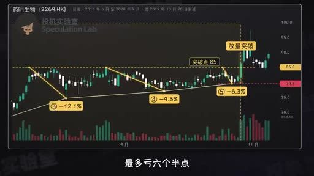
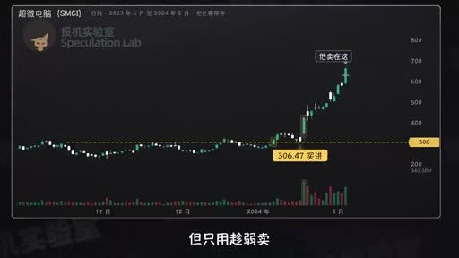
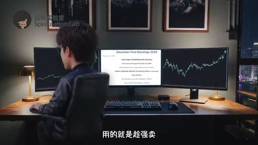

# 投機實驗室 - 100萬美元組交易雙冠王就是他。  香港教師J Law轉行做交易員後天賦就全出來了，把100萬美元兩年做到1600萬，拿下美國投資錦標賽1...

## 思維導圖

- J Law 的 VCP 五步系統
  - 戰績（講者主張）
    - 兩年 1490%
    - 兩度奪冠
  - VCP 邏輯
    - 等想賣的人賣光
    - 回撥逐次變淺量縮
  - ①選股
    - 50 日線>200 日線
    - 離高點 ≤15%
    - 營收加速
  - ②看形態
    - 首次回撥 20–35%
    - 最後一次 ≤10%
    - 最高點＝突破點
  - ③等買點
    - 突破買／回踩買
    - 多重支撐疊加
  - ④止損與倉位
    - 止損 3–5 點
    - 單筆虧千分之三
  - ⑤賣出
    - 趁強賣
    - 趁弱賣
  - 少做
    - 勝率低就少做
  - 實例
    - 耀明生物 賺 40%
    - 超威電腦 賺 106%

## 圖文對照（畫面 + 逐字稿）

### 主題 1：開場：香港教師 J Law 的交易戰績（00:00–00:38）

**重點：** 講者介紹香港中學老師轉行做交易員的 J Law：兩年收益率連起來超過 1490%，100 萬美元帳戶做到 1600 萬，同期標普 500 只漲 47%。2024 年拿下美國投資錦標賽百萬美元以上股票組冠軍（353.9%），打破馬克·米納威尼在該組的紀錄，第二年又以 252.3% 二度奪冠；他的愛人在同組拿亞軍（以上皆講者主張，未查證）。

**標籤：** #J Law #投資錦標賽 #VCP

香港有一位中學老師轉行，做了交易員然後人生就像，開了掛一樣他叫 J Law，他做交易兩年的收益率連，起來超過了 1490% 也就是 100 萬，美元的帳戶兩年就做到了，1600 萬要知道同期的標普 500，才漲了 47% 2024 年他拿下了美，國投資錦標賽百萬美元以，上股票組的冠軍收益率 353.9%，主辦方說這已經打破了美，國交易員馬克· 米納威尼，在這個組的記錄第二年他，又以 252.3% 的收益率二次，拿下冠軍非常的強他用的，就是米納威尼提出來的 VCP 策略 J Law，還上過他的課算是名師高徒。

### 主題 2：策略基礎：VCP 與其邏輯（00:38–01:20）

**重點：** 他用米納威尼提出的 VCP（波動收縮形態），並上過米納威尼的課；統計勝率約 45%–50%，賺時平均賺一成多、虧時平均只虧四五個點（講者主張）。邏輯是等想賣的人賣光再買：股價漲一段後，套牢者一回本就賣，所以一波一波回撥，但每次回撥想賣的人更少，回撥一次比一次淺、成交量越來越小，這時只要有買盤進來就容易漲上去。

**標籤：** #VCP #波動收縮 #回撥

按他的統計，勝率基本是在 45%-50% 之間賺的，時候平均賺一成多虧的時，候平均只虧四五個點後來他又在 VCP，上加了幾個條件比賽那兩，年用的就是這套而且他愛，人也是用的他這套策略獲，得了同組的亞軍也就是他是冠軍，他愛人是亞軍這你受得了，嗎他交易的邏輯，是等想賣的人基本賣光了，再買一隻股票漲了一，大段以後低位買的人想獲，利高位追進去被套的人一，回本就想走所以股價會一，波一波地回撥但每回撥一，次想賣的人就少一批所以，回撥一次比一次淺成交量，也越來越小等到沒什麼人，再賣只要有買盤進來價格，就很容易漲上去 VCP，叫波動收縮形態找的就是，這個時候這套策略有五個。

### 主題 3：第 1 步：選股（01:20–02:19）

**重點：** VCP 只在上升趨勢好用：股價在 50 日線之上、50 日線在 200 日線之上且兩線向上。進一步條件（講者主張）：離一年高點不超過 15%、一年漲幅贏過 89% 的股票、股價 12 美元以上、50 天均量 25,000 股以上、營收加速成長（看營收不看盈利）。2026 年再加兩項：有財報超預期或調高預期且放量大漲，以及同板塊一起漲。

**標籤：** #上升趨勢 #50日線 #200日線 #營收加速

步驟進入交易的第一步是選股 VCP，只有在上升趨勢裡才好用，下跌的股票形態再漂亮也，容易失敗所以先挑再漲的，股票最簡單的是看均線均，線就是過去這些天收盤價的平均，50 日線看中期 200 日線看長，期股價要在 50 日線上面，50 日線又在 200 日線上面而，且兩條線都在往上走他 2020，年教選股的時候還要更嚴，股價離一年裡的最高價不，能超過 1 成 5 過去一年的漲幅，還要跑贏 8 成 9 的股票然，後是看公司本身股價最好，在 12 美元以上太便宜的大，多品質差過去 50 天平均每，天要成交 25000 股以上不然買，價賣價差得遠止損的時候，會多虧一兩個點營收還要，越漲越快比如再往前一季漲，8% 最近一季漲 10% 他看營收，不看盈利因為很多軟體生，物科技公司還沒開始賺錢，營收卻漲得很快 2026 年他再，講選股又加了兩樣先看有，沒有財報超預期公司調高，業績預期這樣的好訊息再，出放量大漲再看同一個板。

### 主題 4：第 2 步：看形態（02:19–03:00）

**重點：** 上升趨勢中橫向整理，會回撥好幾次：第一次回撥不能超過五六成、最好在兩成到三成五；若第一次就跌五六成，底部要橫半年到一年。之後每次回撥都比上次淺，一般三四次，回撥幅度要用看圖軟體量、不能靠眼睛估；最後一次在一成以內且下跌日成交量很小。最緊一段裡最高的價就是突破點（pivot）。

**標籤：** #回撥幅度 #突破點 #pivot

塊是不是一起在漲第二步，是看形態股價在上升趨勢，裡橫著整理中間會回撥好，幾次第一次回撥不能超過，五六成最好在兩成到三成，五之間要是第一次就跌了，五六成底部最好橫半年到，一年才行因為跌一半以後，很快漲回去底部買的人已，經賺了一倍一定會大量賣，出來後面每次回撥都要比，上一次淺一般有三四次回，調了多少要用看圖軟體量，從這次回撥前的最高點量，到最低點不能憑眼睛估它，自己就估錯過看著像兩成，量出來只有一成二最後一，次回撥要在一成以內而且，下跌那幾天成交量要很小，說明想賣的人基本沒了這，最緊的一段裡最高的那個，價就是突破點也叫 pivot 第三步。

### 主題 5：第 3 步：等買點（03:00–03:41）

**重點：** 以前的買法是價格衝過突破點就買，且成交量要比前一天與平時都大才算真突破；已高出理想買點兩個點以上就不追。後來更多是等回踩：突破後約一半會回踩突破點附近，放量突破後第一次縮量回到突破位置、又有 10 日或 20 日均線撐著，幾樣支撐疊在同一價位就買，他稱「多重優勢進場點」。他說只看突破就買勝率可能兩成，這種買法能做到四到五成（講者主張）。

**標籤：** #突破買 #回踩買 #多重優勢

是等買點他之前說的買法，是價格一衝過突破點就買，還沒衝過去就不能買因為，不知道形態走完了沒有成，交量要比前一天大也比平，時大才算真突破已經比理，想的買點高出兩個點以上，就不追了後來他更多是等，回踩再買也就是突破以後，等它跌回來一點再買 VCP，突破以後差不多一半會回，踩到突破點附近所以錯過，了也不用急放量突破以後，第一次縮量回到突破的位，置正好又有 10 日或者 20 日，均線撐著支撐就是價格跌，到這裡容易被接住的位置，幾樣支撐疊在同一個價位，就可以買他把這叫多重優，勢進場點只看到突破就買，勝率可能只有兩成用這種，買法一般能做到四到五成。

### 主題 6：第 4 步：定止損與倉位（03:41–04:41）

**重點：** 突破買的止損放在最後一段整理最低點下面，回踩買的放在那幾樣支撐下面，不要正好放在支撐線上，要留空間免得被掃出去；止損最好 3–5 個點，7–8 個點是極限。倉位倒著算：他平時一筆只虧帳戶千分之三左右，例如 10 萬美元帳戶最多虧 350 美元，100 美元買、95 止損、虧 5 美元就買 70 股，漲到 125 美元賺 1750 美元＝虧損五倍。比賽帳戶較激進、用槓桿，但只拿賺來的錢加大風險；做不順就縮小倉位，新手從小倉位開始。

**標籤：** #止損 #倉位 #風險金額

第四步是定止損和倉位突，破買的止損放在最後那段，整理的最低點下面回踩買，的就放在那幾樣支撐的下，面都不能正好放在支撐線，上要留一點空間不然價格，稍微跌穿一下就被掃出去，了止損最好在三到五個點，七八個點就是極限了倉位，是倒著算限定這一筆最多，虧帳戶的多少他平時一筆，只虧帳戶的千分之三左右，比如十萬美元的帳戶一筆，最多虧三百五十美元一百，美元買進九十五美元止損，一股虧五美元就買七十股，漲到一百二十五美元就賺，一千七百五十美元正好是，虧損的五倍被止損了也不，用急形態沒壞就按計劃買，回來比賽那個帳戶他做的，就激進一些會用槓桿加大，倉位為的是回報率高一些，但他說自己平時一年能賺，三四成就已經很好了而且，就算再激進也只拿賺來的，錢去加大風險比如年初先，賺了百分之三新開的倉加，起來最多就只虧這百分之，三本金不動要是做得不順，他就馬上把倉位減小剛入，門的更應該從小倉位做起。

### 主題 7：第 5 步：賣出（04:41–05:30）

**重點：** 漲了一成多先把止損挪到買入價上方，這一筆就不會再虧。賣法有兩種：趁強賣（漲到前面阻力位，或賺到風險的好幾倍，如止損 5 個點就在賺兩成到兩成五時賣，可全賣或分批）與趁弱賣（只要不跌破 10 日或 20 日線就一直拿，真跌破才走）；兩種都不完美，新手先選一種做熟。一口氣衝到阻力就先減一點；阻力下先走出 VCP 就等突破；漲成拋物線要慢慢賣；跳空大跌或跌破上升趨勢線就分批走。

**標籤：** #趁強賣 #趁弱賣 #拋物線

少冒險多攢經驗第五步是，賣出漲了一段以後先把止，損挪到買入價的上面比如，漲了一成多就挪，這樣這一筆就不會再虧錢，了賣法有兩種一種叫趁強，賣漲到前面的阻力位也就，是以前漲到這裡就掉頭的，價位或者賺到風險的好幾，倍就賣比如止損是五個點，賺到兩成到兩成五就可以，賣可以全賣也可以只賣一，部分另一種叫趁弱賣只要，不跌破某條線就一直拿著，比如 10 日或者 20 日均線真，跌破了才走他說兩種方式，都不會完美新手先選一種，做熟漲到前面的高點要不，要賣要看是怎麼漲上來的，一口氣衝上來中間沒歇過，碰到阻力就先減一點要是，在阻力下面先走出了 VCP，那就拿著等它突破漲成拋，物線也就是越漲越陡以後，很難賣在最高點所以要慢，慢賣出現跳空大跌跌破上，升趨勢線就分批走還有就。

### 主題 8：什麼時候少做（05:30–05:45）

**重點：** 他先看自己最近順不順，勝率低了就少做，這條最重要；然後才看大盤：兩到四週內出現四天放量下跌就提高警惕，暴跌頭幾天別急著接，等最恐慌時再找最抗跌的股票。

**標籤：** #少做 #勝率 #大盤

是什麼時候少做他先看自，己最近順不順勝率低了就，少做這條最重要然後才看，大盤大盤兩到四周裡出現，四天放量下跌就要提高警，惕暴跌的頭幾天，別急著接等到最恐慌的時，候再找最抗跌的股票看兩。

### 主題 9：實例一：耀明生物（突破買）（05:45–06:25）

**重點：** 第一筆是標準 VCP 突破：前一年 6 月起整理，第一次從 98.5 跌到 44.5（回撥五成多），所以底部橫了一年多；之後回撥 25%、12% 不到、最後只有 6%，三次高點都在 85 附近。10 月 28 日放量衝過 85 就在 85 進場，止損放 79.5（最多虧約 6.5 點，比理想略寬但仍在極限內）。之後從沒碰止損，不到四個月最高漲到 121.3，賺 40% 多（講者主張，未查證）。

**標籤：** #耀明生物 #突破買 #止損

筆他自己的單子第一筆是，耀明生物就是一個很標準的 VCP，突破他從前一年 6 月開始，整理第一次就從 98 塊 5 跌，到 44 塊 5 回撥了五成多回，調這麼深按規矩底部就是，要橫的久他橫了一年多之，後先回撥了兩成五，三次越來越淺一成二不到，一成最後一次只有六個點，這三次的高點都在 85 附近，這就是突破點 10 月 28 日股，價放量衝過 85 他就在 85 進，場止損放在最後一次回撥，的低點下面 79 塊 5 最多虧，六個半點比他想要的三到，五個點寬一點但還在極限，以內那天均線也排得很正，常第一步也對得上之後股，價一次都沒碰到止損不到，四個月最高漲到 121 塊 3 賺。

### 主題 10：實例二：超威電腦（回踩買、趁強賣）（06:25–06:55）

**重點：** 比賽那年做的超威電腦用回踩買：先前兩次漲到 306 美元附近都掉下來，一月初放量衝過去後他沒追，等回踩到 306 附近——前兩次高點、20 日均線與一條被突破的下降趨勢線三樣支撐疊在一起時買進。當天收盤後公司提前公布業績遠好於預期，隔天漲 36%，後來漲到上方阻力位，他在 630 美元附近全賣，賺 106%，用的是趁強賣（講者主張，未查證）。

**標籤：** #超威電腦 #回踩買 #多重支撐

了 40% 還多第二筆是他比賽，那年做的超威電腦用的是，回踩買之前它兩次漲到 306，美元附近都掉了下來一月，初才放量衝過去他沒有追，而是等它回踩到 306 附近前，面兩次的高點 20 日均線再，加上一條被突破的下降趨，勢線三樣支撐疊在一起他，就在這裡買進當天收盤後，公司提前公佈業績比原來，的預期好很多第二天股價漲了，36% 後來股價，漲到上方的阻力位他在 630，美元附近全部賣掉這一筆賺了。

### 主題 11：愛人的趁弱賣與結語（06:55–07:19）

**重點：** 他愛人同年在同組拿亞軍，用同一套系統但只用趁弱賣，跟著 10 日線一路上挪止盈，拿得更久、賺了 157%。J Law 事後說照系統應該像愛人那樣拿著，這次是自己主觀判斷賣早了（講者主張，未查證）。結語：影片為娛樂節目，無任何投資建議。

**標籤：** #趁弱賣 #10日線 #免責

106% 用的就是趁強賣他愛人，那年在同一個組拿了第二，用的是同一套系統但只用，趁弱賣他跟著 10 日線一路，往上挪止盈拿得更久賺了，157% 他後來說，照他的系統應該像他那樣，拿著才對這次是自己主觀，判斷賣早了好了娛樂節目，沒有任何投資建議檢查一，下是否點選了訂閱按鈕祝，你早安午安晚安拜拜。

## 知識點

- [[投資理財_VCP 的邏輯：等想賣的人賣光再買]]
- [[投資理財_回撥幅度要用看圖軟體量，不能憑眼睛估]]
- [[投資理財_多重優勢進場點：幾樣支撐疊在同一價位才買]]
- [[投資理財_止損不要正好放在支撐線上]]
- [[投資理財_倉位是倒著算：先定單筆最多虧多少]]
- [[投資理財_趁強賣與趁弱賣：兩種賣法擇一做熟]]
- [[投資理財_先看自己順不順，再看大盤，決定要不要少做]]

## 來源

- 原始資料夾：`watch-output/投資理財/2026-11-18_X_投機實驗室---100萬美元組交易雙冠王就是他-香港教師J-Law轉行做交易員後__2120717713702306002`
- 逐字稿來源：captions (zh, manual, original)
