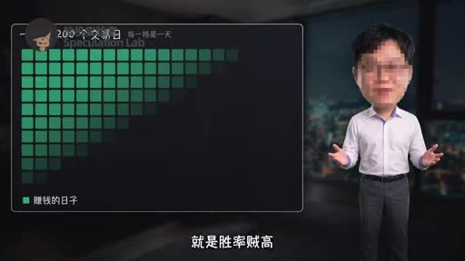
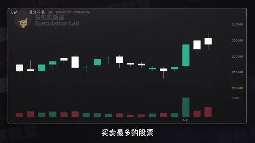
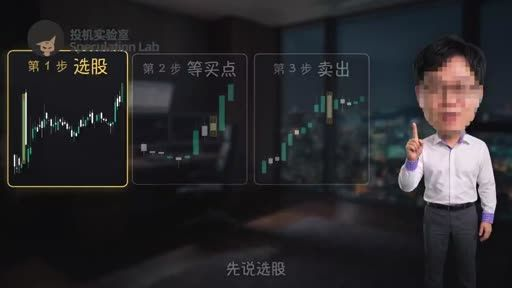
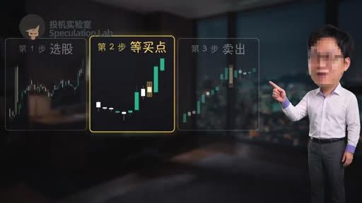
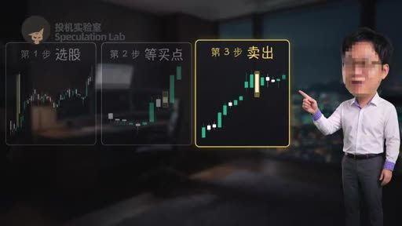
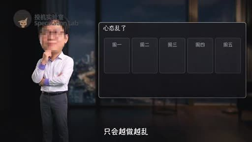
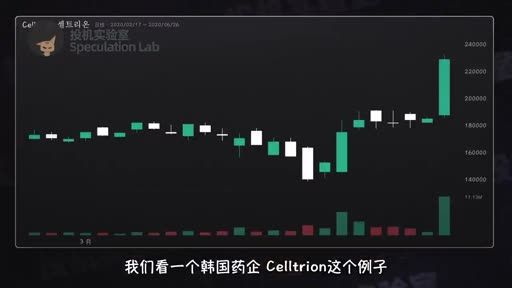
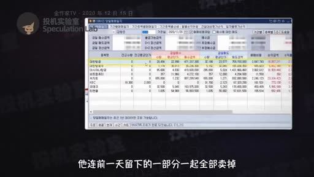

# 投機實驗室 - 被稱為韓國股神的超人氣交易員金亨俊，勝率太高了。  做交易賺了1500萬美元，拿過四次實盤大賽第一，15年交易生涯只有兩個月發生過虧損，股...

## 思維導圖

- 金亨俊新高法
  - 開場：戰績（講者主張）
    - 賺 150–200 億韓元
    - 15 年只虧兩個月
    - 四次實盤大賽第一
  - 新高法邏輯
    - 不追當天大陽線
    - 等收陰線回落再買
  - 第 1 步：選股
    - 成交額前 50、去 ETF
    - 新題材龍頭＋創新高
    - 站上 120 日線
    - 避開公告急拉／審計期
  - 第 2 步：等買點
    - 上升陰線
    - 成交額 ≥500 億韓元
    - 收盤在五日線上
    - 前高壓力＋機構外資買
  - 第 3 步：賣出
    - 開盤不漲就止損
    - 跌破五日線賣
    - 高位五倍爆量視為見頂
  - 停手與資金規矩
    - 做錯當天收手
    - 不借錢留現金
  - 實例一：Celltrion
    - 第八日破五日線賣
    - 賺兩成多（講者主張）
  - 日內交易
    - 只做 9:00–10:30
    - 隔夜最多一成倉
  - 實例二：大韓航空
    - 日內回撥單
    - 賺約 1.5 萬美元（講者主張）

## 圖文對照（畫面 + 逐字稿）

### 主題 1：開場：韓國傳奇交易員金亨俊（00:00–00:44）

**重點：** 講者介紹金亨俊的戰績：靠交易賺到 150 億至 200 億韓元（約 1500 萬美元），一年 200 多個交易日只有二三十天虧錢，15 年全職交易按月算只虧過兩個月，並拿過四次實盤大賽第一（講者主張，未查證）。他在 2020 年節目公開帳戶，小資金組不到兩個月收益率 429%（講者主張，未查證）。

**標籤：** #金亨俊 #勝率 #實盤大賽

韓國傳奇交易員金亨俊靠交易賺了，150 億到 200 億韓元也就是差，不多 1500 萬美元他的方法，不是靠別的就是勝率賊高，一年 200 多個交易日能讓他，虧錢的只有二三十天他全，職交易的 15 年裡按月算只，虧過兩個月這兩個月運氣，很差他參加過很多次實盤，大賽拿過四次第一在 2020 年，上節目時公開了自己的交，易帳戶其中一個不到兩個，月就賺了 60 多萬美元大賽，裡有一次他在 300 萬韓元的，小資金組不到兩個月收益，率就做到了 429% 這人很牛節，目收視率也直接爆了三個，小時的長節目播放量超過，了 230 萬次在韓國散戶眼裡，這絕對算是個傳奇級別的，人物我已經挖到了他的交，易策略叫新高法好用極了。

### 主題 2：新高法的邏輯（00:44–01:23）

**重點：** 他做短線挑最熱、買賣最多的股票。新高法的邏輯是等股票衝上去後回落一下再進場：創新高代表上方沒有套牢賣壓，但當天追大陽線常買在最高處，所以要等收一根陰線回落再買。這招來自追陽線虧了無數次後的覆盤（講者主張）。

**標籤：** #新高法 #陰線回落 #覆盤

話不多說直接開始他做短，線主要挑最熱，買賣最多的股票新高法的，邏輯是等它衝上去以後回，落一下再進場一隻股票創，了新高說明上面已經沒有，被套住等著回本就賣的人所以短期，很容易接著漲但新高大多，是一根大陽線拉上去的，當天追進去，就是買在最高處而且很多，股票盤中創了新高收盤又，跌了回去追進去的人當天，就被套住了所以他要等它，收一根陰線回落一下再買，這一招就是他追陽線虧了，無數次以後覆盤琢磨出來，的新高法分三步選股等買，點賣出看的都是日 K 線他前一天，就把第二天要做的股票挑，好漲了怎麼賣跌了怎麼止。

### 主題 3：第 1 步：選股（01:23–02:36）

**重點：** 先看成交額而非成交量，只選當天成交額前 50 名、去掉 ETF，再挑跟新題材掛鉤的龍頭股；成交額小的股票停損時自己的賣單會砸價。接著挑創新高（如一年新高）的先放進自選股、不馬上買，還要站上 120 日線；公告後急拉、審計期未出報告、隔天有新股上市的股票都避開。

**標籤：** #選股 #成交額 #龍頭股 #120日線

損都提前想好先說選股選，股要先看成交額也就是一，天進出了多少錢因為便宜，的股票成交量看著很大，錢其實不多他要的是錢多，人多的股票買得進也賣得，出所以他看的是當天成交，額排前 50 名的股票基金類的，ETF，去掉再挑跟新題材掛上鉤，的成交額小的股票就算買，也只買一點因為他平時買，得多這種股票一旦要止損，自己的賣單就會把價格砸，下去龍頭股是最好的也就，是一個板塊裡漲的時候最，先漲跌的時候跌得最少的，那隻這些股票裡再挑創了，新高的就是股價刷新了一，段時間以來的最高價比如，一年來的最高價挑出來先，放進自選股不馬上買趨勢，還要向上股價要一路漲上，去首先得站上一百二十日，線也就是過去半年的平均，價跌勢裡的股票不去猜哪，裡是底有幾種股票要小心，公告出來以後急拉的不追，因為訊息一出，散戶一窩蜂地衝進去很容，易買在最高點每年三月是，韓國公司交審計報告的時，候報告還沒出來的公司也，不做因為審計意見要是不，好股票會馬上停牌想賣也，賣不掉收盤買之前還要查，一下第二天會不會有一大，批新股份上市比如可轉債，轉成股票增發或者送股有的話，拿到新股份的人一開盤就會賣股價。

### 主題 4：第 2 步：等買點（02:36–04:02）

**重點：** 買點是「上升陰線」（十字星也算），最好出在衝過前高之後。買前要滿足三個條件：衝上來的一段成交額放到 500 億韓元以上；陰線收盤仍在五日線上；先畫出前高壓力線並看機構外資當天是否在買（機構更重要）。三條件都對才在收盤前買進，並按總資金百分比下單、先算好隔夜最壞虧損，集中在兩三檔、倉位放小（講者主張）。

**標籤：** #上升陰線 #五日線 #機構外資 #收盤前買進

很容易被砸再說買點他等，的是上升陰線也就是股價，往上走的途中收出的陰線，開盤和收盤差不多的十字，星也算這根陰線出在衝過，前面那個高點之前之後都，行出在之後的接著漲的機，會就更大但光有陰線還不，夠買之前要滿足三個條件，一是衝上來的那一段要有，力磨磨蹭蹭擠上去的就得，小心它的標準是成交額放，到五百億韓元以上也就是，三千多萬美元這樣衝上去，的後面大漲得多他自己說過一隻叫 KPS，股票的例子成交額放到五，百多億衝過了一年來的高，點他就在它漲上來回撥一，下的時候大筆買了進去第，二天一早買盤湧進來股價，急漲二是這根陰線收盤還，在五日線上面五日線就是，最近五天的平均價收在它，上面才安全三是先把上面，的壓力線畫出來也就是前，面那個高點看清楚它衝沒，衝過去再看當天機構外資，在不在買兩邊裡看機構更，重要因為機構喜歡短時間，集中買一隻股票在哪個價，位買進了就不會在那個價，位輕易賣掉韓國的看盤軟，體裡盤中就能看到機構外資，買賣的估算數三個條件都，對上就在收盤前買進因為，要等到快收盤才知道它收，成什麼樣自選裡的股票沒，等到買點就漲上去了這種，就不能追每次買多少，按總資金的百分之幾下單，前就定好收盤買的這一筆，要拿過夜第二天低開最壞，再被套一天會虧多少都要，先算進去同時，只集中在兩三隻股票上沒，摸準之前先把倉位放小少。

### 主題 5：第 3 步：賣出（04:02–04:32）

**重點：** 這種買點買對的話隔天多半往上，所以開盤一段時間還漲不上去就馬上止損，最晚幾點走買前就要定好。漲上去就一直拿著，跌破五日線再賣；開盤就在五日線下就賣。若高位突然放出上漲期間五倍以上的成交量，視為見頂，賣掉後再漲也不看（講者主張）。

**標籤：** #止損 #跌破五日線 #五倍成交量

冒險多攢經驗最後是賣出，這種買點要是買對了第二，天多半會往上走所以開盤，一段時間還漲不上去就要，馬上止損最晚幾點走買之，前就要定好漲上去的就一，直拿著跌破五日線再賣要，是哪天開盤就在五日線下，面開盤就賣還有一種情況，也要賣就是股價已經漲到，很高的位置突然放出的成，交量是上漲那幾天的五倍，以上比如上漲的時候一天，成交一百萬股高位一天放，出五百萬股以上這就當成，真的見頂了賣掉以後再漲。

### 主題 6：停手規矩與資金管理（04:32–05:00）

**重點：** 早盤不順下午就歇著，要做也只在收盤前買；做錯（下錯單、跟風亂買）就當天收手，心態亂了先停一個星期；大盤天天跌就少留隔夜單；炒股不借錢、手上一直留現金，到該買時才有錢買。

**標籤：** #停手 #心態 #不借錢 #現金

也不去看它它還有幾個停，手的規矩比如早盤做得不，順下午就歇著要做也只在，收盤前買做錯了比如下錯，單跟著別人亂買就當天收，手因為急著當天撈回來只，會越做越亂心態亂了就先，停一個星期停下來在旁邊，看反而看得更清楚大盤如，果天天在跌就少留隔夜的，單子真是上漲的行情再留，另外炒股不借錢手裡一直，留著現金這樣真到該買的，時候才有錢買。

### 主題 7：實例一：Celltrion（韓國藥企）（05:00–05:53）

**重點：** 三月底股價一天漲兩成多創新高，先放進自選不追；隔天大陰線且機構在賣不買。六月初放量大陽線逼近壓力線，連兩天陰線、第二天機構外資都在賣不買，第三天收 227,500 韓元仍在五日線與 120 日線上且機構買進，三條件對上才收盤前買進。之後貼著五日線上漲，第八個交易日收盤跌破五日線（274,000 韓元）賣出，賺兩成多（講者主張，未查證）。

**標籤：** #Celltrion #案例 #新高法

看一個韓國藥企 Celltrion，這個例子三月底價格一天，漲了兩成多創了一年多來，的新高先放進自選不追第，二天盤中衝到 236,000 韓元收盤，卻大跌收成一根大陰線但，這天機構在賣這也不能買，之後兩個月股價一直沒在，過這個價這個前高就是壓，力線到了六月初一根放量，的大陽線衝上來成交額遠，遠超過 500 億韓元收盤離壓，力線只差一點第二天收了，一根陰線不過看到機構外資，都在賣所以不買再下一天，又是一根陰線收在 227,500 還在，五日線和 120 日線上面這天，還有機構在買三個條件都，對上就可以在收盤前買進，第二天開盤沒往下走一根，大陽線直接衝過了壓力線，之後股價貼著五日線一路，往上走到買進後第八個交，易日才收盤跌破五日線收，在 274,000 這天就可以賣這一筆，賺了兩成多拿著的這幾天，也沒出現過五倍的成交量。

### 主題 8：日內交易：只做早上 9 點到 10 點半（05:53–06:36）

**重點：** 日內交易只做開盤後一個半小時，因為買賣人最多、價格波動最大，講者說賺的錢八九成在這段；隔夜倉位最多只放帳戶一成。買點有兩種：龍頭股漲上來回落兩根陰線的回撥買點，或開盤先跌再反彈站回開盤價。賣點看三分鐘 K 線轉陰線就賣，新手停損要事先定死（他早年超短線虧 2% 機械砍倉）（講者主張）。

**標籤：** #日內 #開盤價 #三分鐘K線

他做日內也就是當天買當，天賣就有一些變化他只做，早上 9 點到 10 點半因為開，盤後這一個半小時，買賣的人最多價格動得也，最大賺的錢八九成都在這，段時間再往後坐就容易跟，著別人亂買留到第二天的，倉位最多只放帳戶的一成，買點有兩種一種是龍頭股，漲上來以後回落兩根陰線，就是回撥的買點接下來往，往會再往上走走成一個，N，字另一種是開盤以後先跌，再反彈站回開盤價的那一，刻因為開盤價是很強的壓，力衝過去就容易繼續漲成，交量再大形狀不對他也不，買賣點看三分鐘 K，線衝上去以後一轉成陰線，就可以賣新手的止損價最，好提前定死跌到就賣他早，年做超短線就是虧 2% 機械，的砍因為那時候還沒有什。

### 主題 9：實例二：大韓航空日內回撥單與結語（06:36–07:25）

**重點：** 2020 年 11 月大韓航空宣布收購韓亞航空，當天成交量為平時 20 倍並創一年新高；依新高法不追，隔日長陰線後再兩根縮量陰線仍收在五日線下，新高法不能買，但他做日內回撥單：週五開盤 23,000 韓元買進，最高 24,400，連同前一天留下的部分全賣，均價 23,500 多，當天賺 15,000 多美元（講者主張，未查證）。結語：影片為娛樂節目，無任何投資建議。

**標籤：** #大韓航空 #日內回撥 #免責

麼盤感看一筆他的日內單，2020 年 11 月的大韓航空那一，周的週一大韓航空宣佈收，購韓亞航空當天成交量是，平時的 20 倍股價，衝到了一年來的新高公告，出來以後急拉又是新高那，天的大陽線照前面的規矩，不追第二天收了一根長陰，線之後又是兩根陰線成交，量縮到只有那天的一成這，就是他說的回撥這幾根陰，線都收在五日線下面照新，高法就不能買對他做的是，日內的回撥單到了週五開，盤 23000 比前一天低一點他看，買盤進來了就在開盤價附，近買進當天最高漲到 24400 他，連前一天留下的一部分一，起全部賣掉均價 23500 多這隻，股票這一天賺了 15000 多美元，好了娛樂節目沒有任何投，資建議檢查一下是否點選，了訂閱按鈕祝你早安午安晚安拜拜。

## 知識點

- [[新高法：不追當天大陽線，等收陰線回落再買]]
- [[選股看成交額而不是成交量]]
- [[公告急拉、審計期與新股上市的股票要避開]]
- [[買點是上升陰線，且要滿足三個條件]]
- [[賣出：跌破五日線再賣，高位五倍爆量視為見頂]]
- [[心態亂了先停一個星期]]
- [[日內交易只做早上九點到十點半]]

## 來源

- 原始資料夾：`watch-output/投資理財/2026-11-18_X_投機實驗室---被稱為韓國股神的超人氣交易員金亨俊-勝率太高了-做交易賺了150__2121456710187716696`
- 逐字稿來源：captions (zh, manual, original)
