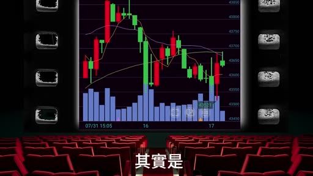
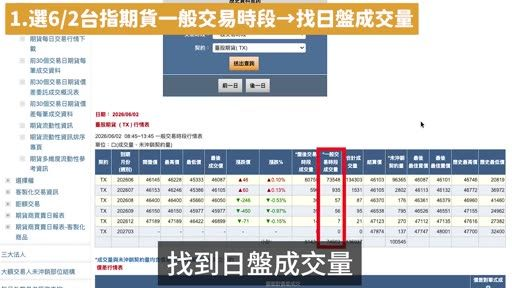
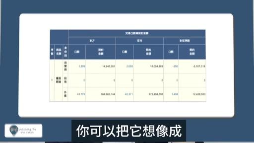
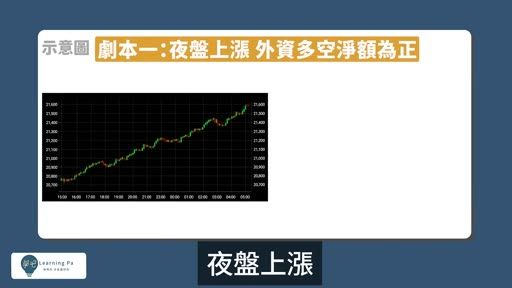
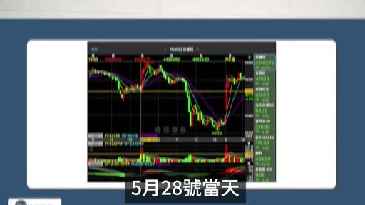
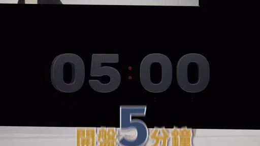

# 臺指期夜盤三個數字判斷隔天台股走勢

## 思維導圖

- 夜盤三數字判斷台股
  - 開場
    - 隔天台股不用猜
    - 夜盤先給線索
  - 夜盤是什麼
    - 盤後交易涵蓋美股
    - 隔天開盤預告片
    - 預告開盤不保證收盤
  - 數字一 漲跌點數
    - 超過300點同向（講者主張）
  - 數字二 量佔比
    - 夜盤量÷總成交量
    - 低於30%參考低（講者主張）
  - 數字三 外資淨額
    - 看多空淨額口數
    - 超過1000口留意（講者主張）
  - 四種劇本
    - 漲且外資正：扎實
    - 漲但外資負：易殺下
    - 跌且外資負：別抄底
    - 跌但外資正：易反彈
  - 案例與結語
    - 5/28開高走低
    - 開盤第一小時
    - 導流免費講座

## 圖文對照（畫面 + 逐字稿）

### 主題 1：開場：只看三個數字判斷隔天台股（00:00–00:29）

**重點：** 講者（股票小王子）主張：前一晚台指期夜盤會先給隔天台股的線索，只看三個數字就能先判斷最可能的走勢，決定哪邊進場、哪邊避開、何時保留現金；影片最後會講他自己用的開盤五分鐘判斷法。他自稱 20 年資深交易員、靠當沖與波段連續 5 年獲利破千萬（講者主張，未查證）。

**標籤：** #台指期 #夜盤

明天台股會往上漲還是往下跌？我跟你說真的不用猜，因為前一天晚上臺指期夜盤會先給你線索，今天我要教你只看三個數字就可以先判斷隔天台股最可能怎麼走，你越早看懂就越早知道哪邊可以進場，哪邊要先避開下跌保留現金，影片最後我再告訴你我自己也在用的開盤五分鐘判斷法，讓你當沖不用整天盯盤，9點開盤10點就可以獲利收工，我是小王子，20年資深交易員，靠股票當沖跟波段連續5年獲利破千萬。

### 主題 2：台指期與夜盤是什麼（00:29–01:42）

**重點：** 台指期是臺股指數期貨，買賣的是臺股整體未來可能的價格；夜盤是盤後交易，講者說從下午 3 點到隔天早上 5 點，涵蓋美股完整交易時段，美股的指數漲跌、就業與通膨資料、戰爭訊息、大型科技股財報會先反映在夜盤，是隔天開盤的預告片。他提醒夜盤較能告訴開盤方向，不一定能直接告訴收盤結果，所以實戰要判斷開盤偏漲或偏跌、以及方向能否延續。

**標籤：** #夜盤 #預告片

我們今天要講的重點是臺指期的夜盤，臺指期全名叫做臺股指數期貨，你可以把它想像成大家在買賣臺股未來可能的價格，它看的不是某一檔股票而是臺股整體的走勢，為什麼叫夜盤？夜盤也就是盤後交易，它的交易時間從下午的3點開始一直到隔天的早上5點，這段時間非常的關鍵，因為臺指期夜盤的交易時間剛好涵蓋了美國開盤的完整交易時段，大家常說臺股是小美股，美股怎麼走臺股也不會差太多，所以晚上美股發生的事情像是四大指數漲跌、就業資料、通膨資料、戰爭訊息、大型科技股財報，這些訊息都會先反映在臺指期的夜盤上，你可以把它當作是隔天開盤的預告片，很多白天看到的走勢其實是前一天晚上，夜盤就已經先演給你看了，但有一件事情很重要，夜盤比較能告訴你隔天的開盤方向，但它不一定能直接告訴你收盤結果，這兩件事差很多，因為有時候開盤漲很多，結果收盤反而跌回去，或是開盤大跌，但是後面一路反彈上漲，所以實戰上我們要判斷兩件事，第一明天開盤比較可能偏漲還是偏跌，第二開盤之後這個方向能不能延續，這兩個問題我們不用搞得太複雜，看三個關鍵數字就好。

### 主題 3：數字一：夜盤與日盤的點數差距（01:42–02:40）

**重點：** 到臺灣期貨交易所網站的「期貨每日交易行情查詢」，選日期（看 6/2 晚上的夜盤要選 6/3）、時段選盤後交易、契約選臺指期貨 TX，看最上面一列的漲跌點數。講者主張夜盤變化超過 300 點，隔天開盤高機率朝同方向走，但這只告訴方向，不告訴可信度。

**標籤：** #漲跌點數 #300點

第一個要看的數字就是臺指期的夜盤，跟日盤點數的差距，簡單來說就是夜盤這段時間到底漲了多少或是跌了多少要找到這些數字你可以到臺灣期貨交易所的網站點交易資訊找到期貨每日的交易行情查詢點進去，先選你要看的日期，這邊有一個小地方要注意，假設你想看的是6月2號晚上的夜盤結果，那日期一定要選隔一天也就是6月3號，接下來交易時段選盤後交易時段，契約選臺指期貨TX選好之後按查詢，結果出來後我們先看最上面那一列就好，這裡會看到漲跌點數代表夜盤開盤價跟收盤價差了多少，如果夜盤的變化超過300點，代表晚上這段時間大家對臺股的預期已經出現了明顯的改變，隔天開盤就高機率朝著同樣的方向走，夜盤大漲隔天高機率開盤會漲，夜盤大跌隔天高機率開盤會跌，但這個數字只能告訴你大概的方向，它還不能告訴你這個方向可不可信，力道有多強，能不能撐到收盤。

### 主題 4：數字二：夜盤量佔比（02:40–03:37）

**重點：** 用前一天日盤成交量與當晚夜盤成交量相加得總成交量，夜盤成交量除以總成交量就是夜盤量佔比，代表有沒有足夠多的人參與。講者主張低於 30% 參考價值較低，超過 40% 甚至一半就是很強的訊號。

**標籤：** #量佔比 #成交量

還要看第二個數字，我們叫做夜盤量佔比，意思就是說，這段時間除了價格改變之外，有沒有足夠多的人跑進來參與，很多人有動作，才代表這段時間真的有什麼新訊息或是重大事件，而不是靠小貓兩三隻在推動價格，那這個數字怎麼算？一樣用臺灣期貨交易所網站，抓兩個數字，第一，前一天的一般交易時段成交量，第二，盤後交易時段成交量，舉例來說，假設你想知道6月3號臺股會怎麼走，先抓兩個數字，第一個，選前一天6月2號臺指期貨一般交易時段，找到日盤成交量，第二個選6月3號盤後交易時段，找到夜盤成交量，然後把這兩個數字相加得到總成交量，接下來再把這個公式，也就是夜盤成交量除以總成交量，就可以算出夜盤量佔比，這個數字可以代表夜盤結果的可信度，如果低於30%，那夜盤的結果參考價值就比較低，如果超過40%甚至超過一半，那就是很強的訊號。

### 主題 5：數字三：外資多空淨額（03:37–04:33）

**重點：** 到期交所網站「交易資訊」的三大法人，選區分各期貨契約、夜盤、臺指期貨，看外資旁邊的多空淨額口數，可想成外資看漲與看跌的差距，正值偏多、負值偏空。講者的習慣是超過 1000 口才值得特別留意，只有幾百口代表態度不明確（講者主張）。

**標籤：** #外資 #多空淨額 #1000口

你想想看都已經是晚上睡覺時間了居然還有那麼多人在買賣應該就是有大事發生到這裡，我們只能確定大家的反應很大，但這個結果代表什麼？還要看第三個數字，外資多空淨額，你先不要被它的名字嚇到，我用最白話的方式講，它就是在看昨天的夜盤外資到底站在哪一邊，為什麼要看外資？是因為外資對臺股的走勢，還有大型股票影響都很大，外資多空淨額怎麼看？還是到臺灣期貨交易所的網站，點交易資訊裡面的三大法人，再選區分各期貨契約點夜盤，選你要的日期契約選臺指期貨，接下來看外資旁邊的多空淨額，那個口數就是我們要看的數字，這個口數你可以把它想像成外資看漲跟看跌之間的差距，如果外資看漲比較多這個數字就會是比較正，如果外資看跌比較多那這個數字就是負的，我自己的習慣是如果外資多空淨額超過1000口就值得特別留意，如果只有幾百口外資的態度就不夠明確，搞清楚外資的態度之後。

### 主題 6：四種劇本：夜盤方向加外資態度（04:33–05:24）

**重點：** 把夜盤漲跌與外資多空淨額合併成四種劇本：夜盤漲且外資為正，上漲力道扎實；夜盤漲但外資為負，常開高後力道不足殺下來；夜盤跌且外資為負，不要抄底，可能繼續跌；夜盤跌但外資為正，開低反彈機率高。均為講者主張，未查證。

**標籤：** #劇本 #抄底

我們要把外資的多空淨額跟前面的夜盤漲跌放在一起看，就可以組合成四種劇本，第一種劇本 夜盤上漲 外資多空淨額為正，代表夜盤漲 外資的態度也是跟著看漲，這種情況隔天開盤不只容易漲 而且還可能持續往上走，簡單說就是上漲的力道很扎實，第二種劇本 夜盤上漲 但是外資的多空淨額是負的，代表價格在漲 但是外資沒有真的站過去，這種盤常常就會開盤有漲 但是力道不強 之後就殺下來，第三種劇本，夜盤下跌加上外資多空淨額是負數，這種情況，夜盤價格往下，外資也看跌，你就不要想說，開盤跌了之後，我去抄底，因為你進去之後會發現，啊！他怎麼繼續跌都不會停，如果要抄底，你要選最後一種劇本，夜盤下跌但是外資的多空淨額是正的，開盤下跌但是外資沒有跟著殺，這種情況，開低反彈的機率就會高。

### 主題 7：整理與 5 月 28 日案例（05:24–06:29）

**重點：** 先整理三個數字的用途，再以 5/28 為例：夜盤漲 445 點（超過 300 點）、夜盤量佔比接近一半、外資多空淨額負 2600 多口，符合劇本二，結果開盤衝 500 多點但後面一路下跌。案例為單一事件，不能證明方法有效（講者主張，未查證）。

**標籤：** #案例 #劇本二

我們先快速整理一次，想知道明天台股開盤比較可能怎麼走，你要先看三個數字，第一個，夜盤漲跌點數，它決定隔天開盤比較可能漲或跌第二個，夜盤量佔比，它用來確認這個方向可不可信第三個，外資多空淨額，它用來判斷外資站在哪一邊，進一步推估隔天比較可能走哪一種劇本，這四種劇本我在這邊幫您整理，接下來我們直接用案例練習，假設今天是5月28號開盤前，我們想先判斷今天台股可能怎麼回，第一個先看昨天夜盤的結果，當天夜盤上漲445點，因為已經超過300點，所以這個訊號是有參考價值，代表今天開盤很可能會往上，第二個看夜盤量佔比，昨天夜盤成交量7萬8千多口，日盤成交量8萬3千多口，算起來夜盤量佔比接近一半，這代表訊號很強不能忽略，第三個看外資多空淨額，結果是負的2600多口，也就是說夜盤雖然上漲但是外資偏向看跌，這就是符合我們剛才講的劇本二，很容易出現開盤上漲但是後面力道不足，甚至開高走低，所以你看5月28號當天開盤往上衝了500多點，但是後面卻一路往下跌。

### 主題 8：結語：開盤第一小時與免費講座（06:29–07:26）

**重點：** 講者說臺股開盤漲跌就是風向，最高勝率的黃金時間是開盤後 9–10 點，並推廣一場免費線上直播講座（開盤五分鐘找強勢上漲股），報名連結在資訊欄、額滿則無報名按鈕。這段是行銷導流，內容未在影片中展開。

**標籤：** #開盤五分鐘 #講座 #導流

那很多人可能會問，就算我知道臺股的開盤漲跌，又不代表我買的股票也會跟著漲，我跟你說，你做股票臺股的開盤漲跌就是風向，大盤漲，大家的情緒就是買買買，衝衝衝，大盤跌就容易變成趕快賣快逃啊，這個風最強最高勝率的黃金時間，剛好就是每天開盤後的第一個小時，也就是9點到10點這段時間，所以我特地辦了一場免費線上直播講座，專門鎖定9點到10點這一個小時，教你怎麼針對不同的走勢，開盤5分鐘找到強勢上漲，高勝率的股票，抓到買賣的最佳時機，不管你是短線、做當沖、還是靠價格波動來做波段，都可以用最有效率的方式來穩定獲利，不用整天盯著股票軟體，如果你也想要每天9點開盤10點就可以收工，我把免費講座的報名連結放在資訊欄，課程名額有限，如果點進去沒有報名按鈕，代表暫時額滿了，如果今天的影片讓你有學到東西，也請你分享給你身邊的家人朋友，也可以幫我按讚、訂閱、開啟小鈴鐺，我是小王子，我們下次見。

## 知識點

- [[期貨_夜盤是隔天台股開盤的預告片]]
- [[期貨_夜盤預告開盤方向，不保證收盤結果]]
- [[期貨_數字一：夜盤漲跌超過 300 點]]
- [[期貨_數字二：夜盤量佔比衡量訊號可信度]]
- [[期貨_數字三：外資多空淨額超過 1000 口才值得留意]]
- [[期貨_夜盤方向加外資態度的四種劇本]]

## 來源

- 原始資料夾：`watch-output/投資理財/期貨/臺指期夜盤三個數字判斷隔天台股走勢_2026-11-22_Facebook__1B8wzcSbku`
- 逐字稿來源：whisper (groq)
