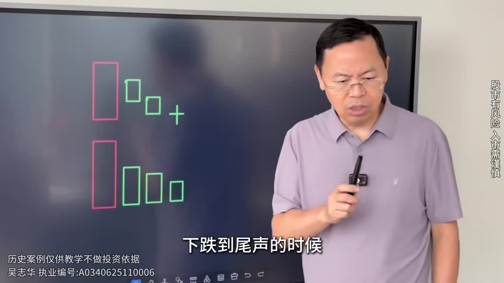
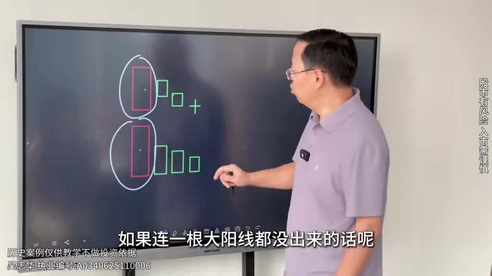
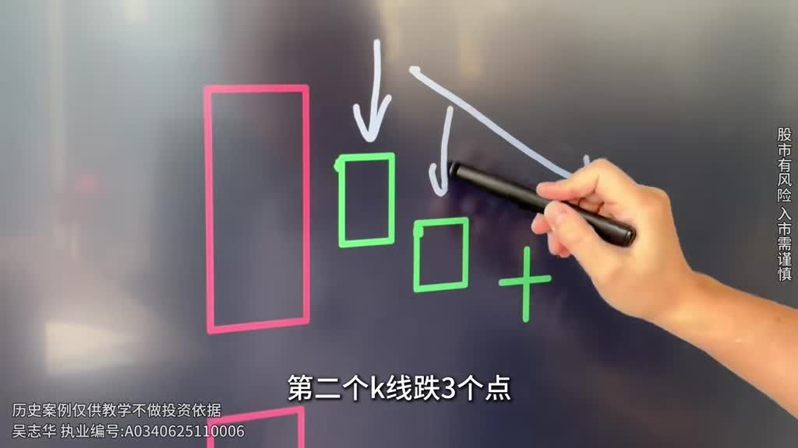
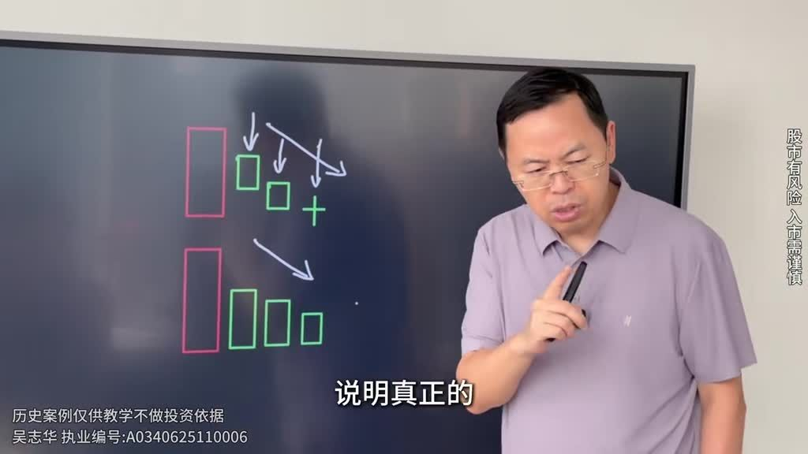
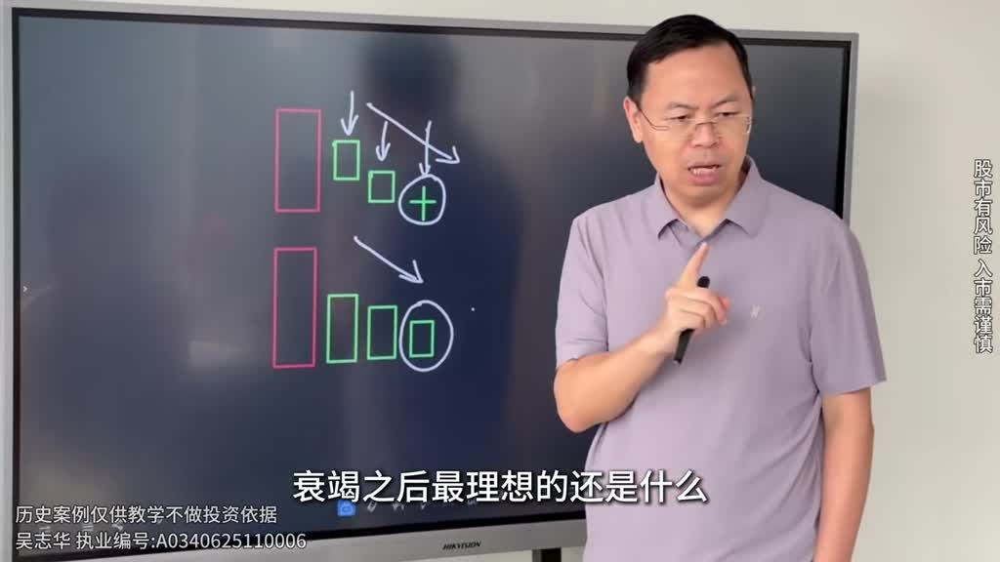
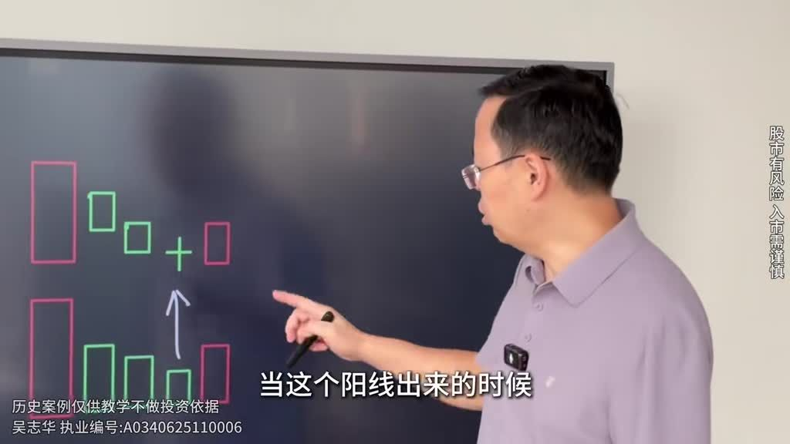

# 股票

## 思維導圖

- 下跌尾聲抄底三條件
  - 前提
    - 下跌途中不參與
  - ①主力進場
    - 放量大陽線
    - 價量齊升
  - ②空方衰竭
    - 價格連續收縮
    - 成交量連續縮
    - 出現最低量與最低價
  - ③確認訊號
    - 第二天價漲量增陽線
    - 最安全的低吸機會

## 圖文對照（畫面 + 逐字稿）

### 主題 1：開場：下跌途中不參與，等下跌尾聲的三個條件（00:00–00:12）

**重點：** 講者（畫面標示為證券從業者，附「歷史案例僅供教學、不作投資依據」字樣）說下跌途中不能參與股票，因為你永遠不知道底在哪裡；要等到下跌尾聲出現三個核心條件才能低吸（講者主張，未查證）。

**標籤：** #下跌 #抄底 #三個條件

下跌途中是不能夠參與股票的，因為你永遠不知道底在哪裡，下跌到尾聲的時候，你必須得出現三個核心的條件，你才能夠低吸。

### 主題 2：條件一：主力進場——一根價量齊升的放量大陽線（00:12–00:29）

**重點：** 第一個條件是主力進場的訊號：一根放量的大陽線，最理想的是接近漲停板；必須同時有價（大陽線）、有量（放量）。講者說如果連一根大陽線都沒出來，就要問主力資金到底有沒有進場（講者主張）。

**標籤：** #主力 #放量大陽線

第一個條件呢，我們叫主力進場，主力進場就是一根放量的大陽線，當然最理想的是轉平板，有價，同時有量的一根大陽線先要出來，如果連一根大陽線都沒出來的話呢，請問主力資金有沒有入場。

### 主題 3：條件二（一）：主力入場後，價格連續收縮（00:29–00:48）

**重點：** 第二個條件是主力入場後看到空方力量衰竭，必須有兩點。第一，價格連續收縮：例如第一根 K 線跌 5 個點、第二根跌 3 個點、第三根可能只跌 1 個點，跌幅越來越小（講者舉例，非實際數據）。

**標籤：** #空方衰竭 #價格收縮 #K線

第二個，主力入場後，看到空方力量的衰竭，必須有兩個條件，第一，價格是連續縮的，比如說，第一根K線跌5個點，第二個K線跌3個點，第三個K線可能跌1個點，價格是越來越跌的。

### 主題 4：條件二（二）：成交量同步收縮，出現最低量與最低價（00:48–01:14）

**重點：** 第二點是成交量也要逐步下降：價格連續縮、量也連續縮，說明真正的空方力量開始衰竭、沒有人賣了；這個位置出現一個最低的量、同時有個最低的價，說明賣的人已經沒有力量再往下拋，講者稱這叫真正的衰竭（講者主張，未查證）。

**標籤：** #縮量 #最低量 #衰竭

第二個條件，量是越來越縮的，第二個條件，它的成交量要逐步下跌的，價格連續縮，量也連續縮，說明什麼？說明真正的空方力量開始衰竭了，沒有人賣了，這個地方出現一個最低的量，同時有個最低的價，說明這個地方賣的人已經沒有力量再往下拋了，這叫真正的衰竭。

### 主題 5：條件三：衰竭之後要等確認訊號（01:14–01:19）

**重點：** 第三個條件是衰竭之後最理想的還是出現一個確認的訊號；講者問「這一天能不能直接進場」，答案是原則上可以。

**標籤：** #確認訊號

第三個衰竭之後最理想的還是一個確認的訊號。

### 主題 6：進場時機：第二天價漲量增的陽線最安全（01:19–01:45）

**重點：** 講者說最安全的機會是第二天出現一根確認的陽線，而且是價漲量增的陽線；當這根陽線出現時再買，他稱是最安全的低吸機會（講者主張，未查證；非投資建議）。

**標籤：** #價漲量增 #低吸 #陽線

這一天能不能直接進場呢，原則上是可以的，當然最安全機會是第二天出現一個確認的陽線，而且價漲量增的陽線，當這個陽線出來的時候，這一天是最安全的入場機會，當這根價漲量增的陽線出現的時候，你再去買，可以說是最安全的低吸機會。

## 知識點

- [[投資理財_下跌途中不能參與，因為不知道底在哪]]
- [[投資理財_條件一：主力進場的訊號是一根放量大陽線]]
- [[投資理財_價縮量縮：空方力量衰竭的訊號]]
- [[投資理財_最低量加最低價：賣方已無力再往下拋]]
- [[投資理財_最安全的進場：第二天價漲量增的確認陽線]]

## 來源

- 原始資料夾：`watch-output/投資理財/2026-11-21_TikTok_股票__7705367988588924168`
- 逐字稿來源：whisper (groq)
