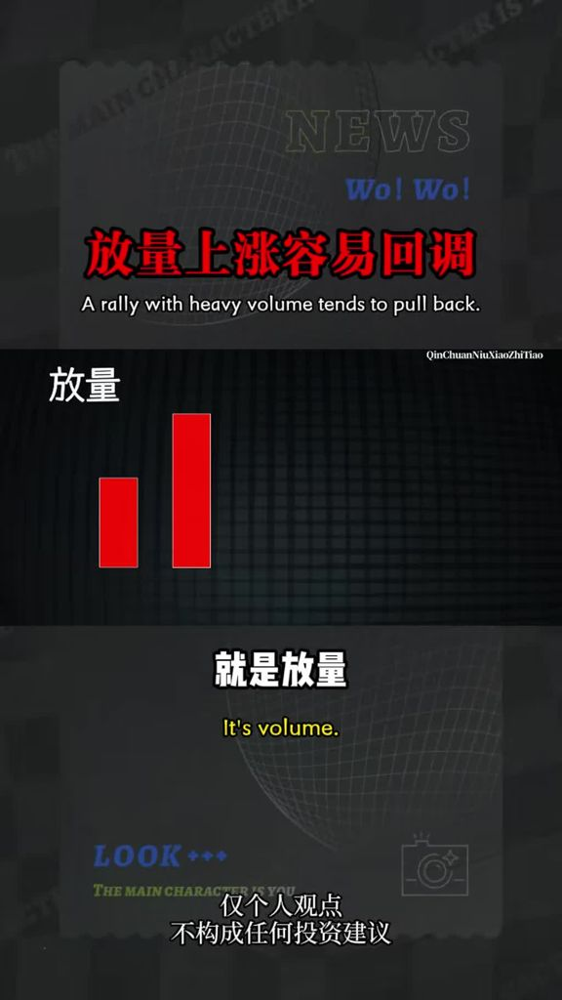
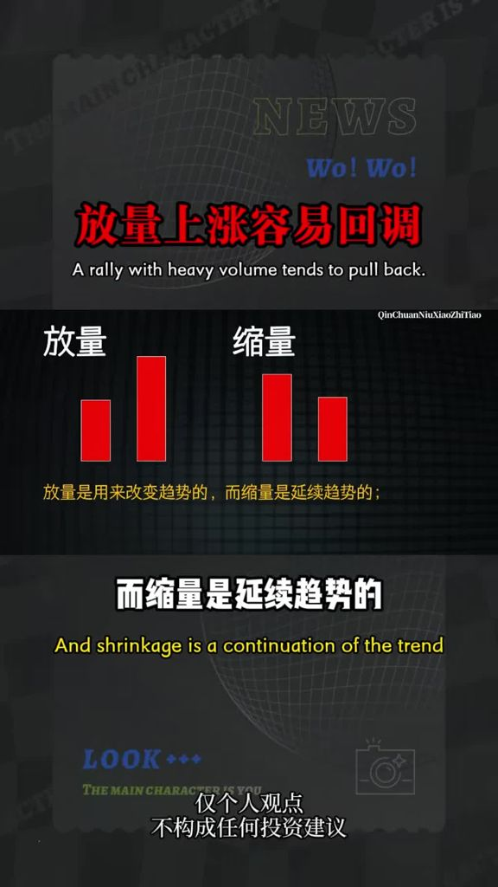
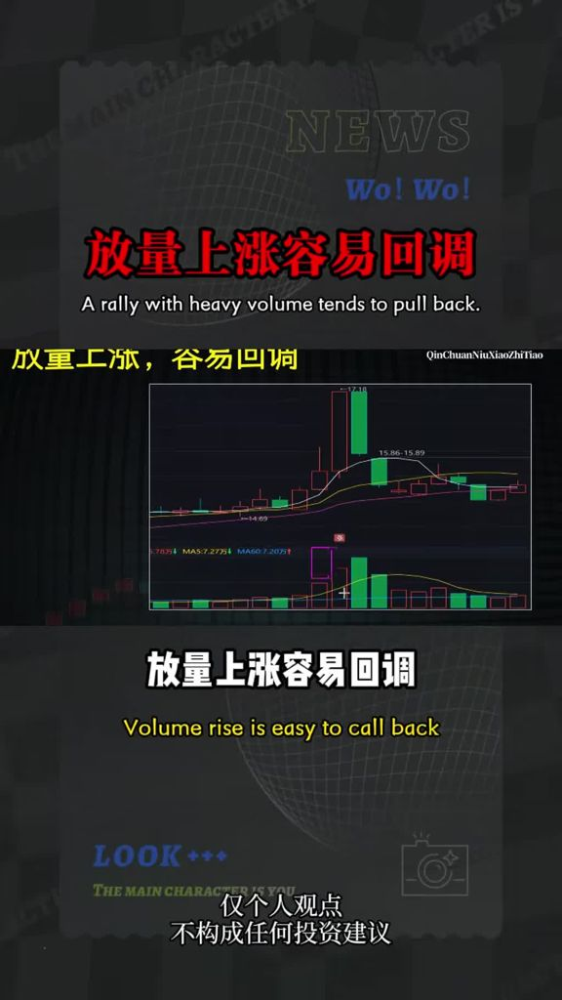
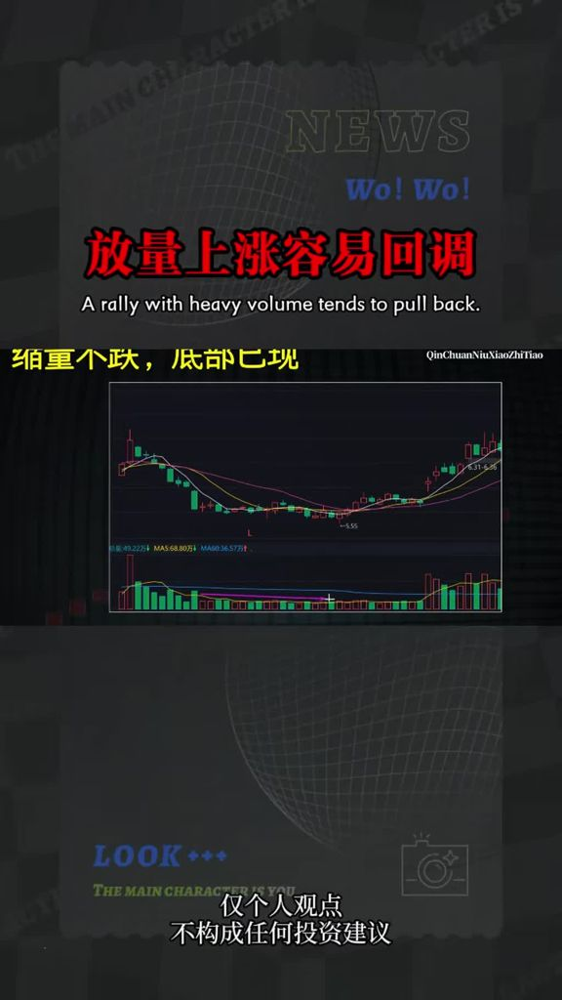

# 放量上漲容易回調

## 思維導圖

- 放量縮量六句口訣
  - 如何判斷
    - 右柱比左柱高＝放量
    - 右柱比左柱矮＝縮量
  - 趨勢關係
    - 放量改變趨勢（作者主張）
    - 縮量延續趨勢（作者主張）
  - 放量三句
    - 放量上漲容易回調
    - 放量下跌容易反彈
    - 放量不漲頭部已現
  - 縮量三句
    - 縮量上漲繼續上漲
    - 縮量下跌還會下跌
    - 縮量不跌底部已現

## 圖文對照（畫面 + 逐字稿）

### 主題 1：怎麼分辨放量與縮量：看右邊柱子比左邊高或矮（00:00–00:06）

**重點：** 影片用成交量柱狀圖說明：右邊的柱子比左邊高就是放量，右邊比左邊矮就是縮量（作者說法，未查證）。

**標籤：** #放量 #縮量 #成交量柱

只要右邊的柱子比左邊的高就是放量，右邊的柱子比左邊的矮就是縮量。

### 主題 2：放量改變趨勢，縮量延續趨勢（00:06–00:18）

**重點：** 作者主張放量是用來改變趨勢的，縮量是延續趨勢的；例如上升趨勢突然放量，可能就是漲到頂，下跌趨勢突然放量，可能就是要反轉（作者主張，未查證）。

**標籤：** #趨勢 #到頂 #反轉

放量是用來改變趨勢的，而縮量是延續趨勢的，比如上升趨勢突然放量了可能就是漲到頂了，下跌趨勢突然放量了可能就是要反轉了。

### 主題 3：放量三句：上漲回調、下跌反彈、不漲見頭（00:18–00:24）

**重點：** 作者的三句口訣：放量上漲容易回調；放量下跌容易反彈；放量不漲，頭部已現。畫面各配一張 K 線與成交量圖例（作者主張，未查證）。

**標籤：** #放量上漲 #放量下跌 #頭部

放量上漲容易回調，放量下跌容易反彈，放量不漲頭部已現。

### 主題 4：縮量三句：上漲續漲、下跌續跌、不跌見底（00:24–00:35）

**重點：** 作者的三句口訣：縮量上漲繼續上漲；縮量下跌還會下跌；縮量不跌，底部已現（作者主張，未查證，不構成投資建議；畫面也標示「僅個人觀點，不構成任何投資建議」）。

**標籤：** #縮量上漲 #縮量下跌 #底部

縮量上漲繼續上漲，縮量下跌還會下跌，縮量不跌底部已現。

## 來源

- 原始資料夾：`watch-output/投資理財/量價/放量上漲容易回調_2026-11-25_TikTok__7694196688931605768`
- 逐字稿來源：whisper (groq)
