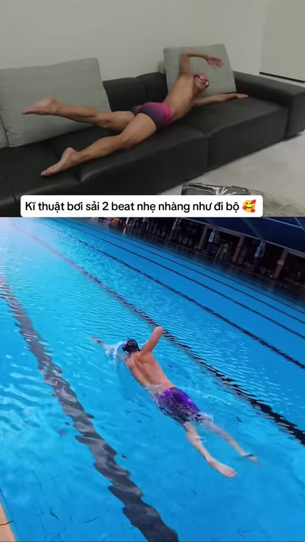
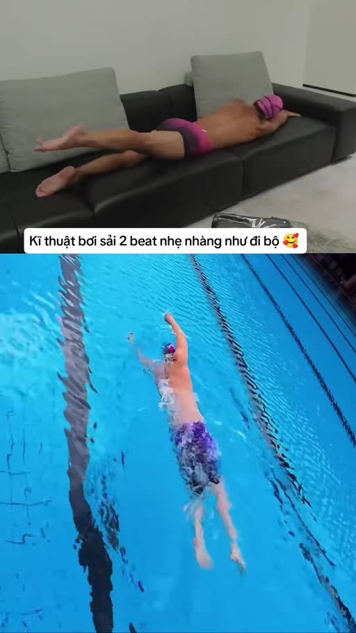
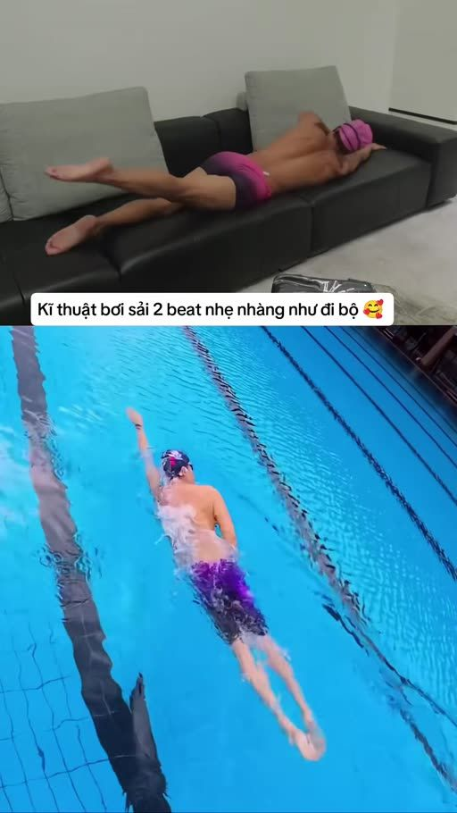

# Kĩ thuật bơi sải nhẹ nhàng như đi bộ

## 思維導圖

- 2 beat 自由式
  - 呈現方式
    - 上：沙發陸上模擬
    - 下：泳池實拍同步
  - 起手
    - 身體拉長側躺
    - 一臂前伸
  - 划手＋打腿
    - 每划一次手一次打腿
    - 另一腿放鬆
  - 循環
    - 左右交替
    - 輕鬆如走路（講者主張）

## 圖文對照（畫面 + 逐字稿＋中譯）

### 投影片 1：起手：身體側躺、一臂前伸（00:00–00:04）

**重點：** 畫面上下同步：上方是在沙發上側躺的陸上模擬，下方是泳池實拍。起手時身體拉長、一手前伸，另一手開始回收，雙腿伸直在身後。這是影片標題所說「2 beat」節奏的起點（每一次划手配一次打腿）。

**標籤：** #起手 #一臂前伸

Thanks for watching!

**中譯：** （全片無人聲；Whisper 只輸出「Thanks for watching!」，疑為無語音片段的幻覺。畫面標題：「Kĩ thuật bơi sải 2 beat nhẹ nhàng như đi bộ」＝「像走路一樣輕鬆的 2 beat 自由式技術」。）

### 投影片 2：划手配合單腿打腿（00:04–00:09）

**重點：** 手臂回收、入水並向前划的同時，只有一條腿做一次較大的打腿，另一條腿放鬆跟隨；沙發版本把動作放慢、放大，方便看清腿與手的配合。池中的泳者身體幾乎不晃，看起來像走路般輕鬆（標題主張）。

**標籤：** #划手 #打腿

### 投影片 3：左右循環，維持輕鬆節奏（00:09–00:13）

**重點：** 後段重複同樣的循環：左右手交替、每划一次手配一次打腿，上下兩個畫面同步對照，示範動作可連續、低耗能地進行。影片結束時沒有文字講解，細節需自行對照畫面。

**標籤：** #循環 #節奏

## 補充資料

### 畫面文字（原文）

- 畫面標題：「Kĩ thuật bơi sải 2 beat nhẹ nhàng như đi bộ 🥰」＝「像走路一樣輕鬆的 2 beat 自由式技術」。
- 原貼文標籤：#bơi #bơilội #swimming #swim（越南語：游泳）。

### 影片未示範／未說明

- 換氣的時機與方式：影片未示範。
- 打腿的腳與入水手的對應（同側或對側）：畫面看得到單腿較大幅度打腿，但哪一側對應哪隻手，影片沒有文字標示，推測需逐格對照，未確認。
- 速度、距離、適用對象：影片未說明；「輕鬆如走路」是標題主張，未查證。

## 來源

- 原始資料夾：`watch-output/游泳/自由式/2026-11-05_TikTok_Kĩ-thuật-bơi-sải-nhẹ-nhàng-như-đi-bộ__7702446650920488210`
- 逐字稿來源：whisper (groq)
