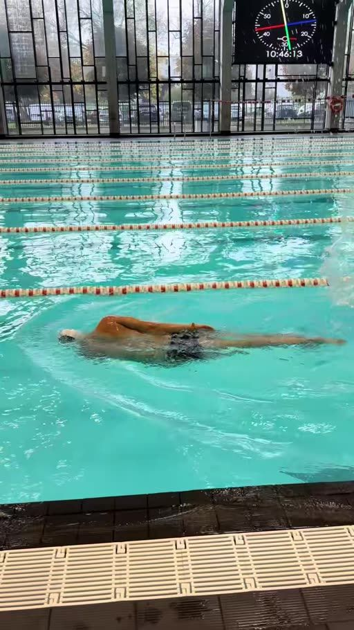

# Сохраняйте и пробуйте новое упражнение для развития 2х ударного кроля...

## 圖文對照（畫面 + 逐字稿）

### 畫面 00:00–00:16

Thanks for watching!

## 來源

- 原始資料夾：`watch-output/游泳/自由式/2026-11-05_TikTok_Сохраняйте-и-пробуйте-новое-упражнение-д__7695091310620871969`
- 逐字稿來源：whisper (groq)
