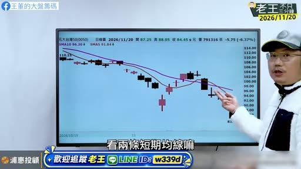

# 短線資金：跌破兩條短期均線代表反彈結束

講者說他週二就提醒，0050 跌破兩條短期均線，代表反彈已經結束，之後跟著大盤走第二隻腳；短線資金在這裡就該先出場，否則會一直抱上又抱下。均為講者主張，未查證。

> 「跌破這兩條短期均線」
>
> — [[0050都破底了快跑臺股沒救了？#主題 2：短線資金：跌破兩條短期均線反彈就結束（00:34–01:07）|00:38]]

> [!quote]- 前後文（00:29–00:44）
> - [00:29] 那如果你是短線資金啊
> - [00:31] 跟著國安基金進場你就要看技術面啊
> - [00:33] 我不是這樣講的嗎
> - [00:34] 那看技術面你就要回過頭來這張圖啊
> - [00:36] 我禮拜二怎麼講
> - [00:36] 看兩條短期均線嘛
> - **[00:38] 跌破這兩條短期均線**
> - [00:39] 我禮拜二已經跟你講
> - [00:40] 它已經反彈已經結束了
> - [00:41] 就跟大盤一樣
> - [00:42] 我就不要再剪VCR了啦
> - [00:44] 你自己回去看

**標示：** 講者／作者主張，未查證

## 出處

- [[0050都破底了快跑臺股沒救了？#主題 2：短線資金：跌破兩條短期均線反彈就結束（00:34–01:07）|0050都破底了快跑臺股沒救了？]]（00:38）
