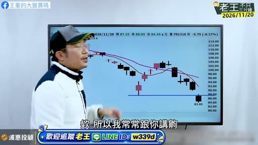

# 空頭趨勢不要隨便買股票

講者說他常提醒這點，也請會員都不要買，因為在空頭趨勢買進，到破底創新低就全部套牢；技術分析教的是順勢交易，等轉強再買。這是他的交易原則，未查證。

> 「空頭趨勢不要隨便買股票」
>
> — [[0050都破底了快跑臺股沒救了？#主題 3：長線不用管，空頭趨勢不亂買（01:07–01:57）|01:31]]

> [!quote]- 前後文（01:20–01:39）
> - [01:20] 但是很多人你想要把握那個效率嘛
> - [01:22] 那你就要短進短出嘛
> - [01:23] 那你看今天這樣蹦下來
> - [01:25] 這裡是已經把前面的低點給跌破了
> - [01:28] 意思就是說你過去
> - [01:30] 所以我常常跟你講
> - **[01:31] 空頭趨勢不要隨便買股票**
> - [01:33] 你看到前面剛才給會員的截圖
> - [01:35] 我叫會員都不要再買股票
> - [01:36] 因為你在空頭趨勢
> - [01:37] 你怎麼買
> - [01:39] 買到今天破底創新低

**標示：** 講者／作者主張，未查證

## 出處

- [[0050都破底了快跑臺股沒救了？#主題 3：長線不用管，空頭趨勢不亂買（01:07–01:57）|0050都破底了快跑臺股沒救了？]]（01:31）
