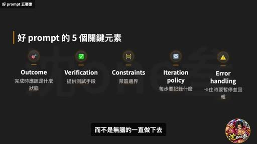

# 完成的定義是 goal 提示詞的核心

講者主張，定義寫得好 AI 會跑到完成且成果符合預期，定義寫得爛 AI 三分鐘就收工、浪費 token。

> 「而是你把所謂的完成定義的有多明確」
>
> — [[上週我讓 AI 連續跑了整整 27 個小時不間斷。Claude Code、Codex、Hermes Agent 三家公司同時推出了 go...#主題 16：完成的定義是提示詞的核心（06:03–06:21）|06:07]]

> [!quote]- 前後文（05:57–06:16）
> - [05:57] 還有可能的下一步
> - [05:58] 第五是Error Handling
> - [06:00] AI在什麼狀況下要暫停並回報
> - [06:02] 而不是無腦地一直做下去
> - [06:03] 一份好的Goal Prompt的設計關鍵
> - [06:06] 不是Prompt都會寫
> - **[06:07] 而是你把所謂的完成定義的有多明確**
> - [06:10] 完成的定義寫得好
> - [06:12] 它就會一直跑
> - [06:13] 跑到完成為止
> - [06:14] 而且完成後是你要的樣子
> - [06:16] 定義寫得爛

**標示：** 講者主張，未查證

## 出處

- [[上週我讓 AI 連續跑了整整 27 個小時不間斷。Claude Code、Codex、Hermes Agent 三家公司同時推出了 go...#主題 16：完成的定義是提示詞的核心（06:03–06:21）|上週我讓 AI 連續跑了整整 27 個小時不間斷。Claude Code、Codex、Hermes Agent 三家公司同時推出了 go...]]（06:07）
