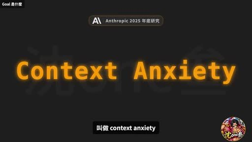

# 講者主張：AI 中途停下來源自 Context Anxiety

講者轉述 Anthropic 2025 年底的研究（講者主張，未查證）：LLM 會留意自己的 context window 用了多少，快滿時就莫名開始收尾交差，講者稱之為「下班心態」；/goal 就是為了對抗這種惰性。

> 「叫做context anxiety」
>
> — [[上週我讓 AI 連續跑了整整 27 個小時不間斷。Claude Code、Codex、Hermes Agent 三家公司同時推出了 go...#主題 5：AI 為何會偷懶：Context Anxiety（02:14–03:07）|02:42]]

> [!quote]- 前後文（02:30–02:52）
> - [02:30] agent可以直接做完
> - [02:32] 沒做完真的不要回來煩我
> - [02:34] 但他就是會停
> - [02:35] 到底為什麼會這樣呢
> - [02:36] Anthropic在2025年底發了一篇研究
> - [02:39] 他們發現LLM做到一半會停下來的根本原因
> - **[02:42] 叫做context anxiety**
> - [02:43] 翻譯成中文就是上下文焦慮
> - [02:45] 用白話文解釋的話就是
> - [02:47] LLM在執行任務的時候
> - [02:49] 會一邊看自己的context window用了多少
> - [02:52] 當他感覺到context快滿了

**標示：** 講者主張，未查證

## 出處

- [[上週我讓 AI 連續跑了整整 27 個小時不間斷。Claude Code、Codex、Hermes Agent 三家公司同時推出了 go...#主題 5：AI 為何會偷懶：Context Anxiety（02:14–03:07）|上週我讓 AI 連續跑了整整 27 個小時不間斷。Claude Code、Codex、Hermes Agent 三家公司同時推出了 go...]]（02:42）
