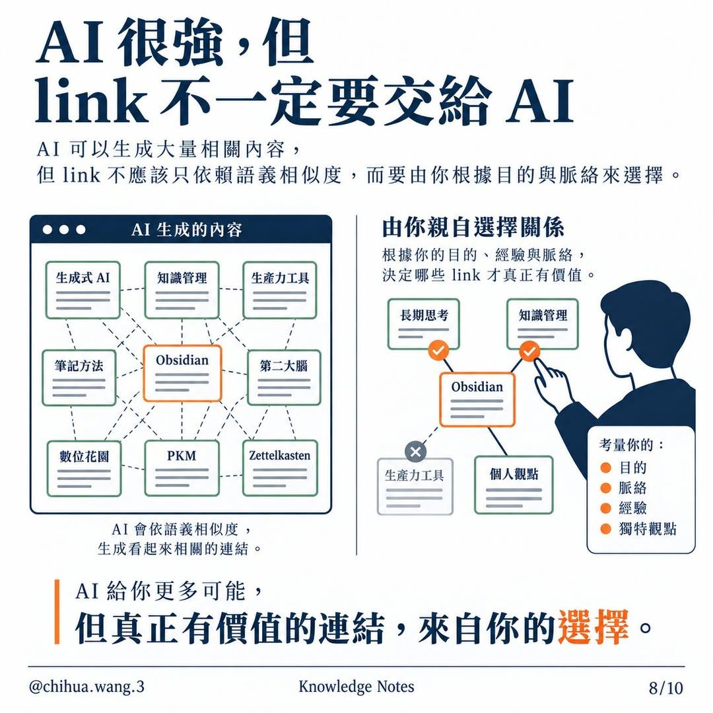

# 連結不該只依語義相似度

第 8 頁指出，AI 會依語義相似度把生成式 AI、知識管理、PKM、Zettelkasten 等全部互連，看起來相關卻沒有篩選。作者主張由你依目的、脈絡、經驗與獨特觀點決定哪些連結有價值，例如圖中保留「Obsidian—長期思考、知識管理、個人觀點」，剔除「生產力工具」。

> 「AI 給你更多可能，但真正有價值的連結，來自你的選擇。」
>
> — [[AI 時代為什麼 Obsidian 反而更重要？#第 8 頁：AI 很強，但 link 不一定要交給 AI|第 8 頁]]

> [!quote]- 前後文（第 8 頁）
> - [00:08] AI 很強，但 link 不一定要交給 AI
> - [00:08] AI 可以生成大量相關內容，但 link 不應該只依賴語義相似度，而要由你根據目的與脈絡來選擇。
> - [00:08] 左：AI 生成的內容——生成式 AI、知識管理、生產力工具、筆記方法、Obsidian、第二大腦、數位花園、PKM、Zettelkasten 全部互連；AI 會依語義相似度，生成看起來相關的連結。
> - [00:08] 右：由你親自選擇關係（根據你的目的、經驗與脈絡，決定哪些 link 才真正有價值）：Obsidian 與長期思考、知識管理、個人觀點保留（打勾），生產力工具剔除（打叉）。
> - [00:08] 考量你的：目的、脈絡、經驗、獨特觀點。
> - **[00:08] 結語：AI 給你更多可能，但真正有價值的連結，來自你的選擇。**

**標示：** 講者／作者主張，未查證

## 出處

- [[AI 時代為什麼 Obsidian 反而更重要？#第 8 頁：AI 很強，但 link 不一定要交給 AI|AI 時代為什麼 Obsidian 反而更重要？]]（第 8 頁）
