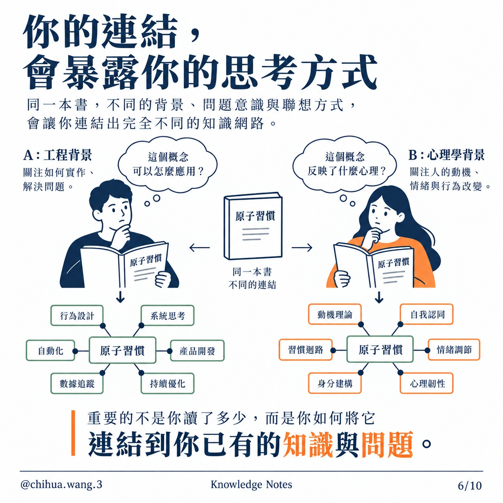

# 連結會暴露你的思考方式

第 6 頁以《原子習慣》為例：工程背景的人問「這個概念可以怎麼應用？」，會連到行為設計、系統思考、自動化；心理學背景的人問「這反映了什麼心理？」，會連到動機理論、自我認同、情緒調節。同一本書連出完全不同的網路，所以連結反映的是你已有的知識與問題意識，而不是讀了多少。

> 「重要的不是你讀了多少，而是你如何將它連結到你已有的知識與問題。」
>
> — [[AI 時代為什麼 Obsidian 反而更重要？#第 6 頁：你的連結，會暴露你的思考方式|第 6 頁]]

> [!quote]- 前後文（第 6 頁）
> - [00:06] 你的連結，會暴露你的思考方式
> - [00:06] 同一本書，不同的背景、問題意識與聯想方式，會讓你連結出完全不同的知識網路。
> - [00:06] A：工程背景（關注如何實作、解決問題）——「這個概念可以怎麼應用？」→ 原子習慣：行為設計、系統思考、自動化、產品開發、數據追蹤、持續優化。
> - [00:06] B：心理學背景（關注人的動機、情緒與行為改變）——「這個概念反映了什麼心理？」→ 原子習慣：動機理論、自我認同、習慣迴路、情緒調節、身分建構、心理韌性。
> - [00:06] 中間：同一本書，不同的連結（《原子習慣》）。
> - **[00:06] 結語：重要的不是你讀了多少，而是你如何將它連結到你已有的知識與問題。**

**標示：** 講者／作者主張，未查證

## 出處

- [[AI 時代為什麼 Obsidian 反而更重要？#第 6 頁：你的連結，會暴露你的思考方式|AI 時代為什麼 Obsidian 反而更重要？]]（第 6 頁）
