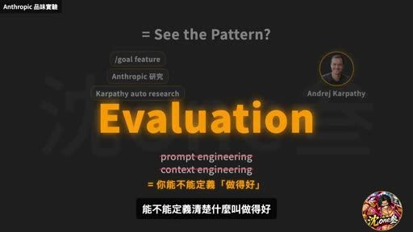

# 關鍵是 Evaluation，不是 Prompt Engineering

講者歸納 /goal 設計、Anthropic 網頁設計研究與 Karpathy 的 Auto Research 都指向 Evaluation：使用者能否定義清楚「好」並請評審依此打分，讓評審逼執行者持續迭代。

> 「能不能定義清楚什麼叫做得好」
>
> — [[上週我讓 AI 連續跑了整整 27 個小時不間斷。Claude Code、Codex、Hermes Agent 三家公司同時推出了 go...#主題 26：共同指向：Evaluation（09:44–10:16）|09:59]]

> [!quote]- 前後文（09:49–10:09）
> - [09:49] 又或者是前陣子Andrej Karpathy推出的Auto Research
> - [09:52] 其實全部都指向同一件事
> - [09:54] 那就是Evaluation
> - [09:54] 不是Prompt Engineering
> - [09:56] 不是Context Engineering
> - [09:58] 而是你身為使用者
> - **[09:59] 能不能定義清楚什麼叫做得好**
> - [10:01] 並請他根據你的指示去做評分
> - [10:03] Evaluation代表的是一個評分標準
> - [10:06] 也是稽核者評估者
> - [10:07] 在每一輪的迭代中都要守住的原則
> - [10:09] 就是有這些原則跟評估標準

**標示：** 講者主張，未查證

## 出處

- [[上週我讓 AI 連續跑了整整 27 個小時不間斷。Claude Code、Codex、Hermes Agent 三家公司同時推出了 go...#主題 26：共同指向：Evaluation（09:44–10:16）|上週我讓 AI 連續跑了整整 27 個小時不間斷。Claude Code、Codex、Hermes Agent 三家公司同時推出了 go...]]（09:59）
