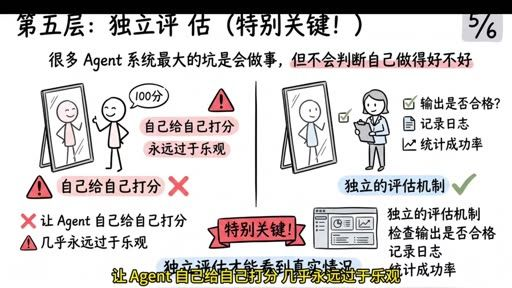

# Agent 自己給自己打分幾乎永遠過於樂觀，需要獨立評估

講者說很多 Agent 系統最大的坑是會做事但不會判斷自己做得好不好，所以要有獨立的評估機制檢查輸出是否合格、記錄日誌、統計成功率；他稱讓 Agent 自己給自己打分幾乎永遠過於樂觀（講者主張）。

> 「讓agent自己給自己打分」
>
> — [[什麼是Harness#主題 10：第 5 層：獨立評估（05:51–06:11）|06:07]]

> [!quote]- 前後文（05:44–06:15）
> - [05:44] 他就做不了任何需要多步驟的事情
> - [05:46] 哪些是當前會話的臨時狀態
> - [05:48] 哪些是要長期記住的偏好
> - [05:50] 哪些是中間產物都得分清楚第五層獨立評估這層特別關鍵很多agent系統最大的坑是它會做事但不會判斷自己做的好不好你得有獨立的評估機制來檢查輸出是否合格
> - [06:05] 記錄日誌
> - [06:06] 統計成功率
> - **[06:07] 讓agent自己給自己打分**
> - [06:09] 幾乎永遠過於樂觀
> - [06:11] 第六層
> - [06:12] 約束和恢復
> - [06:13] 真實世界裡什麼事都會出錯
> - [06:15] API超時

**標示：** 講者主張，未查證

## 出處

- [[什麼是Harness#主題 10：第 5 層：獨立評估（05:51–06:11）|什麼是Harness]]（06:07）
