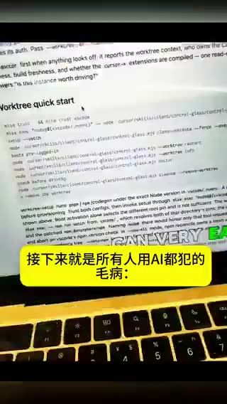

# 別當 AI 的排程員和傳話筒：手動搬資訊就改成自動流程

講者說所有人用 AI 都會犯的毛病是把自己當成 AI 的排程員和傳話筒。她的建議是只要還在手動把一段資訊從這兒挪到那兒就立刻停下，反問 AI「這一步你怎麼幫我解決」，要麼搭自動流程、要麼建技能、要麼建機器人；例如讓抓資訊的 AI 直接把原文交給研究的 AI、再交給創作的 AI（講者轉述，未查證）。

> 「把自己當成 AI 的排程員和傳話筒」
>
> — [[永動之初 - 這個講的太好了 一個不會寫程式碼的女生，憑什麼當上馬斯克AI團隊負責人？#主題 8：方法六：別當 AI 的調度員和傳話筒（02:37–03:04）|02:40]]

> [!quote]- 前後文（02:26–02:47）
> - [02:26] 司內部平台帳號幹完活直接提交
> - [02:29] AI 的東西和你的東西分開出了問題
> - [02:32] 找問題也找不到一塊兒
> - [02:33] 你發現沒它是真把 AI 當員工在用
> - [02:36] 甚至連工牌都發了
> - [02:37] 接下來就是所有人用 AI 都犯的毛病
> - **[02:40] 把自己當成 AI 的排程員和傳話筒**
> - [02:42] 你要有這個習慣
> - [02:43] 再牛的 AI 也全白搭了
> - [02:45] 姐妹兒給的建議是只要你
> - [02:46] 還在手動把一段資訊從這
> - [02:47] 兒挪到那兒

**標示：** 講者主張，未查證

## 出處

- [[永動之初 - 這個講的太好了 一個不會寫程式碼的女生，憑什麼當上馬斯克AI團隊負責人？#主題 8：方法六：別當 AI 的調度員和傳話筒（02:37–03:04）|永動之初 - 這個講的太好了 一個不會寫程式碼的女生，憑什麼當上馬斯克AI團隊負責人？]]（02:40）
