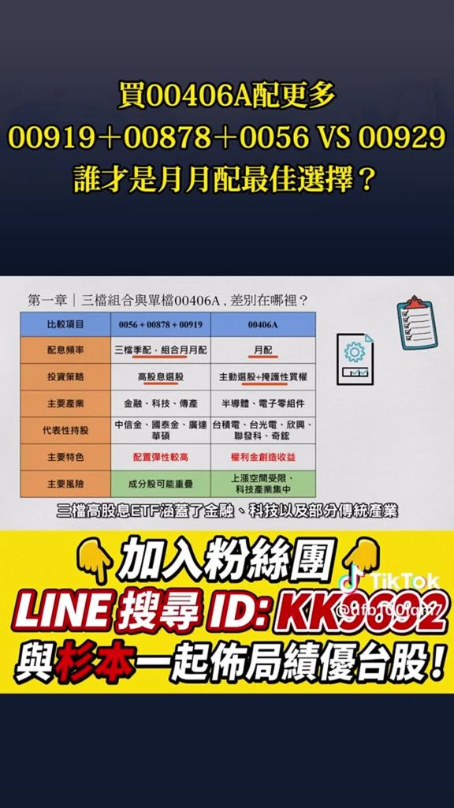

# 兩種月月配組合最大的差異是創造收益的方式

杉本比較三檔高股息 ETF（0056、00878、00919）湊月配與單檔 00406A：配息頻率上 00406A 本身月配、較好管理，但他認為真正的差異是收益來源。三檔靠高股息選股收取股利與資本利得，00406A 是主動選股再加選擇權策略。

> 「不過兩種組合最大的差異其實並不是配息頻率而是背後創造收益的方式」
>
> — [[月領1萬元：三檔高股息ETF月月配 vs 00406A#主題 2：第一章：三檔組合與單檔 00406A 差在哪（01:14–02:30）|01:39]]

> [!quote]- 前後文（01:10–02:07）
> - [01:10] 也可以追蹤杉本的IG、FB、杉本放在影片的資訊欄
> - [01:14] 首先我們先來看看0056、00878、00919三檔高股息ETF與00406A在投資策略上究竟有什麼不同
> - [01:21] 過去杉本經常分享的月月配組合主要是透過三檔季配息ETF利用不同的配息月份讓投資人每個月都有機會領到一筆股息而00406A本身就是一檔月配息ETF因此投資人不需要特別計算三檔ETF的張數及配置比例
> - [01:37] 在管理上相對簡單許多
> - **[01:39] 不過兩種組合最大的差異其實並不是配息頻率而是背後創造收益的方式**
> - [01:44] 0056、00878及00919主要是透過各自的高股息選股機制
> - [01:48] 篩選出符合條件的企業從持股的股利及資本利得等取得收益
> - [01:53] 而00406A除了經過經理人主動選股之外還加入掩護性買權的投資策略
> - [01:58] 藉由賣出選擇權買權增加權利金收入的機會
> - [02:02] 從圖中的持股來看三檔高股息ETF涵蓋了金融、科技及部分傳統產業
> - [02:07] 而00406A則較偏重台積電、台光電、欣興、聯發科以及奇鋐等科技相關企業

**標示：** 講者主張，未查證

## 出處

- [[月領1萬元：三檔高股息ETF月月配 vs 00406A#主題 2：第一章：三檔組合與單檔 00406A 差在哪（01:14–02:30）|月領1萬元：三檔高股息ETF月月配 vs 00406A]]（01:39）
