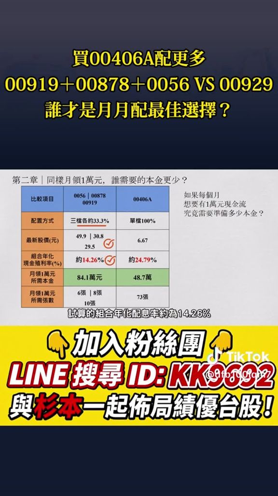

# 月領 1 萬元的本金試算：00406A 較少約 35 萬

以 11/24 股價（0056 為 49.9、00878 為 30.8、00919 為 29.5）平均配置，年化配息率約 14.26%，月領 1 萬元約需 84 萬；00406A 股價 6.67 元、每月配 0.138 元，年化約 25%，約需 48.7 萬，兩者相差約 35 萬。試算假設配息維持不變，是情境而非保證。

> 「也就是說投資人只需要準備約48.7萬買進73張00406A」
>
> — [[月領1萬元：三檔高股息ETF月月配 vs 00406A#主題 4：第二章：同樣月領 1 萬元，誰需要的本金少（04:21–05:30）|05:15]]

> [!quote]- 前後文（04:57–05:32）
> - [04:57] 試算的組合年化配息率約為14.26%
> - [05:01] 也就是說想要達到平均每個月領取1萬元的目標
> - [05:04] 大約需要準備84萬元左右的本金
> - [05:06] 反觀00406A目前股價已經來到6.67元
> - [05:10] 如果以每個月配出0.138元進行試算
> - [05:13] 年化配息率甚至接近25%
> - **[05:15] 也就是說投資人只需要準備約48.7萬買進73張00406A**
> - [05:20] 在配息維持不變的情況之下就有機會達到每個月領取1萬元的目標
> - [05:24] 兩者所需要準備的本金竟然相差了約35萬
> - [05:28] 對於正在累積資產的小資族而言
> - [05:30] 35萬可能是好幾年的存股成果
> - [05:32] 這也是為什麼00406A即便股價持續下跌

**標示：** 講者主張，未查證

## 出處

- [[月領1萬元：三檔高股息ETF月月配 vs 00406A#主題 4：第二章：同樣月領 1 萬元，誰需要的本金少（04:21–05:30）|月領1萬元：三檔高股息ETF月月配 vs 00406A]]（05:15）
