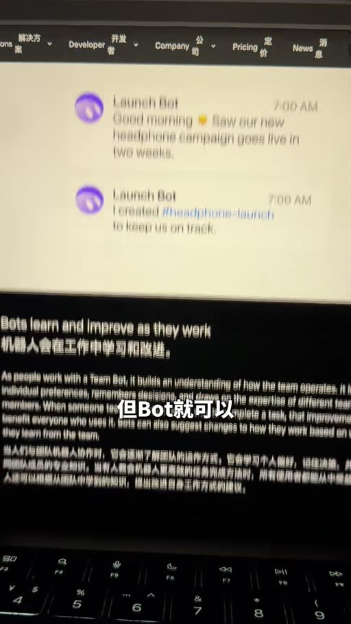

# Bot 像封裝好的作品或員工，可以出售持續盈利

講者說 Bot 不同於 Skill，它像是一個封裝好的作品或員工，可以拿到市場上出售、持續盈利；所以有人斷言「Skill 的時代結束、屬於 Bot 的時代開始」，她覺得有一定道理，至少目前這個資訊差可以賺錢（講者主張，未查證）。

> 「它就像是一個封裝好的作品」
>
> — [[為什麼你要儘快用上Grok Bot#主題 5：Bot 與 Skill 的最大區別：可封裝、可出售（01:28–01:49）|01:43]]

> [!quote]- 前後文（01:35–01:50）
> - [01:35] 今天一個人買了
> - [01:36] 瞬間他就能轉發給100個人
> - [01:38] 1000個人
> - [01:39] 所以行業裡真正懂的人
> - [01:40] 不太有動力去公開最牛的Skill
> - [01:42] 但Bot就可以
> - **[01:43] 它就像是一個封裝好的作品**
> - [01:45] 或者是員工
> - [01:46] 你可以拿到市場上去出售
> - [01:48] 持續盈利
> - [01:49] 所以有人甚至斷言
> - [01:50] Skill的時代結束了

**標示：** 講者主張，未查證

## 出處

- [[為什麼你要儘快用上Grok Bot#主題 5：Bot 與 Skill 的最大區別：可封裝、可出售（01:28–01:49）|為什麼你要儘快用上Grok Bot]]（01:43）
