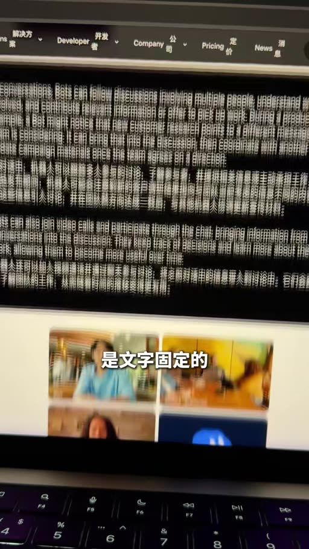

# Skill 複製成本幾乎為零，所以高手不願公開

講者說 Skill 的流程是文字固定的，複製成本幾乎為零，一個人買了瞬間能轉發給 100 個、1000 個人，所以行業裡真正懂的人不太有動力公開最厲害的 Skill（講者主張，未查證）。

> 「複製成本幾乎為零」
>
> — [[為什麼你要儘快用上Grok Bot#主題 5：Bot 與 Skill 的最大區別：可封裝、可出售（01:28–01:49）|01:34]]

> [!quote]- 前後文（01:20–01:40）
> - [01:20] 那現在這個市場已經在對一些創作者有一些獎勵
> - [01:23] 未來可能會進一步的商業化
> - [01:25] 慢慢的就可以讓使用者直接付費給Bot製作人
> - [01:28] 他跟Skill的最大區別是
> - [01:30] 他可以更加的客製化
> - [01:32] Skill的流程是文字固定的
> - **[01:34] 複製成本幾乎為零**
> - [01:35] 今天一個人買了
> - [01:36] 瞬間他就能轉發給100個人
> - [01:38] 1000個人
> - [01:39] 所以行業裡真正懂的人
> - [01:40] 不太有動力去公開最牛的Skill

**標示：** 講者主張，未查證

## 出處

- [[為什麼你要儘快用上Grok Bot#主題 5：Bot 與 Skill 的最大區別：可封裝、可出售（01:28–01:49）|為什麼你要儘快用上Grok Bot]]（01:34）
