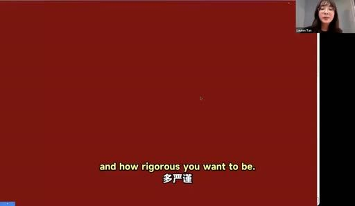

# eval 是 agent 的單元測試

講者說維護 skill 要靠 eval，她的心智模型是「agent 的單元測試」，不需要特別框架、視嚴謹程度自行建立；PStack 的 eval playbook 讓主協調 agent 訂評分標準、產生多個子 agent 去跑，並可跨多個模型比較（講者主張）。

> 「it's like a unit test for an agent」
>
> — [[Hux - 今晚別刷Netflix了。  去看這個SpaceX AI工程師1小時的課程。  這是我見過最清晰、端到端講透GrokBot到底該怎麼真正用...#主題 7：如何維護 skill：把 eval 當作 agent 的單元測試（17:26–21:36）|18:16]]

> [!quote]- 前後文（中譯）（17:56–17:56）
> - [17:56] 我先回答第一個：我怎麼維護這些 skill？如果你不熟這個概念：eval 基本上就是——我的心智模型是——「agent 的單元測試」。你可以自己做 eval，不需要特別的框架，視你想要多科學、多嚴謹而定。

**標示：** 講者主張，未查證

## 出處

- [[Hux - 今晚別刷Netflix了。  去看這個SpaceX AI工程師1小時的課程。  這是我見過最清晰、端到端講透GrokBot到底該怎麼真正用...#主題 7：如何維護 skill：把 eval 當作 agent 的單元測試（17:26–21:36）|Hux - 今晚別刷Netflix了。  去看這個SpaceX AI工程師1小時的課程。  這是我見過最清晰、端到端講透GrokBot到底該怎麼真正用...]]（18:16）
